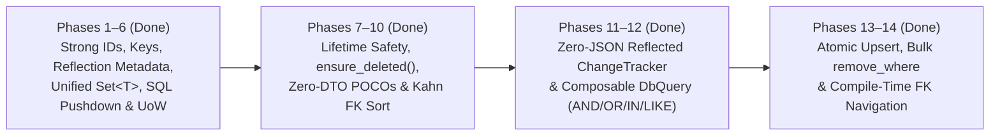
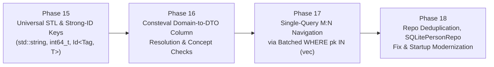

# CodeFirstCppDB_sqlgen — Architecture, Audit & Next-Gen Roadmap

> **Document Version:** 7.0 (Post-Phase-14 Audit, Consolidated Summary & Phases 15–18 Specification)  
> **Date:** 2026-11-15  
> **Active Branch:** `Review99` (based on `main` at commit `01853df`)  
> **Toolchain Baseline:** GCC 16.1+ (`-std=c++26 -freflection`), CMake 4.4+, Ninja, SQLite 3  
> **Status:** Phases 1–14 Completed & Verified (53/53 GoogleTests passing across 15 suites in ~23 ms)

---

## Table of Contents

1. [Executive Summary & Vision](#1-executive-summary--vision)
2. [Quick Start & Developer Setup](#2-quick-start--developer-setup)
3. [Current Architecture (v7.0 — Phases 1–14 Complete)](#3-current-architecture-v70--phases-114-complete)
   - [Directory Layout](#directory-layout)
   - [Layer Boundaries](#layer-boundaries)
   - [End-to-End Developer Experience (Encapsulated & Zero-DTO POCO Modes)](#end-to-end-developer-experience-encapsulated--zero-dto-poco-modes)
   - [Core Technical Pillars](#core-technical-pillars)
4. [Completed Engineering Roadmap (Phases 1–14 Summary)](#4-completed-engineering-roadmap-phases-114-summary)
5. [Post-Phase-14 Code Audit & Verification Findings](#5-post-phase-14-code-audit--verification-findings)
6. [Next-Generation Improvements Roadmap (Phases 15–18)](#6-next-generation-improvements-roadmap-phases-1518)
   - [Phase 15: Universal STL & Strong-ID Primary Keys (`std::string`, `std::int64_t`, `Core::Id<Tag, T>`)](#phase-15-universal-stl--strong-id-primary-keys-stdstring-stdint64_t-coreidtag-t)
   - [Phase 16: Compile-Time Domain-to-DTO Column Resolution & Concept Validation in `DbQuery`](#phase-16-compile-time-domain-to-dto-column-resolution--concept-validation-in-dbquery)
   - [Phase 17: Eliminating N+1 Queries in `query_many_to_many` via Batched `WHERE pk IN (vector)` Pushdown](#phase-17-eliminating-n1-queries-in-query_many_to_many-via-batched-where-pk-in-vector-pushdown)
   - [Phase 18: Repository Layer Deduplication, `SQLitePersonRepo` Pushdown Fix & `Startup` Modernization](#phase-18-repository-layer-deduplication-sqlitepersonrepo-pushdown-fix--startup-modernization)
7. [Architecture Comparison Matrix](#7-architecture-comparison-matrix)
8. [Appendix: Technical FAQ](#8-appendix-technical-faq)

---

## 1. Executive Summary & Vision

**CodeFirstCppDB_sqlgen** brings the **Code-First developer experience of C# and Entity Framework Core (EF Core)** to native C++26.

By combining **C++26 static reflection (`<meta>`)**, **C++23 deducing `this` & named modules (`import std;`)**, **C++20 concepts**, **monadic error handling (`std::expected`)**, and **`sqlgen`**, the library eliminates repetitive C++ data-access boilerplate at compile time—without external code generators, preprocessor macros, or runtime reflection overhead.

```text
┌────────────────────────────────────────────────────────────────────────┐
│                        C++26 Domain Entities                           │
│   (Encapsulated DDD classes OR Zero-DTO POCOs with auto-inferred Key)  │
└───────────────────────────────────┬────────────────────────────────────┘
                                    │
                       C++26 Static Reflection (std::meta)
                                    │
                                    ▼
┌────────────────────────────────────────────────────────────────────────┐
│               Compile-Time Relational Metadata Engine                  │
│   (SchemaTraits, EntityKey_t, EntityMetadata, Topological FK Graph)    │
└───────┬───────────────────────────┼────────────────────────────┬───────┘
        │                           │                            │
        ▼                           ▼                            ▼
┌──────────────────┐       ┌──────────────────┐       ┌──────────────────┐
│ ensure_created & │       │ MapperTraits     │       │ DbContextBase,   │
│ ensure_deleted   │       │ (Private Splice  │       │ Set<T>, DbQuery, │
│ (Kahn FK Order)  │       │  & POCO Identity)│       │ FK Nav & Tracker │
└───────┬──────────┘       └────────┬─────────┘       └────────┬─────────┘
        │                           │                          │
        └───────────────────────────┼──────────────────────────┘
                                    ▼
┌────────────────────────────────────────────────────────────────────────┐
│              SQLiteConnection / DatabaseConnection (sqlgen)            │
│  (Server-side WHERE, ORDER BY, LIMIT/OFFSET, COUNT, UPSERT, DELETE)    │
└────────────────────────────────────────────────────────────────────────┘
```

---

## 2. Quick Start & Developer Setup

### Prerequisites (Arch Linux / EndeavourOS)

```bash
sudo pacman -S --needed base-devel cmake ninja gdb sqlite postgresql-libs mariadb-libs

g++ --version     # Requires GCC 16.1+ (-std=c++26 -freflection)
cmake --version   # Requires CMake 4.4+ (CMAKE_CXX_MODULE_STD)
```

### Build, Test & Run

```bash
# 1. Initialize submodules (sqlgen, reflect-cpp, googletest)
git submodule update --init --recursive

# 2. Configure & build (GCC Debug preset)
cmake --preset gcc-debug
cmake --build build/linux/arch/gcc/debug

# 3. Run unit & integration test suite (53 tests across 15 test suites)
./build/linux/arch/gcc/debug/DAL/tests/test_DAL

# 4. Run the Startup application (creates & queries relationalDB.db)
./build/linux/arch/gcc/debug/Startup/Startup
./build/linux/arch/gcc/debug/Startup/Startup --no-reset
```

---

## 3. Current Architecture (v7.0 — Phases 1–14 Complete)

### Directory Layout

```text
CodeFirstCppDB_sqlgen/
├── CMakeLists.txt                  # Root CMake config (C++26, -freflection, import std)
├── CMakePresets.json               # Presets for gcc-debug, gcc-release
├── readme4.md                      # Master architectural specification & roadmap
│
├── Core/                           # Module: `core` (Pure Domain Layer — Zero DB deps)
│   ├── core.ixx                    # Primary module interface
│   ├── Id.ixx                      # Strong ID wrapper: Core::Id<Tag>
│   ├── Key.ixx                     # SingleKey<K>, CompositeKey<K...>, Key concepts
│   ├── entities/                   # Encapsulated domain entities (immutable IDs)
│   │   ├── Person.ixx              # Key = SingleKey<PersonId>
│   │   ├── Something.ixx           # Key = SingleKey<SomethingId>
│   │   └── Person_Something.ixx    # Key = CompositeKey<PersonId, SomethingId>
│   └── repositories/               # Abstract contracts & structured error model
│       ├── DbError.ixx             # DbError, DbErrorCode & message classifier
│       ├── IGenericRepository.ixx  # IRepository<T> & IGenericRepository<T, KeyType>
│       ├── IPersonRepository.ixx
│       ├── ISomethingRepository.ixx
│       └── IPerson_SomethingRepository.ixx
│
├── DAL/                            # Module: `dal` (Data Access Layer)
│   ├── dal.ixx                     # Primary module interface
│   ├── context/                    # EF Core-style Gateway, Set, Query & Driver Adapter
│   │   ├── DbContext.ixx           # DbContextBase<Conn>, TransactionScope, FK Nav, Tracker
│   │   ├── DbSet.ixx               # DbSet<Domain> & composable server-side DbQuery
│   │   └── SQLiteConnection.ixx    # SQL pushdown, upsert, delete_where & tx adapter
│   ├── schema/                     # Relational DTOs & compile-time reflection metadata
│   │   ├── SchemaTraits.ixx        # Concepts, InferredKey_t, dto_equals, Kahn FK sort
│   │   ├── EntityMetadata.ixx      # Compile-time table/column/key reflection inspector
│   │   ├── PersonDTO.ixx
│   │   ├── SomethingDTO.ixx
│   │   └── Person_SomethingDTO.ixx
│   ├── mappers/
│   │   └── MapperTraits.ixx        # Bidirectional Domain <-> DTO + POCO identity fast-path
│   ├── repositories/
│   │   ├── GenericRepository.ixx
│   │   ├── SQLitePersonRepo.ixx
│   │   ├── SQLiteSomethingRepo.ixx
│   │   └── SQLitePerson_SomethingRepo.ixx
│   └── tests/
│       └── test_DAL.cpp            # 53 GoogleTests across 15 suites
│
└── Startup/                        # Pure-Module Composition Root (Zero #includes)
    └── main.cpp                    # Defines AppDbContext, seeds via UoW, queries entities
```

### Layer Boundaries

| Layer | Module / Namespace | Responsibilities | Architectural Rules |
| :--- | :--- | :--- | :--- |
| **Core** | `core` (`Core::*`) | Domain entities, `Id<Tag>`, `SingleKey`, `CompositeKey`, `DbError`, repository interfaces. | **Zero external dependencies.** No `sqlgen` or SQLite headers; immutable identities. |
| **DAL::Schema** | `dal` (`DAL::Schema::*`) | DTO structs, `SchemaOf<Domain>`, `EntityKey_t<Domain>`, `EntityMetadata<Domain>`, `col_of<Member>`, `dto_equals`, `kahn_topological_sort`, and FK navigation traits. | Constrained by `RelationalEntity<T>` (`SinglePrimaryKey` or `CompositePrimaryKey`). |
| **DAL::Mappers** | `dal` (`DAL::Mappers::*`) | `MapperTraits<Domain, DTO>` converting private domain fields <-> public DTO members, or zero-overhead identity pass-through for POCOs. | Uses `std::meta::access_context::unchecked()` and `consteval` name matching. |
| **DAL::Context** | `dal` (`DAL::*`) | `DbContextBase`, `TransactionScope`, `DbSet` (`Set<Domain>`), `DbQuery`, and `SQLiteConnection`. | Non-copyable/non-movable context; coordinates topological DDL, UoW, Zero-JSON `ChangeTracker`, FK navigation, and SQL pushdown. |
| **Startup** | Executable ([main.cpp](file:///home/d5/Developer09/CodeFirstCppDB_sqlgen/Startup/main.cpp)) | Defines `AppDbContext`, connects via `SQLiteConnection::connect`, and runs workflows. | **100% pure C++ modules** (`import std; import core; import dal;`) — no `#include`s or DTOs. |

### End-to-End Developer Experience (Encapsulated & Zero-DTO POCO Modes)

**CodeFirstCppDB_sqlgen** supports two ergonomic Code-First styles out of the box:

#### Style A: Clean Architecture (Encapsulated Domain Classes + Separated DTOs)
Shown in [Startup/main.cpp](file:///home/d5/Developer09/CodeFirstCppDB_sqlgen/Startup/main.cpp), where `Core::Person` has private members and strong `Core::PersonId` types:

```cpp
import std;
import core;
import dal;

class AppDbContext : public DAL::DbContextBase<DAL::SQLiteConnection> {
public:
    Set<Core::Person> people{ this };
    Set<Core::Something> somethings{ this };
    Set<Core::Person_Something> personSomethings{ this };

    using DbContextBase::DbContextBase;
};

int main() {
    auto conn = DAL::SQLiteConnection::connect("relationalDB.db").value();
    AppDbContext db(conn);

    // 1. Topological FK DDL: drops children before parents, creates parents before children
    db.ensure_deleted().value();
    db.ensure_created().value();

    // 2. Staged Unit of Work committed atomically in a transaction
    db.defer_changes(true);
    Core::Person ada(Core::PersonId{ 1 }, "Ada", "Lovelace");
    db.people.add(ada);
    db.somethings.add(Core::Something(Core::SomethingId{ 1 }, "Analytical Engine", "Hardware"));
    db.personSomethings.add(Core::Person_Something(Core::PersonId{ 1 }, Core::SomethingId{ 1 }, "Architect"));
    db.save_changes().value();

    // 3. Composable server-side SQL query pushdown (AND/OR, LIKE, IN, ORDER BY, LIMIT/OFFSET, COUNT, ANY)
    auto matches = db.people
        .where_equal<"last_name">("Lovelace")
        .where_like<"first_name">("Ad%")
        .order_by<"id">(false)
        .page(10, 0)
        .to_vector();

    // 4. Compile-time Foreign-Key Relationship Navigation (1:N, N:1, M:N)
    auto adaItems = db.query_many_to_many<Core::Something, Core::Person_Something>(ada).value();
}
```

#### Style B: Zero-DTO Single-Struct POCO Mode (EF Core-Style Rapid Prototyping)
Shown in [DAL/tests/test_DAL.cpp](file:///home/d5/Developer09/CodeFirstCppDB_sqlgen/DAL/tests/test_DAL.cpp#L1553-L1666), where a single struct serves as both Domain and DTO with automatic `Key` inference and Zero-JSON reflected `ChangeTracker`:

```cpp
struct PocoUser {
    static constexpr auto tablename = "PocoUsers";
    sqlgen::PrimaryKey<std::int32_t, true> user_id{ 0 };
    std::string username;
};

class PocoDbContext : public DAL::DbContextBase<DAL::SQLiteConnection> {
public:
    Set<PocoUser> users{ this }; // Key = SingleKey<int32_t> auto-inferred!
    using DbContextBase::DbContextBase;
};

// Optional Identity Map & Zero-JSON Reflected ChangeTracker:
db.enable_change_tracking(true);
auto alice = db.users.find_tracked(1); // Returns shared_ptr<PocoUser>
alice->username = "alice_v2";          // Mutate in-memory
db.save_changes().value();             // Compares via reflected dto_equals & emits UPDATE!
```

### Core Technical Pillars

1. **Private-Member Splicing & Zero-DTO Identity Fast-Path ([MapperTraits.ixx](file:///home/d5/Developer09/CodeFirstCppDB_sqlgen/DAL/mappers/MapperTraits.ixx)):**
   - Maps private domain fields (`camelCase_`) to/from DTO columns (`snake_case`) using `std::meta::access_context::unchecked()` and member splices (`result.[:dom_m:] = ...`).
   - Short-circuits with `if constexpr (std::is_same_v<Domain, DTO>) return dto;` when a single POCO struct is used directly.
2. **Compile-Time Key Inference & Schema Introspection ([SchemaTraits.ixx](file:///home/d5/Developer09/CodeFirstCppDB_sqlgen/DAL/schema/SchemaTraits.ixx), [EntityMetadata.ixx](file:///home/d5/Developer09/CodeFirstCppDB_sqlgen/DAL/schema/EntityMetadata.ixx)):**
   - `InferredKey_t<DTO>` and `EntityKey_t<Domain, DTO>` synthesize `Core::SingleKey<K>` or `Core::CompositeKey<K1, K2, ...>` directly from `sqlgen::PrimaryKey` and `sqlgen::ForeignKey` fields when `Domain::Key` is omitted.
3. **Compile-Time Topological Foreign-Key Sorting & Relationship Navigation ([SchemaTraits.ixx](file:///home/d5/Developer09/CodeFirstCppDB_sqlgen/DAL/schema/SchemaTraits.ixx#L317-L508), [DbContext.ixx](file:///home/d5/Developer09/CodeFirstCppDB_sqlgen/DAL/context/DbContext.ixx#L111-L500)):**
   - `kahn_topological_sort` inspects `SqlgenForeignKeyField<F>::ForeignTableType` across all reflected `Set<T>` members at compile time (`consteval`), ensuring `ensure_created()` and `ensure_deleted()` always execute in valid foreign-key dependency order.
   - `find_fk_member_referencing<ChildDTO, ParentDTO>()` powers `db.query_children<Child>(parent)`, `db.query_parent<Parent>(child)`, and `db.query_many_to_many<Target, Junction>(source)`.
4. **Composable Server-Side `DbQuery`, Atomic `upsert`, & Zero-JSON `ChangeTracker` ([DbSet.ixx](file:///home/d5/Developer09/CodeFirstCppDB_sqlgen/DAL/context/DbSet.ixx), [SQLiteConnection.ixx](file:///home/d5/Developer09/CodeFirstCppDB_sqlgen/DAL/context/SQLiteConnection.ixx)):**
   - `DbQuery` composes chained `AND`/`OR` conditions, `=`, `!=`, `<`, `<=`, `>`, `>=`, `LIKE`, `IN`, `ORDER BY`, `LIMIT/OFFSET`, `.count()`, `.any()`, and bulk `.remove_where()`.
   - `ChangeTracker` compares baseline and current DTOs via `consteval`-reflected `DAL::Schema::dto_equals` with zero JSON serialization overhead and automatically evicts removed keys.

---

## 4. Completed Engineering Roadmap (Phases 1–14 Summary)



- [x] **Phases 1–4 — Foundations, Keys & Unified `DbSet<Domain>`:** Immutable `Core::Id<Tag>`, `SingleKey<K>`, `CompositeKey<K...>`, `DbError::map_from_message`, `<meta>`-based `EntityMetadata`, and monadic reads.
- [x] **Phases 5–6 — SQL Pushdown, Unit of Work & `ensure_created()`:** `col_of<Member>`, server-side `WHERE`/`COUNT`/`UPDATE`/`DELETE`, `SQLiteConnection::connect`, `defer_changes` + atomic `save_changes()`, and reflection-driven `db.ensure_created()`.
- [x] **Phases 7–10 — Lifecycle Hardening, POCO Mode, Topological FK Sort & Initial `DbQuery`/`ChangeTracker` (`ba427b2`–`29cfa92`):** Non-copyable `DbContextBase`, RAII `TransactionScope`, `ensure_deleted()`, `InferredKey_t<DTO>`, `kahn_topological_sort`, `DbQuery`, and `ChangeTracker`.
- [x] **Phase 11 — Native C++26 Reflection `ChangeTracker` (Zero-JSON) & Lifecycle Sync (`01853df`):** Added `DAL::Schema::dto_equals`, removed `<rfl/json.hpp>`, keyed `tracked_entries_` by `(std::type_index, std::format("{}", key))`, and evicted tracked entries on `remove()`.
- [x] **Phase 12 — Composable `DbQuery` Chaining, Rich Predicates & Aggregations (`01853df`):** Chained `.where_*` (`&&`) and `.or_where_*` (`||`), added `where_not_equal`, `where_lt`, `where_le`, `where_gt`, `where_ge`, `where_like`, `where_in`, and server-side `.try_count()`, `.count()`, `.any()`.
- [x] **Phase 13 — Atomic Upsert & Bulk Server-Side `remove_where` (`01853df`):** Added `upsert` / `upsert_range` (with `has_auto_incr_primary_key` awareness and UoW staging) and `DbQuery::remove_where()`.
- [x] **Phase 14 — Compile-Time Foreign-Key Relationship Navigation (`01853df`):** Added `find_fk_member_referencing<ChildDTO, ParentDTO>()` and `db.query_children<Child>(parent)`, `db.query_parent<Parent>(child)`, `db.query_many_to_many<Target, Junction>(source)`.

---

## 5. Post-Phase-14 Code Audit & Verification Findings

A full build and deep code review of commit `01853df` on branch `Review99` confirmed:
- **Build & Test Health:** All **53 unit and integration tests across 15 test suites** in [DAL/tests/test_DAL.cpp](file:///home/d5/Developer09/CodeFirstCppDB_sqlgen/DAL/tests/test_DAL.cpp) pass in ~23 ms, and [Startup/main.cpp](file:///home/d5/Developer09/CodeFirstCppDB_sqlgen/Startup/main.cpp) runs cleanly.
- **Architectural Bottlenecks & Edge Cases Identified During Review:**

  1. **Hardcoded `std::int32_t` Primary Key Casts Block STL & 64-Bit Key Types (`std::string`, `std::int64_t`, UUIDs) ([Core/Id.ixx](file:///home/d5/Developer09/CodeFirstCppDB_sqlgen/Core/Id.ixx#L10-L34), [GenericRepository.ixx](file:///home/d5/Developer09/CodeFirstCppDB_sqlgen/DAL/repositories/GenericRepository.ixx#L73-L298), [SQLiteConnection.ixx](file:///home/d5/Developer09/CodeFirstCppDB_sqlgen/DAL/context/SQLiteConnection.ixx#L231-L264)):**
     - While `Core::SingleKey<K>`, `Core::CompositeKey<K...>`, and `DAL::Schema::make_pk_where<DTO>` already support arbitrary key types (`std::string`, `std::int64_t`, etc.), two layers still hardcode `std::int32_t`:
       - `GenericRepository::unwrap_single_key` ([GenericRepository.ixx](file:///home/d5/Developer09/CodeFirstCppDB_sqlgen/DAL/repositories/GenericRepository.ixx#L287-L297)) returns `std::int32_t` via `static_cast<std::int32_t>(...)`, and its composite-key methods ([lines 80, 115, 228, 263](file:///home/d5/Developer09/CodeFirstCppDB_sqlgen/DAL/repositories/GenericRepository.ixx#L80-L265)) cast every key component with `static_cast<std::int32_t>(parts)...`.
       - `SQLiteConnection::try_get_by_id`, `get_by_id`, `delete_by_id`, and `exists` ([SQLiteConnection.ixx](file:///home/d5/Developer09/CodeFirstCppDB_sqlgen/DAL/context/SQLiteConnection.ixx#L232-L444)) take `std::int32_t id` instead of a deduced `const IdType& id`.
       - `Core::Id<Tag>` ([Core/Id.ixx](file:///home/d5/Developer09/CodeFirstCppDB_sqlgen/Core/Id.ixx#L10-L34)) hardcodes `std::int32_t value{ 0 };` instead of `template<typename Tag, typename ValueType = std::int32_t> struct Id`.
     - As a result, defining an entity with `sqlgen::PrimaryKey<std::string>` (e.g. a slug, code, or UUID primary key), `sqlgen::PrimaryKey<std::int64_t>`, or `Core::Id<Tag, std::string>` fails to compile when calling `find()`, `try_find()`, `contains()`, or `remove()`.

  2. **DTO Column Naming Leaks into Domain Queries & Lack of Compile-Time Column Validation ([DbSet.ixx](file:///home/d5/Developer09/CodeFirstCppDB_sqlgen/DAL/context/DbSet.ixx#L105-L169)):**
     - In Clean Architecture mode (`Core::Person` with private field `lastName_` mapped to `PersonDTO::last_name`), callers must currently write DTO snake_case column names (`db.people.where_equal<"last_name">("Smith")`), leaking persistence naming conventions into the domain consumer.
     - Furthermore, `DbQuery` does not validate `ColLiteral` with a C++20 `requires` concept at the call site, so a typo like `db.people.where_equal<"last_naem">("Smith")` produces a deep template instantiation trace inside `sqlgen` (or silently compiles on mock connections).
     - Using our `consteval` name-matching reflection in [MapperTraits.ixx](file:///home/d5/Developer09/CodeFirstCppDB_sqlgen/DAL/mappers/MapperTraits.ixx#L25-L168), `DbQuery` can accept **either** the DTO column name (`"last_name"`) **or** the Domain member name (`"lastName"` / `"lastName_"`), resolve it at compile time to the canonical DTO column literal, and reject invalid names via a `ValidQueryColumn<Domain, DTO, ColLiteral>` concept!

  3. **N+1 Query Pattern in `DbContextBase::query_many_to_many` & Missing Tracked Eviction in `remove_where` ([DbContext.ixx](file:///home/d5/Developer09/CodeFirstCppDB_sqlgen/DAL/context/DbContext.ixx#L465-L500), [DbSet.ixx](file:///home/d5/Developer09/CodeFirstCppDB_sqlgen/DAL/context/DbSet.ixx#L292-L326)):**
     - `query_many_to_many` currently loops over each `JunctionDomain` row and executes an individual `target_set.try_find(target_fk)` (`SELECT ... WHERE id = ? LIMIT 1`), issuing $1 + N$ SQL queries for $N$ linked rows.
     - Because `sqlgen` natively supports `sqlgen::Col<Col>::in(const std::vector<T>&)` ([conditions.hpp](file:///home/d5/Developer09/CodeFirstCppDB_sqlgen/extern/sqlgen/include/sqlgen/transpilation/conditions.hpp#L74-L85)), `query_many_to_many` can collect all `target_fk` values into a `std::vector` and fetch all target entities in a **single `WHERE pk IN (...)` SQL query**!
     - Additionally, `DbQuery::remove_where()` deletes matching rows in SQLite without clearing or evicting matching entries from the context's `ChangeTracker`.

  4. **Legacy Boilerplate in `SQLitePerson_SomethingRepo`, Uncompiled `SQLitePersonRepo::find_by_last_name` on `SQLiteConnection`, & Legacy Lambda Query in `Startup` ([SQLitePerson_SomethingRepo.ixx](file:///home/d5/Developer09/CodeFirstCppDB_sqlgen/DAL/repositories/SQLitePerson_SomethingRepo.ixx), [SQLitePersonRepo.ixx](file:///home/d5/Developer09/CodeFirstCppDB_sqlgen/DAL/repositories/SQLitePersonRepo.ixx#L24-L30), [Startup/main.cpp](file:///home/d5/Developer09/CodeFirstCppDB_sqlgen/Startup/main.cpp#L114-L123)):**
     - `SQLitePerson_SomethingRepo.ixx` still contains 196 lines of manual CRUD methods written before `GenericRepository` supported `CompositeKey`. Inheriting from `GenericRepository<Core::Person_Something, DAL::Schema::Person_SomethingDTO, ConnectionHandle, Core::Person_Something::Key>` cuts over 120 lines of duplicate code.
     - `SQLitePersonRepo::find_by_last_name` calls `this->conn_->template query<PersonDTO>()` (which only exists on `TestDatabaseConnection` in unit tests!) without an `if constexpr` branch for `SQLiteConnection::fetch_where_equal`.
     - [Startup/main.cpp](file:///home/d5/Developer09/CodeFirstCppDB_sqlgen/Startup/main.cpp#L114-L123) still uses the legacy in-memory lambda `.where(...)` instead of demonstrating server-side `DbQuery` pushdown and `db.query_many_to_many`.

---

## 6. Next-Generation Improvements Roadmap (Phases 15–18)

To resolve the audit findings above and make **CodeFirstCppDB_sqlgen** completely type-agnostic for primary keys, domain-column aware, and N+1-free, we specify **Phases 15 through 18**:



---

### Phase 15: Universal STL & Strong-ID Primary Keys (`std::string`, `std::int64_t`, `Core::Id<Tag, T>`)

#### Objective
Remove all hardcoded `std::int32_t` primary-key casts in `Core::Id`, `GenericRepository`, and `SQLiteConnection` so entities can use any STL or strong-ID key type (`std::string`, `std::int64_t`, `std::int32_t`, `Core::Id<Tag, std::string>`, and heterogeneous `Core::CompositeKey<std::string, std::int64_t>`).

#### Detailed Tasks

- [ ] **Task 15.1: Generalize `Core::Id<Tag, ValueType = std::int32_t>` (`Core/Id.ixx`)**
  - Update `Core::Id` in [Core/Id.ixx](file:///home/d5/Developer09/CodeFirstCppDB_sqlgen/Core/Id.ixx#L10-L53) to accept an optional underlying `ValueType` defaulting to `std::int32_t` (preserving 100% backward compatibility with `using PersonId = Id<struct PersonTag>;`):
    ```cpp
    template<typename Tag, typename ValueType = std::int32_t>
    struct Id
    {
        using value_type = ValueType;
        ValueType value{};

        constexpr Id() = default;
        constexpr explicit Id(ValueType v) noexcept(std::is_nothrow_move_constructible_v<ValueType>)
            : value(std::move(v))
        {
        }

        [[nodiscard]] constexpr const ValueType& get() const noexcept { return value; }
        constexpr operator const ValueType&() const noexcept { return value; }

        constexpr bool operator==(const Id&) const noexcept = default;
        constexpr auto operator<=>(const Id&) const noexcept = default;
    };
    ```
  - Update `std::formatter<Core::Id<Tag, ValueType>> : std::formatter<ValueType>` to format `id.value` for any `ValueType`.

- [ ] **Task 15.2: Type-Preserving Key Unwrapping in `GenericRepository` & `SQLiteConnection` (`GenericRepository.ixx` & `SQLiteConnection.ixx`)**
  - In [DAL/repositories/GenericRepository.ixx](file:///home/d5/Developer09/CodeFirstCppDB_sqlgen/DAL/repositories/GenericRepository.ixx#L287-L298), replace `unwrap_single_key` (which casts to `std::int32_t`) and `static_cast<std::int32_t>(parts)...` with a recursive, type-preserving `unwrap_key_part`:
    ```cpp
    template<typename Part>
    [[nodiscard]] static constexpr decltype(auto) unwrap_key_part(const Part& part) noexcept
    {
        if constexpr (Core::SingleKeyType<std::remove_cvref_t<Part>>)
        {
            return unwrap_key_part(part.get());
        }
        else if constexpr (requires { part.get(); })
        {
            return part.get();
        }
        else
        {
            return part;
        }
    }
    ```
  - Use `unwrap_key_part(parts)...` in `get_by_id`, `try_get_by_id`, `delete_by_id`, and `exists_by_id` inside `GenericRepository`, and update the `if constexpr (requires ...)` probes on line 165 to pass `unwrap_key_part(id)` instead of `std::int32_t{}`.
  - In [DAL/context/SQLiteConnection.ixx](file:///home/d5/Developer09/CodeFirstCppDB_sqlgen/DAL/context/SQLiteConnection.ixx#L231-L264) (and [lines 414–444](file:///home/d5/Developer09/CodeFirstCppDB_sqlgen/DAL/context/SQLiteConnection.ixx#L414-L444)), change `try_get_by_id`, `get_by_id`, `delete_by_id`, and `exists` from `std::int32_t id` to `template<typename DTO, typename IdType> ... (const IdType& id)`.

- [ ] **Task 15.3: Phase 15 Verification Tests (`DAL/tests/test_DAL.cpp`)**
  - Test a POCO and/or encapsulated entity with `sqlgen::PrimaryKey<std::string>` (e.g., `PocoDocument` with `std::string doc_slug`), `sqlgen::PrimaryKey<std::int64_t>`, `Core::Id<struct DocTag, std::string>`, and a composite key `CompositeKey<std::string, std::int64_t>` across `add`, `find`, `try_find`, `update`, `upsert`, `contains`, `find_tracked`, and `remove`.

---

### Phase 16: Compile-Time Domain-to-DTO Column Resolution & Concept Validation in `DbQuery`

#### Objective
Allow `DbSet` and `DbQuery` column-based methods (`where_equal<"col">`, `where_gt<"col">`, `order_by<"col">`, etc.) to accept **either** the DTO column name (`"first_name"`) **or** the Domain member name (`"firstName"` / `"firstName_"`), resolving the canonical DTO column literal at compile time (`consteval`) and rejecting unknown column names immediately via C++20 concepts.

#### Detailed Tasks

- [ ] **Task 16.1: `consteval` Column Validator & Domain-to-DTO Name Resolver (`DAL/mappers/MapperTraits.ixx`)**
  - In [DAL/mappers/MapperTraits.ixx](file:///home/d5/Developer09/CodeFirstCppDB_sqlgen/DAL/mappers/MapperTraits.ixx), add `consteval` helpers that check whether a `StringLiteral` matches a DTO member directly or matches a Domain member (which maps to a DTO member via `find_matching_dto_member`):
    ```cpp
    template<typename Domain, typename DTO, rfl::internal::StringLiteral ColOrField>
    consteval bool is_valid_query_column()
    {
        constexpr std::string_view name = ColOrField.str();
        constexpr auto dto_ctx = std::meta::access_context::current();
        constexpr auto dto_members = std::define_static_array(
            std::meta::nonstatic_data_members_of(^^DTO, dto_ctx));

        for (auto m : dto_members)
        {
            if (std::meta::identifier_of(m) == name)
                return true;
        }

        if constexpr (!std::is_same_v<Domain, DTO>)
        {
            constexpr auto dom_ctx = std::meta::access_context::unchecked();
            constexpr auto dom_members = std::define_static_array(
                std::meta::nonstatic_data_members_of(^^Domain, dom_ctx));
            for (auto dm : dom_members)
            {
                std::string_view d_name = std::meta::identifier_of(dm);
                if (d_name == name ||
                    (d_name.size() == name.size() + 1 && d_name.starts_with(name) && d_name.ends_with("_")))
                {
                    return true;
                }
            }
        }
        return false;
    }

    template<typename Domain, typename DTO, rfl::internal::StringLiteral ColOrField>
    concept ValidQueryColumn = is_valid_query_column<Domain, DTO, ColOrField>();

    template<typename Domain, typename DTO, rfl::internal::StringLiteral ColOrField>
        requires ValidQueryColumn<Domain, DTO, ColOrField>
    consteval std::meta::info resolve_dto_member()
    {
        constexpr std::string_view name = ColOrField.str();
        constexpr auto dto_ctx = std::meta::access_context::current();
        static constexpr auto dto_members = std::define_static_array(
            std::meta::nonstatic_data_members_of(^^DTO, dto_ctx));

        for (auto m : dto_members)
        {
            if (std::meta::identifier_of(m) == name)
                return m;
        }

        constexpr auto dom_ctx = std::meta::access_context::unchecked();
        static constexpr auto dom_members = std::define_static_array(
            std::meta::nonstatic_data_members_of(^^Domain, dom_ctx));
        for (auto dm : dom_members)
        {
            std::string_view d_name = std::meta::identifier_of(dm);
            if (d_name == name ||
                (d_name.size() == name.size() + 1 && d_name.starts_with(name) && d_name.ends_with("_")))
            {
                return detail::find_matching_dto_member(dm, dto_members);
            }
        }
        throw std::invalid_argument("Invalid query column or domain field name");
    }
    ```

- [ ] **Task 16.2: Constrain & Resolve Column Literals in `DbQuery` and `DbSet` (`DAL/context/DbSet.ixx`)**
  - Constrain `where_equal`, `or_where_equal`, `where_not_equal`, `where_lt`, `where_le`, `where_gt`, `where_ge`, `where_like`, `where_in`, `order_by`, and `remove_where_equal` on `DbQuery` and `DbSet` with `requires DAL::Mappers::ValidQueryColumn<Domain, DTO, ColLiteral>`.
  - Use `Schema::col_of<DAL::Mappers::resolve_dto_member<Domain, DTO, ColLiteral>()` instead of raw `sqlgen::Col<ColLiteral>{}` so callers can query `Core::Person` using either `"firstName"` (domain property), `"firstName_"` (private domain field), or `"first_name"` (DTO column).

- [ ] **Task 16.3: Phase 16 Verification Tests (`DAL/tests/test_DAL.cpp`)**
  - Verify `static_assert(DAL::Mappers::ValidQueryColumn<Core::Person, DAL::Schema::PersonDTO, "firstName">)` and `static_assert(!DAL::Mappers::ValidQueryColumn<Core::Person, DAL::Schema::PersonDTO, "nonExistentCol">)`.
  - Verify querying `db.people.where_equal<"lastName">("Smith").order_by<"firstName">(false).to_vector()` in SQLite.

---

### Phase 17: Eliminating N+1 Queries in `query_many_to_many` via Batched `WHERE pk IN (vector)` Pushdown

#### Objective
Replace the $O(N)$ per-row `try_find` loop in `DbContextBase::query_many_to_many` with a single batched `WHERE pk IN (...)` SQL query using `sqlgen::Col<...>::in(const std::vector<T>&)`.

#### Detailed Tasks

- [ ] **Task 17.1: Add `where_in_vec<ColLiteral>(const std::vector<Val>&)` to `DbQuery` and `DbSet` (`DAL/context/DbSet.ixx`)**
  - Add a vector-based `IN` predicate helper on `DbQuery` and `DbSet`:
    ```cpp
    template<rfl::internal::StringLiteral ColLiteral, typename Val>
        requires DAL::Mappers::ValidQueryColumn<Domain, DTO, ColLiteral>
    [[nodiscard]] auto where_in_vec(const std::vector<Val>& vals) const
    {
        constexpr auto dto_m = DAL::Mappers::resolve_dto_member<Domain, DTO, ColLiteral>();
        using NormalizedT = decltype(detail::normalize_query_val(std::declval<const Val&>()));
        std::vector<NormalizedT> normalized;
        normalized.reserve(vals.size());
        for (const auto& v : vals)
        {
            normalized.push_back(detail::normalize_query_val(v));
        }
        return where_sql(Schema::col_of<dto_m>.in(normalized));
    }
    ```

- [ ] **Task 17.2: Refactor `DbContextBase::query_many_to_many` to Use Batched `IN` Query (`DAL/context/DbContext.ixx`)**
  - In `DbContextBase::query_many_to_many` ([DAL/context/DbContext.ixx](file:///home/d5/Developer09/CodeFirstCppDB_sqlgen/DAL/context/DbContext.ixx#L465-L500)):
    - If `junctions_res.value().empty()`, return `std::vector<TargetDomain>{}` immediately.
    - When `Schema::SinglePrimaryKey<TargetDTO>` is true, extract all `target_fk` values into `std::vector<FkValueType> target_fks`, build `constexpr auto pk_m = Schema::primary_key_member<TargetDTO>();`, and execute a single query:
      `return target_set.where_sql(Schema::col_of<pk_m>.in(target_fks)).try_to_vector();`
    - Also ensure `DbQuery::remove_where()` clears/invalidates tracked entries for `Domain` when change tracking is enabled so deleted entities are never resurrected by `save_changes()`.

- [ ] **Task 17.3: Phase 17 Verification Tests (`DAL/tests/test_DAL.cpp`)**
  - Test `where_in_vec<"id">(std::vector<int>{ 1, 3, 5 })` and `where_in_vec<"id">(std::vector<Core::PersonId>{ ... })`.
  - Test `query_many_to_many` when a source entity has 0, 1, and multiple linked targets.

---

### Phase 18: Repository Layer Deduplication, `SQLitePersonRepo` Pushdown Fix & `Startup` Modernization

#### Objective
Bring the legacy repository classes (`SQLitePersonRepo` and `SQLitePerson_SomethingRepo`) and `Startup/main.cpp` up to the same C++26 standard as `DbContext` and `DbSet`.

#### Detailed Tasks

- [ ] **Task 18.1: Fix `SQLitePersonRepo::find_by_last_name` for `SQLiteConnection` (`DAL/repositories/SQLitePersonRepo.ixx`)**
  - Update [DAL/repositories/SQLitePersonRepo.ixx](file:///home/d5/Developer09/CodeFirstCppDB_sqlgen/DAL/repositories/SQLitePersonRepo.ixx#L24-L30) to dispatch via `if constexpr` to `fetch_where_equal<DAL::Schema::PersonDTO, "last_name">(lastName)` when available on `ConnectionHandle` (like `SQLiteConnection`), falling back to `.query<PersonDTO>()` on `TestDatabaseConnection`.

- [ ] **Task 18.2: Deduplicate `SQLitePerson_SomethingRepo` via `GenericRepository` Inheritance (`DAL/repositories/SQLitePerson_SomethingRepo.ixx`)**
  - Refactor [DAL/repositories/SQLitePerson_SomethingRepo.ixx](file:///home/d5/Developer09/CodeFirstCppDB_sqlgen/DAL/repositories/SQLitePerson_SomethingRepo.ixx) to inherit from `GenericRepository<Core::Person_Something, DAL::Schema::Person_SomethingDTO, ConnectionHandle, Core::Person_Something::Key>` and `Core::IPerson_SomethingRepository`, delegating `get_by_composite_id`, `delete_by_composite_id`, and `exists_by_composite_id` to `this->get_by_id(...)`, `this->delete_by_id(...)`, and `this->exists_by_id(...)`.

- [ ] **Task 18.3: Modernize `Startup/main.cpp` & Add Phase 18 Tests (`Startup/main.cpp` & `DAL/tests/test_DAL.cpp`)**
  - Update [Startup/main.cpp](file:///home/d5/Developer09/CodeFirstCppDB_sqlgen/Startup/main.cpp#L114-L123) to demonstrate server-side `DbQuery` filtering (`db.somethings.where_equal<"category">("Electronics").to_vector()`) and compile-time relationship navigation (`db.query_many_to_many<Core::Something, Core::Person_Something>(person1)`).
  - Add a GoogleTest verifying `SQLitePersonRepo<DAL::SQLiteConnection>::find_by_last_name` against a live `:memory:` SQLite connection.

---

## 7. Architecture Comparison Matrix

| Feature / Aspect | Early v3 Baseline | Current `main` (v7.0 — Phases 1–14) | Next-Gen Target (Phases 15–18) | C# Entity Framework Core |
| :--- | :--- | :--- | :--- | :--- |
| **Primary Key Types** | `int32_t` only (mutable) | Immutable `Id<Tag>`, `SingleKey`, `CompositeKey` (`int32_t` in repo/conn) | **Universal STL & Strong IDs** (`std::string`, `int64_t`, `Id<Tag, T>`) | Any primitive / `Guid` / `string` |
| **Column Querying** | Raw `sqlgen::read` | `DbQuery` with DTO column literals (`"last_name"`) | **Domain or DTO names** (`"lastName"` or `"last_name"`) + `ValidQueryColumn` concept | LINQ `x => x.LastName` |
| **Change Tracking** | None | Native C++26 `<meta>` `dto_equals` (Zero-JSON) + `remove()` eviction | + Bulk `remove_where()` tracker synchronization | `ChangeTracker` + `SaveChanges()` |
| **Relationships** | Manual ID lookups | `query_children`, `query_parent`, `query_many_to_many` ($1+N$ queries) | **Single-query batched `WHERE pk IN (vec)`** for M:N navigation | `.Include()` / Navigation properties |
| **Repositories** | Duplicated boilerplate | `GenericRepository` + legacy `SQLitePerson_SomethingRepo` | Fully deduplicated `GenericRepository` hierarchy | `DbSet<TEntity>` |

---

## 8. Appendix: Technical FAQ

1. **Why is GCC 16.1+ required instead of Clang?**
   - GCC 16.1+ implements ISO C++26 static reflection (`P2996`) via `-std=c++26 -freflection` and `<meta>`. Standard Clang releases do not yet support `<meta>`.
2. **Why is `extern/reflect-cpp` still needed if our code uses C++26 `<meta>`?**
   - Our `Core` and `DAL` modules use C++26 `<meta>` for entity/schema introspection, private member splicing, DTO equality, and topological FK sorting, while `sqlgen` uses `reflect-cpp` (`rfl::Result`, `rfl::Ref`, `rfl::internal::StringLiteral`) for its internal SQL transpiler.
3. **How does `MapperTraits` populate private fields on `Core::Person` without `friend` or setters?**
   - `std::meta::access_context::unchecked()` combined with member splicing (`result.[:dom_m:] = ...`) reads and writes private members at compile time without exposing mutable setters on domain models.
4. **How do `db.ensure_created()` and `db.ensure_deleted()` handle foreign-key table ordering?**
   - They use C++23 **deducing `this`** (`this Self&& self`) to reflect all `Set<T>` members on the derived `DbContext`, extract each DTO's `sqlgen::ForeignKey` targets, and run a `consteval` Kahn topological sort (`kahn_topological_sort`) so parent tables are always created first and dropped last.
