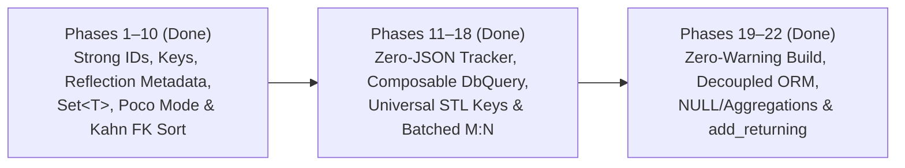
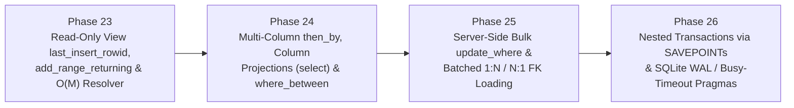

# CodeFirstCppDB_sqlgen — Architecture, Audit & Next-Gen Roadmap

> **Document Version:** 9.0 (Post-Phase-22 Full Code, Architecture & Library Audit + Phases 23–26 Specification)  
> **Date:** 2026-11-15  
> **Active Branch:** `main` (at commit `88c46ac`)  
> **Toolchain Baseline:** GCC 16.1+ (`-std=c++26 -freflection`), CMake 4.4+, Ninja, SQLite 3  
> **Status:** Phases 1–22 Completed & Verified (60/60 GoogleTests passing across 22 suites in ~28 ms, zero compiler warnings)

---

## Table of Contents

1. [Executive Summary & Vision](#1-executive-summary--vision)
2. [Quick Start & Developer Setup](#2-quick-start--developer-setup)
3. [Current Architecture & Library Stack (v9.0 — Phases 1–22 Complete)](#3-current-architecture--library-stack-v90--phases-122-complete)
   - [Directory Layout](#directory-layout)
   - [Layer Boundaries](#layer-boundaries)
   - [External Submodule Libraries Assessment](#external-submodule-libraries-assessment)
   - [End-to-End Developer Experience (Encapsulated & Zero-DTO POCO Modes)](#end-to-end-developer-experience-encapsulated--zero-dto-poco-modes)
   - [Core Technical Pillars](#core-technical-pillars)
4. [Completed Engineering Roadmap (Phases 1–22 Summary)](#4-completed-engineering-roadmap-phases-122-summary)
5. [Post-Phase-22 Deep Audit of Code, Architecture & SQLite Execution](#5-post-phase-22-deep-audit-of-code-architecture--sqlite-execution)
6. [Next-Generation Improvements Roadmap (Phases 23–26)](#6-next-generation-improvements-roadmap-phases-2326)
   - [Phase 23: Read-Only Temp-View `try_last_insert_rowid()`, `add_range_returning()`, & $O(M)$ Column Resolution](#phase-23-read-only-temp-view-try_last_insert_rowid-add_range_returning--om-column-resolution)
   - [Phase 24: Multi-Column Sorting (`then_by`), Server-Side Column Projections (`select`), & Range/Negation Predicates (`where_between`, `where_not_in_vec`)](#phase-24-multi-column-sorting-then_by-server-side-column-projections-select--rangenegation-predicates-where_between-where_not_in_vec)
   - [Phase 25: Server-Side Bulk `UPDATE ... WHERE` (`update_where`) & Batched Collection Relationship Loading (`query_children_batch`, `query_parents_batch`)](#phase-25-server-side-bulk-update--where-update_where--batched-collection-relationship-loading-query_children_batch-query_parents_batch)
   - [Phase 26: Nested Transactions via SQL `SAVEPOINT`s & SQLite Pragma Configuration (`busy_timeout`, `journal_mode`)](#phase-26-nested-transactions-via-sql-savepoints--sqlite-pragma-configuration-busy_timeout-journal_mode)
7. [Architecture Comparison Matrix](#7-architecture-comparison-matrix)
8. [Appendix: Technical FAQ](#8-appendix-technical-faq)

---

## 1. Executive Summary & Vision

**CodeFirstCppDB_sqlgen** brings the **Code-First developer experience of C# and Entity Framework Core (EF Core)** to native C++26.

By combining **C++26 static reflection (`<meta>`)**, **C++23 deducing `this` & named modules (`import std;`)**, **C++20 concepts**, **monadic error handling (`std::expected`)**, and **`sqlgen`**, the library eliminates repetitive C++ data-access boilerplate at compile time—without external code generators, preprocessor macros, or runtime reflection overhead.

```text
┌────────────────────────────────────────────────────────────────────────┐
│                        C++26 Domain Entities                           │
│  (Encapsulated DDD classes OR Zero-DTO POCOs with Universal STL Keys)  │
└───────────────────────────────────┬────────────────────────────────────┘
                                    │
                       C++26 Static Reflection (std::meta)
                                    │
                                    ▼
┌────────────────────────────────────────────────────────────────────────┐
│               Compile-Time Relational Metadata Engine                  │
│   (SchemaTraits, EntityKey_t, ValidQueryColumn, Topological FK Graph)  │
└───────┬───────────────────────────┼────────────────────────────┬───────┘
        │                           │                            │
        ▼                           ▼                            ▼
┌──────────────────┐       ┌──────────────────┐       ┌──────────────────┐
│ ensure_created & │       │ MapperTraits     │       │ DbContextBase,   │
│ ensure_deleted   │       │ (Private Splice, │       │ Set<T>, DbQuery, │
│ (Kahn FK Order)  │       │  with_pk & POCO) │       │ FK Nav & Tracker │
└───────┬──────────┘       └────────┬─────────┘       └────────┬─────────┘
        │                           │                          │
        └───────────────────────────┼──────────────────────────┘
                                    ▼
┌────────────────────────────────────────────────────────────────────────┐
│              SQLiteConnection / DatabaseConnection (sqlgen)            │
│  (WHERE, NULL, LIKE, IN, ORDER BY, LIMIT/OFFSET, MIN/MAX/SUM/AVG/COUNT)│
└────────────────────────────────────────────────────────────────────────┘
```

---

## 2. Quick Start & Developer Setup

### Prerequisites (Arch Linux / EndeavourOS)

```bash
sudo pacman -S --needed base-devel cmake ninja gdb sqlite

g++ --version     # Requires GCC 16.1+ (-std=c++26 -freflection)
cmake --version   # Requires CMake 4.4+ (CMAKE_CXX_MODULE_STD)
```

### Build, Test & Run

```bash
# 1. Initialize submodules (sqlgen, reflect-cpp, googletest)
git submodule update --init --recursive

# 2. Configure & build (GCC Debug preset — zero compiler warnings)
cmake --preset gcc-debug
cmake --build build/linux/arch/gcc/debug

# 3. Run unit & integration test suite (60 tests across 22 test suites)
./build/linux/arch/gcc/debug/DAL/tests/test_DAL

# 4. Run the Startup application (creates & queries relationalDB.db)
./build/linux/arch/gcc/debug/Startup/Startup
./build/linux/arch/gcc/debug/Startup/Startup --no-reset
```

---

## 3. Current Architecture & Library Stack (v9.0 — Phases 1–22 Complete)

### Directory Layout

```text
CodeFirstCppDB_sqlgen/
├── CMakeLists.txt                  # Root CMake config (C++26, optional Postgres, import std)
├── CMakePresets.json               # Presets for gcc-debug, gcc-release
├── readme4.md                      # Master architectural specification & roadmap
│
├── Core/                           # Module: `core` (Pure Domain Layer — Zero DB deps)
│   ├── core.ixx                    # Primary module interface
│   ├── Id.ixx                      # Universal strong ID wrapper: Core::Id<Tag, ValueType>
│   ├── Key.ixx                     # SingleKey<K>, CompositeKey<K...>, Key concepts
│   ├── entities/                   # Sample encapsulated domain entities (immutable IDs)
│   │   ├── Person.ixx              # Key = SingleKey<PersonId>
│   │   ├── Something.ixx           # Key = SingleKey<SomethingId>
│   │   └── Person_Something.ixx    # Key = CompositeKey<PersonId, SomethingId>
│   └── repositories/               # Abstract contracts & structured error model
│       ├── DbError.ixx             # DbError, DbErrorCode & message classifier
│       ├── IGenericRepository.ixx  # IRepository<T> & IGenericRepository<T, KeyType>
│       ├── IPersonRepository.ixx
│       ├── ISomethingRepository.ixx
│       └── IPerson_SomethingRepository.ixx
│
├── DAL/                            # Module: `dal` (Data Access Layer)
│   ├── dal.ixx                     # Primary module interface
│   ├── context/                    # EF Core-style Gateway, Set, Query & Driver Adapter
│   │   ├── DbContext.ixx           # DbContextBase<Conn>, TransactionScope, FK Nav, Tracker
│   │   ├── DbSet.ixx               # DbSet<Domain> & composable server-side DbQuery
│   │   └── SQLiteConnection.ixx    # SQL pushdown, aggregations, upsert, delete_where & tx
│   ├── schema/                     # Relational DTOs & compile-time reflection metadata
│   │   ├── SchemaTraits.ixx        # Concepts, InferredKey_t, dto_equals, Kahn FK sort
│   │   ├── EntityMetadata.ixx      # Compile-time table/column/key reflection inspector
│   │   ├── PersonDTO.ixx
│   │   ├── SomethingDTO.ixx
│   │   └── Person_SomethingDTO.ixx
│   ├── mappers/
│   │   └── MapperTraits.ixx        # Domain <-> DTO splice mapper, with_primary_key, ValidQueryColumn
│   ├── repositories/
│   │   ├── GenericRepository.ixx   # Type-agnostic CRUD repository (Single & Composite keys)
│   │   ├── SQLitePersonRepo.ixx
│   │   ├── SQLiteSomethingRepo.ixx
│   │   └── SQLitePerson_SomethingRepo.ixx
│   └── tests/
│       └── test_DAL.cpp            # 60 GoogleTests across 22 suites
│
└── Startup/                        # Pure-Module Composition Root (Zero #includes)
    └── main.cpp                    # Defines AppDbContext, seeds via UoW, queries entities
```

### Layer Boundaries

| Layer | Module / Namespace | Responsibilities | Architectural Rules |
| :--- | :--- | :--- | :--- |
| **Core** | `core` (`Core::*`) | Domain entities, `Id<Tag, ValueType>`, `SingleKey`, `CompositeKey`, `DbError`, repository interfaces. | **Zero external dependencies.** No `sqlgen` or SQLite headers; immutable identities. |
| **DAL::Schema** | `dal` (`DAL::Schema::*`) | DTO structs, `SchemaOf<Domain>`, `EntityKey_t<Domain>`, `EntityMetadata<Domain>`, `col_of<Member>`, `dto_equals`, `kahn_topological_sort`, and FK navigation traits. | Constrained by `RelationalEntity<T>` (`SinglePrimaryKey` or `CompositePrimaryKey`). |
| **DAL::Mappers** | `dal` (`DAL::Mappers::*`) | `MapperTraits<Domain, DTO>` converting private domain fields <-> public DTO members, `with_primary_key`, POCO identity pass-through, and case-insensitive `ValidQueryColumn` / `resolve_dto_member`. | Uses `std::meta::access_context::unchecked()` and `consteval` name matching; zero dependency on sample DTOs. |
| **DAL::Context** | `dal` (`DAL::*`) | `DbContextBase`, `TransactionScope`, `DbSet` (`Set<Domain>`), `DbQuery`, and `SQLiteConnection`. | Non-copyable/non-movable context; coordinates topological DDL, UoW, Zero-JSON `ChangeTracker`, batched FK navigation, SQL aggregations, and `add_returning`. |
| **Startup** | Executable ([main.cpp](file:///home/d5/Developer09/CodeFirstCppDB_sqlgen/Startup/main.cpp)) | Defines `AppDbContext`, connects via `SQLiteConnection::connect`, and runs workflows. | **100% pure C++ modules** (`import std; import core; import dal;`) — no `#include`s or DTOs. |

### External Submodule Libraries Assessment

| Submodule / Library | Version / Role | How We Use It | Audit & Integration Notes |
| :--- | :--- | :--- | :--- |
| **`extern/sqlgen`** | `0.6.0` (SQL AST & Driver Layer) | Provides `sqlgen::sqlite::Connection`, `PrimaryKey`, `ForeignKey`, `Col`, `read`, `where`, `order_by`, `limit`, `offset`, `insert`, `insert_or_replace`, `update`, `delete_from`, `create_table`, `drop`, and `min`/`max`/`sum`/`avg`/`count`. | Isolated behind `DAL` global module fragments (`module; #include <sqlgen.hpp>`). PostgreSQL (`CODEFIRST_ENABLE_POSTGRES`), MySQL, and DuckDB are disabled by default so only SQLite3 is required. |
| **`extern/reflect-cpp`** | Transitive dependency of `sqlgen` | Supplies `rfl::Result`, `rfl::Ref`, `rfl::Tuple`, and `rfl::internal::StringLiteral` used inside `sqlgen`'s SQL transpiler. | **Not** used for JSON or domain reflection in our code; all `Core`/`DAL` introspection uses native ISO C++26 `<meta>`. |
| **`extern/googletest`** | Unit & Integration Testing | Runs 60 tests across 22 suites (`test_DAL`) covering mock connections and live `:memory:` SQLite databases in ~28 ms. | Linked privately only to `test_DAL`. |

### End-to-End Developer Experience (Encapsulated & Zero-DTO POCO Modes)

```cpp
import std;
import core;
import dal;

class AppDbContext : public DAL::DbContextBase<DAL::SQLiteConnection> {
public:
    Set<Core::Person> people{ this };
    Set<Core::Something> somethings{ this };
    Set<Core::Person_Something> personSomethings{ this };

    using DbContextBase::DbContextBase;
};

int main() {
    auto conn = DAL::SQLiteConnection::connect("relationalDB.db").value();
    AppDbContext db(conn);

    // 1. Topological FK DDL: drops children before parents, creates parents before children
    db.ensure_deleted().value();
    db.ensure_created().value();

    // 2. Insert and back-populate auto-increment ID into private Core::Person::id_ via <meta>
    auto ada = db.people.add_returning(Core::Person(Core::PersonId{ 0 }, "Ada", "Lovelace")).value();

    // 3. Case-insensitive domain/DTO column query pushdown + aggregations
    auto matches = db.people
        .where_equal<"LastName">("Lovelace")
        .where_not_like<"FirstName">("Z%")
        .order_by<"firstName">(false)
        .page(10, 0)
        .to_vector();

    auto maxId = db.people.max<"id">(); // Server-side SELECT MAX("id")
}
```

### Core Technical Pillars

1. **Private-Member Splicing, Auto-Increment Back-Population & Case-Insensitive Column Resolution ([MapperTraits.ixx](file:///home/d5/Developer09/CodeFirstCppDB_sqlgen/DAL/mappers/MapperTraits.ixx)):**
   - Maps private domain fields (`camelCase_`) to/from DTO columns (`snake_case`) and splices database-generated primary keys back into encapsulated domain entities (`with_primary_key`) using `std::meta::access_context::unchecked()`.
   - Resolves `"FirstName"`, `"firstName"`, `"firstName_"`, and `"first_name"` to `PersonDTO::first_name` at compile time via `ValidQueryColumn<Domain, DTO, ColLiteral>`.
2. **Universal STL & Strong-ID Keys ([Id.ixx](file:///home/d5/Developer09/CodeFirstCppDB_sqlgen/Core/Id.ixx), [Key.ixx](file:///home/d5/Developer09/CodeFirstCppDB_sqlgen/Core/Key.ixx), [SchemaTraits.ixx](file:///home/d5/Developer09/CodeFirstCppDB_sqlgen/DAL/schema/SchemaTraits.ixx)):**
   - `Core::Id<Tag, ValueType = std::int32_t>`, `SingleKey<K>`, `CompositeKey<K...>`, and `InferredKey_t<DTO>` support `std::int32_t`, `std::int64_t`, `std::string`, and heterogeneous composite keys.
3. **Compile-Time Topological Foreign-Key Sorting & Batched Relationship Navigation ([SchemaTraits.ixx](file:///home/d5/Developer09/CodeFirstCppDB_sqlgen/DAL/schema/SchemaTraits.ixx#L317-L508), [DbContext.ixx](file:///home/d5/Developer09/CodeFirstCppDB_sqlgen/DAL/context/DbContext.ixx#L111-L529)):**
   - `kahn_topological_sort` orders `ensure_created()` and `ensure_deleted()` at compile time (`consteval`).
   - `query_children`, `query_parent`, and batched `query_many_to_many` (`WHERE pk IN (target_fks)`) navigate foreign-key relationships without manual SQL.
4. **Composable Server-Side `DbQuery`, SQL Aggregations, Atomic `upsert`, & Zero-JSON `ChangeTracker` ([DbSet.ixx](file:///home/d5/Developer09/CodeFirstCppDB_sqlgen/DAL/context/DbSet.ixx), [SQLiteConnection.ixx](file:///home/d5/Developer09/CodeFirstCppDB_sqlgen/DAL/context/SQLiteConnection.ixx)):**
   - `DbQuery` composes `AND`/`OR`, `=`, `!=`, `<`, `<=`, `>`, `>=`, `LIKE`, `NOT LIKE`, `IN`, `NOT IN`, `IS NULL`, `IS NOT NULL`, `ORDER BY`, `LIMIT/OFFSET`, `.count()`, `.min()`, `.max()`, `.sum()`, `.avg()`, `.any()`, and `.remove_where()`.
   - `ChangeTracker` compares DTOs via `consteval`-reflected `DAL::Schema::dto_equals` with zero JSON overhead.

---

## 4. Completed Engineering Roadmap (Phases 1–22 Summary)



- [x] **Phases 1–10 — Core Foundations, Reflection Metadata, POCO Mode, Topological FK Sort & Initial `DbQuery`/`ChangeTracker`:** `Core::Id`, `SingleKey`/`CompositeKey`, `DbError`, `EntityMetadata`, `col_of<Member>`, `ensure_created()`/`ensure_deleted()`, `InferredKey_t<DTO>`, `kahn_topological_sort`, `DbQuery`, and `ChangeTracker`.
- [x] **Phases 11–18 — Zero-JSON `ChangeTracker`, Composable `DbQuery`, Universal STL Keys, Domain Column Resolution & Batched M:N (`01853df`, `dca5d38`):** `dto_equals`, `upsert`/`remove_where`, `query_children`/`query_parent`/`query_many_to_many` with batched `where_in_vec`, `Core::Id<Tag, ValueType>`, and `ValidQueryColumn`.
- [x] **Phase 19 — Build System Hardening & Zero-Warning Module Compilation (`88c46ac`):** Added `CODEFIRST_ENABLE_POSTGRES` (default `OFF`), scoped `-freflection` to first-party targets (`Core`, `DAL`, `Startup`, `test_DAL`), and suppressed global-module-fragment warnings from `ctre.hpp` and `sqlgen/literals.hpp`.
- [x] **Phase 20 — ORM Engine Decoupling & Case-Insensitive Column Resolution (`88c46ac`):** Removed sample DTO imports from `MapperTraits.ixx` and `SQLiteConnection.ixx`, and upgraded `ValidQueryColumn` / `resolve_dto_member` to resolve `PascalCase`, `camelCase`, `camelCase_`, and `snake_case`.
- [x] **Phase 21 — Nullable/Pattern Predicates & Server-Side SQL Aggregations (`88c46ac`):** Added `where_null`, `where_not_null`, `where_not_like`, `where_not_in`, and server-side `min`, `max`, `sum`, `avg` (plus `try_*` counterparts) on `DbQuery` and `DbSet`.
- [x] **Phase 22 — Auto-Increment Primary Key Retrieval (`add_returning`) (`88c46ac`):** Added `SQLiteConnection::try_last_insert_rowid()`, `MapperTraits::with_primary_key()`, and `DbSet::add_returning()`.

---

## 5. Post-Phase-22 Deep Audit of Code, Architecture & SQLite Execution

A full audit of `main` at commit `88c46ac` verified that all **60 GoogleTests across 22 test suites** pass in ~28 ms and the entire module graph compiles with **zero warnings**. Inspecting the implementation of Phases 19–22 and the surrounding query/transaction architecture revealed four important findings and opportunities for the next wave of improvements:

1. **Bug & 4x SQL Overhead in `SQLiteConnection::try_last_insert_rowid()` ([SQLiteConnection.ixx:549-602](file:///home/d5/Developer09/CodeFirstCppDB_sqlgen/DAL/context/SQLiteConnection.ixx#L549-L602)):**
   - Currently, `try_last_insert_rowid() const` executes **4 SQL statements** on every call:
     1. `CREATE TEMP TABLE IF NOT EXISTS _codefirst_last_rowid (id INTEGER);`
     2. `DELETE FROM _codefirst_last_rowid;`
     3. `INSERT INTO _codefirst_last_rowid (id) VALUES (last_insert_rowid());`
     4. `SELECT "id" FROM "_codefirst_last_rowid" LIMIT 1`
   - **Critical Side-Effect Bug:** Because step 3 performs an `INSERT` into `_codefirst_last_rowid`, SQLite **overwrites the connection's `last_insert_rowid()`** with the `rowid` of that temp-table row (`1`)! If `conn->try_last_insert_rowid()` is called a second time after inserting an entity with `id = 42`, it returns `1` instead of `42`!
   - **Solution:** Replace the temp table with a lazy one-time **temporary view**:
     ```sql
     CREATE TEMP VIEW IF NOT EXISTS _codefirst_last_rowid AS SELECT last_insert_rowid() AS id;
     ```
     Reading from a view performs **zero `INSERT`/`DELETE` operations**, **never mutates `last_insert_rowid()`** (making `try_last_insert_rowid()` truly `const` and idempotent), and reduces per-call SQL statements from 4 to **1**!
   - Additionally, in [DbSet.ixx:780](file:///home/d5/Developer09/CodeFirstCppDB_sqlgen/DAL/context/DbSet.ixx#L780), `add_returning()` calls `record_snapshot(result)` unconditionally even when `is_tracking_enabled()` is `false` (unlike `find()` and `to_vector()`), and [MapperTraits.ixx:374-380](file:///home/d5/Developer09/CodeFirstCppDB_sqlgen/DAL/mappers/MapperTraits.ixx#L374-L380) still uses a nested loop instead of calling `detail::find_matching_dto_member(dm, dto_members)` directly.

2. **Single-Column `order_by` Overwrite & Missing Server-Side Column Projections (`DbQuery` in [DbSet.ixx:246-257](file:///home/d5/Developer09/CodeFirstCppDB_sqlgen/DAL/context/DbSet.ixx#L246-L257)):**
   - Calling `.order_by<"col2">()` after `.order_by<"col1">()` overwrites `order_by_`, and there is no `.then_by<"col2">(bool desc = false)` to chain multi-column sorting (`ORDER BY "last_name", "first_name" DESC`), even though `sqlgen::OrderBy<ColTypes...>` in [order_by.hpp](file:///home/d5/Developer09/CodeFirstCppDB_sqlgen/extern/sqlgen/include/sqlgen/order_by.hpp) is variadic and supports multiple sort columns natively.
   - Similarly, callers who only need a single column's values (e.g. `db.people.where_equal<"lastName">("Smith").select<"firstName">()`) currently have to `SELECT *` and hydrate full `Domain` objects instead of projecting a single column in SQL (`SELECT "first_name" AS "val" FROM "Person" ...`).
   - `DbQuery` also lacks `where_between<ColLiteral>(low, high)` and `where_not_in_vec<ColLiteral>(const std::vector<Val>&)`.

3. **Missing Server-Side Bulk `UPDATE ... WHERE` (`update_where`) & Batch 1:N / N:1 Relationship Loading ([DbSet.ixx](file:///home/d5/Developer09/CodeFirstCppDB_sqlgen/DAL/context/DbSet.ixx), [DbContext.ixx](file:///home/d5/Developer09/CodeFirstCppDB_sqlgen/DAL/context/DbContext.ixx)):**
   - While `DbQuery` has `remove_where()` (EF Core's `.ExecuteDelete()`), it does not yet have `update_where<ColLiteral>(new_val)` (EF Core's `.ExecuteUpdate()`), even though `sqlgen::update<DTO>(col.set(val)) | sqlgen::where(cond)` in [update.hpp](file:///home/d5/Developer09/CodeFirstCppDB_sqlgen/extern/sqlgen/include/sqlgen/update.hpp) supports filtered single-column SQL `UPDATE`s directly.
   - In [DbContext.ixx:446-470](file:///home/d5/Developer09/CodeFirstCppDB_sqlgen/DAL/context/DbContext.ixx#L446-L470), `query_children` and `query_parent` only accept a single entity. Loading children or parents for a `std::vector<ParentDomain>` requires $N$ separate queries unless we add batched `query_children_batch` and `query_parents_batch` (`WHERE fk IN (...)` / `WHERE pk IN (...)`).

4. **No Nested Transaction (`SAVEPOINT`) Support or SQLite Concurrency Pragmas ([SQLiteConnection.ixx:113-185](file:///home/d5/Developer09/CodeFirstCppDB_sqlgen/DAL/context/SQLiteConnection.ixx#L113-L185), [DbContext.ixx:626-683](file:///home/d5/Developer09/CodeFirstCppDB_sqlgen/DAL/context/DbContext.ixx#L626-L683)):**
   - If a method running inside `db.transaction([&] { ... })` calls another helper that also calls `db.transaction([&] { ... })`, the inner `begin_transaction()` fails with `"Transaction is already active"`.
   - Adding `savepoint`, `release_savepoint`, and `rollback_to_savepoint` on `SQLiteConnection` and teaching `DbContextBase::transaction(Fn&& fn)` to automatically use a `SAVEPOINT` when `in_transaction()` is already `true` enables composable, nested transactional workflows with partial rollback!

---

## 6. Next-Generation Improvements Roadmap (Phases 23–26)



---

### Phase 23: Read-Only Temp-View `try_last_insert_rowid()`, `add_range_returning()`, & $O(M)$ Column Resolution

#### Objective
Fix `SQLiteConnection::try_last_insert_rowid()` so it is a single, read-only, idempotent `SELECT` over a temporary view (never clobbering `last_insert_rowid()`), add `DbSet::add_range_returning()`, guard `record_snapshot` with `is_tracking_enabled()`, and simplify `resolve_dto_member()` to $O(M)$.

#### Detailed Tasks

- [x] **Task 23.1: Idempotent Single-Query `try_last_insert_rowid()` via Temp View (`DAL/context/SQLiteConnection.ixx`)**
  - Add `mutable bool last_rowid_view_ready_{ false };` to `SQLiteConnection` (resetting it to `false` in `close()`).
  - In `SQLiteConnection::try_last_insert_rowid() const` ([DAL/context/SQLiteConnection.ixx:549-602](file:///home/d5/Developer09/CodeFirstCppDB_sqlgen/DAL/context/SQLiteConnection.ixx#L549-L602)), replace the `CREATE TEMP TABLE` + `DELETE` + `INSERT` sequence with:
    ```cpp
    if (!last_rowid_view_ready_)
    {
        if (auto r = conn_->execute(
                "CREATE TEMP VIEW IF NOT EXISTS _codefirst_last_rowid AS SELECT last_insert_rowid() AS id;");
            !r)
        {
            return std::unexpected<Core::DbError>{ Core::DbError::map_from_message(r.error().what()) };
        }
        last_rowid_view_ready_ = true;
    }
    ```
    followed by reading `_codefirst_last_rowid` via `conn_->template read<std::vector<LastRowIdRow>>(query)`.

- [x] **Task 23.2: Guard `record_snapshot` & Add `DbSet::add_range_returning()` (`DAL/context/DbSet.ixx`)**
  - In `DbSet::add_returning()` ([DAL/context/DbSet.ixx:780](file:///home/d5/Developer09/CodeFirstCppDB_sqlgen/DAL/context/DbSet.ixx#L780)), wrap `record_snapshot(result)` in `if (is_tracking_enabled()) { record_snapshot(result); }`.
  - Add `[[nodiscard]] std::expected<std::vector<Domain>, Core::DbError> add_range_returning(const std::vector<Domain>& items)` to `DbSet`, which inserts each item via `add_returning` (or inside a transaction when not already in one) and returns the vector of populated `Domain` entities.

- [x] **Task 23.3: Simplify `resolve_dto_member()` Fallback to $O(M)$ (`DAL/mappers/MapperTraits.ixx`)**
  - In [DAL/mappers/MapperTraits.ixx:374-380](file:///home/d5/Developer09/CodeFirstCppDB_sqlgen/DAL/mappers/MapperTraits.ixx#L374-L380), replace the inner `for (auto dto_m : dto_members)` loop with `return detail::find_matching_dto_member(dm, dto_members);`.

- [x] **Task 23.4: Phase 23 Verification Tests (`DAL/tests/test_DAL.cpp`)**
  - Verify that calling `conn->try_last_insert_rowid()` twice in a row after an insert returns the exact same `rowid` both times (proving `last_insert_rowid()` is no longer overwritten).
  - Verify `db.people.add_range_returning(...)` returns all inserted entities with populated sequential auto-increment IDs.

---

### Phase 24: Multi-Column Sorting (`then_by`), Server-Side Column Projections (`select`), & Range/Negation Predicates (`where_between`, `where_not_in_vec`)

#### Objective
Support multi-column `ORDER BY` chains via `.then_by<ColLiteral>(bool desc = false)`, single-column SQL projections via `.select<ColLiteral>()` / `.try_select<ColLiteral>()`, and `.where_between<ColLiteral>(low, high)` / `.where_not_in_vec<ColLiteral>(vec)`.

#### Detailed Tasks

- [x] **Task 24.1: Multi-Column `then_by<ColLiteral>(bool desc = false)` on `DbQuery` (`DAL/context/DbSet.ixx`)**
  - In `DAL::detail` ([DAL/context/DbSet.ixx](file:///home/d5/Developer09/CodeFirstCppDB_sqlgen/DAL/context/DbSet.ixx)), add a helper that appends a new `ColOrDesc` type to an existing `sqlgen::OrderBy<PrevCols...>` variant:
    ```cpp
    template<typename OrderByVariant, typename NewAscCol, typename NewDescCol>
    struct AppendOrderByVariant;

    template<typename... PrevOrderBys, typename NewAscCol, typename NewDescCol>
    struct AppendOrderByVariant<std::variant<PrevOrderBys...>, NewAscCol, NewDescCol>
    {
        template<typename PrevOB, typename NextCol>
        struct AppendOne;

        template<typename... Cols, typename NextCol>
        struct AppendOne<sqlgen::OrderBy<Cols...>, NextCol>
        {
            using type = sqlgen::OrderBy<Cols..., NextCol>;
        };

        using type = std::variant<
            typename AppendOne<PrevOrderBys, NewAscCol>::type...,
            typename AppendOne<PrevOrderBys, NewDescCol>::type...>;
    };
    ```
  - Add `then_by<ColLiteral>(bool desc = false)` on `DbQuery` (constrained by `!std::same_as<OrderByT, rfl::Nothing> && DAL::Mappers::ValidQueryColumn<Domain, DTO, ColLiteral>`) that visits `order_by_` and returns a new `DbQuery` with the combined `OrderBy` variant!

- [x] **Task 24.2: Server-Side Column Projections (`try_select<ColLiteral>()` & `select<ColLiteral>()`) (`SQLiteConnection.ixx` & `DbSet.ixx`)**
  - In [DAL/context/DbSet.ixx](file:///home/d5/Developer09/CodeFirstCppDB_sqlgen/DAL/context/DbSet.ixx), add `try_select<ColLiteral>()` and `select<ColLiteral>()` on `DbQuery` and `DbSet`:
    - Resolves `constexpr auto dto_m = DAL::Mappers::resolve_dto_member<Domain, DTO, ColLiteral>();`.
    - Determines the projected column type `ColValueT` (`std::optional<ScalarT>` if the DTO field is `std::optional`, or `ScalarT` otherwise).
    - Builds a `sqlgen::select_from<DTO>(Schema::col_of<dto_m> | sqlgen::as<"val">)` pipeline with `where_cond_`, `order_by_`, `limit_`, `offset_`, and `| sqlgen::to<std::vector<ProjRow>>` (where `struct ProjRow { ColValueT val; };`), executing it on `conn_` and extracting `std::vector<ColValueT>`.

- [x] **Task 24.3: Add `where_between` and `where_not_in_vec` (`DAL/context/DbSet.ixx`)**
  - On `DbQuery` and `DbSet`, add:
    - `where_between<ColLiteral>(const Val& low, const Val& high)` -> `where_sql((Schema::col_of<dto_m> >= detail::normalize_query_val(low)) && (Schema::col_of<dto_m> <= detail::normalize_query_val(high)))`
    - `where_not_in_vec<ColLiteral>(const std::vector<Val>& vals)` -> normalizes `vals` into `std::vector<NormalizedT>` and calls `where_sql(Schema::col_of<dto_m>.not_in(normalized))`.

- [x] **Task 24.4: Phase 24 Verification Tests (`DAL/tests/test_DAL.cpp`)**
  - Test `.order_by<"lastName">(false).then_by<"firstName">(true)` on multiple people sharing the same `lastName`.
  - Test `.select<"firstName">()` and filtered/ordered `.where_equal<"lastName">("Smith").order_by<"firstName">().select<"firstName">()`.
  - Test `where_between` and `where_not_in_vec`.

---

### Phase 25: Server-Side Bulk `UPDATE ... WHERE` (`update_where`) & Batched Collection Relationship Loading (`query_children_batch`, `query_parents_batch`)

#### Objective
Add EF Core-style `.ExecuteUpdate()` (`update_where<ColLiteral>(new_val)`) for single-statement bulk SQL updates, and eliminate N+1 queries when loading 1:N or N:1 relationships across a collection of entities (`query_children_batch`, `query_parents_batch`).

#### Detailed Tasks

- [x] **Task 25.1: Server-Side `update_where<ColLiteral>(new_val)` (`SQLiteConnection.ixx` & `DbSet.ixx`)**
  - In [DAL/context/SQLiteConnection.ixx](file:///home/d5/Developer09/CodeFirstCppDB_sqlgen/DAL/context/SQLiteConnection.ixx), add:
    ```cpp
    template<typename DTO, typename SetExpr, typename Condition>
    std::expected<void, Core::DbError> update_where(const SetExpr& set_expr, const Condition& cond)
    {
        if (!is_open())
        {
            return std::unexpected<Core::DbError>{
                Core::DbError::connection_error("Database connection is closed")
            };
        }
        auto query = sqlgen::update<DTO>(set_expr) | sqlgen::where(cond);
        auto res = query(conn_);
        if (!res)
        {
            return std::unexpected<Core::DbError>{ Core::DbError::map_from_message(res.error().what()) };
        }
        return {};
    }
    ```
  - In `DbQuery` ([DAL/context/DbSet.ixx](file:///home/d5/Developer09/CodeFirstCppDB_sqlgen/DAL/context/DbSet.ixx)), add:
    ```cpp
    template<rfl::internal::StringLiteral ColLiteral, typename Val>
        requires (!std::same_as<WhereCondT, rfl::Nothing>)
              && DAL::Mappers::ValidQueryColumn<Domain, DTO, ColLiteral>
    std::expected<void, Core::DbError> update_where(const Val& new_val) const
    ```
    which calls `conn_->template update_where<DTO>(Schema::col_of<dto_m>.set(detail::normalize_query_val(new_val)), where_cond_)` and invokes `if (res && clear_track_fn_) { clear_track_fn_(); }` so the `ChangeTracker` never holds stale baselines.

- [x] **Task 25.2: Batched 1:N and N:1 Relationship Loading (`query_children_batch` & `query_parents_batch` in `DAL/context/DbContext.ixx`)**
  - In [DAL/context/DbContext.ixx](file:///home/d5/Developer09/CodeFirstCppDB_sqlgen/DAL/context/DbContext.ixx#L446-L529), add:
    - `query_children_batch<ChildDomain>(this Self&& self, const std::vector<ParentDomain>& parents)`:
      - If `parents.empty()`, returns `std::vector<ChildDomain>{}`.
      - Extracts each parent's primary key scalar into `std::vector<FkValueType> pks`, finds the FK member on `ChildDTO` referencing `ParentDTO` (`Schema::find_fk_member_referencing<ChildDTO, ParentDTO>()`), and executes `child_set.where_sql(Schema::col_of<fk_m>.in(pks)).try_to_vector()` in **1 SQL query**!
    - `query_parents_batch<ParentDomain>(this Self&& self, const std::vector<ChildDomain>& children)`:
      - If `children.empty()`, returns `std::vector<ParentDomain>{}`.
      - Extracts the FK values from `children` referencing `ParentDTO` (`Schema::extract_fk_value<ChildDTO, ParentDTO>`), and executes `parent_set.where_sql(Schema::col_of<pk_m>.in(fk_vals)).try_to_vector()` in **1 SQL query**!

- [x] **Task 25.3: Phase 25 Verification Tests (`DAL/tests/test_DAL.cpp`)**
  - Test `db.somethings.where_equal<"category">("Electronics").update_where<"category">("Tech")` and verify `ChangeTracker` eviction.
  - Test `db.query_children_batch<ChildEntity>(parents)` and `db.query_parents_batch<ParentEntity>(children)` in 1 query.

---

### Phase 26: Nested Transactions via SQL `SAVEPOINT`s & SQLite Pragma Configuration (`busy_timeout`, `journal_mode`)

#### Objective
Support nested transactions via SQL `SAVEPOINT`s in `SQLiteConnection` and `DbContextBase::transaction()`, and expose SQLite concurrency/durability pragmas (`set_busy_timeout`, `enable_wal_mode`).

#### Detailed Tasks

- [x] **Task 26.1: Add `SAVEPOINT` Operations & Concurrency Pragmas to `SQLiteConnection` (`DAL/context/SQLiteConnection.ixx`)**
  - In [DAL/context/SQLiteConnection.ixx](file:///home/d5/Developer09/CodeFirstCppDB_sqlgen/DAL/context/SQLiteConnection.ixx), add:
    - `std::expected<void, Core::DbError> savepoint(std::string_view name)` -> executes `SAVEPOINT "<name>";`
    - `std::expected<void, Core::DbError> release_savepoint(std::string_view name)` -> executes `RELEASE SAVEPOINT "<name>";`
    - `std::expected<void, Core::DbError> rollback_to_savepoint(std::string_view name)` -> executes `ROLLBACK TO SAVEPOINT "<name>"; RELEASE SAVEPOINT "<name>";`
    - `std::expected<void, Core::DbError> set_busy_timeout(std::chrono::milliseconds timeout)` -> executes `std::format("PRAGMA busy_timeout = {};", timeout.count())`
    - `std::expected<void, Core::DbError> enable_wal_mode()` -> executes `"PRAGMA journal_mode = WAL;"`

- [x] **Task 26.2: Automatic Savepoint Nesting in `DbContextBase::transaction()` (`DAL/context/DbContext.ixx`)**
  - Add `std::size_t savepoint_depth_{ 0 };` to `DbContextBase`.
  - Expose `savepoint(std::string_view)`, `release_savepoint(std::string_view)`, and `rollback_to_savepoint(std::string_view)` on `DbContextBase`.
  - In `DbContextBase::transaction(Fn&& fn)` ([DAL/context/DbContext.ixx:626-683](file:///home/d5/Developer09/CodeFirstCppDB_sqlgen/DAL/context/DbContext.ixx#L626-L683)):
    - If `in_transaction()` is `true` and `ConnectionHandle` supports `savepoint` / `release_savepoint` / `rollback_to_savepoint`:
      - Generate savepoint name `const std::string sp_name = std::format("_codefirst_sp_{}", ++savepoint_depth_);`.
      - Call `conn_->savepoint(sp_name)`.
      - Run `fn()`. If `fn()` returns an error or throws an exception, call `conn_->rollback_to_savepoint(sp_name)`, decrement `savepoint_depth_`, and return/rethrow—leaving the outer transaction active!
      - If `fn()` succeeds, call `conn_->release_savepoint(sp_name)` and decrement `savepoint_depth_` without committing the outer transaction!

- [x] **Task 26.3: Phase 26 Verification Tests (`DAL/tests/test_DAL.cpp`)**
  - Verify a nested `db.transaction([&] { ... })` inside an outer `db.transaction([&] { ... })`:
    - When the inner transaction fails, its writes are rolled back to the savepoint while the outer transaction's prior and subsequent writes still commit atomically!
    - When both inner and outer transactions succeed, all writes are committed.
  - Verify `conn->set_busy_timeout(std::chrono::milliseconds(5000))` and `conn->enable_wal_mode()`.

---

## 7. Architecture Comparison Matrix

| Feature / Aspect | Early v3 Baseline | Current `main` (v9.0 — Phases 1–22) | Next-Gen Target (Phases 23–26) | C# Entity Framework Core |
| :--- | :--- | :--- | :--- | :--- |
| **Primary Key & Auto-Incr** | `int32_t` only (mutable) | Universal STL/Strong IDs + `add_returning` | + Read-only view `last_insert_rowid` & `add_range_returning` | `ValueGeneratedOnAdd` |
| **Sorting & Projections** | Raw `sqlgen::read` | Single-column `order_by` | + Multi-column `.then_by` & single-column `.select<"col">()` | `.OrderBy().ThenBy().Select()` |
| **SQL Predicates & Bulk Ops** | None | `=`, `!=`, `<`, `>`, `LIKE`, `IN`, `NULL`, `MIN/MAX/SUM/AVG`, `remove_where` | + `where_between`, `where_not_in_vec`, & bulk `update_where` | `.ExecuteDelete()` / `.ExecuteUpdate()` |
| **Relationships** | Manual ID lookups | Single-entity `query_children` / `query_parent` & batched M:N | + Batched `query_children_batch` & `query_parents_batch` (1 query) | `.Include()` / `.ThenInclude()` |
| **Transactions** | None | Flat `begin`/`commit`/`rollback` & `TransactionScope` | + Composable nested transactions via SQL `SAVEPOINT`s | `IDbContextTransaction.CreateSavepoint` |

---

## 8. Appendix: Technical FAQ

1. **Why is GCC 16.1+ required instead of Clang?**
   - GCC 16.1+ implements ISO C++26 static reflection (`P2996`) via `-std=c++26 -freflection` and `<meta>`. Standard Clang releases do not yet support `<meta>`.
2. **Why is `extern/reflect-cpp` still needed if our code uses C++26 `<meta>`?**
   - Our `Core` and `DAL` modules use C++26 `<meta>` for entity/schema introspection, private member splicing, DTO equality, and topological FK sorting, while `sqlgen` uses `reflect-cpp` (`rfl::Result`, `rfl::Ref`, `rfl::internal::StringLiteral`) for its internal SQL transpiler.
3. **Why use a `TEMP VIEW` instead of a `TEMP TABLE` for `try_last_insert_rowid()`?**
   - Inserting `last_insert_rowid()` into a temporary table executes a SQL `INSERT`, which causes SQLite to overwrite `last_insert_rowid()` with the new row's `rowid` (`1`) in the temporary table. Defining `CREATE TEMP VIEW IF NOT EXISTS _codefirst_last_rowid AS SELECT last_insert_rowid() AS id;` allows `sqlgen::dynamic::SelectFrom` to read `last_insert_rowid()` in a single read-only `SELECT` without ever mutating connection state.
4. **How do `db.ensure_created()` and `db.ensure_deleted()` handle foreign-key table ordering?**
   - They use C++23 **deducing `this`** (`this Self&& self`) to reflect all `Set<T>` members on the derived `DbContext`, extract each DTO's `sqlgen::ForeignKey` targets, and run a `consteval` Kahn topological sort (`kahn_topological_sort`) so parent tables are always created first and dropped last.
