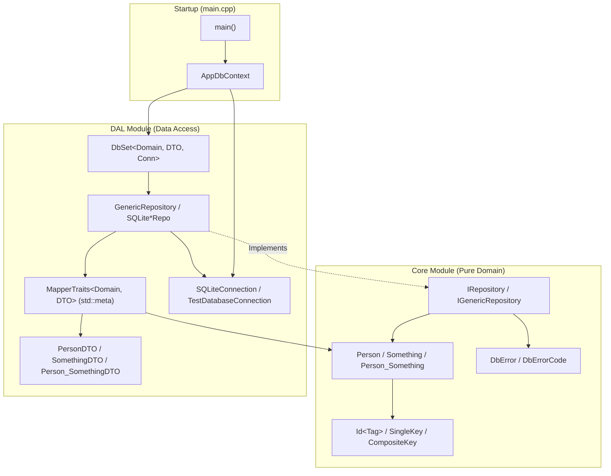
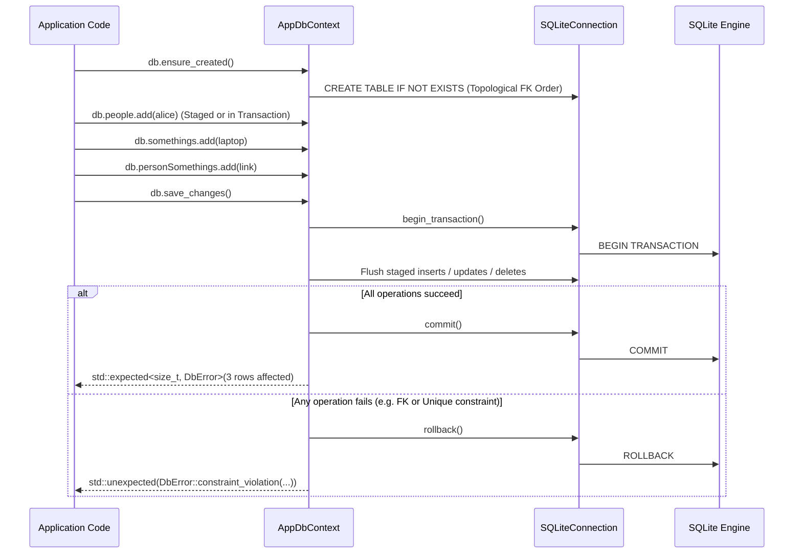
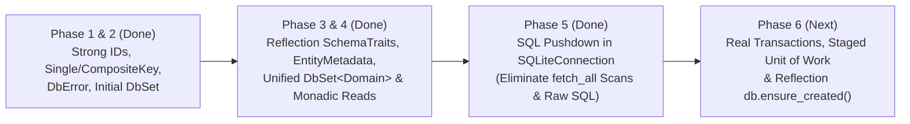

# CodeFirstCppDB_sqlgen — Architecture, Code Review & Plug-and-Play Roadmap

> **Document Version:** 4.1 (Consolidated Master Specification & Planning Blueprint)  
> **Date:** 2026-11-14  
> **Active Branch:** `main` (at commit `ad5ac96`)  
> **Toolchain Baseline:** GCC 16.1+ (`-std=c++26 -freflection`), CMake 4.4+, Ninja, SQLite 3  
> **Scope:** Consolidates all prior project documentation (`README.md`, `README2.md`, `README3.md`, `Antigravity_opinion.md`, `ChatGPT_opinion.md`) and incorporates a fresh architectural audit of the current codebase for the next planning phase.

---

## Table of Contents

1. [Executive Summary & Project Vision](#1-executive-summary--project-vision)
2. [Quick Start & Developer Setup](#2-quick-start--developer-setup)
3. [Evolutionary Background](#3-evolutionary-background)
4. [Current Architecture (Baseline v4 on `main`)](#4-current-architecture-baseline-v4-on-main)
   - [Project Directory Structure](#project-directory-structure)
   - [Layer Boundaries & Separation of Concerns](#layer-boundaries--separation-of-concerns)
   - [Dependency Inversion & Context Flow](#dependency-inversion--context-flow)
   - [Implemented Technical Mechanisms](#implemented-technical-mechanisms)
5. [Honest Code Audit: Where We Are vs. True "Plug-and-Play"](#5-honest-code-audit-where-we-are-vs-true-plug-and-play)
   - [What Works Well Today](#what-works-well-today)
   - [Resolved Issues (Completed in Recent Sprints)](#resolved-issues-completed-in-recent-sprints)
   - [Critical Remaining Gaps & Hidden Bottlenecks](#critical-remaining-gaps--hidden-bottlenecks)
6. [Target Blueprint: "Entity Framework Core" Ergonomics in C++26](#6-target-blueprint-entity-framework-core-ergonomics-in-c26)
   - [Pillar 1: Zero-Boilerplate Entity Registration (`SchemaOf<Domain>`)](#pillar-1-zero-boilerplate-entity-registration-schemaofdomain)
   - [Pillar 2: Unified `DbSet<Domain>` for Single & Composite Keys](#pillar-2-unified-dbsetdomain-for-single--composite-keys)
   - [Pillar 3: Server-Side SQL Pushdown vs. In-Memory Filtering](#pillar-3-server-side-sql-pushdown-vs-in-memory-filtering)
   - [Pillar 4: True Unit of Work & Transactional `save_changes()`](#pillar-4-true-unit-of-work--transactional-save_changes)
   - [Pillar 5: Compile-Time `EntityMetadata<T>` & `ensure_created()`](#pillar-5-compile-time-entitymetadatat--ensure_created)
7. [Actionable Next-Steps Roadmap](#7-actionable-next-steps-roadmap)
8. [Architecture Comparison Matrix](#8-architecture-comparison-matrix)
9. [Appendix: Troubleshooting & Technical FAQ](#9-appendix-troubleshooting--technical-faq)

---

## 1. Executive Summary & Project Vision

**CodeFirstCppDB_sqlgen** is a modern C++26 data-access framework aiming to bring the **Code-First developer experience of C# and Entity Framework Core (EF Core)** to native C++.

By combining **C++26 static reflection (`std::meta`)**, **C++23 named modules (`import std;`)**, **C++20 concepts**, **monadic error handling (`std::expected`)**, and **`sqlgen`**, the project seeks to eliminate the repetitive boilerplate traditionally required in C++ database layers.

### The "Plug-and-Play" North Star
In C# EF Core, adding a persisted domain model requires only:
1. Writing a clean domain class (POCO).
2. Exposing a `DbSet<T>` property inside a `DbContext`.
3. Calling `db.Database.EnsureCreated()` (or running a migration) and using `db.Entities.Add(...)`,LINQ queries, and `db.SaveChanges()`.

Our goal is to achieve this **exact workflow in C++26 entirely at compile time**, without external code-generation scripts, preprocessor macros, or runtime reflection overhead:

```text
┌────────────────────────────────────────────────────────────────────────┐
│                        C++26 Domain Entities                           │
│     (Encapsulated classes or POCOs with SingleKey / CompositeKey)      │
└───────────────────────────────────┬────────────────────────────────────┘
                                    │
                       C++26 Static Reflection (std::meta)
                                    │
                                    ▼
┌────────────────────────────────────────────────────────────────────────┐
│               Compile-Time Relational Metadata Engine                  │
│       (Tables, Columns, Primary/Composite Keys, FKs, Nullability)       │
└───────┬───────────────────────────┼────────────────────────────┬───────┘
        │                           │                            │
        ▼                           ▼                            ▼
┌──────────────┐           ┌──────────────────┐           ┌──────────────┐
│ DDL Schema   │           │ Reflection Auto- │           │ DbContext &  │
│ Generation   │           │ Object Mapper    │           │ DbSet<T> API │
└───────┬──────┘           └────────┬─────────┘           └──────┬───────┘
        │                           │                            │
        └───────────────────────────┼────────────────────────────┘
                                    ▼
┌────────────────────────────────────────────────────────────────────────┐
│                  Database Provider Abstraction (sqlgen)                │
│                      (SQLite / PostgreSQL / DuckDB)                    │
└────────────────────────────────────────────────────────────────────────┘
```

---

## 2. Quick Start & Developer Setup

### Prerequisites & System Packages (Arch Linux / EndeavourOS)

```bash
sudo pacman -S --needed \
    base-devel \
    cmake \
    ninja \
    gdb \
    sqlite \
    postgresql-libs \
    mariadb-libs

# Verify required versions
g++ --version     # Must be GCC 16.x+ (supports -std=c++26 -freflection)
cmake --version   # Must be CMake 4.4+ (supports CMAKE_CXX_MODULE_STD)
ninja --version   # Ninja 1.11+
```

> [!NOTE]
> Standard trunk releases of Clang do not yet include native C++26 static reflection (`<meta>` / `-freflection`). **GCC 16.1+ is required** to build this project.

### Cloning, Building & Running

```bash
# 1. Clone and initialize submodules (sqlgen, reflect-cpp, googletest)
git clone <repo-url>
cd CodeFirstCppDB_sqlgen
git submodule update --init --recursive

# 2. Configure & build using CMake Presets (GCC Debug)
cmake --preset gcc-debug
cmake --build build/linux/arch/gcc/debug

# 3. Run the GoogleTest unit test suite (27 tests across 4 test suites)
./build/linux/arch/gcc/debug/DAL/tests/test_DAL
# Or via CTest:
ctest --test-dir build/linux/arch/gcc/debug --output-on-failure

# 4. Run the Startup demo application (creates and queries relationalDB.db)
./build/linux/arch/gcc/debug/Startup/Startup
# Pass --no-reset to preserve existing relationalDB.db across runs:
./build/linux/arch/gcc/debug/Startup/Startup --no-reset
```

### VS Code / VSCodium Extensions
- `kylinideteam.cppdebug` (GDB debugging)
- `kylinideteam.kylin-cmake-tools` (CMake Preset integration)
- `yy0931.vscode-sqlite3-editor` (Inspect `relationalDB.db` directly in the editor)

---

## 3. Evolutionary Background

1. **Header-to-Module Migration (`README.md` -> `README2.md` -> `README3.md`):**
   - Migrated from traditional `.h`/`.cpp` files to **C++23/26 Named Module Partitions (`.ixx`)** (`core`, `dal`) and `import std;`.
   - Quarantined third-party C/C++ headers (`<sqlgen.hpp>`, `<meta>`) inside global module fragments (`module;`).
2. **Reflection Mapper Evolution:**
   - Replaced manual per-entity field copying with a generic `MapperTraits<Domain, DTO>` powered by GCC 16's `<meta>` implementation (`std::meta::nonstatic_data_members_of`, `template for`, and unchecked splice expressions `obj.[:m:]`).
3. **Key Model & Context Evolution (Recent Sprints):**
   - Introduced `Core::SingleKey<K>` and `Core::CompositeKey<K...>`, structured error classification (`Core::DbError`), and initial `DAL::DbContextBase` / `DAL::DbSet` abstractions.

---

## 4. Current Architecture (Baseline v4 on `main`)

### Project Directory Structure

```text
CodeFirstCppDB_sqlgen/
├── CMakeLists.txt                  # Root CMake config (C++26, -freflection, import std)
├── CMakePresets.json               # Presets for gcc-debug, gcc-release, clang-*
├── readme4.md                      # This consolidated master specification
├── relationalDB.db                 # SQLite database file generated by Startup
│
├── Core/                           # Module: `core` (Pure Domain Layer — Zero DB deps)
│   ├── CMakeLists.txt
│   ├── core.ixx                    # Primary module interface (exports all partitions)
│   ├── Id.ixx                      # Strongly-typed ID wrapper: Core::Id<Tag>
│   ├── Key.ixx                     # Compile-time keys: SingleKey<T>, CompositeKey<T...>
│   ├── entities/                   # Encapsulated domain entities
│   │   ├── Person.ixx              # Key = SingleKey<PersonId>
│   │   ├── Something.ixx           # Key = SingleKey<SomethingId>
│   │   └── Person_Something.ixx    # Key = CompositeKey<PersonId, SomethingId>
│   └── repositories/               # Abstract repository contracts & error model
│       ├── DbError.ixx             # DbError, DbErrorCode & message classifier
│       ├── IGenericRepository.ixx  # IRepository<T> & IGenericRepository<T, KeyType>
│       ├── IPersonRepository.ixx
│       ├── ISomethingRepository.ixx
│       └── IPerson_SomethingRepository.ixx
│
├── DAL/                            # Module: `dal` (Data Access Layer)
│   ├── CMakeLists.txt
│   ├── dal.ixx                     # Primary module interface
│   ├── context/                    # EF Core-style Gateway & Connection Adapter
│   │   ├── DbContext.ixx           # DbContextBase<ConnectionHandle>
│   │   ├── DbSet.ixx               # DbSet<Domain, DTO, ConnectionHandle, KeyType>
│   │   └── SQLiteConnection.ixx    # Adapter wrapping sqlgen::sqlite::Connection
│   ├── schema/                     # Relational DTO structs & schema concepts
│   │   ├── SchemaTraits.ixx        # HasTableName, SinglePrimaryKey, CompositePrimaryKey
│   │   ├── PersonDTO.ixx
│   │   ├── SomethingDTO.ixx
│   │   └── Person_SomethingDTO.ixx
│   ├── mappers/                    # Compile-time Reflection Mapper
│   │   └── MapperTraits.ixx        # Bidirectional Domain <-> DTO via std::meta
│   ├── repositories/               # Concrete Repository Implementations
│   │   ├── GenericRepository.ixx
│   │   ├── SQLitePersonRepo.ixx
│   │   ├── SQLiteSomethingRepo.ixx
│   │   └── SQLitePerson_SomethingRepo.ixx
│   └── tests/                      # Unit Test Suite
│       ├── CMakeLists.txt
│       └── test_DAL.cpp            # 27 GoogleTests across 4 test suites
│
├── Startup/                        # Composition Root & Demo Executable
│   ├── CMakeLists.txt
│   └── main.cpp                    # Initializes SQLite, seeds & queries via AppDbContext
│
└── extern/                         # Git Submodules
    ├── googletest/
    ├── reflect-cpp/                # Required transitively by sqlgen
    └── sqlgen/                     # SQL generation & SQLite driver
```

### Layer Boundaries & Separation of Concerns

| Layer | Module / Namespace | Responsibilities | Architectural Rules |
| :--- | :--- | :--- | :--- |
| **Core** | `core` (`Core::*`) | Domain entities (`Person`, `Something`, `Person_Something`), strong IDs (`Id<Tag>`), key descriptors (`SingleKey`, `CompositeKey`), `DbError`, and repository interfaces. | **Zero external dependencies.** No `sqlgen`, `reflect-cpp`, or `SQLite3` headers. Immutable entity identities. |
| **DAL::Schema** | `dal` (`DAL::Schema::*`) | POD structs (`PersonDTO`, etc.) annotated with `sqlgen::PrimaryKey` and `sqlgen::ForeignKey`. | Public members for `sqlgen` serialization. Constrained by `RelationalEntity<T>`. |
| **DAL::Mappers** | `dal` (`DAL::Mappers::*`) | Compile-time `MapperTraits<Domain, DTO>` converting between private domain members and public DTO fields. | Uses C++26 `std::meta` reflection and `consteval` name matching (`snake_case` <-> `camelCase_`). |
| **DAL::Repositories** | `dal` (`DAL::Repositories::*`) | Generic and entity-specific repository implementations over a `DatabaseConnection`. | Implements `Core` repository contracts and maps driver errors to `Core::DbError`. |
| **DAL::Context** | `dal` (`DAL::*`) | `DbContextBase`, `DbSet`, and `SQLiteConnection` providing an EF Core-style façade. | Coordinates entity sets over a shared connection handle. |
| **Startup** | Executable (`main.cpp`) | Defines `AppDbContext`, connects to SQLite, creates tables, seeds domain models, and runs sample queries. | Interacts with domain entities through `AppDbContext` and repository interfaces. |

### Dependency Inversion & Context Flow



### Implemented Technical Mechanisms

1. **Strong IDs & Compile-Time Key Types (`Core/Id.ixx`, `Core/Key.ixx`):**
   - `Core::Id<Tag>` prevents mixing IDs of different entities (`PersonId` vs `SomethingId`).
   - `Core::SingleKey<KeyType>` (`arity = 1`, `is_composite = false`) and `Core::CompositeKey<KeyTypes...>` (`arity >= 2`, `is_composite = true`) model primary keys with full `<=>` comparison, `std::formatter` support, and C++ structured bindings (`auto [pid, sid] = link.getKey();`).
2. **C++26 Static Reflection Auto-Mapper (`DAL/mappers/MapperTraits.ixx`):**
   - Reflects private domain members via `std::meta::nonstatic_data_members_of(^^Domain, std::meta::access_context::unchecked())` and DTO fields via `std::meta::access_context::current()`.
   - Matches field names at compile time (`consteval`) across exact match, trailing underscore (`id` <-> `id_`), and `snake_case` to `camelCase_` (`first_name` <-> `firstName_`).
   - Uses unchecked splice assignment (`result.[:dom_m:] = ...`) so domain classes keep private state and immutable IDs without needing `friend` declarations or setter methods.

---

## 5. Honest Code Audit: Where We Are vs. True "Plug-and-Play"

To plan the next engineering phases effectively, we must distinguish between what is **already working**, what was **recently fixed**, and what **hidden architectural bottlenecks** still remain in the code.

### What Works Well Today
- **Clean Module Compilation:** Builds cleanly with GCC 16.1+ using C++26 `-freflection` and CMake 4.4 `import std;`.
- **Zero-Setter Reflection Mapping:** Domain entities (`Person`, `Something`, `Person_Something`) have immutable primary keys (no `setId`), yet `MapperTraits` populates them effortlessly via C++26 member splicing.
- **Reflection-Driven Metadata & Unified `Set<Domain>`:** `SchemaTraits`, `SchemaOf<Domain>`, and `EntityMetadata<Domain, DTO>` introspect primary/foreign keys via `<meta>`, allowing `DbContextBase::Set<T>` to handle both single-key (`Person`, `Something`) and composite-key (`Person_Something`) entities with monadic `try_to_vector()` / `try_find()` error propagation.
- **Targeted SQL Pushdown (`SQLiteConnection`):** Single-key and composite-key lookups (`WHERE ... LIMIT 1`), `SELECT COUNT(*)`, `DELETE FROM ... WHERE`, and true SQL `UPDATE ... SET ... WHERE` are generated at compile time via C++26 `<meta>` (`col_of<Member>`), eliminating full-table `fetch_all()` scans and raw SQL string formatting.
- **Fast Unit Test Suite:** 37 unit tests across 6 test suites in `test_DAL.cpp` (including live `:memory:` SQLite pushdown tests) verify reflection mapping, optional fields, CRUD operations, `DbError` classification, `SingleKey`/`CompositeKey` semantics, `EntityMetadata`, and `DbSet` usage.

### Resolved Issues (Completed in Phases 1–5)
- [x] **Entity ID Immutability:** Removed `setId`, `setPersonId`, and `setSomethingId` from domain entities.
- [x] **Key Type Abstractions:** Implemented `SingleKey<K>` and `CompositeKey<K...>` with concepts (`SingleKeyType`, `CompositeKeyType`, `Key`) and structured bindings.
- [x] **Base Repository Split:** Split `IRepository<T>` (common operations) from `IGenericRepository<T, KeyType>` (single-key operations) so junction tables are not forced to implement `get_by_id(int32_t)`.
- [x] **Error Message Classification & Monadic Reads:** Added `DbError::map_from_message` and `try_fetch_all` / `try_get_all` / `try_to_vector` / `try_find` returning `std::expected<..., Core::DbError>`.
- [x] **Reflection-Based `CompositePrimaryKey` & `EntityMetadata`:** Replaced hardcoded `person_id`/`something_id` concept checks with `consteval` `<meta>` member introspection (`primary_key_count<T>()`, `foreign_key_count<T>()`).
- [x] **Unified `DbSet` (`Set<Domain>`) via `SchemaOf<Domain>`:** `AppDbContext` now manages `Set<Core::Person>`, `Set<Core::Something>`, and `Set<Core::Person_Something>` uniformly without external repository boilerplate.
- [x] **SQL Pushdown & True SQL `UPDATE`:** Replaced `fetch_all()` loops, raw `DELETE` string formatting, and `sqlgen::write` in `SQLiteConnection` with reflection-generated `sqlgen` `WHERE`, `COUNT(*)`, `DELETE`, and `UPDATE` queries.

---

### Remaining Final-Mile Gap (Targeted in Phase 6)

Only **1 architectural milestone** remains to complete the EF Core-style experience:

#### Gap 1: True Unit of Work (`save_changes`), Transactions, & Automatic Schema Creation (`ensure_created`)
- **What the code currently does:**
  - `db.people.add(p)` executes `INSERT` immediately against SQLite, and `db.save_changes()` in [DbContext.ixx](file:///home/d5/Developer09/CodeFirstCppDB_sqlgen/DAL/context/DbContext.ixx) only checks `if (!is_connected()) return error; return {};`.
  - `Startup/main.cpp` still includes `<sqlgen.hpp>` and `<sqlgen/sqlite.hpp>` to call `sqlgen::sqlite::connect` and manually chain `sqlgen::create_table<DTO> | sqlgen::if_not_exists` for each DTO.
- **What needs to change (Phase 6):**
  - Expose connection factory (`SQLiteConnection::connect`), DDL helpers (`ensure_table_created<DTO>()`, `enable_foreign_keys()`), and transaction primitives (`begin_transaction()`, `commit()`, `rollback()`) on `SQLiteConnection` and `TestDatabaseConnection`.
  - Implement C++26 reflection-driven `db.ensure_created(this Self&& self)` on `DbContextBase` that inspects all `Set<T>` data members of the derived `DbContext` at compile time (`std::meta::nonstatic_data_members_of(^^Derived)`) and creates every table + enables foreign keys automatically.
  - Implement both **staged Unit-of-Work execution** (`defer_changes(true)`, `stage_add` / `stage_update` / `stage_remove`, `pending_changes_count()`, `discard_changes()`, atomic `save_changes()`) and **scoped transactions** (`db.transaction(fn)`) with automatic rollback on failure.

---

## 6. Target Blueprint: "Entity Framework Core" Ergonomics in C++26

Here is the concrete engineering design to resolve the 7 gaps above and achieve a truly plug-and-play C++26 ORM.

### Pillar 1: Zero-Boilerplate Entity Registration (`SchemaOf<Domain>`)

By mapping a `Domain` type to its `DTO` (or defaulting to `Domain` itself when a user uses simple POCO structs), we eliminate repetitive template arguments:

```cpp
// Default: An entity can act as its own schema struct if desired (pure POCO mode)
template<typename Domain>
struct SchemaOf {
    using type = Domain;
};

// Optional Clean-Architecture specialization: keeps Core 100% free of sqlgen types
template<> struct SchemaOf<Core::Person> { using type = DAL::Schema::PersonDTO; };
template<> struct SchemaOf<Core::Something> { using type = DAL::Schema::SomethingDTO; };
template<> struct SchemaOf<Core::Person_Something> { using type = DAL::Schema::Person_SomethingDTO; };

template<typename Domain>
using SchemaOf_t = typename SchemaOf<Domain>::type;
```

### Pillar 2: Unified `DbSet<Domain>` for Single & Composite Keys

Using `typename Domain::Key` (`SingleKey<K>` vs. `CompositeKey<K1, K2, ...>`) and `if constexpr`, a single `DbSet<Domain, Conn>` template can seamlessly support both regular entities and junction tables:

```cpp
template<typename Domain, typename ConnectionHandle, typename DTO = SchemaOf_t<Domain>>
class DbSet {
public:
    using KeyType = typename Domain::Key;

    // Works for SingleKey (e.g. PersonId) AND CompositeKey (e.g. CompositeKey<PersonId, SomethingId>)
    [[nodiscard]] std::expected<std::optional<Domain>, Core::DbError> find(const KeyType& key) const;

    // Convenience overload for unpacking CompositeKey arguments directly:
    // e.g. db.personSomethings.find(PersonId{1}, SomethingId{2})
    template<typename... Args>
        requires (Core::CompositeKeyType<KeyType> && sizeof...(Args) == KeyType::arity)
    [[nodiscard]] std::expected<std::optional<Domain>, Core::DbError> find(Args&&... keyParts) const {
        return find(KeyType{ std::forward<Args>(keyParts)... });
    }

    std::expected<void, Core::DbError> add(const Domain& entity);
    std::expected<void, Core::DbError> update(const Domain& entity);
    std::expected<void, Core::DbError> remove(const KeyType& key);
};
```

With this design, `AppDbContext` becomes completely uniform:

```cpp
class AppDbContext : public DAL::DbContextBase<DAL::SQLiteConnection> {
public:
    Set<Core::Person> people{this};
    Set<Core::Something> somethings{this};
    Set<Core::Person_Something> personSomethings{this}; // First-class citizen!

    using DbContextBase::DbContextBase;
};
```

### Pillar 3: Server-Side SQL Pushdown vs. In-Memory Filtering

Instead of `fetch_all<DTO>()` + C++ loops, `SQLiteConnection` should use `sqlgen` query builders combined with C++26 reflection:
- **`count<DTO>()`:** Execute `SELECT COUNT(*) FROM <tablename>` or `sqlgen` aggregation.
- **`get_by_id<DTO>(id)`:** Execute `sqlgen::select_from<DTO>() | sqlgen::where("id"_c == id) | sqlgen::to<std::optional<DTO>>`.
- **`get_by_key<DTO>(CompositeKey)`:** Use C++26 `template for` over the reflected key columns of `DTO` to build the `WHERE` condition dynamically without hardcoding `person_id` or `something_id`!
- **`delete_by_key<DTO>(Key)`:** Use `sqlgen::delete_from<DTO> | sqlgen::where(...)`.

### Pillar 4: True Unit of Work & Transactional `save_changes()`

`DbContextBase` should support both **immediate execution within an explicit transaction** and **staged Unit-of-Work execution**:



### Pillar 5: Compile-Time Reflection `db.ensure_created()` (Deducing `this` + `<meta>`)

By combining C++23 **deducing `this`** (`this Self&& self`) with C++26 **static reflection** (`std::meta::nonstatic_data_members_of(^^Derived)`), `DbContextBase::ensure_created()` automatically discovers every `Set<Domain>` member declared on `AppDbContext` without requiring duplicate template arguments or macro registration:
```cpp
template<typename Self>
std::expected<void, Core::DbError> ensure_created(this Self&& self) {
    using Derived = std::remove_cvref_t<Self>;
    static constexpr auto members = std::define_static_array(
        std::meta::nonstatic_data_members_of(^^Derived, std::meta::access_context::unchecked()));

    template for (constexpr auto m : members) {
        using MemberType = std::remove_cvref_t<[:std::meta::type_of(m):]>;
        if constexpr (IsDbSetMember<MemberType>) {
            auto res = self.conn_->template ensure_table_created<typename MemberType::DTOType>();
            if (!res) return res;
        }
    }
    return self.conn_->enable_foreign_keys(); // PRAGMA foreign_keys = ON;
}
```
This eliminates the manual `rawConnRes.and_then(sqlgen::create_table<...>...)` boilerplate and `<sqlgen.hpp>` includes in `Startup/main.cpp`!

---

## 7. Actionable Next-Steps Roadmap



### Phase 1 & Phase 2: Foundations & Key Model *(Completed)*
- [x] **Task 1.1–1.5:** Clean up CMake target links, strengthen `DatabaseConnection` concepts (`ReadableConnection`, `WritableConnection`), implement `DbError::map_from_message`, enforce immutable entity IDs, and remove raw mapper loops from `Startup/main.cpp`.
- [x] **Task 2.1–2.4:** Implement `SingleKey<KeyType>` and `CompositeKey<KeyTypes...>` in `Core/Key.ixx` with structured bindings, concepts, and unit tests; split `IRepository` from `IGenericRepository`; implement `SQLitePerson_SomethingRepo`.

### Phase 3: Reflection-Driven Schema Concepts & Zero-Boilerplate Traits *(Completed)*
- [x] **Task 3.1: Reflection-Based `SinglePrimaryKey<T>` & `CompositePrimaryKey<T>` (`DAL/schema/SchemaTraits.ixx`)**
  - **Problem:** `SinglePrimaryKey<T>` currently hardcodes `dto.id.value()`, and `CompositePrimaryKey<T>` hardcodes `dto.person_id.value()` and `dto.something_id.value()`. Any custom entity (e.g., `Order_ProductDTO`) with different key column names fails `RelationalEntity<T>`.
  - **Design:** Use C++26 static reflection (`#include <meta>`, `std::meta::nonstatic_data_members_of(^^T, std::meta::access_context::current())`) to inspect field types at compile time:
    - `SqlgenPrimaryKeyField<F>`: detects `sqlgen::PrimaryKey<V, auto_incr>` via `typename F::ReflectionType`, `F::auto_incr`, and `f.value()`.
    - `SqlgenForeignKeyField<F>`: detects `sqlgen::ForeignKey<V, Table, Col>` via `typename F::ReflectionType`, `typename F::ForeignTableType`, `typename F::ColumnType`, and `f.value()`.
    - `consteval std::size_t primary_key_count<T>()` and `consteval std::size_t foreign_key_count<T>()` count key fields across all non-static data members of `T`.
    - `SinglePrimaryKey<T>`: `HasTableName<T> && (primary_key_count<T>() == 1)`.
    - `CompositePrimaryKey<T>`: `HasTableName<T> && !SinglePrimaryKey<T> && ((primary_key_count<T>() >= 2) || (primary_key_count<T>() == 0 && foreign_key_count<T>() >= 2))`.
- [x] **Task 3.2: Zero-Boilerplate `SchemaOf<Domain>` Trait (`DAL/schema/SchemaTraits.ixx` & `*DTO.ixx`)**
  - **Design:**
    - Define `template<typename Domain> struct SchemaOf { using type = Domain; };` and `template<typename Domain> using SchemaOf_t = typename SchemaOf<Domain>::type;`.
    - Define concept `template<typename Domain> concept HasSchema = RelationalEntity<SchemaOf_t<Domain>>;`.
    - Specialize `SchemaOf<Core::Person>`, `SchemaOf<Core::Something>`, and `SchemaOf<Core::Person_Something>` in their respective DTO partitions (`PersonDTO.ixx`, `SomethingDTO.ixx`, `Person_SomethingDTO.ixx`).
- [x] **Task 3.3: Compile-Time `EntityMetadata<Domain, DTO>` (`DAL/schema/EntityMetadata.ixx`)**
  - **Design:** Add new module partition `export module dal:entity_metadata;` (exported in `DAL/dal.ixx` and registered in `DAL/CMakeLists.txt`):
    - `table_name`: `static constexpr std::string_view table_name = DTO::tablename;`
    - `KeyType`: `using KeyType = typename Domain::Key;`
    - `is_composite_key`: `static constexpr bool is_composite_key = Core::CompositeKeyType<KeyType>;`
    - `key_arity`: `static constexpr std::size_t key_arity = KeyType::arity;`
    - `column_names()`: `consteval` function returning `std::array<std::string_view, N>` of all DTO field names via `std::meta::identifier_of`.
    - `key_column_names()`: `consteval` function returning `std::array<std::string_view, key_arity>` of key column names.
    - `extract_key(const Domain&)` & `extract_dto_key(const DTO&)`: extracts `typename Domain::Key` from either a `Domain` instance or a `DTO` instance using `MapperTraits<Domain, DTO>`.
    - `matches_key(const DTO& dto, const KeyType& key)`: compares `extract_dto_key(dto) == key` at runtime.

### Phase 4: Unified `DbSet<Domain>` & Monadic Read Semantics *(Completed)*
- [x] **Task 4.1: Generalize `GenericRepository`, `DbSet`, and `DbContextBase` for Single & Composite Keys**
  - **`DAL/repositories/GenericRepository.ixx`:**
    - Support `KeyType` being a scalar (`std::int32_t`), strong ID (`Core::Id<Tag>`), `Core::SingleKey<K>`, or `Core::CompositeKey<K1, K2, ...>`.
    - Use `if constexpr (Core::CompositeKeyType<KeyType>)` inside `get_by_id`, `delete_by_id`, and `exists_by_id`:
      - Single-key path unwraps `SingleKey`/`Id` to `std::int32_t` and delegates to `conn_->get_by_id<DTO>(raw_id)` / `delete_by_id<DTO>(raw_id)` / `exists<DTO>(raw_id)`.
      - Composite-key path matches DTOs via `Schema::EntityMetadata<Domain, DTO>::matches_key(dto, key)` for reads and unpacks key components into `conn_->delete_by_composite_id(...)` for deletes.
  - **`DAL/context/DbSet.ixx` & `DAL/context/DbContext.ixx`:**
    - Default `DTO = Schema::SchemaOf_t<Domain>` and `KeyType = typename Domain::Key` in `DbSet<Domain, DTO, ConnectionHandle, KeyType>`.
    - Add `template<typename Domain, typename DTO = Schema::SchemaOf_t<Domain>, typename KeyType = typename Domain::Key> using Set = DbSet<Domain, DTO, ConnectionHandle, KeyType>;` inside `DbContextBase<ConnectionHandle>`.
    - Add constructor overload on `DbSet` accepting `DbContextBase<ConnectionHandle>*` (or `std::shared_ptr<ConnectionHandle>`) so `Set<Core::Person> people{this};` works inline in `AppDbContext`.
    - Provide ergonomic key overloads on `DbSet::find`, `DbSet::try_find`, `DbSet::remove`, and `DbSet::contains`:
      - Direct `KeyType` (`SingleKey<K>` or `CompositeKey<K...>`)
      - Unwrapped value/scalar for `SingleKeyType` (`PersonId{1}` or `1`)
      - Variadic key components for `CompositeKeyType` (`db.personSomethings.find(Core::PersonId{1}, Core::SomethingId{1})`)
  - **`Startup/main.cpp`:**
    - Upgrade `AppDbContext` to declare `Set<Core::Person> people{this};`, `Set<Core::Something> somethings{this};`, and `Set<Core::Person_Something> personSomethings{this};`, removing the standalone `linkRepo` from `main.cpp`.
- [x] **Task 4.2: Monadic Read Semantics (`std::expected<..., Core::DbError>`)**
  - **`DAL/context/SQLiteConnection.ixx` & `TestDatabaseConnection` (`DAL/tests/test_DAL.cpp`):**
    - Add `try_fetch_all<DTO>() const -> std::expected<std::vector<DTO>, Core::DbError>` and `try_get_by_id<DTO>(std::int32_t) const -> std::expected<std::optional<DTO>, Core::DbError>`.
  - **`Core/repositories/IGenericRepository.ixx` & `DAL/repositories/GenericRepository.ixx`:**
    - Add `try_get_all() const -> std::expected<std::vector<Domain>, Core::DbError>` and `try_get_by_id(KeyType id) const -> std::expected<std::optional<Domain>, Core::DbError>` while preserving `get_all()` and `get_by_id()` for backward compatibility.
  - **`DAL/context/DbSet.ixx`:**
    - Expose `try_to_vector() const -> std::expected<std::vector<Domain>, Core::DbError>` and `try_find(...) const -> std::expected<std::optional<Domain>, Core::DbError>`.
  - **`DAL/tests/test_DAL.cpp`:**
    - Add unit tests covering generic `CompositePrimaryKey` on custom DTOs, `EntityMetadata` reflection queries, `SchemaOf_t`, `Set<Core::Person_Something>` composite CRUD via `DbContext`, and `try_to_vector()` / `try_find()` error propagation when the connection is closed or fails.

### Phase 5: SQL Query Pushdown — Eliminating Full-Table Scans & Raw SQL *(Completed)*
- [x] **Task 5.1: Compile-Time Reflection Bridge to `sqlgen::Col` (`DAL/schema/SchemaTraits.ixx`)**
  - **Problem:** `SQLiteConnection` currently hardcodes `item.id.value()`, `"DELETE FROM {} WHERE id = {};"`, and `"DELETE FROM Person_Something WHERE person_id = {} AND something_id = {};"`. Meanwhile, `sqlgen` requires compile-time `sqlgen::Col<StringLiteral>` objects to build type-safe `WHERE` and `SET` clauses.
  - **Design:** Bridge C++26 `std::meta::info` directly to `sqlgen::Col` at compile time (`consteval`):
    - `col_literal_of<Member>()`: Converts `std::meta::identifier_of(Member)` (`std::string_view`) into `rfl::internal::StringLiteral<N + 1>`.
    - `col_of<Member>`: `inline constexpr auto col_of = sqlgen::Col<col_literal_of<Member>()>{};`
    - `primary_key_member<DTO>()`: `consteval` helper returning the `std::meta::info` of the single primary key field for `SinglePrimaryKey<DTO>`.
    - `key_members_of<DTO>()` & `non_key_members_of<DTO>()`: `consteval` helpers returning `std::array<std::meta::info, K>` of all key fields (`PrimaryKey` or `ForeignKey`) and non-key fields of `DTO` without requiring a `Domain` type parameter.
    - `make_pk_where<DTO>(id)`: Constructs `col_of<primary_key_member<DTO>()> == id`.
    - `make_composite_where<DTO>(parts...)`: Fold-combines `(col_of<km[Is]> == static_cast<...>(parts)) && ...` into a strongly-typed `sqlgen` `Condition` AST for any composite key arity $K \ge 2$.
- [x] **Task 5.2: Single-Key SQL Pushdown & True SQL `UPDATE` in `SQLiteConnection` (`DAL/context/SQLiteConnection.ixx`)**
  - **`try_get_by_id<DTO>(id)` & `get_by_id<DTO>(id)`:**
    - Replace `try_fetch_all<DTO>()` + C++ linear scan with:
      ```cpp
      auto query = sqlgen::read<std::vector<DTO>>
                 | sqlgen::where(DAL::Schema::make_pk_where<DTO>(id))
                 | sqlgen::limit(1);
      auto res = query(conn_);
      ```
    - Executes `SELECT ... FROM "Table" WHERE "<pk>" = <id> LIMIT 1;` in $O(\log N)$ via SQLite's B-tree index.
  - **`try_count<DTO>()` & `count<DTO>()`:**
    - Replace `fetch_all<DTO>().size()` with server-side SQL aggregation:
      ```cpp
      struct RowCount { std::size_t count = 0; };
      auto query = sqlgen::select_from<DTO>(sqlgen::count() | sqlgen::as<"count">)
                 | sqlgen::to<RowCount>;
      ```
    - Executes `SELECT COUNT(*) AS "count" FROM "Table";` without reading or deserializing entity rows.
  - **`delete_by_id<DTO>(id)`:**
    - Replace `std::format("DELETE FROM {} WHERE id = {};", ...)` with `(sqlgen::delete_from<DTO> | sqlgen::where(DAL::Schema::make_pk_where<DTO>(id)))(conn_)`.
  - **`update<DTO>(const DTO& item)`:**
    - **Bug Fix:** `sqlgen::write(conn_, vec)` in `sqlgen` runs `CREATE TABLE` (without `IF NOT EXISTS`) followed by `INSERT INTO`, which fails on existing tables/rows instead of executing `UPDATE`!
    - **Fix:** Use C++26 reflection over `non_key_members_of<DTO>()` and `key_members_of<DTO>()` to build:
      ```cpp
      (sqlgen::update<DTO>(col_of<non_key_m>.set(unwrap_field(item.[:non_key_m:]))...)
          | sqlgen::where(make_dto_key_where<DTO>(item)))(conn_)
      ```
    - Check row existence beforehand so updating a non-existent record returns `sqlgen::error("Update failed: item not found")`, mapping cleanly to `Core::DbErrorCode::NotFound`.
- [x] **Task 5.3: Generic Reflection-Driven Composite-Key & Column Pushdown (`SQLiteConnection.ixx`, `GenericRepository.ixx`, `SQLitePerson_SomethingRepo.ixx`)**
  - **`SQLiteConnection` Composite-Key Operations:**
    - Add `try_get_by_composite_id<DTO>(Parts... parts)` and `get_by_composite_id<DTO>(Parts... parts)` executing `sqlgen::read<std::vector<DTO>> | sqlgen::where(make_composite_where<DTO>(parts...)) | sqlgen::limit(1)`.
    - Generalize `delete_by_composite_id<DTO = DAL::Schema::Person_SomethingDTO>(Parts... parts)` using `(sqlgen::delete_from<DTO> | sqlgen::where(make_composite_where<DTO>(parts...)))(conn_)`, removing the hardcoded `"DELETE FROM Person_Something ..."` string while keeping default `DTO = Person_SomethingDTO` for backward compatibility.
    - Add `exists_by_composite_id<DTO>(Parts... parts)` and `fetch_where_equal<DTO, ColLiteral>(Val)` for indexed foreign-key filtering.
  - **`GenericRepository` & `SQLitePerson_SomethingRepo` Integration:**
    - In `GenericRepository::get_by_id`, `try_get_by_id`, `delete_by_id`, and `exists_by_id` (for `CompositeKeyType<KeyType>`), dispatch to `conn_->template try_get_by_composite_id<DTO>(parts...)`, `conn_->template get_by_composite_id<DTO>(parts...)`, and `conn_->template delete_by_composite_id<DTO>(parts...)` when supported by `ConnectionHandle` (retaining the `EntityMetadata::matches_key` fallback for minimal mock connections).
    - In `SQLitePerson_SomethingRepo`, route `get_by_composite_id`, `find_by_person_id`, and `find_by_something_id` through the pushdown methods.
- [x] **Task 5.4: Real SQLite (`":memory:"`) Pushdown Unit Tests (`DAL/tests/test_DAL.cpp`)**
  - Upgrade `TestDatabaseConnection` to support `get_by_composite_id<DTO>`, `try_get_by_composite_id<DTO>`, generic `delete_by_composite_id<DTO>`, and composite-key `update<DTO>`.
  - Add `Phase5SqlPushdownTest` suite in `DAL/tests/test_DAL.cpp` using a live in-memory `SQLiteConnection` (`":memory:"`) to verify:
    - Single-key `try_get_by_id`, `count`, `exists`, `update` (including `DbErrorCode::NotFound` on missing rows), and `delete_by_id`.
    - Composite-key `DbSet<Core::Person_Something>` (`find`, `try_find`, `update`, `remove`, `contains`) and `SQLitePerson_SomethingRepo` (`find_by_person_id`, `find_by_something_id`) against real SQLite tables.

### Phase 6: True Unit of Work (`save_changes`), Transactions, & Automatic Schema (`ensure_created`) *(Next Up — Detailed Spec)*
- [ ] **Task 6.1: Connection Factory, DDL Helpers, & Transaction Primitives (`DAL/context/SQLiteConnection.ixx` & `TestDatabaseConnection`)**
  - **`DAL/context/SQLiteConnection.ixx`:**
    - Add `static std::expected<std::shared_ptr<SQLiteConnection>, Core::DbError> connect(const std::string& dbPath)` wrapping `sqlgen::sqlite::connect(dbPath)`.
    - Add `template<typename DTO> std::expected<void, Core::DbError> ensure_table_created()` executing `(sqlgen::create_table<DTO> | sqlgen::if_not_exists)(conn_)`.
    - Add `std::expected<void, Core::DbError> enable_foreign_keys()` executing `conn_->execute("PRAGMA foreign_keys = ON;")`.
    - Add transaction lifecycle methods wrapping `sqlgen::sqlite::Connection`:
      - `std::expected<void, Core::DbError> begin_transaction()` (`conn_->begin_transaction()`, sets `in_transaction_ = true`)
      - `std::expected<void, Core::DbError> commit()` (`conn_->commit()`, sets `in_transaction_ = false`)
      - `std::expected<void, Core::DbError> rollback()` (`conn_->rollback()`, sets `in_transaction_ = false`)
      - `[[nodiscard]] bool in_transaction() const noexcept`
  - **`TestDatabaseConnection` (`DAL/tests/test_DAL.cpp`):**
    - Add snapshot-backed `begin_transaction()`, `commit()`, `rollback()`, `in_transaction()`, `ensure_table_created<DTO>()`, and `enable_foreign_keys()`:
      - `begin_transaction()` snapshots `(persons_, somethings_, person_somethings_)` so `rollback()` restores all in-memory tables to their exact pre-transaction state.
- [ ] **Task 6.2: Staged Unit of Work (`save_changes`) & Scoped Transactions (`DAL/context/DbContext.ixx` & `DAL/context/DbSet.ixx`)**
  - **`DAL/context/DbContext.ixx`:**
    - Maintain a queue of staged operations: `std::vector<std::function<std::expected<void, Core::DbError>()>> pending_ops_;` and a `bool defer_changes_ = false;` mode flag.
    - Expose Unit-of-Work controls:
      - `void defer_changes(bool enabled = true) noexcept` and `[[nodiscard]] bool is_deferred() const noexcept`
      - `void enqueue_op(std::function<std::expected<void, Core::DbError>()> op)`
      - `[[nodiscard]] std::size_t pending_changes_count() const noexcept`
      - `void discard_changes() noexcept` (clears `pending_ops_`)
    - Expose connection transaction wrappers on `DbContextBase`: `begin_transaction()`, `commit()`, `rollback()`, and `in_transaction()`.
    - Upgrade `save_changes()`:
      1. Verifies `is_connected()`.
      2. If `pending_ops_` is non-empty: starts a transaction (`begin_transaction()`), executes all staged operations in FIFO order, and if **any** operation fails, immediately calls `rollback()`, clears `pending_ops_`, and returns `std::unexpected(err)`. If all succeed, calls `commit()`, clears `pending_ops_`, and returns `{}`.
      3. If an explicit transaction was already started via `db.begin_transaction()`, commits it.
    - Add `template<typename Fn> std::expected<void, Core::DbError> transaction(Fn&& fn)`:
      - Begins a transaction, invokes `fn()`, flushes any staged changes, and commits on success or automatically rolls back and returns the `DbError` on failure.
  - **`DAL/context/DbSet.ixx`:**
    - Expose `using DomainType = Domain; using DTOType = DTO; using KeyValueType = KeyType;`.
    - When constructed with `Ctx* ctx`, bind optional callbacks to `ctx->is_deferred()` and `ctx->enqueue_op(...)` (avoiding circular module imports).
    - When `is_deferred()` is `true`, `add()`, `add_range()`, `update()`, and `remove()` automatically enqueue into `DbContextBase` and return `{}`.
    - Also provide explicit staging methods `stage_add(item)`, `stage_add_range(items)`, `stage_update(item)`, and `stage_remove(key_or_parts...)` that always stage into `DbContextBase` regardless of `is_deferred()`.
- [ ] **Task 6.3: Reflection-Driven `db.ensure_created()` & Pure-Module `Startup/main.cpp` (`DAL/context/DbContext.ixx`, `Startup/main.cpp`)**
  - **Compile-Time `DbSet` Discovery via Deducing `this` + C++26 `<meta>`:**
    - Define `concept IsDbSetMember` detecting `T::DomainType`, `T::DTOType`, and `Schema::RelationalEntity<typename T::DTOType>`.
    - Implement `template<typename Self> std::expected<void, Core::DbError> ensure_created(this Self&& self)` on `DbContextBase`:
      - Reflects `std::meta::nonstatic_data_members_of(^^std::remove_cvref_t<Self>, std::meta::access_context::unchecked())` at compile time (`template for`).
      - For every `DbSet` member declared on the derived `DbContext` (e.g., `people`, `somethings`, `personSomethings` on `AppDbContext`), calls `conn_->template ensure_table_created<typename MemberType::DTOType>()` in declaration order, followed by `conn_->enable_foreign_keys()`.
    - Also provide `template<typename... Domains> std::expected<void, Core::DbError> ensure_created_for()` for base `DbContextBase` instances without derived members.
  - **`Startup/main.cpp` Cleanup:**
    - Remove `#include <sqlgen.hpp>`, `#include <sqlgen/sqlite.hpp>`, and manual `sqlgen::create_table<...>` chains from `Startup/main.cpp`.
    - Use pure C++ modules (`import std; import core; import dal;`), connect via `DAL::SQLiteConnection::connect(dbPath)`, initialize schema via `db.ensure_created()`, stage seed records with `db.defer_changes(true)`, and commit atomically via `db.save_changes()`.
- [ ] **Task 6.4: Phase 6 Unit & Integration Tests (`DAL/tests/test_DAL.cpp`)**
  - Add `Phase6UnitOfWorkAndSchemaTest` suite verifying:
    1. Reflection-driven `db.ensure_created()` on a fresh `:memory:` `SQLiteConnection` automatically creates `Person`, `Something`, and `Person_Something` tables and enforces `PRAGMA foreign_keys = ON` (verifying foreign-key violation returns `DbErrorCode::ConstraintViolation`).
    2. Deferred Unit of Work (`db.defer_changes(true)` + `add` / `update` / `remove`): changes are not visible in the database before `db.save_changes()`, and become persisted after `db.save_changes()`.
    3. Atomic rollback on mid-batch failure: when staging multiple valid inserts followed by a duplicate-key or foreign-key violation insert, `db.save_changes()` returns an error and rolls back all earlier inserts in the batch (leaving 0 partial writes in both `TestDatabaseConnection` and `:memory:` `SQLiteConnection`).
    4. Scoped `db.transaction([&] { ... })` commit and rollback behavior, plus `db.discard_changes()`.

---

## 8. Architecture Comparison Matrix

| Feature / Aspect | v3 Baseline (Earlier) | Current `main` (v4.1) | Target C++26 "EF Core" (Phases 3–6) | C# Entity Framework Core |
| :--- | :--- | :--- | :--- | :--- |
| **Entity Identity** | Mutable (`setId` exposed) | Immutable (`Id<Tag>`, `SingleKey`, `CompositeKey`) | Immutable + Auto-detected via `std::meta` | POCO Properties (`[Key]` or Convention) |
| **Composite Keys** | Broken (`static_assert` failure) | `CompositeKey<K...>` + `SQLitePerson_SomethingRepo` | Generic `DbSet<T>` & reflected composite SQL | `.HasKey(x => new { x.K1, x.K2 })` |
| **DbSet Ergonomics** | None (Manual Repos only) | `DbSet<Domain, DTO, Conn>` (Single-key only) | `Set<Domain>` (Single & Composite keys) | `DbSet<TEntity>` |
| **Query Execution** | Raw `sqlgen::read` in `main` | `fetch_all()` + in-memory C++ loops | Server-side SQL `WHERE` / `COUNT` pushdown | LINQ `IQueryable` -> SQL translation |
| **Unit of Work** | None | Stub `save_changes()` (immediate writes) | Staged changes + atomic `BEGIN/COMMIT/ROLLBACK` | `ChangeTracker` + `SaveChanges()` |
| **Schema Creation** | Manual `create_table` chain | Manual `create_table` chain in `main.cpp` | `db.ensure_created()` from registered entities | `db.Database.EnsureCreated()` / Migrations |
| **Error Handling** | Hardcoded `DbErrorCode::Unknown` | Classified `DbError` on writes; silent on reads | Monadic `std::expected<T, DbError>` on reads & writes | Exceptions (`DbUpdateException`) |

---

## 9. Appendix: Troubleshooting & Technical FAQ

### Q1: Why does Clang fail to build the project?
**Answer:** GCC 16.1+ includes experimental support for ISO C++26 static reflection (`P2996`) via `-std=c++26 -freflection` and `<meta>`. Standard Clang releases do not yet support `<meta>`. Always use the `gcc-debug` or `gcc-release` presets.

### Q2: Can we remove the `extern/reflect-cpp` submodule since we use C++26 `<meta>`?
**Answer:** Not while using `sqlgen`. While **our** `Core` and `DAL` code uses native C++26 `<meta>` (`std::meta::nonstatic_data_members_of`), `sqlgen` itself is built on top of `reflect-cpp` (`rfl::Result`, `rfl::Ref`, `rfl::Variant`, and `rfl` struct serialization). Therefore, `reflect-cpp` must remain initialized as a submodule for `sqlgen` to compile, though `Core` and `DAL` do not need to reference `rfl` directly.

### Q3: Why does CMake emit a deprecation warning for `SQLite::SQLite3`?
**Answer:** `extern/sqlgen/CMakeLists.txt` links against the legacy target name `SQLite::SQLite3`. Our root `CMakeLists.txt` aliases `SQLite::SQLite3` to modern CMake's `SQLite3::SQLite3`. The warning originates inside the `sqlgen` submodule and is benign.

### Q4: How does `MapperTraits` access `private` fields of `Core::Person` without `friend`?
**Answer:** C++26 static reflection provides `std::meta::access_context::unchecked()`. When combined with splice expressions (`result.[:dom_m:] = ...`), the reflection mapper can read and write private data members at compile time without polluting domain classes with ORM-specific `friend` declarations or public setters.
