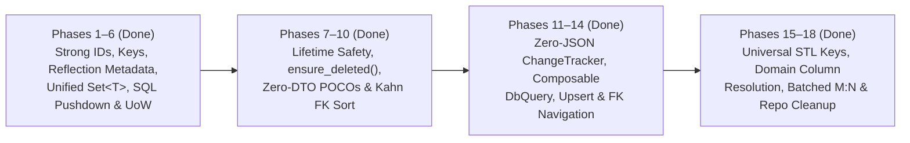
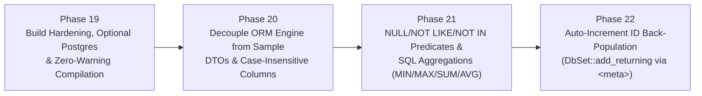

# CodeFirstCppDB_sqlgen — Architecture, Audit & Next-Gen Roadmap

> **Document Version:** 8.0 (Post-Phase-18 Full Code, Architecture & Library Audit + Phases 19–22 Specification)  
> **Date:** 2026-11-15  
> **Active Branch:** `Review98` (based on `main` at commit `dca5d38`)  
> **Toolchain Baseline:** GCC 16.1+ (`-std=c++26 -freflection`), CMake 4.4+, Ninja, SQLite 3  
> **Status:** Phases 1–18 Completed & Verified (57/57 GoogleTests passing across 19 suites in ~24 ms)

---

## Table of Contents

1. [Executive Summary & Vision](#1-executive-summary--vision)
2. [Quick Start & Developer Setup](#2-quick-start--developer-setup)
3. [Current Architecture & Library Stack (v8.0 — Phases 1–18 Complete)](#3-current-architecture--library-stack-v80--phases-118-complete)
   - [Directory Layout](#directory-layout)
   - [Layer Boundaries](#layer-boundaries)
   - [External Submodule Libraries Assessment](#external-submodule-libraries-assessment)
   - [End-to-End Developer Experience (Encapsulated & Zero-DTO POCO Modes)](#end-to-end-developer-experience-encapsulated--zero-dto-poco-modes)
   - [Core Technical Pillars](#core-technical-pillars)
4. [Completed Engineering Roadmap (Phases 1–18 Summary)](#4-completed-engineering-roadmap-phases-118-summary)
5. [Post-Phase-18 Audit of Code, Architecture & Libraries](#5-post-phase-18-audit-of-code-architecture--libraries)
6. [Next-Generation Improvements Roadmap (Phases 19–22)](#6-next-generation-improvements-roadmap-phases-1922)
   - [Phase 19: Build System Hardening, Submodule Isolation & Zero-Warning Module Compilation](#phase-19-build-system-hardening-submodule-isolation--zero-warning-module-compilation)
   - [Phase 20: Decoupling the Generic ORM Engine from Sample Models & Case-Insensitive Column Resolution](#phase-20-decoupling-the-generic-orm-engine-from-sample-models--case-insensitive-column-resolution)
   - [Phase 21: Nullable/Pattern Predicates (`where_null`, `where_not_null`, `where_not_like`, `where_not_in`) & SQL Aggregations (`min`, `max`, `sum`, `avg`)](#phase-21-nullablepattern-predicates-where_null-where_not_null-where_not_like-where_not_in--sql-aggregations-min-max-sum-avg)
   - [Phase 22: Auto-Increment ID Retrieval (`add_returning`) via C++26 Reflection Splicing](#phase-22-auto-increment-id-retrieval-add_returning-via-c26-reflection-splicing)
7. [Architecture Comparison Matrix](#7-architecture-comparison-matrix)
8. [Appendix: Technical FAQ](#8-appendix-technical-faq)

---

## 1. Executive Summary & Vision

**CodeFirstCppDB_sqlgen** brings the **Code-First developer experience of C# and Entity Framework Core (EF Core)** to native C++26.

By combining **C++26 static reflection (`<meta>`)**, **C++23 deducing `this` & named modules (`import std;`)**, **C++20 concepts**, **monadic error handling (`std::expected`)**, and **`sqlgen`**, the library eliminates repetitive C++ data-access boilerplate at compile time—without external code generators, preprocessor macros, or runtime reflection overhead.

```text
┌────────────────────────────────────────────────────────────────────────┐
│                        C++26 Domain Entities                           │
│  (Encapsulated DDD classes OR Zero-DTO POCOs with Universal STL Keys)  │
└───────────────────────────────────┬────────────────────────────────────┘
                                    │
                       C++26 Static Reflection (std::meta)
                                    │
                                    ▼
┌────────────────────────────────────────────────────────────────────────┐
│               Compile-Time Relational Metadata Engine                  │
│   (SchemaTraits, EntityKey_t, ValidQueryColumn, Topological FK Graph)  │
└───────┬───────────────────────────┼────────────────────────────┬───────┘
        │                           │                            │
        ▼                           ▼                            ▼
┌──────────────────┐       ┌──────────────────┐       ┌──────────────────┐
│ ensure_created & │       │ MapperTraits     │       │ DbContextBase,   │
│ ensure_deleted   │       │ (Private Splice  │       │ Set<T>, DbQuery, │
│ (Kahn FK Order)  │       │  & POCO Identity)│       │ FK Nav & Tracker │
└───────┬──────────┘       └────────┬─────────┘       └────────┬─────────┘
        │                           │                          │
        └───────────────────────────┼──────────────────────────┘
                                    ▼
┌────────────────────────────────────────────────────────────────────────┐
│              SQLiteConnection / DatabaseConnection (sqlgen)            │
│  (Server-side WHERE, IN, LIKE, ORDER BY, LIMIT/OFFSET, COUNT, UPSERT)  │
└────────────────────────────────────────────────────────────────────────┘
```

---

## 2. Quick Start & Developer Setup

### Prerequisites (Arch Linux / EndeavourOS)

```bash
sudo pacman -S --needed base-devel cmake ninja gdb sqlite

g++ --version     # Requires GCC 16.1+ (-std=c++26 -freflection)
cmake --version   # Requires CMake 4.4+ (CMAKE_CXX_MODULE_STD)
```

### Build, Test & Run

```bash
# 1. Initialize submodules (sqlgen, reflect-cpp, googletest)
git submodule update --init --recursive

# 2. Configure & build (GCC Debug preset)
cmake --preset gcc-debug
cmake --build build/linux/arch/gcc/debug

# 3. Run unit & integration test suite (57 tests across 19 test suites)
./build/linux/arch/gcc/debug/DAL/tests/test_DAL

# 4. Run the Startup application (creates & queries relationalDB.db)
./build/linux/arch/gcc/debug/Startup/Startup
./build/linux/arch/gcc/debug/Startup/Startup --no-reset
```

---

## 3. Current Architecture & Library Stack (v8.0 — Phases 1–18 Complete)

### Directory Layout

```text
CodeFirstCppDB_sqlgen/
├── CMakeLists.txt                  # Root CMake config (C++26, -freflection, import std)
├── CMakePresets.json               # Presets for gcc-debug, gcc-release
├── readme4.md                      # Master architectural specification & roadmap
│
├── Core/                           # Module: `core` (Pure Domain Layer — Zero DB deps)
│   ├── core.ixx                    # Primary module interface
│   ├── Id.ixx                      # Universal strong ID wrapper: Core::Id<Tag, ValueType>
│   ├── Key.ixx                     # SingleKey<K>, CompositeKey<K...>, Key concepts
│   ├── entities/                   # Sample encapsulated domain entities (immutable IDs)
│   │   ├── Person.ixx              # Key = SingleKey<PersonId>
│   │   ├── Something.ixx           # Key = SingleKey<SomethingId>
│   │   └── Person_Something.ixx    # Key = CompositeKey<PersonId, SomethingId>
│   └── repositories/               # Abstract contracts & structured error model
│       ├── DbError.ixx             # DbError, DbErrorCode & message classifier
│       ├── IGenericRepository.ixx  # IRepository<T> & IGenericRepository<T, KeyType>
│       ├── IPersonRepository.ixx
│       ├── ISomethingRepository.ixx
│       └── IPerson_SomethingRepository.ixx
│
├── DAL/                            # Module: `dal` (Data Access Layer)
│   ├── dal.ixx                     # Primary module interface
│   ├── context/                    # EF Core-style Gateway, Set, Query & Driver Adapter
│   │   ├── DbContext.ixx           # DbContextBase<Conn>, TransactionScope, FK Nav, Tracker
│   │   ├── DbSet.ixx               # DbSet<Domain> & composable server-side DbQuery
│   │   └── SQLiteConnection.ixx    # SQL pushdown, upsert, delete_where & tx adapter
│   ├── schema/                     # Relational DTOs & compile-time reflection metadata
│   │   ├── SchemaTraits.ixx        # Concepts, InferredKey_t, dto_equals, Kahn FK sort
│   │   ├── EntityMetadata.ixx      # Compile-time table/column/key reflection inspector
│   │   ├── PersonDTO.ixx
│   │   ├── SomethingDTO.ixx
│   │   └── Person_SomethingDTO.ixx
│   ├── mappers/
│   │   └── MapperTraits.ixx        # Domain <-> DTO splice mapper & ValidQueryColumn resolver
│   ├── repositories/
│   │   ├── GenericRepository.ixx   # Type-agnostic CRUD repository (Single & Composite keys)
│   │   ├── SQLitePersonRepo.ixx
│   │   ├── SQLiteSomethingRepo.ixx
│   │   └── SQLitePerson_SomethingRepo.ixx
│   └── tests/
│       └── test_DAL.cpp            # 57 GoogleTests across 19 suites
│
└── Startup/                        # Pure-Module Composition Root (Zero #includes)
    └── main.cpp                    # Defines AppDbContext, seeds via UoW, queries entities
```

### Layer Boundaries

| Layer | Module / Namespace | Responsibilities | Architectural Rules |
| :--- | :--- | :--- | :--- |
| **Core** | `core` (`Core::*`) | Domain entities, `Id<Tag, ValueType>`, `SingleKey`, `CompositeKey`, `DbError`, repository interfaces. | **Zero external dependencies.** No `sqlgen` or SQLite headers; immutable identities. |
| **DAL::Schema** | `dal` (`DAL::Schema::*`) | DTO structs, `SchemaOf<Domain>`, `EntityKey_t<Domain>`, `EntityMetadata<Domain>`, `col_of<Member>`, `dto_equals`, `kahn_topological_sort`, and FK navigation traits. | Constrained by `RelationalEntity<T>` (`SinglePrimaryKey` or `CompositePrimaryKey`). |
| **DAL::Mappers** | `dal` (`DAL::Mappers::*`) | `MapperTraits<Domain, DTO>` converting private domain fields <-> public DTO members, POCO identity pass-through, and `ValidQueryColumn` / `resolve_dto_member`. | Uses `std::meta::access_context::unchecked()` and `consteval` name matching. |
| **DAL::Context** | `dal` (`DAL::*`) | `DbContextBase`, `TransactionScope`, `DbSet` (`Set<Domain>`), `DbQuery`, and `SQLiteConnection`. | Non-copyable/non-movable context; coordinates topological DDL, UoW, Zero-JSON `ChangeTracker`, batched FK navigation, and SQL pushdown. |
| **Startup** | Executable ([main.cpp](file:///home/d5/Developer09/CodeFirstCppDB_sqlgen/Startup/main.cpp)) | Defines `AppDbContext`, connects via `SQLiteConnection::connect`, and runs workflows. | **100% pure C++ modules** (`import std; import core; import dal;`) — no `#include`s or DTOs. |

### External Submodule Libraries Assessment

| Submodule / Library | Version / Role | How We Use It | Audit & Integration Notes |
| :--- | :--- | :--- | :--- |
| **`extern/sqlgen`** | `0.6.0` (SQL AST & Driver Layer) | Provides `sqlgen::sqlite::Connection`, `PrimaryKey`, `ForeignKey`, `Col`, `read`, `where`, `order_by`, `limit`, `offset`, `insert`, `insert_or_replace`, `update`, `delete_from`, `create_table`, `drop`, and `aggregations`. | Isolated behind `DAL` global module fragments (`module; #include <sqlgen.hpp>`). Supports SQLite3, PostgreSQL, MySQL/MariaDB, and DuckDB backends. |
| **`extern/reflect-cpp`** | Transitive dependency of `sqlgen` | Supplies `rfl::Result`, `rfl::Ref`, `rfl::Tuple`, and `rfl::internal::StringLiteral` used inside `sqlgen`'s SQL transpiler. | **Not** used for JSON or domain reflection in our code; all `Core`/`DAL` introspection uses native ISO C++26 `<meta>`. |
| **`extern/googletest`** | Unit & Integration Testing | Runs 57 tests across 19 suites (`test_DAL`) covering mock connections and live `:memory:` SQLite databases in ~24 ms. | Linked privately only to `test_DAL`. |

### End-to-End Developer Experience (Encapsulated & Zero-DTO POCO Modes)

#### Style A: Clean Architecture (Encapsulated Domain Classes + Domain-Property Queries)
Shown in [Startup/main.cpp](file:///home/d5/Developer09/CodeFirstCppDB_sqlgen/Startup/main.cpp), where `Core::Person` has private members (`firstName_`, `lastName_`) and strong `Core::PersonId` types, and callers can query using domain property names (`"lastName"`, `"firstName"`) directly:

```cpp
import std;
import core;
import dal;

class AppDbContext : public DAL::DbContextBase<DAL::SQLiteConnection> {
public:
    Set<Core::Person> people{ this };
    Set<Core::Something> somethings{ this };
    Set<Core::Person_Something> personSomethings{ this };

    using DbContextBase::DbContextBase;
};

int main() {
    auto conn = DAL::SQLiteConnection::connect("relationalDB.db").value();
    AppDbContext db(conn);

    // 1. Topological FK DDL: drops children before parents, creates parents before children
    db.ensure_deleted().value();
    db.ensure_created().value();

    // 2. Staged Unit of Work committed atomically in a transaction
    db.defer_changes(true);
    Core::Person ada(Core::PersonId{ 1 }, "Ada", "Lovelace");
    db.people.add(ada);
    db.somethings.add(Core::Something(Core::SomethingId{ 1 }, "Analytical Engine", "Hardware"));
    db.personSomethings.add(Core::Person_Something(Core::PersonId{ 1 }, Core::SomethingId{ 1 }, "Architect"));
    db.save_changes().value();

    // 3. Domain-name-aware server-side SQL query pushdown ("lastName" -> "last_name" at compile time)
    auto matches = db.people
        .where_equal<"lastName">("Lovelace")
        .order_by<"firstName">(false)
        .page(10, 0)
        .to_vector();

    // 4. Batched single-IN-query M:N Foreign-Key Navigation
    auto adaItems = db.query_many_to_many<Core::Something, Core::Person_Something>(ada).value();
}
```

#### Style B: Zero-DTO Single-Struct POCO Mode (Universal STL Keys & ChangeTracker)
Shown in [DAL/tests/test_DAL.cpp](file:///home/d5/Developer09/CodeFirstCppDB_sqlgen/DAL/tests/test_DAL.cpp#L2095-L2184), supporting `std::string`, `std::int64_t`, ` std::int32_t`, and heterogeneous composite keys:

```cpp
struct PocoDocument {
    static constexpr auto tablename = "PocoDocuments";
    sqlgen::PrimaryKey<std::string> doc_slug;
    std::string title;
};

class DocDbContext : public DAL::DbContextBase<DAL::SQLiteConnection> {
public:
    Set<PocoDocument> documents{ this }; // Key = SingleKey<std::string> auto-inferred!
    using DbContextBase::DbContextBase;
};
```

### Core Technical Pillars

1. **Private-Member Splicing, Zero-DTO Identity Fast-Path & Domain Column Resolution ([MapperTraits.ixx](file:///home/d5/Developer09/CodeFirstCppDB_sqlgen/DAL/mappers/MapperTraits.ixx)):**
   - Maps private domain fields (`camelCase_`) to/from DTO columns (`snake_case`) using `std::meta::access_context::unchecked()` and member splices (`result.[:dom_m:] = ...`).
   - Validates and resolves both DTO column names (`"first_name"`) and Domain property names (`"firstName"` / `"firstName_"`) at compile time via `ValidQueryColumn<Domain, DTO, ColLiteral>` and `resolve_dto_member()`.
2. **Universal STL & Strong-ID Keys ([Id.ixx](file:///home/d5/Developer09/CodeFirstCppDB_sqlgen/Core/Id.ixx), [Key.ixx](file:///home/d5/Developer09/CodeFirstCppDB_sqlgen/Core/Key.ixx), [SchemaTraits.ixx](file:///home/d5/Developer09/CodeFirstCppDB_sqlgen/DAL/schema/SchemaTraits.ixx)):**
   - `Core::Id<Tag, ValueType = std::int32_t>`, `SingleKey<K>`, `CompositeKey<K...>`, and `InferredKey_t<DTO>` support `std::int32_t`, `std::int64_t`, `std::string`, and heterogeneous composite keys.
3. **Compile-Time Topological Foreign-Key Sorting & Batched Relationship Navigation ([SchemaTraits.ixx](file:///home/d5/Developer09/CodeFirstCppDB_sqlgen/DAL/schema/SchemaTraits.ixx#L317-L508), [DbContext.ixx](file:///home/d5/Developer09/CodeFirstCppDB_sqlgen/DAL/context/DbContext.ixx#L111-L529)):**
   - `kahn_topological_sort` orders `ensure_created()` and `ensure_deleted()` at compile time (`consteval`).
   - `query_children`, `query_parent`, and batched `query_many_to_many` (`WHERE pk IN (target_fks)`) navigate foreign-key relationships without manual SQL or N+1 query loops.
4. **Composable Server-Side `DbQuery`, Atomic `upsert`, & Zero-JSON `ChangeTracker` ([DbSet.ixx](file:///home/d5/Developer09/CodeFirstCppDB_sqlgen/DAL/context/DbSet.ixx), [SQLiteConnection.ixx](file:///home/d5/Developer09/CodeFirstCppDB_sqlgen/DAL/context/SQLiteConnection.ixx)):**
   - `DbQuery` composes chained `AND`/`OR` conditions, `=`, `!=`, `<`, `<=`, `>`, `>=`, `LIKE`, `IN` (variadic & `std::vector`), `ORDER BY`, `LIMIT/OFFSET`, `.count()`, `.any()`, and `.remove_where()`.
   - `ChangeTracker` compares DTOs via `consteval`-reflected `DAL::Schema::dto_equals` with zero JSON overhead and synchronizes state on both single-key `remove()` and bulk `remove_where()`.

---

## 4. Completed Engineering Roadmap (Phases 1–18 Summary)



- [x] **Phases 1–6 — Core Foundations, Reflection Metadata, SQL Pushdown & Unit of Work:** `Core::Id`, `SingleKey`/`CompositeKey`, `DbError`, `EntityMetadata`, `col_of<Member>`, transactions, `save_changes()`, and `ensure_created()`.
- [x] **Phases 7–10 — Lifecycle Hardening, POCO Mode, Topological FK Sort & Initial `DbQuery`/`ChangeTracker`:** Non-copyable `DbContextBase`, `TransactionScope`, `ensure_deleted()`, `InferredKey_t<DTO>`, `kahn_topological_sort`, `DbQuery`, and `ChangeTracker`.
- [x] **Phases 11–14 — Zero-JSON `ChangeTracker`, Composable `DbQuery`, Atomic `upsert` & FK Navigation (`01853df`):** `dto_equals`, `remove()` tracker eviction, chained `AND`/`OR`/`LIKE`/`IN`/`.count()`/`.any()`, `upsert`/`remove_where`, and `query_children`/`query_parent`/`query_many_to_many`.
- [x] **Phase 15 — Universal STL & Strong-ID Primary Keys (`dca5d38`):** Generalized `Core::Id<Tag, ValueType = std::int32_t>`, replaced `std::int32_t` casts in `GenericRepository` with `unwrap_key_part`, and templated `SQLiteConnection` key operations on `IdType`.
- [x] **Phase 16 — Compile-Time Domain-to-DTO Column Resolution & Concept Validation (`dca5d38`):** Added `ValidQueryColumn<Domain, DTO, ColOrField>` and `resolve_dto_member<Domain, DTO, ColOrField>()` in `MapperTraits.ixx`.
- [x] **Phase 17 — Batched `WHERE pk IN (vector)` for `query_many_to_many` & `remove_where` Tracker Sync (`dca5d38`):** Added `where_in_vec`, eliminated the N+1 query loop in `query_many_to_many`, and wired `untrack_type` into `remove_where()`.
- [x] **Phase 18 — Repository Deduplication, `SQLitePersonRepo` Fix & `Startup` Modernization (`dca5d38`):** Added `fetch_where_equal` dispatch to `SQLitePersonRepo`, inherited `GenericRepository` in `SQLitePerson_SomethingRepo` (removing ~100 lines of duplicate code), and updated `Startup/main.cpp`.

---

## 5. Post-Phase-18 Audit of Code, Architecture & Libraries

A comprehensive audit of commit `dca5d38` across the C++26 modules, CMake build configuration, and external submodules (`extern/sqlgen`, `extern/reflect-cpp`, `extern/googletest`) verified that all **57 GoogleTests across 19 suites** pass in ~24 ms. The review uncovered four high-leverage areas for further improvement:

1. **Build System & Submodule Library Isolation ([CMakeLists.txt](file:///home/d5/Developer09/CodeFirstCppDB_sqlgen/CMakeLists.txt#L11-L39), [extern/sqlgen/CMakeLists.txt](file:///home/d5/Developer09/CodeFirstCppDB_sqlgen/extern/sqlgen/CMakeLists.txt#L11-L130)):**
   - **Unconditional PostgreSQL Dependency in `sqlgen`:** [extern/sqlgen/CMakeLists.txt](file:///home/d5/Developer09/CodeFirstCppDB_sqlgen/extern/sqlgen/CMakeLists.txt#L11) sets `option(SQLGEN_POSTGRES "Enable PostgreSQL support" ON)` by default. Because root [CMakeLists.txt](file:///home/d5/Developer09/CodeFirstCppDB_sqlgen/CMakeLists.txt#L36-L38) only sets `SQLGEN_SQLITE3 ON` without setting `SQLGEN_POSTGRES OFF`, CMake requires `libpq` (`find_package(PostgreSQL REQUIRED)`) and compiles `sqlgen_postgres.cpp` even for SQLite-only builds.
   - **Global `-freflection` & Noisy Third-Party Header Warnings (~600 KB per build):** Root [CMakeLists.txt](file:///home/d5/Developer09/CodeFirstCppDB_sqlgen/CMakeLists.txt#L12) calls `add_compile_options(-freflection)` globally before `add_subdirectory(extern/...)`. Furthermore, including `<sqlgen.hpp>` and `<rfl.hpp>` in `DAL`'s global module fragments triggers dozens of `-Wexpose-global-module-tu-local` warnings from `extern/reflect-cpp/include/rfl/thirdparty/ctre.hpp` and `-Wdeprecated-literal-operator` warnings from `extern/sqlgen/include/sqlgen/literals.hpp:11`. Scoping `-freflection` to first-party targets and adding `-Wno-expose-global-module-tu-local -Wno-deprecated-literal-operator` on `DAL` produces a **clean, zero-warning build**.

2. **Residual Coupling Between the Generic `DAL` ORM Engine and Sample Entities ([MapperTraits.ixx](file:///home/d5/Developer09/CodeFirstCppDB_sqlgen/DAL/mappers/MapperTraits.ixx#L9-L11), [SQLiteConnection.ixx](file:///home/d5/Developer09/CodeFirstCppDB_sqlgen/DAL/context/SQLiteConnection.ixx#L10)):**
   - [DAL/mappers/MapperTraits.ixx](file:///home/d5/Developer09/CodeFirstCppDB_sqlgen/DAL/mappers/MapperTraits.ixx#L9-L11) still has unused `import :schema_person;`, `import :schema_something;`, and `import :schema_person_something;` left over from Phase 1.
   - [DAL/context/SQLiteConnection.ixx](file:///home/d5/Developer09/CodeFirstCppDB_sqlgen/DAL/context/SQLiteConnection.ixx#L10) still imports `:schema_person_something` solely for a legacy default template parameter `template<typename DTO = DAL::Schema::Person_SomethingDTO, typename... Parts> auto delete_by_composite_id(...)` on [line 427](file:///home/d5/Developer09/CodeFirstCppDB_sqlgen/DAL/context/SQLiteConnection.ixx#L427).
   - Removing those leftover imports makes the core ORM partitions (`:schema_traits`, `:entity_metadata`, `:mappers`, `:generic_repo`, `:sqlite_connection`, `:db_set`, `:db_context`) **100% independent of the sample `Person`/`Something` models**—ready to drop into any project as a reusable library!
   - Additionally, in [MapperTraits.ixx](file:///home/d5/Developer09/CodeFirstCppDB_sqlgen/DAL/mappers/MapperTraits.ixx#L280-L338), `is_valid_query_column` and `resolve_dto_member` only check exact/trailing-underscore domain field names; also checking `detail::matches_snake_to_camel(std::meta::identifier_of(dto_m), name)` and calling `detail::find_matching_dto_member(dm, dto_members)` directly allows case-insensitive PascalCase/camelCase column names (e.g., `"FirstName"`, `"firstName"`, `"firstName_"`, `"first_name"`) in `O(M)` compile time.

3. **Unexposed `sqlgen` Predicates (`IS NULL`, `IS NOT NULL`, `NOT LIKE`, `NOT IN`) & Column Aggregations (`MIN`, `MAX`, `SUM`, `AVG`) ([col.hpp](file:///home/d5/Developer09/CodeFirstCppDB_sqlgen/extern/sqlgen/include/sqlgen/col.hpp#L50-L79), [aggregations.hpp](file:///home/d5/Developer09/CodeFirstCppDB_sqlgen/extern/sqlgen/include/sqlgen/aggregations.hpp)):**
   - `sqlgen::Col` natively supports `.is_null()`, `.is_not_null()`, `.not_like(pattern)`, and `.not_in(ts...)`, which are essential when querying nullable `std::optional<T>` columns like `Something::description`.
   - `sqlgen` also provides `sqlgen::min`, `sqlgen::max`, `sqlgen::sum`, and `sqlgen::avg` in `<sqlgen/aggregations.hpp>`, which are not yet exposed on `DbQuery` or `DbSet`.

4. **Auto-Increment Primary Key Retrieval (`add_returning`) ([SchemaTraits.ixx](file:///home/d5/Developer09/CodeFirstCppDB_sqlgen/DAL/schema/SchemaTraits.ixx#L509-L527), [DbSet.ixx](file:///home/d5/Developer09/CodeFirstCppDB_sqlgen/DAL/context/DbSet.ixx#L553-L561)):**
   - When inserting an entity with `sqlgen::PrimaryKey<T, true>` (`auto_incr = true`, such as `PocoUser{ .username = "alice" }`), SQLite generates the new `rowid`, but `DbSet::add()` returns `std::expected<void, Core::DbError>`, forcing the caller to guess or re-query the generated ID.
   - Adding `SQLiteConnection::try_last_insert_rowid()` (`SELECT last_insert_rowid()`) and `DbSet::add_returning(Domain item)` -> `std::expected<Domain, Core::DbError>` (using C++26 `<meta>` unchecked member splicing to write the generated ID back into the returned `Domain` entity) provides seamless EF Core-style identity population on insert!

---

## 6. Next-Generation Improvements Roadmap (Phases 19–22)



---

### Phase 19: Build System Hardening, Submodule Isolation & Zero-Warning Module Compilation

#### Objective
Make PostgreSQL optional in CMake (defaulting to `OFF` so only SQLite3 is required), scope `-freflection` strictly to first-party C++26 targets, and silence third-party global-module-fragment warnings from `sqlgen` and `reflect-cpp`.

#### Detailed Tasks

- [x] **Task 19.1: Disable Unneeded `SQLGEN_POSTGRES` by Default in `CMakeLists.txt`**
  - In root [CMakeLists.txt](file:///home/d5/Developer09/CodeFirstCppDB_sqlgen/CMakeLists.txt#L35-L39), add an option `option(CODEFIRST_ENABLE_POSTGRES "Enable sqlgen PostgreSQL driver" OFF)` and set:
    ```cmake
    set(SQLGEN_BUILD_TESTS OFF CACHE BOOL "" FORCE)
    set(SQLGEN_POSTGRES ${CODEFIRST_ENABLE_POSTGRES} CACHE BOOL "" FORCE)
    set(SQLGEN_MYSQL OFF CACHE BOOL "" FORCE)
    set(SQLGEN_DUCKDB OFF CACHE BOOL "" FORCE)
    set(SQLGEN_SQLITE3 ON CACHE BOOL "" FORCE)
    add_subdirectory(extern/sqlgen)
    ```

- [x] **Task 19.2: Target-Scoped `-freflection` & Zero-Warning Global Module Fragments (`CMakeLists.txt` & `DAL/CMakeLists.txt`)**
  - Remove global `add_compile_options(-freflection)` before `add_subdirectory(extern/...)` in [CMakeLists.txt](file:///home/d5/Developer09/CodeFirstCppDB_sqlgen/CMakeLists.txt#L12) (or apply `-freflection` via `target_compile_options(Core PUBLIC -freflection)` so `Core`, `DAL`, `Startup`, and `test_DAL` inherit it without affecting `reflect-cpp`, `sqlgen`, or `googletest`).
  - In [DAL/CMakeLists.txt](file:///home/d5/Developer09/CodeFirstCppDB_sqlgen/DAL/CMakeLists.txt), add:
    ```cmake
    target_compile_options(DAL PUBLIC
        -Wno-expose-global-module-tu-local
        -Wno-deprecated-literal-operator
    )
    ```
    so that `ctre.hpp` in `reflect-cpp` and `operator"" _c` in `sqlgen/literals.hpp` produce zero compiler warnings when imported through C++26 modules.

---

### Phase 20: Decoupling the Generic ORM Engine from Sample Models & Case-Insensitive Column Resolution

#### Objective
Eliminate all references to sample DTOs (`PersonDTO`, `SomethingDTO`, `Person_SomethingDTO`) from the core ORM engine partitions and upgrade `ValidQueryColumn` / `resolve_dto_member` to support case-insensitive `camelCase`/`PascalCase`/`snake_case` matching in $O(M)$ compile time.

#### Detailed Tasks

- [x] **Task 20.1: Remove Sample DTO Imports from `MapperTraits.ixx` & `SQLiteConnection.ixx`**
  - In [DAL/mappers/MapperTraits.ixx](file:///home/d5/Developer09/CodeFirstCppDB_sqlgen/DAL/mappers/MapperTraits.ixx#L9-L11), remove the unused `import :schema_person;`, `import :schema_something;`, and `import :schema_person_something;`.
  - In [DAL/context/SQLiteConnection.ixx](file:///home/d5/Developer09/CodeFirstCppDB_sqlgen/DAL/context/SQLiteConnection.ixx#L10), remove `import :schema_person_something;` and change line 427 from:
    `template<typename DTO = DAL::Schema::Person_SomethingDTO, typename... Parts>`
    to:
    `template<typename DTO, typename... Parts>`
  - In [DAL/repositories/SQLitePerson_SomethingRepo.ixx](file:///home/d5/Developer09/CodeFirstCppDB_sqlgen/DAL/repositories/SQLitePerson_SomethingRepo.ixx) (and `GenericRepository.ixx` line 235 if needed), ensure `delete_by_composite_id` passes `<DTO>` when supported or falls back cleanly for mock connections.

- [x] **Task 20.2: $O(M)$ Case-Insensitive `ValidQueryColumn` & `resolve_dto_member` (`DAL/mappers/MapperTraits.ixx`)**
  - Simplify `is_valid_query_column` and `resolve_dto_member` in [DAL/mappers/MapperTraits.ixx](file:///home/d5/Developer09/CodeFirstCppDB_sqlgen/DAL/mappers/MapperTraits.ixx#L264-L340) to:
    1. Check exact match on `dto_members` (`std::meta::identifier_of(m) == name`).
    2. Check case-insensitive `snake_case` <-> `camelCase`/`PascalCase` match on `dto_members` (`detail::matches_snake_to_camel(std::meta::identifier_of(m), name)`).
    3. If `Domain != DTO`, check exact or trailing-underscore match on `dom_members` and resolve via `detail::find_matching_dto_member(dm, dto_members)`.
  - Add unit tests in `test_DAL.cpp` verifying `"FirstName"`, `"firstName"`, `"firstName_"`, and `"first_name"` all resolve to `PersonDTO::first_name`.

---

### Phase 21: Nullable/Pattern Predicates (`where_null`, `where_not_null`, `where_not_like`, `where_not_in`) & SQL Aggregations (`min`, `max`, `sum`, `avg`)

#### Objective
Expose `sqlgen::Col`'s nullability and negative-pattern predicates (`IS NULL`, `IS NOT NULL`, `NOT LIKE`, `NOT IN`) and `sqlgen`'s column aggregations (`MIN`, `MAX`, `SUM`, `AVG`) on `DbQuery` and `DbSet`.

#### Detailed Tasks

- [x] **Task 21.1: Add `where_null`, `where_not_null`, `where_not_like`, and `where_not_in` to `DbQuery` & `DbSet` (`DAL/context/DbSet.ixx`)**
  - On both `DbQuery` and `DbSet` in [DAL/context/DbSet.ixx](file:///home/d5/Developer09/CodeFirstCppDB_sqlgen/DAL/context/DbSet.ixx), add:
    - `where_null<ColLiteral>()` -> `where_sql(Schema::col_of<dto_m>.is_null())`
    - `where_not_null<ColLiteral>()` -> `where_sql(Schema::col_of<dto_m>.is_not_null())`
    - `where_not_like<ColLiteral>(std::string_view pattern)` -> `where_sql(Schema::col_of<dto_m>.not_like(std::string(pattern)))`
    - `where_not_in<ColLiteral>(const Ts&... vals)` -> `where_sql(Schema::col_of<dto_m>.not_in(detail::normalize_query_val(vals)...))`

- [x] **Task 21.2: Server-Side Column Aggregations (`try_min`, `try_max`, `try_sum`, `try_avg`) (`SQLiteConnection.ixx` & `DbSet.ixx`)**
  - In [DAL/context/SQLiteConnection.ixx](file:///home/d5/Developer09/CodeFirstCppDB_sqlgen/DAL/context/SQLiteConnection.ixx), add a generic single-value aggregation executor using `sqlgen::select_from<DTO>(agg_expr | sqlgen::as<"val">)` (with optional `| sqlgen::where(cond)`) into `struct AggRow { std::optional<ResultT> val; };`.
  - Expose `.try_min<ColLiteral>()`, `.try_max<ColLiteral>()`, `.try_sum<ColLiteral>()`, and `.try_avg<ColLiteral>()` (plus `.min<ColLiteral>()`, `.max<ColLiteral>()`, `.sum<ColLiteral>()`, `.avg<ColLiteral>()`) on `DbQuery` and `DbSet`.

- [x] **Task 21.3: Phase 21 Verification Tests (`DAL/tests/test_DAL.cpp`)**
  - Test `db.somethings.where_null<"description">()` and `db.somethings.where_not_null<"description">()` on `Core::Something` entities with `std::nullopt` vs populated descriptions.
  - Test `where_not_like`, `where_not_in`, and `.min<"id">()`, `.max<"id">()`, `.sum<"id">()`, `.avg<"id">()`.

---

### Phase 22: Auto-Increment ID Retrieval (`add_returning`) via C++26 Reflection Splicing

#### Objective
Support retrieving the database-assigned primary key upon inserting an auto-increment entity (`sqlgen::PrimaryKey<T, true>`) and splicing the generated ID back into the returned `Domain` instance (for both POCOs and private-member DDD classes).

#### Detailed Tasks

- [x] **Task 22.1: Add `try_last_insert_rowid()` to `SQLiteConnection` (`DAL/context/SQLiteConnection.ixx`)**
  - Add `[[nodiscard]] std::expected<std::int64_t, Core::DbError> try_last_insert_rowid() const` in [DAL/context/SQLiteConnection.ixx](file:///home/d5/Developer09/CodeFirstCppDB_sqlgen/DAL/context/SQLiteConnection.ixx). Note: in SQLite, `sqlgen::sqlite::Connection` wraps `sqlite3*`, or we can query `sqlgen` / `sqlite3_last_insert_rowid` (or `SELECT last_insert_rowid()`).

- [x] **Task 22.2: Reflection Helper to Populate Primary Key on `Domain` (`DAL/mappers/MapperTraits.ixx`)**
  - Add `MapperTraits<Domain, DTO>::with_primary_key(const Domain& domain, auto new_pk_val)` which converts `domain` to `DTO`, sets the `primary_key_member<DTO>()` field on `DTO` to `new_pk_val`, and maps it back via `MapperTraits<Domain, DTO>::to_domain(dto)`!
  - Because `MapperTraits<Domain, DTO>::to_domain(dto)` already uses `std::meta::access_context::unchecked()` to splice private members on `Domain` (and is a no-op copy on POCOs), this works for **both** encapsulated DDD entities (`Core::Person`) and Zero-DTO POCOs (`PocoUser`) with zero extra reflection code!

- [x] **Task 22.3: Add `DbSet::add_returning(const Domain& item)` (`DAL/context/DbSet.ixx`)**
  - Implement `[[nodiscard]] std::expected<Domain, Core::DbError> add_returning(const Domain& item)` on `DbSet`:
    - Calls `repo_->insert_one(item)`.
    - If `Schema::SinglePrimaryKey<DTO>` and `Schema::has_auto_incr_primary_key<DTO>()` are true, queries `conn_->try_last_insert_rowid()` (when key is default/zero or always after insert) and returns `MapperTraits<Domain, DTO>::with_primary_key(item, rowid)` (and records snapshot in `ChangeTracker` if enabled).
  - Add Phase 22 GoogleTests verifying `auto alice = db.users.add_returning(PocoUser{ .username = "alice" }).value();` has `alice.user_id.value() == 1`.

---

## 7. Architecture Comparison Matrix

| Feature / Aspect | Early v3 Baseline | Current `main` (v8.0 — Phases 1–18) | Next-Gen Target (Phases 19–22) | C# Entity Framework Core |
| :--- | :--- | :--- | :--- | :--- |
| **Primary Key Types** | `int32_t` only (mutable) | Universal STL & Strong IDs (`std::string`, `int64_t`, `Id<Tag, T>`) | + Auto-increment ID back-population (`add_returning`) | `[Key]` / `ValueGeneratedOnAdd` |
| **Column Querying** | Raw `sqlgen::read` | Domain or DTO names + `ValidQueryColumn` concept | + Case-insensitive `PascalCase` / `camelCase` / `snake_case` | LINQ `x => x.LastName` |
| **SQL Predicates & Aggregations** | None | `=`, `!=`, `<`, `<=`, `>`, `>=`, `LIKE`, `IN`, `COUNT`, `ANY` | + `IS NULL`, `IS NOT NULL`, `NOT LIKE`, `NOT IN`, `MIN`, `MAX`, `SUM`, `AVG` | Full LINQ provider |
| **Library Modularity** | Coupled to `PersonDTO` | Generic `Set<T>` with minor leftover DTO imports | **100% decoupled ORM engine** + zero-warning build | `Microsoft.EntityFrameworkCore` |
| **Relationships** | Manual ID lookups | `query_children`, `query_parent`, batched `query_many_to_many` | Full 1:N, N:1, and M:N navigation | `.Include()` / Navigation properties |

---

## 8. Appendix: Technical FAQ

1. **Why is GCC 16.1+ required instead of Clang?**
   - GCC 16.1+ implements ISO C++26 static reflection (`P2996`) via `-std=c++26 -freflection` and `<meta>`. Standard Clang releases do not yet support `<meta>`.
2. **Why is `extern/reflect-cpp` still needed if our code uses C++26 `<meta>`?**
   - Our `Core` and `DAL` modules use C++26 `<meta>` for entity/schema introspection, private member splicing, DTO equality, and topological FK sorting, while `sqlgen` uses `reflect-cpp` (`rfl::Result`, `rfl::Ref`, `rfl::internal::StringLiteral`) for its internal SQL transpiler.
3. **How does `MapperTraits` populate private fields on `Core::Person` without `friend` or setters?**
   - `std::meta::access_context::unchecked()` combined with member splicing (`result.[:dom_m:] = ...`) reads and writes private members at compile time without exposing mutable setters on domain models.
4. **How do `db.ensure_created()` and `db.ensure_deleted()` handle foreign-key table ordering?**
   - They use C++23 **deducing `this`** (`this Self&& self`) to reflect all `Set<T>` members on the derived `DbContext`, extract each DTO's `sqlgen::ForeignKey` targets, and run a `consteval` Kahn topological sort (`kahn_topological_sort`) so parent tables are always created first and dropped last.
