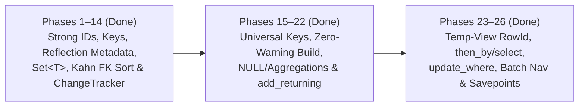
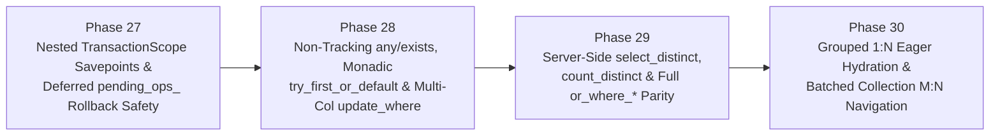

# CodeFirstCppDB_sqlgen — Architecture, Audit & Next-Gen Roadmap

> **Document Version:** 10.0 (Post-Phase-26 Full Code, Architecture & SQLite Audit + Phases 27–30 Specification)  
> **Date:** 2026-11-15  
> **Active Branch:** `main` (at commit `1debbd4` / `a51208b`)  
> **Toolchain Baseline:** GCC 16.1+ (`-std=c++26 -freflection`), CMake 4.4+, Ninja, SQLite 3  
> **Status:** Phases 1–26 Completed & Verified (64/64 GoogleTests passing across 26 suites in ~28 ms, zero compiler warnings)

---

## Table of Contents

1. [Executive Summary & Vision](#1-executive-summary--vision)
2. [Quick Start & Developer Setup](#2-quick-start--developer-setup)
3. [Current Architecture & Library Stack (v10.0 — Phases 1–26 Complete)](#3-current-architecture--library-stack-v100--phases-126-complete)
   - [Directory Layout](#directory-layout)
   - [Layer Boundaries](#layer-boundaries)
   - [External Submodule Libraries Assessment](#external-submodule-libraries-assessment)
   - [End-to-End Developer Experience (Encapsulated & Zero-DTO POCO Modes)](#end-to-end-developer-experience-encapsulated--zero-dto-poco-modes)
   - [Core Technical Pillars](#core-technical-pillars)
4. [Completed Engineering Roadmap (Phases 1–26 Summary)](#4-completed-engineering-roadmap-phases-126-summary)
5. [Post-Phase-26 Deep Audit of Code, Architecture & SQLite Execution](#5-post-phase-26-deep-audit-of-code-architecture--sqlite-execution)
6. [Next-Generation Improvements Roadmap (Phases 27–30)](#6-next-generation-improvements-roadmap-phases-2730)
   - [Phase 27: Nested `TransactionScope` Savepoints, Deferred-Op Savepoint Flushing & Rollback Safety](#phase-27-nested-transactionscope-savepoints-deferred-op-savepoint-flushing--rollback-safety)
   - [Phase 28: Non-Tracking `any()` / `exists()`, Monadic `try_first_or_default()` & `try_any()`, and Variadic Multi-Column `update_where`](#phase-28-non-tracking-any--exists-monadic-try_first_or_default--try_any-and-variadic-multi-column-update_where)
   - [Phase 29: Server-Side `select_distinct`, `count_distinct`, & Full `or_where_*` Predicate Parity](#phase-29-server-side-select_distinct-count_distinct--full-or_where_-predicate-parity)
   - [Phase 30: Grouped 1:N Eager Hydration (`query_children_grouped`) & Batched Collection M:N Navigation (`query_many_to_many_batch`)](#phase-30-grouped-1n-eager-hydration-query_children_grouped--batched-collection-mn-navigation-query_many_to_many_batch)
7. [Architecture Comparison Matrix](#7-architecture-comparison-matrix)
8. [Appendix: Technical FAQ](#8-appendix-technical-faq)

---

## 1. Executive Summary & Vision

**CodeFirstCppDB_sqlgen** brings the **Code-First developer experience of C# and Entity Framework Core (EF Core)** to native C++26.

By combining **C++26 static reflection (`<meta>`)**, **C++23 deducing `this` & named modules (`import std;`)**, **C++20 concepts**, **monadic error handling (`std::expected`)**, and **`sqlgen`**, the library eliminates repetitive C++ data-access boilerplate at compile time—without external code generators, preprocessor macros, or runtime reflection overhead.

```text
┌────────────────────────────────────────────────────────────────────────┐
│                        C++26 Domain Entities                           │
│  (Encapsulated DDD classes OR Zero-DTO POCOs with Universal STL Keys)  │
└───────────────────────────────────┬────────────────────────────────────┘
                                    │
                       C++26 Static Reflection (std::meta)
                                    │
                                    ▼
┌────────────────────────────────────────────────────────────────────────┐
│               Compile-Time Relational Metadata Engine                  │
│   (SchemaTraits, EntityKey_t, ValidQueryColumn, Topological FK Graph)  │
└───────┬───────────────────────────┼────────────────────────────┬───────┘
        │                           │                            │
        ▼                           ▼                            ▼
┌──────────────────┐       ┌──────────────────┐       ┌──────────────────┐
│ ensure_created & │       │ MapperTraits     │       │ DbContextBase,   │
│ ensure_deleted   │       │ (Private Splice, │       │ Set<T>, DbQuery, │
│ (Kahn FK Order)  │       │  with_pk & POCO) │       │ Batch FK & UoW   │
└───────┬──────────┘       └────────┬─────────┘       └────────┬─────────┘
        │                           │                          │
        └───────────────────────────┼──────────────────────────┘
                                    ▼
┌────────────────────────────────────────────────────────────────────────┐
│              SQLiteConnection / DatabaseConnection (sqlgen)            │
│ (WHERE/BETWEEN/IN/NULL, ORDER BY/THEN BY, SELECT, AGGS, SAVEPOINT, WAL)│
└────────────────────────────────────────────────────────────────────────┘
```

---

## 2. Quick Start & Developer Setup

### Prerequisites (Arch Linux / EndeavourOS)

```bash
sudo pacman -S --needed base-devel cmake ninja gdb sqlite

g++ --version     # Requires GCC 16.1+ (-std=c++26 -freflection)
cmake --version   # Requires CMake 4.4+ (CMAKE_CXX_MODULE_STD)
```

### Build, Test & Run

```bash
# 1. Initialize submodules (sqlgen, reflect-cpp, googletest)
git submodule update --init --recursive

# 2. Configure & build (GCC Debug preset — zero compiler warnings)
cmake --preset gcc-debug
cmake --build build/linux/arch/gcc/debug

# 3. Run unit & integration test suite (64 tests across 26 test suites)
./build/linux/arch/gcc/debug/DAL/tests/test_DAL

# 4. Run the Startup application (creates & queries relationalDB.db)
./build/linux/arch/gcc/debug/Startup/Startup
./build/linux/arch/gcc/debug/Startup/Startup --no-reset
```

---

## 3. Current Architecture & Library Stack (v10.0 — Phases 1–26 Complete)

### Directory Layout

```text
CodeFirstCppDB_sqlgen/
├── CMakeLists.txt                  # Root CMake config (C++26, optional Postgres, import std)
├── CMakePresets.json               # Presets for gcc-debug, gcc-release
├── readme4.md                      # Master architectural specification & roadmap
│
├── Core/                           # Module: `core` (Pure Domain Layer — Zero DB deps)
│   ├── core.ixx                    # Primary module interface
│   ├── Id.ixx                      # Universal strong ID wrapper: Core::Id<Tag, ValueType>
│   ├── Key.ixx                     # SingleKey<K>, CompositeKey<K...>, Key concepts
│   ├── entities/                   # Sample encapsulated domain entities (immutable IDs)
│   │   ├── Person.ixx              # Key = SingleKey<PersonId>
│   │   ├── Something.ixx           # Key = SingleKey<SomethingId>
│   │   └── Person_Something.ixx    # Key = CompositeKey<PersonId, SomethingId>
│   └── repositories/               # Abstract contracts & structured error model
│       ├── DbError.ixx             # DbError, DbErrorCode & message classifier
│       ├── IGenericRepository.ixx  # IRepository<T> & IGenericRepository<T, KeyType>
│       ├── IPersonRepository.ixx
│       ├── ISomethingRepository.ixx
│       └── IPerson_SomethingRepository.ixx
│
├── DAL/                            # Module: `dal` (Data Access Layer)
│   ├── dal.ixx                     # Primary module interface
│   ├── context/                    # EF Core-style Gateway, Set, Query & Driver Adapter
│   │   ├── DbContext.ixx           # DbContextBase<Conn>, TransactionScope, Batch FK Nav, Savepoints
│   │   ├── DbSet.ixx               # DbSet<Domain> & composable server-side DbQuery (then_by, select, update_where)
│   │   └── SQLiteConnection.ixx    # SQL pushdown, aggregations, temp-view rowid, savepoint & WAL pragmas
│   ├── schema/                     # Relational DTOs & compile-time reflection metadata
│   │   ├── SchemaTraits.ixx        # Concepts, InferredKey_t, dto_equals, Kahn FK sort
│   │   ├── EntityMetadata.ixx      # Compile-time table/column/key reflection inspector
│   │   ├── PersonDTO.ixx
│   │   ├── SomethingDTO.ixx
│   │   └── Person_SomethingDTO.ixx
│   ├── mappers/
│   │   └── MapperTraits.ixx        # Domain <-> DTO splice mapper, with_primary_key, ValidQueryColumn
│   ├── repositories/
│   │   ├── GenericRepository.ixx   # Type-agnostic CRUD repository (Single & Composite keys)
│   │   ├── SQLitePersonRepo.ixx
│   │   ├── SQLiteSomethingRepo.ixx
│   │   └── SQLitePerson_SomethingRepo.ixx
│   └── tests/
│       └── test_DAL.cpp            # 64 GoogleTests across 26 suites
│
└── Startup/                        # Pure-Module Composition Root (Zero #includes)
    └── main.cpp                    # Defines AppDbContext, seeds via UoW, queries entities
```

### Layer Boundaries

| Layer | Module / Namespace | Responsibilities | Architectural Rules |
| :--- | :--- | :--- | :--- |
| **Core** | `core` (`Core::*`) | Domain entities, `Id<Tag, ValueType>`, `SingleKey`, `CompositeKey`, `DbError`, repository interfaces. | **Zero external dependencies.** No `sqlgen` or SQLite headers; immutable identities. |
| **DAL::Schema** | `dal` (`DAL::Schema::*`) | DTO structs, `SchemaOf<Domain>`, `EntityKey_t<Domain>`, `EntityMetadata<Domain>`, `col_of<Member>`, `dto_equals`, `kahn_topological_sort`, and FK navigation traits. | Constrained by `RelationalEntity<T>` (`SinglePrimaryKey` or `CompositePrimaryKey`). |
| **DAL::Mappers** | `dal` (`DAL::Mappers::*`) | `MapperTraits<Domain, DTO>` converting private domain fields <-> public DTO members, `with_primary_key`, POCO identity pass-through, and $O(M)$ case-insensitive `ValidQueryColumn` / `resolve_dto_member`. | Uses `std::meta::access_context::unchecked()` and `consteval` name matching; zero dependency on sample DTOs. |
| **DAL::Context** | `dal` (`DAL::*`) | `DbContextBase`, `TransactionScope`, `DbSet` (`Set<Domain>`), `DbQuery`, and `SQLiteConnection`. | Non-copyable/non-movable context; coordinates topological DDL, UoW, Zero-JSON `ChangeTracker`, batched FK navigation, SQL projections/aggregations, `add_returning`, and nested `SAVEPOINT` transactions. |
| **Startup** | Executable ([main.cpp](file:///home/d5/Developer09/CodeFirstCppDB_sqlgen/Startup/main.cpp)) | Defines `AppDbContext`, connects via `SQLiteConnection::connect`, and runs workflows. | **100% pure C++ modules** (`import std; import core; import dal;`) — no `#include`s or DTOs. |

### External Submodule Libraries Assessment

| Submodule / Library | Version / Role | How We Use It | Audit & Integration Notes |
| :--- | :--- | :--- | :--- |
| **`extern/sqlgen`** | `0.6.0` (SQL AST & Driver Layer) | Provides `sqlgen::sqlite::Connection`, `PrimaryKey`, `ForeignKey`, `Col`, `read`, `select_from`, `where`, `group_by`, `order_by`, `limit`, `offset`, `insert`, `insert_or_replace`, `update`, `delete_from`, `create_table`, `drop`, and `min`/`max`/`sum`/`avg`/`count`/`count_distinct`. | Isolated behind `DAL` global module fragments (`module; #include <sqlgen.hpp>`). PostgreSQL (`CODEFIRST_ENABLE_POSTGRES`), MySQL, and DuckDB are disabled by default so only SQLite3 is required. |
| **`extern/reflect-cpp`** | Transitive dependency of `sqlgen` | Supplies `rfl::Result`, `rfl::Ref`, `rfl::Tuple`, and `rfl::internal::StringLiteral` used inside `sqlgen`'s SQL transpiler. | **Not** used for JSON or domain reflection in our code; all `Core`/`DAL` introspection uses native ISO C++26 `<meta>`. |
| **`extern/googletest`** | Unit & Integration Testing | Runs 64 tests across 26 suites (`test_DAL`) covering mock connections and live `:memory:` SQLite databases in ~28 ms. | Linked privately only to `test_DAL`. |

### End-to-End Developer Experience (Encapsulated & Zero-DTO POCO Modes)

```cpp
import std;
import core;
import dal;

class AppDbContext : public DAL::DbContextBase<DAL::SQLiteConnection> {
public:
    Set<Core::Person> people{ this };
    Set<Core::Something> somethings{ this };
    Set<Core::Person_Something> personSomethings{ this };

    using DbContextBase::DbContextBase;
};

int main() {
    auto conn = DAL::SQLiteConnection::connect("relationalDB.db").value();
    conn->enable_wal_mode().value();
    AppDbContext db(conn);

    // 1. Topological FK DDL: drops children before parents, creates parents before children
    db.ensure_deleted().value();
    db.ensure_created().value();

    // 2. Batch insert and back-populate sequential auto-increment IDs via <meta>
    auto seeded = db.people.add_range_returning({
        Core::Person(Core::PersonId{ 0 }, "Ada", "Lovelace"),
        Core::Person(Core::PersonId{ 0 }, "Alan", "Turing")
    }).value();

    // 3. Multi-column sort + single-column server-side projection
    auto firstNames = db.people
        .where_between<"id">(1, 10)
        .order_by<"lastName">(false)
        .then_by<"firstName">(true)
        .select<"firstName">();

    // 4. Bulk server-side UPDATE ... WHERE
    db.somethings
        .where_equal<"category">("Electronics")
        .update_where<"category">("Hardware")
        .value();
}
```

### Core Technical Pillars

1. **Private-Member Splicing, Auto-Increment Back-Population & Case-Insensitive Column Resolution ([MapperTraits.ixx](file:///home/d5/Developer09/CodeFirstCppDB_sqlgen/DAL/mappers/MapperTraits.ixx)):**
   - Maps private domain fields (`camelCase_`) to/from DTO columns (`snake_case`) and splices database-generated primary keys back into encapsulated domain entities (`with_primary_key`) using `std::meta::access_context::unchecked()`.
   - Resolves `"FirstName"`, `"firstName"`, `"firstName_"`, and `"first_name"` to `PersonDTO::first_name` in $O(M)$ compile time via `ValidQueryColumn<Domain, DTO, ColLiteral>`.
2. **Universal STL & Strong-ID Keys ([Id.ixx](file:///home/d5/Developer09/CodeFirstCppDB_sqlgen/Core/Id.ixx), [Key.ixx](file:///home/d5/Developer09/CodeFirstCppDB_sqlgen/Core/Key.ixx), [SchemaTraits.ixx](file:///home/d5/Developer09/CodeFirstCppDB_sqlgen/DAL/schema/SchemaTraits.ixx)):**
   - `Core::Id<Tag, ValueType = std::int32_t>`, `SingleKey<K>`, `CompositeKey<K...>`, and `InferredKey_t<DTO>` support `std::int32_t`, `std::int64_t`, `std::string`, and heterogeneous composite keys.
3. **Compile-Time Topological Foreign-Key Sorting & Batched Relationship Navigation ([SchemaTraits.ixx](file:///home/d5/Developer09/CodeFirstCppDB_sqlgen/DAL/schema/SchemaTraits.ixx#L317-L508), [DbContext.ixx](file:///home/d5/Developer09/CodeFirstCppDB_sqlgen/DAL/context/DbContext.ixx#L111-L585)):**
   - `kahn_topological_sort` orders `ensure_created()` and `ensure_deleted()` at compile time (`consteval`).
   - `query_children`, `query_parent`, `query_children_batch`, `query_parents_batch`, and batched `query_many_to_many` navigate foreign-key relationships in $O(1)$ SQL queries.
4. **Composable Server-Side `DbQuery`, Projections, Bulk Updates, Savepoints & Zero-JSON `ChangeTracker` ([DbSet.ixx](file:///home/d5/Developer09/CodeFirstCppDB_sqlgen/DAL/context/DbSet.ixx), [SQLiteConnection.ixx](file:///home/d5/Developer09/CodeFirstCppDB_sqlgen/DAL/context/SQLiteConnection.ixx)):**
   - `DbQuery` composes `AND`/`OR`, `=`, `!=`, `<`, `<=`, `>`, `>=`, `BETWEEN`, `LIKE`, `NOT LIKE`, `IN`, `NOT IN`, `IS NULL`, `IS NOT NULL`, multi-column `order_by`/`then_by`, `LIMIT/OFFSET`, `.select<"col">()`, `.count()`, `.min()`, `.max()`, `.sum()`, `.avg()`, `.any()`, `.remove_where()`, and `.update_where()`.
   - `DbContextBase::transaction()` supports nested transactions via SQL `SAVEPOINT`s.

---

## 4. Completed Engineering Roadmap (Phases 1–26 Summary)



- [x] **Phases 1–14 — Core Foundations, Reflection Metadata, POCO Mode, Topological FK Sort, Zero-JSON `ChangeTracker`, Composable `DbQuery`, Upsert & FK Navigation (`01853df`).**
- [x] **Phases 15–18 — Universal STL Keys, Domain Column Resolution, Batched M:N `IN` Pushdown & Repository Cleanup (`dca5d38`).**
- [x] **Phases 19–22 — Build Hardening, ORM Engine Decoupling, Case-Insensitive Columns, `NULL`/Negative Predicates, SQL Aggregations & `add_returning` (`88c46ac`).**
- [x] **Phase 23 — Read-Only Temp-View `try_last_insert_rowid()`, `add_range_returning()`, & $O(M)$ Column Resolution (`a51208b`):** Replaced the 4-statement mutating temp-table in `try_last_insert_rowid()` with a lazy one-time `TEMP VIEW`, added transactional `add_range_returning()`, and simplified `resolve_dto_member()` to $O(M)$.
- [x] **Phase 24 — Multi-Column Sorting (`then_by`), Server-Side Column Projections (`select`), & `where_between` / `where_not_in_vec` (`a51208b`):** Added variadic `AppendOrderByVariant` and `.then_by<ColLiteral>(desc)`, `.select<ColLiteral>()` / `.try_select<ColLiteral>()`, `.where_between`, and `.where_not_in_vec`.
- [x] **Phase 25 — Server-Side Bulk `update_where` & Batched 1:N / N:1 Relationship Loading (`a51208b`):** Added `DbQuery::update_where<ColLiteral>(new_val)` with `ChangeTracker` eviction, plus `query_children_batch` and `query_parents_batch` on `DbContextBase`.
- [x] **Phase 26 — Nested Transactions via SQL `SAVEPOINT`s & SQLite Concurrency Pragmas (`a51208b`):** Added `savepoint`, `release_savepoint`, `rollback_to_savepoint`, `set_busy_timeout`, and `enable_wal_mode` on `SQLiteConnection`, and automatic savepoint nesting in `DbContextBase::transaction()`.

---

## 5. Post-Phase-26 Deep Audit of Code, Architecture & SQLite Execution

A comprehensive audit of `main` at commit `1debbd4` (`a51208b`) verified that all **64 GoogleTests across 26 test suites** pass in ~28 ms with zero compiler warnings. Reviewing the new Phase 23–26 implementations and their interactions with `TransactionScope`, `ChangeTracker`, and `DbQuery` surfaced four high-value areas for the next wave of improvements:

1. **Nested `TransactionScope` Still Calls `begin_transaction()` & Deferred `pending_ops_` Leak on Nested Savepoint Rollback ([DbContext.ixx:738-783, 846-917](file:///home/d5/Developer09/CodeFirstCppDB_sqlgen/DAL/context/DbContext.ixx#L738-L917)):**
   - In Phase 26, `DbContextBase::transaction(Fn&& fn)` was upgraded to use a `SAVEPOINT` when `in_transaction()` is already `true`. However, RAII `TransactionScope` ([DbContext.ixx:849-853](file:///home/d5/Developer09/CodeFirstCppDB_sqlgen/DAL/context/DbContext.ixx#L849-L853)) still unconditionally calls `ctx_->begin_transaction()`, so constructing a nested `TransactionScope` inside an active transaction or outer `TransactionScope` fails with `"Transaction is already active"`.
   - Furthermore, inside `DbContextBase::transaction(Fn&& fn)`'s nested savepoint branch ([DbContext.ixx:738-783](file:///home/d5/Developer09/CodeFirstCppDB_sqlgen/DAL/context/DbContext.ixx#L738-L783)), if `db.defer_changes(true)` is active and the inner callback stages operations into `pending_ops_` and then fails, `conn_->rollback_to_savepoint(sp_name)` rolls back SQLite, **but the inner operations remain in `pending_ops_`** and will be erroneously executed when the outer transaction commits! Conversely, if the inner callback succeeds while `defer_changes(true)` is active, its staged operations in `pending_ops_` should be flushed *before* `release_savepoint(sp_name)` so any constraint failure inside the inner block is caught and rolled back to the savepoint.

2. **`DbQuery::any()` Pollutes `ChangeTracker`, Missing `try_first_or_default()` / `try_any()`, & Single-Column Limitation in `update_where` ([DbSet.ixx:408-416, 614-618, 665-685](file:///home/d5/Developer09/CodeFirstCppDB_sqlgen/DAL/context/DbSet.ixx#L614-L685)):**
   - Look at `DbQuery::any()` ([DbSet.ixx:614-618](file:///home/d5/Developer09/CodeFirstCppDB_sqlgen/DAL/context/DbSet.ixx#L614-L618)):
     ```cpp
     [[nodiscard]] bool any() const {
         auto res = limit(1).try_to_vector();
         return res.has_value() && !res.value().empty();
     }
     ```
     Because `try_to_vector()` invokes `track_fn_(entity)` ([DbSet.ixx:384-387](file:///home/d5/Developer09/CodeFirstCppDB_sqlgen/DAL/context/DbSet.ixx#L384-L387)), calling `db.people.where_equal<...>().any()` when `enable_change_tracking(true)` is active **deserializes a full entity and silently inserts a snapshot into `ChangeTracker`**! Similarly, `SQLiteConnection::exists` and `exists_by_composite_id` ([SQLiteConnection.ixx:440-450](file:///home/d5/Developer09/CodeFirstCppDB_sqlgen/DAL/context/SQLiteConnection.ixx#L440-L450)) deserialize a full `DTO` instead of running `try_count_where<DTO>(...)` (`SELECT COUNT(*)`).
   - `DbQuery` and `DbSet` also lack monadic `try_first_or_default()` and `try_any()` terminals.
   - In [DbSet.ixx:665-685](file:///home/d5/Developer09/CodeFirstCppDB_sqlgen/DAL/context/DbSet.ixx#L665-L685), `update_where<ColLiteral>(new_val)` only accepts a single column, whereas `sqlgen::update<DTO>(sets...)` in [update.hpp:58-63](file:///home/d5/Developer09/CodeFirstCppDB_sqlgen/extern/sqlgen/include/sqlgen/update.hpp#L58-L63) is variadic and supports updating multiple columns in one atomic `UPDATE` statement (`update_where<"col1", "col2">(val1, val2)`).

3. **Unexposed `SELECT DISTINCT` / `COUNT(DISTINCT col)` & Incomplete `or_where_*` Predicates ([DbSet.ixx:165-299](file:///home/d5/Developer09/CodeFirstCppDB_sqlgen/DAL/context/DbSet.ixx#L165-L299), [aggregations.hpp:34-39](file:///home/d5/Developer09/CodeFirstCppDB_sqlgen/extern/sqlgen/include/sqlgen/aggregations.hpp#L34-L39)):**
   - `sqlgen` provides `sqlgen::count_distinct(col)` (`SELECT COUNT(DISTINCT "col")`) and `sqlgen::group_by(col)` (`SELECT "col" FROM ... GROUP BY "col"`), which allow computing distinct column counts (`count_distinct<"col">()`) and distinct column values (`select_distinct<"col">()`) server-side in SQLite.
   - While `DbQuery` has 15 `where_*` predicate methods, it only has a single `or_where_equal` method—missing `or_where_not_equal`, `or_where_lt`, `or_where_le`, `or_where_gt`, `or_where_ge`, `or_where_like`, `or_where_not_like`, `or_where_in`, `or_where_null`, `or_where_not_null`, and `or_where_between`.

4. **Flat Return in `query_children_batch` & Single-Source Limitation in `query_many_to_many` ([DbContext.ixx:472-585](file:///home/d5/Developer09/CodeFirstCppDB_sqlgen/DAL/context/DbContext.ixx#L472-L585)):**
   - `query_children_batch<ChildDomain>(parents)` returns a flat `std::vector<ChildDomain>`, requiring callers to manually extract foreign keys to associate children back with their parent. Adding `query_children_grouped<ChildDomain>(parents)` (`std::expected<std::vector<std::pair<ParentDomain, std::vector<ChildDomain>>>, Core::DbError>`) hydrates parent-child graphs in 1 query with $O(N + M)$ grouping.
   - Adding `query_many_to_many_batch<TargetDomain, JunctionDomain>(sources)` extends batched M:N navigation to a collection of source entities in just **2 SQL `IN` queries**.

---

## 6. Next-Generation Improvements Roadmap (Phases 27–30)



---

### Phase 27: Nested `TransactionScope` Savepoints, Deferred-Op Savepoint Flushing & Rollback Safety

#### Objective
Make RAII `TransactionScope` support nested `SAVEPOINT`s automatically when a transaction is already active, and ensure deferred Unit-of-Work operations (`pending_ops_`) staged inside a nested transaction or savepoint are flushed before savepoint release and truncated on savepoint rollback.

#### Detailed Tasks

- [x] **Task 27.1: Savepoint-Aware `pending_ops_` Flushing & Truncation in `DbContextBase` (`DAL/context/DbContext.ixx`)**
  - Add a helper `flush_pending_since(std::size_t start_idx)` on `DbContextBase` that executes `pending_ops_[i]` for `i` in `[start_idx, pending_ops_.size())` and erases the executed range (or, on error, truncates `pending_ops_.resize(start_idx)` and returns the `DbError`).
  - In the nested savepoint branch of `DbContextBase::transaction(Fn&& fn)` ([DAL/context/DbContext.ixx:738-783](file:///home/d5/Developer09/CodeFirstCppDB_sqlgen/DAL/context/DbContext.ixx#L738-L783)):
    - Record `const std::size_t saved_pending_size = pending_ops_.size();` before invoking `fn()`.
    - If `fn()` returns an error or throws, call `pending_ops_.resize(saved_pending_size)` in addition to `conn_->rollback_to_savepoint(sp_name)`.
    - If `fn()` succeeds and `pending_ops_.size() > saved_pending_size`, call `flush_pending_since(saved_pending_size)` *before* `conn_->release_savepoint(sp_name)` (rolling back to `sp_name` if flushing fails!).

- [x] **Task 27.2: Upgrade `TransactionScope` to Support Nested Savepoints (`DAL/context/DbContext.ixx`)**
  - Add `acquire_savepoint()` -> `std::expected<std::string, Core::DbError>` on `DbContextBase` (incrementing `savepoint_depth_` and calling `savepoint(sp_name)`).
  - In `TransactionScope` ([DAL/context/DbContext.ixx:846-917](file:///home/d5/Developer09/CodeFirstCppDB_sqlgen/DAL/context/DbContext.ixx#L846-L917)):
    - Record `saved_pending_size_ = ctx_->pending_changes_count();`.
    - If `ctx_->in_transaction()` is already `true` when `TransactionScope` is constructed (and savepoints are supported), set `is_savepoint_ = true;` and acquire a savepoint `savepoint_name_` instead of calling `ctx_->begin_transaction()`.
    - On `commit()`: if `is_savepoint_`, flush pending ops added since `saved_pending_size_` and call `ctx_->release_savepoint(savepoint_name_)`.
    - On `rollback()` and `~TransactionScope()`: if `is_savepoint_`, truncate pending ops to `saved_pending_size_` and call `ctx_->rollback_to_savepoint(savepoint_name_)` while keeping the outer transaction active!

- [x] **Task 27.3: Phase 27 Verification Tests (`DAL/tests/test_DAL.cpp`)**
  - Test nested `DAL::TransactionScope` inside an outer `DAL::TransactionScope` (both inner rollback and inner commit).
  - Test `db.defer_changes(true)` with nested `db.transaction(...)` where the inner transaction stages an operation and fails, verifying the aborted staged operation is not executed when the outer transaction commits.

---

### Phase 28: Non-Tracking `any()` / `exists()`, Monadic `try_first_or_default()` & `try_any()`, and Variadic Multi-Column `update_where`

#### Objective
Prevent `DbQuery::any()` from polluting `ChangeTracker`, optimize `SQLiteConnection::exists` to use `COUNT(*)`, add monadic `try_first_or_default()` and `try_any()` terminals, and upgrade `update_where` to support variadic multi-column updates in a single SQL `UPDATE` statement.

#### Detailed Tasks

- [x] **Task 28.1: Non-Tracking `try_any()` / `any()`, `try_first_or_default()`, & `COUNT(*)` `exists()` (`SQLiteConnection.ixx` & `DbSet.ixx`)**
  - In [DAL/context/SQLiteConnection.ixx:440-450](file:///home/d5/Developer09/CodeFirstCppDB_sqlgen/DAL/context/SQLiteConnection.ixx#L440-L450), update `exists<DTO>(id)` and `exists_by_composite_id<DTO>(parts...)` to use `try_count_where<DTO>(DAL::Schema::make_pk_where<DTO>(id))` / `make_composite_where<DTO>(parts...)` (`res.has_value() && *res > 0`).
  - In `DbQuery` ([DAL/context/DbSet.ixx](file:///home/d5/Developer09/CodeFirstCppDB_sqlgen/DAL/context/DbSet.ixx)):
    - Add `[[nodiscard]] std::expected<std::optional<Domain>, Core::DbError> try_first_or_default() const` (calling `limit(1).try_to_vector()`).
    - Add `[[nodiscard]] std::expected<bool, Core::DbError> try_any() const` which calls `try_count()` when `!limit_.has_value() && !offset_.has_value()` (or executes `limit(1).execute_query(*conn_)` directly on DTOs without invoking `track_fn_`), and update `any()` to return `try_any().value_or(false)`.
  - Expose `first_or_default()`, `try_first_or_default()`, `any()`, and `try_any()` directly on `DbSet`.

- [x] **Task 28.2: Variadic Multi-Column `update_where<ColLiterals...>(new_vals...)` (`SQLiteConnection.ixx` & `DbSet.ixx`)**
  - In [DAL/context/SQLiteConnection.ixx:642-658](file:///home/d5/Developer09/CodeFirstCppDB_sqlgen/DAL/context/SQLiteConnection.ixx#L642-L658), add a variadic overload:
    ```cpp
    template<typename DTO, typename Condition, typename... SetExprs>
        requires (sizeof...(SetExprs) >= 2)
    std::expected<void, Core::DbError> update_where_many(const Condition& cond, const SetExprs&... set_exprs)
    {
        if (!is_open())
        {
            return std::unexpected<Core::DbError>{
                Core::DbError::connection_error("Database connection is closed")
            };
        }
        auto query = sqlgen::update<DTO>(set_exprs...) | sqlgen::where(cond);
        auto res = query(conn_);
        if (!res)
        {
            return std::unexpected<Core::DbError>{ Core::DbError::map_from_message(res.error().what()) };
        }
        return {};
    }
    ```
  - In `DbQuery` ([DAL/context/DbSet.ixx:665-685](file:///home/d5/Developer09/CodeFirstCppDB_sqlgen/DAL/context/DbSet.ixx#L665-L685)), generalize `update_where` to accept 1 or more column literals and values:
    ```cpp
    template<rfl::internal::StringLiteral... ColLiterals, typename... Vals>
        requires (sizeof...(ColLiterals) >= 1)
              && (sizeof...(ColLiterals) == sizeof...(Vals))
              && (!std::same_as<WhereCondT, rfl::Nothing>)
              && (DAL::Mappers::ValidQueryColumn<Domain, DTO, ColLiterals> && ...)
    std::expected<void, Core::DbError> update_where(const Vals&... new_vals) const
    ```

- [x] **Task 28.3: Phase 28 Verification Tests (`DAL/tests/test_DAL.cpp`)**
  - Verify calling `db.books.where_equal<"genre">("SciFi").any()` while `db.enable_change_tracking(true)` is active leaves `db.tracked_entities_count() == 0`.
  - Verify `try_first_or_default()`, `try_any()`, and multi-column `update_where<"genre", "title">("Classic", "Updated Title")`.

---

### Phase 29: Server-Side `select_distinct`, `count_distinct`, & Full `or_where_*` Predicate Parity

#### Objective
Expose server-side `COUNT(DISTINCT col)` and `SELECT col ... GROUP BY col` (`select_distinct`) on `DbQuery` and `DbSet`, and add complete `or_where_*` counterparts for all query predicates.

#### Detailed Tasks

- [x] **Task 29.1: Server-Side `try_count_distinct<ColLiteral>()` & `count_distinct<ColLiteral>()` (`DbSet.ixx`)**
  - In `DbQuery` and `DbSet` ([DAL/context/DbSet.ixx](file:///home/d5/Developer09/CodeFirstCppDB_sqlgen/DAL/context/DbSet.ixx)), add:
    - `try_count_distinct<ColLiteral>()` -> `std::expected<std::size_t, Core::DbError>` using `try_aggregate_impl<std::size_t>(sqlgen::count_distinct(Schema::col_of<dto_m>))` (unwrapping the `std::optional<std::size_t>` to `0` if empty).
    - `count_distinct<ColLiteral>()` -> `std::size_t` returning `try_count_distinct<ColLiteral>().value_or(0)`.

- [x] **Task 29.2: Server-Side `try_select_distinct<ColLiteral>()` & `select_distinct<ColLiteral>()` (`DbSet.ixx`)**
  - In `DbQuery` and `DbSet`, add `try_select_distinct<ColLiteral>()` and `select_distinct<ColLiteral>()`:
    - Builds `sqlgen::select_from<DTO>(Schema::col_of<dto_m> | sqlgen::as<"val">)` (with optional `| sqlgen::where(where_cond_)`) piped into `| sqlgen::group_by(Schema::col_of<dto_m>)` and `execute_projection<ProjRow>(*conn_, ...)` so SQLite returns only distinct column values directly from the database engine.

- [x] **Task 29.3: Full `or_where_*` Predicate Parity on `DbQuery` (`DAL/context/DbSet.ixx`)**
  - Alongside `or_where_equal`, add on `DbQuery`:
    - `or_where_not_equal<ColLiteral>(val)`
    - `or_where_lt<ColLiteral>(val)`, `or_where_le<ColLiteral>(val)`, `or_where_gt<ColLiteral>(val)`, `or_where_ge<ColLiteral>(val)`
    - `or_where_between<ColLiteral>(low, high)`
    - `or_where_like<ColLiteral>(pattern)`, `or_where_not_like<ColLiteral>(pattern)`
    - `or_where_in<ColLiteral>(vals...)`, `or_where_in_vec<ColLiteral>(vec)`, `or_where_not_in<ColLiteral>(vals...)`, `or_where_not_in_vec<ColLiteral>(vec)`
    - `or_where_null<ColLiteral>()`, `or_where_not_null<ColLiteral>()`

- [x] **Task 29.4: Phase 29 Verification Tests (`DAL/tests/test_DAL.cpp`)**
  - Test `count_distinct<"lastName">()` and `select_distinct<"lastName">()` on a table with duplicate last names.
  - Test chained `where_equal<"lastName">("Smith").or_where_like<"firstName">("B%").or_where_between<"id">(10, 20)`.

---

### Phase 30: Grouped 1:N Eager Hydration (`query_children_grouped`) & Batched Collection M:N Navigation (`query_many_to_many_batch`)

#### Objective
Provide one-call grouped 1:N hydration (`query_children_grouped`) that pairs each parent entity with its vector of children in a single SQL query, and batched M:N navigation (`query_many_to_many_batch`) across a collection of source entities in 2 SQL queries.

#### Detailed Tasks

- [x] **Task 30.1: Add `query_children_grouped<ChildDomain>(parents)` to `DbContextBase` (`DAL/context/DbContext.ixx`)**
  - In [DAL/context/DbContext.ixx](file:///home/d5/Developer09/CodeFirstCppDB_sqlgen/DAL/context/DbContext.ixx), add:
    ```cpp
    template<typename ChildDomain, typename ParentDomain, typename Self>
    [[nodiscard]] std::expected<std::vector<std::pair<ParentDomain, std::vector<ChildDomain>>>, Core::DbError>
    query_children_grouped(this Self&& self, const std::vector<ParentDomain>& parents)
    ```
  - Calls `self.template query_children_batch<ChildDomain>(parents)` to fetch all children in **1 SQL query**, buckets the children into a map keyed by their parent FK value (`Schema::extract_fk_value<ChildDTO, ParentDTO>`), and returns a `std::vector<std::pair<ParentDomain, std::vector<ChildDomain>>>` preserving the exact order of `parents` (including parents with 0 children).

- [x] **Task 30.2: Add `query_many_to_many_batch<TargetDomain, JunctionDomain>(sources)` to `DbContextBase` (`DAL/context/DbContext.ixx`)**
  - In [DAL/context/DbContext.ixx](file:///home/d5/Developer09/CodeFirstCppDB_sqlgen/DAL/context/DbContext.ixx), add:
    ```cpp
    template<typename TargetDomain, typename JunctionDomain, typename SourceDomain, typename Self>
    [[nodiscard]] std::expected<std::vector<TargetDomain>, Core::DbError>
    query_many_to_many_batch(this Self&& self, const std::vector<SourceDomain>& sources)
    ```
  - Calls `self.template query_children_batch<JunctionDomain>(sources)` (Query 1), extracts all `target_fks` from the junction rows, and queries `target_set.where_sql(Schema::col_of<pk_m>.in(target_fks)).try_to_vector()` (Query 2).

- [x] **Task 30.3: Phase 30 Verification Tests (`DAL/tests/test_DAL.cpp`)**
  - Test `db.query_children_grouped<Phase25Book>(authors)` with multiple authors (including an author with 0 books) and verify each author is paired with its exact books.
  - Test `db.query_many_to_many_batch<Core::Something, Core::Person_Something>(people)` across multiple `Core::Person` entities.

---

## 7. Architecture Comparison Matrix

| Feature / Aspect | Early v3 Baseline | Current `main` (v10.0 — Phases 1–26) | Next-Gen Target (Phases 27–30) | C# Entity Framework Core |
| :--- | :--- | :--- | :--- | :--- |
| **Primary Key & Auto-Incr** | `int32_t` only (mutable) | Universal STL/Strong IDs + `add_returning` / `add_range_returning` | Full identity & batch returning support | `ValueGeneratedOnAdd` |
| **Sorting & Projections** | Raw `sqlgen::read` | Multi-column `order_by` / `then_by` & `.select<"col">()` | + `select_distinct<"col">()` & `count_distinct<"col">()` | `.OrderBy().ThenBy().Select().Distinct()` |
| **SQL Predicates & Bulk Ops** | None | `where_*`, `BETWEEN`, `NULL`, `MIN/MAX/SUM/AVG`, 1-col `update_where` | + Variadic multi-column `update_where`, non-tracking `any()`, & full `or_where_*` | `.ExecuteDelete()` / `.ExecuteUpdate()` |
| **Relationships** | Manual ID lookups | `query_children_batch`, `query_parents_batch`, 1-source M:N | + Grouped 1:N `query_children_grouped` & collection `query_many_to_many_batch` | `.Include()` / `.ThenInclude()` |
| **Transactions** | None | `db.transaction()` with `SAVEPOINT`s & flat `TransactionScope` | + Nested `TransactionScope` `SAVEPOINT`s & deferred `pending_ops_` rollback safety | `IDbContextTransaction.CreateSavepoint` |

---

## 8. Appendix: Technical FAQ

1. **Why is GCC 16.1+ required instead of Clang?**
   - GCC 16.1+ implements ISO C++26 static reflection (`P2996`) via `-std=c++26 -freflection` and `<meta>`. Standard Clang releases do not yet support `<meta>`.
2. **Why is `extern/reflect-cpp` still needed if our code uses C++26 `<meta>`?**
   - Our `Core` and `DAL` modules use C++26 `<meta>` for entity/schema introspection, private member splicing, DTO equality, and topological FK sorting, while `sqlgen` uses `reflect-cpp` (`rfl::Result`, `rfl::Ref`, `rfl::internal::StringLiteral`) for its internal SQL transpiler.
3. **Why use a `TEMP VIEW` instead of a `TEMP TABLE` for `try_last_insert_rowid()`?**
   - Inserting `last_insert_rowid()` into a temporary table executes a SQL `INSERT`, which causes SQLite to overwrite `last_insert_rowid()` with the new row's `rowid` (`1`) in the temporary table. Defining `CREATE TEMP VIEW IF NOT EXISTS _codefirst_last_rowid AS SELECT last_insert_rowid() AS id;` allows `sqlgen::dynamic::SelectFrom` to read `last_insert_rowid()` in a single read-only `SELECT` without ever mutating connection state.
4. **How do `db.ensure_created()` and `db.ensure_deleted()` handle foreign-key table ordering?**
   - They use C++23 **deducing `this`** (`this Self&& self`) to reflect all `Set<T>` members on the derived `DbContext`, extract each DTO's `sqlgen::ForeignKey` targets, and run a `consteval` Kahn topological sort (`kahn_topological_sort`) so parent tables are always created first and dropped last.
