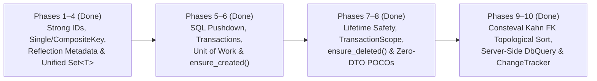
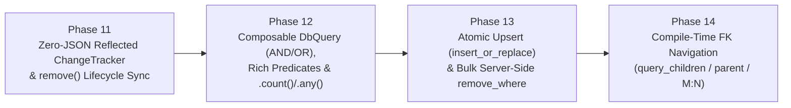

# CodeFirstCppDB_sqlgen — Architecture, Audit & Next-Gen Roadmap

> **Document Version:** 6.0 (Post-Phase-10 Audit, Consolidated Summary & Phases 11–14 Specification)  
> **Date:** 2026-11-14  
> **Active Branch:** `main` (at commit `29cfa92`)  
> **Toolchain Baseline:** GCC 16.1+ (`-std=c++26 -freflection`), CMake 4.4+, Ninja, SQLite 3  
> **Status:** Phases 1–10 Completed & Verified (48/48 GoogleTests passing across 11 suites in ~21 ms)

---

## Table of Contents

1. [Executive Summary & Vision](#1-executive-summary--vision)
2. [Quick Start & Developer Setup](#2-quick-start--developer-setup)
3. [Current Architecture (v6.0 — Phases 1–10 Complete)](#3-current-architecture-v60--phases-110-complete)
   - [Directory Layout](#directory-layout)
   - [Layer Boundaries](#layer-boundaries)
   - [End-to-End Developer Experience (Encapsulated & Zero-DTO POCO Modes)](#end-to-end-developer-experience-encapsulated--zero-dto-poco-modes)
   - [Core Technical Pillars](#core-technical-pillars)
4. [Completed Engineering Roadmap (Phases 1–10 Summary)](#4-completed-engineering-roadmap-phases-110-summary)
5. [Post-Phase-10 Code Audit & Verification Findings](#5-post-phase-10-code-audit--verification-findings)
6. [Next-Generation Improvements Roadmap (Phases 11–14)](#6-next-generation-improvements-roadmap-phases-1114)
   - [Phase 11: Native C++26 Reflection `ChangeTracker` (Zero-JSON) & Lifecycle Sync](#phase-11-native-c26-reflection-changetracker-zero-json--lifecycle-sync)
   - [Phase 12: Composable `DbQuery` Chaining, Rich Predicates & Server-Side Aggregations](#phase-12-composable-dbquery-chaining-rich-predicates--server-side-aggregations)
   - [Phase 13: Atomic Upsert (`upsert` / `upsert_range`) & Bulk Server-Side `remove_where`](#phase-13-atomic-upsert-upsert--upsert_range--bulk-server-side-remove_where)
   - [Phase 14: Compile-Time Foreign-Key Relationship Navigation (`query_children`, `query_parent`, `query_many_to_many`)](#phase-14-compile-time-foreign-key-relationship-navigation-query_children-query_parent-query_many_to_many)
7. [Architecture Comparison Matrix](#7-architecture-comparison-matrix)
8. [Appendix: Technical FAQ](#8-appendix-technical-faq)

---

## 1. Executive Summary & Vision

**CodeFirstCppDB_sqlgen** brings the **Code-First developer experience of C# and Entity Framework Core (EF Core)** to native C++26.

By combining **C++26 static reflection (`<meta>`)**, **C++23 deducing `this` & named modules (`import std;`)**, **C++20 concepts**, **monadic error handling (`std::expected`)**, and **`sqlgen`**, the library eliminates repetitive C++ data-access boilerplate at compile time—without external code generators, preprocessor macros, or runtime reflection overhead.

```text
┌────────────────────────────────────────────────────────────────────────┐
│                        C++26 Domain Entities                           │
│   (Encapsulated DDD classes OR Zero-DTO POCOs with auto-inferred Key)  │
└───────────────────────────────────┬────────────────────────────────────┘
                                    │
                       C++26 Static Reflection (std::meta)
                                    │
                                    ▼
┌────────────────────────────────────────────────────────────────────────┐
│               Compile-Time Relational Metadata Engine                  │
│   (SchemaTraits, EntityKey_t, EntityMetadata, Topological FK Graph)    │
└───────┬───────────────────────────┼────────────────────────────┬───────┘
        │                           │                            │
        ▼                           ▼                            ▼
┌──────────────────┐       ┌──────────────────┐       ┌──────────────────┐
│ ensure_created & │       │ MapperTraits     │       │ DbContextBase,   │
│ ensure_deleted   │       │ (Private Splice  │       │ Set<T>, DbQuery  │
│ (Kahn FK Order)  │       │  & POCO Identity)│       │ & ChangeTracker  │
└───────┬──────────┘       └────────┬─────────┘       └────────┬─────────┘
        │                           │                          │
        └───────────────────────────┼──────────────────────────┘
                                    ▼
┌────────────────────────────────────────────────────────────────────────┐
│              SQLiteConnection / DatabaseConnection (sqlgen)            │
│    (Server-side WHERE, ORDER BY, LIMIT/OFFSET, COUNT, UPDATE, TX)      │
└────────────────────────────────────────────────────────────────────────┘
```

---

## 2. Quick Start & Developer Setup

### Prerequisites (Arch Linux / EndeavourOS)

```bash
sudo pacman -S --needed base-devel cmake ninja gdb sqlite postgresql-libs mariadb-libs

g++ --version     # Requires GCC 16.1+ (-std=c++26 -freflection)
cmake --version   # Requires CMake 4.4+ (CMAKE_CXX_MODULE_STD)
```

### Build, Test & Run

```bash
# 1. Initialize submodules (sqlgen, reflect-cpp, googletest)
git submodule update --init --recursive

# 2. Configure & build (GCC Debug preset)
cmake --preset gcc-debug
cmake --build build/linux/arch/gcc/debug

# 3. Run unit & integration test suite (48 tests across 11 test suites)
./build/linux/arch/gcc/debug/DAL/tests/test_DAL

# 4. Run the Startup application (creates & queries relationalDB.db)
./build/linux/arch/gcc/debug/Startup/Startup
./build/linux/arch/gcc/debug/Startup/Startup --no-reset
```

---

## 3. Current Architecture (v6.0 — Phases 1–10 Complete)

### Directory Layout

```text
CodeFirstCppDB_sqlgen/
├── CMakeLists.txt                  # Root CMake config (C++26, -freflection, import std)
├── CMakePresets.json               # Presets for gcc-debug, gcc-release
├── readme4.md                      # Master architectural specification & roadmap
│
├── Core/                           # Module: `core` (Pure Domain Layer — Zero DB deps)
│   ├── core.ixx                    # Primary module interface
│   ├── Id.ixx                      # Strong ID wrapper: Core::Id<Tag>
│   ├── Key.ixx                     # SingleKey<K>, CompositeKey<K...>, Key concepts
│   ├── entities/                   # Encapsulated domain entities (immutable IDs)
│   │   ├── Person.ixx              # Key = SingleKey<PersonId>
│   │   ├── Something.ixx           # Key = SingleKey<SomethingId>
│   │   └── Person_Something.ixx    # Key = CompositeKey<PersonId, SomethingId>
│   └── repositories/               # Abstract contracts & structured error model
│       ├── DbError.ixx             # DbError, DbErrorCode & message classifier
│       ├── IGenericRepository.ixx  # IRepository<T> & IGenericRepository<T, KeyType>
│       ├── IPersonRepository.ixx
│       ├── ISomethingRepository.ixx
│       └── IPerson_SomethingRepository.ixx
│
├── DAL/                            # Module: `dal` (Data Access Layer)
│   ├── dal.ixx                     # Primary module interface
│   ├── context/                    # EF Core-style Gateway, Set, Query & Driver Adapter
│   │   ├── DbContext.ixx           # DbContextBase<Conn>, TransactionScope, ChangeTracker
│   │   ├── DbSet.ixx               # DbSet<Domain> & fluent server-side DbQuery
│   │   └── SQLiteConnection.ixx    # SQL pushdown, lifecycle & transaction adapter
│   ├── schema/                     # Relational DTOs & compile-time reflection metadata
│   │   ├── SchemaTraits.ixx        # Concepts, InferredKey_t, col_of, Kahn FK sort
│   │   ├── EntityMetadata.ixx      # Compile-time table/column/key reflection inspector
│   │   ├── PersonDTO.ixx
│   │   ├── SomethingDTO.ixx
│   │   └── Person_SomethingDTO.ixx
│   ├── mappers/
│   │   └── MapperTraits.ixx        # Bidirectional Domain <-> DTO + POCO identity fast-path
│   ├── repositories/
│   │   ├── GenericRepository.ixx
│   │   ├── SQLitePersonRepo.ixx
│   │   ├── SQLiteSomethingRepo.ixx
│   │   └── SQLitePerson_SomethingRepo.ixx
│   └── tests/
│       └── test_DAL.cpp            # 48 GoogleTests across 11 suites
│
└── Startup/                        # Pure-Module Composition Root (Zero #includes)
    └── main.cpp                    # Defines AppDbContext, seeds via UoW, queries entities
```

### Layer Boundaries

| Layer | Module / Namespace | Responsibilities | Architectural Rules |
| :--- | :--- | :--- | :--- |
| **Core** | `core` (`Core::*`) | Domain entities, `Id<Tag>`, `SingleKey`, `CompositeKey`, `DbError`, repository interfaces. | **Zero external dependencies.** No `sqlgen` or SQLite headers; immutable identities. |
| **DAL::Schema** | `dal` (`DAL::Schema::*`) | DTO structs, `SchemaOf<Domain>`, `EntityKey_t<Domain>`, `EntityMetadata<Domain>`, `col_of<Member>`, and `kahn_topological_sort`. | Constrained by `RelationalEntity<T>` (`SinglePrimaryKey` or `CompositePrimaryKey`). |
| **DAL::Mappers** | `dal` (`DAL::Mappers::*`) | `MapperTraits<Domain, DTO>` converting private domain fields <-> public DTO members, or zero-overhead identity pass-through for POCOs. | Uses `std::meta::access_context::unchecked()` and `consteval` name matching. |
| **DAL::Context** | `dal` (`DAL::*`) | `DbContextBase`, `TransactionScope`, `DbSet` (`Set<Domain>`), `DbQuery`, and `SQLiteConnection`. | Non-copyable/non-movable context; coordinates topological DDL, UoW, `ChangeTracker`, and SQL pushdown. |
| **Startup** | Executable ([main.cpp](file:///home/d5/Developer09/CodeFirstCppDB_sqlgen/Startup/main.cpp)) | Defines `AppDbContext`, connects via `SQLiteConnection::connect`, and runs workflows. | **100% pure C++ modules** (`import std; import core; import dal;`) — no `#include`s or DTOs. |

### End-to-End Developer Experience (Encapsulated & Zero-DTO POCO Modes)

**CodeFirstCppDB_sqlgen** supports two ergonomic Code-First styles out of the box:

#### Style A: Clean Architecture (Encapsulated Domain Classes + Separated DTOs)
Shown in [Startup/main.cpp](file:///home/d5/Developer09/CodeFirstCppDB_sqlgen/Startup/main.cpp), where `Core::Person` has private members and strong `Core::PersonId` types:

```cpp
import std;
import core;
import dal;

class AppDbContext : public DAL::DbContextBase<DAL::SQLiteConnection> {
public:
    Set<Core::Person> people{ this };
    Set<Core::Something> somethings{ this };
    Set<Core::Person_Something> personSomethings{ this };

    using DbContextBase::DbContextBase;
};

int main() {
    auto conn = DAL::SQLiteConnection::connect("relationalDB.db").value();
    AppDbContext db(conn);

    // 1. Topological FK DDL: drops children before parents, creates parents before children
    db.ensure_deleted().value();
    db.ensure_created().value();

    // 2. Staged Unit of Work committed atomically in a transaction
    db.defer_changes(true);
    db.people.add(Core::Person(Core::PersonId{ 1 }, "Ada", "Lovelace"));
    db.somethings.add(Core::Something(Core::SomethingId{ 1 }, "Analytical Engine", "Hardware"));
    db.personSomethings.add(Core::Person_Something(Core::PersonId{ 1 }, Core::SomethingId{ 1 }, "Architect"));
    db.save_changes().value();

    // 3. Fluent server-side SQL query pushdown (WHERE + ORDER BY + LIMIT/OFFSET)
    auto page = db.people
        .where_equal<"last_name">("Lovelace")
        .order_by<"first_name">(false)
        .page(10, 0)
        .to_vector();
}
```

#### Style B: Zero-DTO Single-Struct POCO Mode (EF Core-Style Rapid Prototyping)
Shown in [DAL/tests/test_DAL.cpp](file:///home/d5/Developer09/CodeFirstCppDB_sqlgen/DAL/tests/test_DAL.cpp#L1553-L1666), where a single struct serves as both Domain and DTO with automatic `Key` inference and optional `ChangeTracker` dirty checking:

```cpp
struct PocoUser {
    static constexpr auto tablename = "PocoUsers";
    sqlgen::PrimaryKey<std::int32_t, true> user_id{ 0 };
    std::string username;
};

class PocoDbContext : public DAL::DbContextBase<DAL::SQLiteConnection> {
public:
    Set<PocoUser> users{ this }; // Key = SingleKey<int32_t> auto-inferred!
    using DbContextBase::DbContextBase;
};

// Optional Identity Map & Snapshot ChangeTracker:
db.enable_change_tracking(true);
auto alice = db.users.find_tracked(1); // Returns shared_ptr<PocoUser>
alice->username = "alice_v2";          // Mutate in-memory
db.save_changes().value();             // Automatically detects dirty state & emits UPDATE!
```

### Core Technical Pillars

1. **Private-Member Splicing & Zero-DTO Identity Fast-Path ([MapperTraits.ixx](file:///home/d5/Developer09/CodeFirstCppDB_sqlgen/DAL/mappers/MapperTraits.ixx)):**
   - Maps private domain fields (`camelCase_`) to/from DTO columns (`snake_case`) using `std::meta::access_context::unchecked()` and member splices (`result.[:dom_m:] = ...`).
   - Short-circuits with `if constexpr (std::is_same_v<Domain, DTO>) return dto;` when a single POCO struct is used directly.
2. **Compile-Time Key Inference & Schema Introspection ([SchemaTraits.ixx](file:///home/d5/Developer09/CodeFirstCppDB_sqlgen/DAL/schema/SchemaTraits.ixx), [EntityMetadata.ixx](file:///home/d5/Developer09/CodeFirstCppDB_sqlgen/DAL/schema/EntityMetadata.ixx)):**
   - `InferredKey_t<DTO>` and `EntityKey_t<Domain, DTO>` synthesize `Core::SingleKey<K>` or `Core::CompositeKey<K1, K2, ...>` directly from `sqlgen::PrimaryKey` and `sqlgen::ForeignKey` fields when `Domain::Key` is omitted.
3. **Compile-Time Topological Foreign-Key Sorting ([SchemaTraits.ixx](file:///home/d5/Developer09/CodeFirstCppDB_sqlgen/DAL/schema/SchemaTraits.ixx#L323-L429), [DbContext.ixx](file:///home/d5/Developer09/CodeFirstCppDB_sqlgen/DAL/context/DbContext.ixx#L100-L193)):**
   - `kahn_topological_sort` inspects `SqlgenForeignKeyField<F>::ForeignTableType` across all reflected `Set<T>` members at compile time (`consteval`), ensuring `ensure_created()` creates parent tables before child/junction tables and `ensure_deleted()` drops child tables before parent tables—regardless of member declaration order in `DbContext`.
4. **Fluent Server-Side `DbQuery` & Snapshot `ChangeTracker` ([DbSet.ixx](file:///home/d5/Developer09/CodeFirstCppDB_sqlgen/DAL/context/DbSet.ixx), [SQLiteConnection.ixx](file:///home/d5/Developer09/CodeFirstCppDB_sqlgen/DAL/context/SQLiteConnection.ixx)):**
   - `DbQuery` compiles `.where_sql(...)`, `.where_equal<"col">(val)`, `.order_by<"col">(desc)`, and `.page(limit, offset)` directly into a single `sqlgen::read` pipeline.
   - `ChangeTracker` provides an opt-in Identity Map (`find_tracked`, `to_tracked_vector`) and snapshot dirty-checking on `save_changes()`.

---

## 4. Completed Engineering Roadmap (Phases 1–10 Summary)



- [x] **Phases 1 & 2 — Foundations & Key Model:** Immutable entity IDs (`Core::Id<Tag>`), `SingleKey<K>`, `CompositeKey<K...>`, structured `DbError::map_from_message`.
- [x] **Phases 3 & 4 — Reflection Schema & Unified `DbSet<Domain>`:** `<meta>`-based `SinglePrimaryKey`/`CompositePrimaryKey`, `EntityMetadata<Domain, DTO>`, variadic composite-key `Set<Domain>`, and monadic `try_to_vector()` / `try_find()`.
- [x] **Phases 5 & 6 — SQL Pushdown, Unit of Work & `ensure_created()`:** `col_of<Member>`, server-side `WHERE`/`COUNT`/`UPDATE`/`DELETE`, `SQLiteConnection::connect`, `defer_changes` + atomic `save_changes()`, and reflection-driven `db.ensure_created()`.
- [x] **Phase 7 — Lifetime Hardening, `TransactionScope` & `ensure_deleted()` (`ba427b2`):** Non-copyable/non-movable `DbContextBase`, RAII `TransactionScope`, `SQLiteConnection::close()`, and `db.ensure_deleted()`.
- [x] **Phase 8 — Zero-DTO Single-Struct POCO Mode (`7fe2d32`):** Identity fast-path in `MapperTraits<T, T>` and automatic `InferredKey_t<DTO>` / `EntityKey_t<Domain, DTO>`.
- [x] **Phase 9 — Compile-Time Topological FK Sorting (`90fc90c`):** `consteval` `kahn_topological_sort` over `SqlgenForeignKeyField` for declaration-order-independent `ensure_created()` and `ensure_deleted()`.
- [x] **Phase 10 — Server-Side `DbQuery` & Snapshot `ChangeTracker` (`29cfa92`):** Fluent `where_sql`, `where_equal`, `order_by`, `limit`, `offset`, `page` pushdown and opt-in Identity Map / dirty-checking `ChangeTracker`.

---

## 5. Post-Phase-10 Code Audit & Verification Findings

A full build and audit of commit `29cfa92` confirmed:
- **Build & Test Health:** All **48 unit and integration tests across 11 test suites** in [DAL/tests/test_DAL.cpp](file:///home/d5/Developer09/CodeFirstCppDB_sqlgen/DAL/tests/test_DAL.cpp) compile cleanly and pass in ~21 ms. [Startup/main.cpp](file:///home/d5/Developer09/CodeFirstCppDB_sqlgen/Startup/main.cpp) executes end-to-end using `db.ensure_deleted()`, `db.ensure_created()`, and Unit of Work transactions.
- **Technical Findings & Improvement Opportunities Identified in Phases 7–10 Code:**
  1. **`ChangeTracker` Uses `<rfl/json.hpp>` Serialization Instead of C++26 Reflection & Retains Deleted Entities ([DbSet.ixx](file:///home/d5/Developer09/CodeFirstCppDB_sqlgen/DAL/context/DbSet.ixx#L3), [DbSet.ixx](file:///home/d5/Developer09/CodeFirstCppDB_sqlgen/DAL/context/DbSet.ixx#L618-L625), [DbSet.ixx](file:///home/d5/Developer09/CodeFirstCppDB_sqlgen/DAL/context/DbSet.ixx#L750)):**
     - `DbSet.ixx` includes `#include <rfl/json.hpp>` in its global module fragment and calls `rfl::json::write(key)` and `rfl::json::write(dto)` on every tracked lookup and `save_changes()` dirty check.
     - Because we have C++26 static reflection (`<meta>`) and `std::formatter` specializations for `SingleKey` and `CompositeKey` ([Core/Key.ixx](file:///home/d5/Developer09/CodeFirstCppDB_sqlgen/Core/Key.ixx#L208-L232)), we can compare two `DTO` instances directly in C++ via a `consteval`-reflected field-by-field equality helper `DAL::Schema::dto_equals(const DTO& a, const DTO& b)` and format identity keys via `std::format("{}#{}", table_name, key)`—eliminating `#include <rfl/json.hpp>` and runtime JSON string allocation/serialization overhead completely.
     - **Stale Tracker Bug on `remove()`:** When a tracked entity is deleted via `db.set.remove(...)`, `tracked_entries_` in [DbContext.ixx](file:///home/d5/Developer09/CodeFirstCppDB_sqlgen/DAL/context/DbContext.ixx#L303-L386) is not notified. If the entity was modified in memory before `remove()`, `save_changes()` will still run `detect_changes()` and emit a redundant `UPDATE` on the deleted row.
     - **Unused Local Array in `topological_dbset_order()`:** In [DbContext.ixx](file:///home/d5/Developer09/CodeFirstCppDB_sqlgen/DAL/context/DbContext.ixx#L116-L120), `std::array<std::meta::info, K> dto_types{};` is populated with `dbset_members[i]` and never read (superseded by `resolved_dtos` on line 122).
  2. **Chained `.where_*()` Calls on `DbQuery` Overwrite Previous Conditions & Lack Aggregations ([DbSet.ixx](file:///home/d5/Developer09/CodeFirstCppDB_sqlgen/DAL/context/DbSet.ixx#L42-L58)):**
     - Calling `db.people.where_equal<"last_name">("Smith").where_equal<"first_name">("Alice")` currently **replaces** the first `ConditionT` instead of combining both predicates with `&&` (`sqlgen::transpilation::Condition::operator&&`).
     - Additionally, `DbQuery` lacks server-side `.count()`, `.try_count()`, and `.any()` terminal operations (forcing callers to materialize `.to_vector()` just to check existence or count filtered rows), as well as rich column predicate helpers (`where_not_equal`, `where_lt`, `where_le`, `where_gt`, `where_ge`, `where_like`, `where_in`).
  3. **Missing Upsert (`insert_or_replace`) & Server-Side Bulk Conditional Delete (`remove_where`) ([DbSet.ixx](file:///home/d5/Developer09/CodeFirstCppDB_sqlgen/DAL/context/DbSet.ixx#L305-L450), [SQLiteConnection.ixx](file:///home/d5/Developer09/CodeFirstCppDB_sqlgen/DAL/context/SQLiteConnection.ixx#L317-L385)):**
     - `sqlgen` natively provides `sqlgen::insert_or_replace` ([extern/sqlgen/include/sqlgen/insert.hpp](file:///home/d5/Developer09/CodeFirstCppDB_sqlgen/extern/sqlgen/include/sqlgen/insert.hpp#L86-L102)) and `sqlgen::delete_from<DTO> | sqlgen::where(cond)`, but neither is exposed on `SQLiteConnection` or `DbSet`.
  4. **Foreign-Key Metadata Not Yet Exposed for Relationship Navigation Queries ([SchemaTraits.ixx](file:///home/d5/Developer09/CodeFirstCppDB_sqlgen/DAL/schema/SchemaTraits.ixx#L323-L337)):**
     - Phase 9 added compile-time introspection of `SqlgenForeignKeyField<F>::ForeignTableType` and `ForeignColName`, which can now power zero-boilerplate relationship navigation (`query_children`, `query_parent`, and `query_many_to_many`) directly on `DbContextBase`.

---

## 6. Next-Generation Improvements Roadmap (Phases 11–14)

To resolve the audit findings above and complete the EF Core-style feature set, we specify **Phases 11 through 14**:



---

### Phase 11: Native C++26 Reflection `ChangeTracker` (Zero-JSON) & Lifecycle Sync

#### Objective
Eliminate `#include <rfl/json.hpp>` and runtime JSON serialization from `ChangeTracker` in favor of native C++26 `<meta>` field-by-field DTO comparison, evict tracked entities when `remove()` is called, and clean up dead code in `DbContextBase`.

#### Detailed Tasks

- [ ] **Task 11.1: Add `consteval`-Reflected `dto_equals<DTO>(a, b)` in `DAL/schema/SchemaTraits.ixx`**
  - Implement a zero-allocation, compile-time reflected equality helper in [DAL/schema/SchemaTraits.ixx](file:///home/d5/Developer09/CodeFirstCppDB_sqlgen/DAL/schema/SchemaTraits.ixx) that compares all non-static data members of `DTO` (unwrapping `.value()` via `unwrap_sqlgen_value`):
    ```cpp
    template<typename DTO>
    [[nodiscard]] constexpr bool dto_equals(const DTO& a, const DTO& b)
    {
        constexpr auto ctx = std::meta::access_context::unchecked();
        template for (constexpr auto m : std::define_static_array(std::meta::nonstatic_data_members_of(^^DTO, ctx)))
        {
            if (unwrap_sqlgen_value(a.[:m:]) != unwrap_sqlgen_value(b.[:m:]))
            {
                return false;
            }
        }
        return true;
    }
    ```
  - In [DAL/context/DbSet.ixx](file:///home/d5/Developer09/CodeFirstCppDB_sqlgen/DAL/context/DbSet.ixx):
    - Remove `#include <rfl/json.hpp>` from the global module fragment.
    - Replace `serialize_key_json(key)` with `std::format("{}", key)` (using the `std::formatter` specializations in [Core/Key.ixx](file:///home/d5/Developer09/CodeFirstCppDB_sqlgen/Core/Key.ixx#L208-L232)).
    - Store `DTO baseline_dto` directly inside `snapshot_dtos_` (`std::unordered_map<std::string, DTO>`) and inside the `detect_fn` closure, comparing `!DAL::Schema::dto_equals(current_dto, baseline_dto)` instead of `rfl::json::write`.

- [ ] **Task 11.2: Evict Tracked Entities on `remove()` & Add `clear_change_tracker()` (`DAL/context/DbContext.ixx` & `DbSet.ixx`)**
  - Add `void untrack_key(const std::string& key) noexcept` and `void clear_change_tracker() noexcept` on `DbContextBase` in [DAL/context/DbContext.ixx](file:///home/d5/Developer09/CodeFirstCppDB_sqlgen/DAL/context/DbContext.ixx#L303-L386).
  - Wire an `untrack_fn_` callback into `DbSet` so that calling `remove(key)` or `remove(k1, k2, ...)` (both immediate and deferred) removes `table_key` from `snapshot_dtos_` and `tracked_entries_`, preventing `save_changes()` from emitting a phantom `UPDATE` for a deleted entity.
  - Remove the unused `std::array<std::meta::info, K> dto_types{};` in `DbContextBase::topological_dbset_order()` ([DAL/context/DbContext.ixx](file:///home/d5/Developer09/CodeFirstCppDB_sqlgen/DAL/context/DbContext.ixx#L116-L120)).

- [ ] **Task 11.3: Phase 11 Verification Tests (`DAL/tests/test_DAL.cpp`)**
  - Verify `DAL::Schema::dto_equals` on both single-key and composite-key DTOs.
  - Verify that mutating a `find_tracked` entity and then calling `remove()` before `save_changes()` deletes the entity cleanly without emitting a redundant `UPDATE` or leaving stale entries in `tracked_entities_count()`.

---

### Phase 12: Composable `DbQuery` Chaining, Rich Predicates & Server-Side Aggregations

#### Objective
Make `DbQuery` fully composable when chaining multiple `.where_*` / `.or_where_*` calls, add rich column comparison helpers so callers never have to import raw `sqlgen::Col` types, and add server-side `.count()`, `.try_count()`, and `.any()` terminal operations on `DbQuery`.

#### Detailed Tasks

- [ ] **Task 12.1: Composable `AND` / `OR` Chaining on `DbQuery` (`DAL/context/DbSet.ixx`)**
  - Update `DbQuery::where_sql(NewCondition cond)` in [DAL/context/DbSet.ixx](file:///home/d5/Developer09/CodeFirstCppDB_sqlgen/DAL/context/DbSet.ixx#L42-L48) so that when `HasWhere == true`, it combines the existing condition and the new condition via `auto combined = condition_ && cond;`:
    ```cpp
    template<typename NewCondition>
    [[nodiscard]] auto where_sql(NewCondition cond) const
    {
        if constexpr (HasWhere)
        {
            auto combined = condition_ && cond;
            using CombinedT = decltype(combined);
            return DbQuery<Domain, DTO, ConnectionHandle, true, CombinedT, HasOrderBy, OrderByCol>{
                conn_, std::move(combined), order_desc_, limit_, offset_
            };
        }
        else
        {
            return DbQuery<Domain, DTO, ConnectionHandle, true, NewCondition, HasOrderBy, OrderByCol>{
                conn_, std::move(cond), order_desc_, limit_, offset_
            };
        }
    }
    ```
  - Add `or_where_sql(NewCondition cond)` and `or_where_equal<ColName>(val)` on `DbQuery` using `condition_ || cond` when `HasWhere == true`.

- [ ] **Task 12.2: Rich Column Comparison Predicates on `DbSet` and `DbQuery` (`DAL/context/DbSet.ixx`)**
  - Add helper methods parameterized by `rfl::internal::StringLiteral ColName` on both `DbSet` and `DbQuery` (normalizing `const char*` / `std::string_view` to `std::string` and unwrapping `Core::Id<Tag>` via `unwrap_single_key` where appropriate):
    - `where_not_equal<ColName>(val)` (`sqlgen::Col<ColName>{} != val`)
    - `where_lt<ColName>(val)` (`<`), `where_le<ColName>(val)` (`<=`), `where_gt<ColName>(val)` (`>`), `where_ge<ColName>(val)` (`>=`)
    - `where_like<ColName>(std::string_view pattern)` (`sqlgen::Col<ColName>{}.like(std::string(pattern))`)
    - `where_in<ColName>(const Ts&... vals)` (`sqlgen::Col<ColName>{}.in(vals...)`)

- [ ] **Task 12.3: Server-Side `.try_count()`, `.count()`, and `.any()` on `DbQuery` (`SQLiteConnection.ixx` & `DbSet.ixx`)**
  - In [DAL/context/SQLiteConnection.ixx](file:///home/d5/Developer09/CodeFirstCppDB_sqlgen/DAL/context/SQLiteConnection.ixx#L211-L230), add `try_count_where<DTO, Condition>(const Condition& cond)` executing:
    ```cpp
    const auto query = sqlgen::select_from<DTO>(sqlgen::count().as<"total">()) |
                       sqlgen::where(cond) |
                       sqlgen::to<CountRow>;
    ```
  - In `DbQuery` ([DAL/context/DbSet.ixx](file:///home/d5/Developer09/CodeFirstCppDB_sqlgen/DAL/context/DbSet.ixx)), add:
    - `[[nodiscard]] std::expected<std::size_t, Core::DbError> try_count() const` (dispatching to `conn_->template try_count_where<DTO>(condition_)` when `HasWhere` is true and no `limit_`/`offset_` is active, or `try_to_vector().transform(&std::vector<Domain>::size)` otherwise).
    - `[[nodiscard]] std::size_t count() const` (returning `try_count().value_or(0)`).
    - `[[nodiscard]] bool any() const` (executing `this->limit(1).try_to_vector()` and checking `!res->empty()`).

- [ ] **Task 12.4: Phase 12 Verification Tests (`DAL/tests/test_DAL.cpp`)**
  - Test chained `.where_equal<"last_name">("Smith").where_gt<"id">(1).where_like<"first_name">("%li%")`, `.or_where_equal(...)`, `.where_in<"id">(1, 3, 5)`, and server-side `.count()` / `.any()`.

---

### Phase 13: Atomic Upsert (`upsert` / `upsert_range`) & Bulk Server-Side `remove_where`

#### Objective
Expose SQLite's atomic `INSERT OR REPLACE` (`sqlgen::insert_or_replace`) for single and batch upserts (with full Unit of Work staging support), and add server-side conditional bulk deletion (`DELETE FROM Table WHERE ...`).

#### Detailed Tasks

- [ ] **Task 13.1: `upsert` and `upsert_many` in `SQLiteConnection` & `DbSet` (`SQLiteConnection.ixx` & `DbSet.ixx`)**
  - In [DAL/context/SQLiteConnection.ixx](file:///home/d5/Developer09/CodeFirstCppDB_sqlgen/DAL/context/SQLiteConnection.ixx#L317-L370), add:
    ```cpp
    template<DAL::Schema::RelationalEntity DTO>
    auto upsert(const DTO& dto)
    {
        if (!is_open_)
            return sqlgen::Result<sqlgen::Ref<RawConn>>{ sqlgen:: error("Database connection is closed") };
        return sqlgen::insert_or_replace(conn_, dto);
    }

    template<DAL::Schema::RelationalEntity DTO>
    auto upsert_many(const std::vector<DTO>& dtos)
    {
        if (!is_open_)
            return sqlgen::Result<sqlgen::Ref<RawConn>>{ sqlgen::error("Database connection is closed") };
        return sqlgen::insert_or_replace(conn_, dtos);
    }
    ```
  - In `DbSet` ([DAL/context/DbSet.ixx](file:///home/d5/Developer09/CodeFirstCppDB_sqlgen/DAL/context/DbSet.ixx)), add `upsert(const Domain& entity)` and `upsert_range(const std::vector<Domain>& entities)`:
    - When `is_deferred()` is true, stage the upsert into the `DbContextBase` Unit of Work queue.
    - When `conn_` supports `conn_->upsert(dto)`, execute `sqlgen::insert_or_replace` atomically; otherwise (e.g., on mock connections without `upsert`), fall back to `contains(key) ? update_immediate(entity) : add_immediate(entity)`.
    - Automatically update the `ChangeTracker` snapshot for the upserted entity.

- [ ] **Task 13.2: Server-Side Conditional Bulk Delete (`delete_where` / `remove_where`) (`SQLiteConnection.ixx` & `DbSet.ixx`)**
  - In [DAL/context/SQLiteConnection.ixx](file:///home/d5/Developer09/CodeFirstCppDB_sqlgen/DAL/context/SQLiteConnection.ixx), add:
    ```cpp
    template<DAL::Schema::RelationalEntity DTO, typename Condition>
    std::expected<void, Core::DbError> delete_where(const Condition& cond)
    {
        if (!is_open_)
        {
            return std::unexpected<Core::DbError>{
                Core::DbError::connection_error("Database connection is closed")
            };
        }
        const auto query = sqlgen::delete_from<DTO> | sqlgen::where(cond);
        auto res = query(conn_);
        if (!res)
        {
            return std::unexpected<Core::DbError>{ Core::DbError::map_from_message(res.error().what()) };
        }
        return {};
    }
    ```
  - Add `std::expected<void, Core::DbError> remove_where() const` on `DbQuery` (when `HasWhere == true`) and `remove_where_equal<ColName>(val)` on `DbSet`.

- [ ] **Task 13.3: Phase 13 Verification Tests (`DAL/tests/test_DAL.cpp`)**
  - Test `db.people.upsert(...)` inserting a new row and replacing an existing row (both immediate and deferred inside `save_changes()`), and test `db.people.where_equal<"last_name">("Smith").remove_where()`.

---

### Phase 14: Compile-Time Foreign-Key Relationship Navigation (`query_children`, `query_parent`, `query_many_to_many`)

#### Objective
Leverage C++26 static reflection over `sqlgen::ForeignKey<ValueType, TargetTableDTO, TargetColumnName>` to provide type-safe, zero-boilerplate relationship navigation queries across 1:N, N:1, and M:N junction tables directly on `DbContextBase` and `DbSet`.

#### Detailed Tasks

- [ ] **Task 14.1: Compile-Time FK Introspection Helpers in `DAL/schema/SchemaTraits.ixx`**
  - Add `consteval` helpers that locate the unique `sqlgen::ForeignKey` member on `ChildDTO` whose `ForeignTableType` matches `ParentDTO` (`std::meta::dealias(^^ChildDTO)` -> `std::meta::dealias(^^ParentDTO)`):
    ```cpp
    template<typename ChildDTO, typename ParentDTO>
    consteval std::size_t count_fk_members_referencing()
    {
        constexpr auto ctx = std::meta::access_context::unchecked();
        constexpr auto parent_target = std::meta::dealias(^^ParentDTO);
        std::size_t count = 0;
        for (auto m : std::meta::nonstatic_data_members_of(^^ChildDTO, ctx))
        {
            using FieldT = [:std::meta::type_of(m):];
            if constexpr (SqlgenForeignKeyField<FieldT>::value)
            {
                using TargetT = typename SqlgenForeignKeyField<FieldT>::ForeignTableType;
                if (std::meta::dealias(^^TargetT) == parent_target)
                    ++count;
            }
        }
        return count;
    }

    template<typename ChildDTO, typename ParentDTO>
        requires (count_fk_members_referencing<ChildDTO, ParentDTO>() == 1)
    consteval std::meta::info find_fk_member_referencing()
    {
        constexpr auto ctx = std::meta::access_context::unchecked();
        constexpr auto parent_target = std::meta::dealias(^^ParentDTO);
        for (auto m : std::meta::nonstatic_data_members_of(^^ChildDTO, ctx))
        {
            using FieldT = [:std::meta::type_of(m):];
            if constexpr (SqlgenForeignKeyField<FieldT>::value)
            {
                using TargetT = typename SqlgenForeignKeyField<FieldT>::ForeignTableType;
                if (std::meta::dealias(^^TargetT) == parent_target)
                    return m;
            }
        }
        return std::meta::info{};
    }

    template<typename ChildDTO, typename ParentDTO, typename KeyValue>
        requires (count_fk_members_referencing<ChildDTO, ParentDTO>() == 1)
    [[nodiscard]] auto make_fk_where(const KeyValue& parent_pk_val)
    {
        constexpr auto fk_m = find_fk_member_referencing<ChildDTO, ParentDTO>();
        return col_of<fk_m> == parent_pk_val;
    }
    ```

- [ ] **Task 14.2: Navigation Query Methods on `DbSet` and `DbContextBase` (`DbSet.ixx` & `DbContext.ixx`)**
  - On `DbSet<ChildDomain, ChildDTO, ...>`, add `where_foreign_key<ParentDomain>(const ParentDomain& parent)` which extracts the parent's primary key (`EntityMetadata<ParentDomain>::extract_key(parent).get()`), unwraps any `Core::Id<Tag>`, and returns a `DbQuery` filtered by `make_fk_where<ChildDTO, ParentDTO>(raw_pk)`.
  - On `DbContextBase` ([DAL/context/DbContext.ixx](file:///home/d5/Developer09/CodeFirstCppDB_sqlgen/DAL/context/DbContext.ixx)), add deduced-`this` navigation helpers that discover the corresponding `Set<T>` members on the derived `DbContext`:
    - `db.query_children<ChildDomain>(this Self&& self, const ParentDomain& parent)` -> returns `std::expected<std::vector<ChildDomain>, Core::DbError>` of all `ChildDomain` rows referencing `parent`.
    - `db.query_parent<ParentDomain>(this Self&& self, const ChildDomain& child)` -> reads the FK value on `ChildDTO` referencing `ParentDTO` and calls `parent_set.try_find(fk_val)`.
    - `db.query_many_to_many<TargetDomain, JunctionDomain>(this Self&& self, const SourceDomain& source)` -> queries matching `JunctionDomain` rows via `query_children<JunctionDomain>(source)` and resolves the corresponding `TargetDomain` entities via a single `WHERE pk IN (...)` query (or key lookup).

- [ ] **Task 14.3: Phase 14 Verification Tests (`DAL/tests/test_DAL.cpp`)**
  - Test `db.query_children<Core::Person_Something>(person)`, `db.query_parent<Core::Person>(link)`, and `db.query_many_to_many<Core::Something, Core::Person_Something>(person)` on both encapsulated (`Core::Person` / `Core::Something`) and POCO (`PocoUser` / `PocoRole` / `PocoUserRole`) models.

---

## 7. Architecture Comparison Matrix

| Feature / Aspect | Early v3 Baseline | Current `main` (v6.0 — Phases 1–10) | Next-Gen Target (Phases 11–14) | C# Entity Framework Core |
| :--- | :--- | :--- | :--- | :--- |
| **Entity Identity** | Mutable (`setId`) | Immutable (`Id<Tag>`, `SingleKey`, `CompositeKey`) + Auto-inferred POCO keys | + Full navigation key resolution | `[Key]` or Convention |
| **DbSet & POCOs** | Manual Repos only | `Set<Domain>` (Encapsulated DDD or Zero-DTO POCO) | + Atomic `upsert` & `remove_where` | `DbSet<TEntity>` |
| **Query Execution** | Raw `sqlgen::read` | `DbQuery` (`where_equal`, `order_by`, `page`) | + Chained `AND`/`OR`, `<`/`>`/`LIKE`/`IN`, `.count()`, `.any()` | LINQ `IQueryable` -> SQL |
| **Change Tracking** | None | Opt-in Identity Map + JSON snapshot `ChangeTracker` | Native C++26 `<meta>` `dto_equals` (Zero-JSON) + `remove()` eviction | `ChangeTracker` + `SaveChanges()` |
| **Schema DDL** | Manual `create_table` | `consteval` Kahn FK topological `ensure_created()` & `ensure_deleted()` | Zero-dead-code reflected DDL | `EnsureCreated()` / `EnsureDeleted()` |
| **Relationships** | Manual ID lookups | Reflected `ForeignKey` graph for DDL ordering | + `query_children`, `query_parent`, `query_many_to_many` | `.Include()` / Navigation properties |

---

## 8. Appendix: Technical FAQ

1. **Why is GCC 16.1+ required instead of Clang?**
   - GCC 16.1+ implements ISO C++26 static reflection (`P2996`) via `-std=c++26 -freflection` and `<meta>`. Standard Clang releases do not yet support `<meta>`.
2. **Why is `extern/reflect-cpp` still needed if our code uses C++26 `<meta>`?**
   - Our `Core` and `DAL` modules use C++26 `<meta>` for entity/schema introspection, private member splicing, and topological FK sorting, while `sqlgen` uses `reflect-cpp` (`rfl::Result`, `rfl::Ref`, `rfl::internal::StringLiteral`) for its internal SQL transpiler.
3. **How does `MapperTraits` populate private fields on `Core::Person` without `friend` or setters?**
   - `std::meta::access_context::unchecked()` combined with member splicing (`result.[:dom_m:] = ...`) reads and writes private members at compile time without exposing mutable setters on domain models.
4. **How do `db.ensure_created()` and `db.ensure_deleted()` handle foreign-key table ordering?**
   - They use C++23 **deducing `this`** (`this Self&& self`) to reflect all `Set<T>` members on the derived `DbContext`, extract each DTO's `sqlgen::ForeignKey` targets, and run a `consteval` Kahn topological sort (`kahn_topological_sort`) so parent tables are always created first and dropped last.
