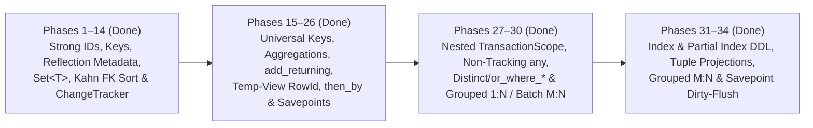
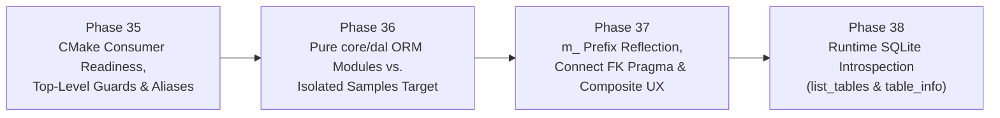

# CodeFirstCppDB_sqlgen — Architecture, Reusability & Next-Gen Roadmap

> **Document Version:** 12.1 (Post-Phase-34 Audit, [CODING_STANDARDS.md](CODING_STANDARDS.md), & External Consumer Reusability Roadmap ("Project Horizon") — Phases 35–38)  
> **Date:** 2026-11-15  
> **Active Branch:** `main` (at commit `7b95202`)  
> **Toolchain Baseline:** GCC 16.1+ (`-std=c++26 -freflection`), CMake 4.0+, Ninja, SQLite 3  
> **Status:** Phases 1–34 Completed & Verified (72/72 GoogleTests passing across 34 suites, zero C++ compiler warnings)

---

## Table of Contents

1. [Executive Summary & Vision](#1-executive-summary--vision)
2. [Quick Start, Coding Standards & Developer Setup](#2-quick-start-coding-standards--developer-setup)
3. [Current Architecture & Library Stack (v12.1 — Phases 1–34 Complete)](#3-current-architecture--library-stack-v121--phases-134-complete)
   - [Directory Layout](#directory-layout)
   - [Layer Boundaries](#layer-boundaries)
   - [External Submodule Libraries Assessment](#external-submodule-libraries-assessment)
   - [End-to-End Developer Experience (Encapsulated, Zero-DTO POCO, & `m_` Aggregate Modes)](#end-to-end-developer-experience-encapsulated-zero-dto-poco--m_-aggregate-modes)
   - [Core Technical Pillars](#core-technical-pillars)
4. [Completed Engineering Roadmap (Phases 1–34 Summary)](#4-completed-engineering-roadmap-phases-134-summary)
5. [External Consumer Audit ("Project Horizon" Integration & Reusability Review)](#5-external-consumer-audit-project-horizon-integration--reusability-review)
6. [Next-Generation Reusability & Consumer Adoption Roadmap (Phases 35–38)](#6-next-generation-reusability--consumer-adoption-roadmap-phases-3538)
   - [Phase 35: CMake Superbuild Consumer Readiness, Top-Level Guards & Namespaced Aliases (`CodeFirstCppDB::*`)](#phase-35-cmake-superbuild-consumer-readiness-top-level-guards--namespaced-aliases-codefirstcppdb)
   - [Phase 36: Decoupling the Pure ORM Engine (`core` / `dal`) from Sample Demo Entities (`Samples` Target)](#phase-36-decoupling-the-pure-orm-engine-core--dal-from-sample-demo-entities-samples-target)
   - [Phase 37: Standardized `m_` Member Prefix Reflection & Real-World SQLite Hardening](#phase-37-standardized-m_-member-prefix-reflection--real-world-sqlite-hardening)
   - [Phase 38: Runtime SQLite Schema & Table Introspection API (`list_tables`, `table_info`, & `execute_raw`)](#phase-38-runtime-sqlite-schema--table-introspection-api-list_tables-table_info--execute_raw)
7. [External Consumer Integration Guide (CMake `FetchContent` & `add_subdirectory`)](#7-external-consumer-integration-guide-cmake-fetchcontent--add_subdirectory)
8. [Architecture Comparison Matrix](#8-architecture-comparison-matrix)
9. [Appendix: Technical FAQ](#9-appendix-technical-faq)

---

## 1. Executive Summary & Vision

**CodeFirstCppDB_sqlgen** brings the **Code-First developer experience of C# and Entity Framework Core (EF Core)** to native C++26 as a **plug-and-play reusable library**.

By combining **C++26 static reflection (`<meta>`)**, **C++23 deducing `this` & named modules (`import std;`)**, **C++20 concepts**, **monadic error handling (`std::expected`)**, and **`sqlgen`**, the library eliminates repetitive C++ data-access boilerplate at compile time—without external code generators, preprocessor macros, or runtime reflection overhead. See [CODING_STANDARDS.md](CODING_STANDARDS.md) for the project's C++26 module, naming, SQLite integrity, and CMake packaging rules.

```text
┌────────────────────────────────────────────────────────────────────────┐
│                   Consumer C++26 Domain / Data Models                  │
│   (DDD Classes, Zero-DTO POCOs, or Consumer `m_` Aggregate Structs)    │
└───────────────────────────────────┬────────────────────────────────────┘
                                    │
                       C++26 Static Reflection (std::meta)
                                    │
                                    ▼
┌────────────────────────────────────────────────────────────────────────┐
│         Pure Reusable ORM Modules: `core` & `dal` (CodeFirstCppDB)     │
│   (SchemaTraits, EntityKey_t, ValidQueryColumn, Topological FK Graph)  │
└───────┬───────────────────────────┼────────────────────────────┬───────┘
        │                           │                            │
        ▼                           ▼                            ▼
┌──────────────────┐       ┌──────────────────┐       ┌──────────────────┐
│ ensure_created & │       │ MapperTraits     │       │ DbContextBase,   │
│ ensure_index     │       │ (Private Splice, │       │ Set<T>, DbQuery, │
│ (Kahn FK + UX)   │       │  m_ / _ & POCO)  │       │ Grouped FK & UoW │
└───────┬──────────┘       └────────┬─────────┘       └────────┬─────────┘
        │                           │                          │
        └───────────────────────────┼──────────────────────────┘
                                    ▼
┌────────────────────────────────────────────────────────────────────────┐
│              SQLiteConnection / DatabaseConnection (sqlgen)            │
│ (Typed AST Pushdown, Tuple Projections, SAVEPOINT, WAL, Table Pragma)  │
└────────────────────────────────────────────────────────────────────────┘
```

---

## 2. Quick Start, Coding Standards & Developer Setup

### Prerequisites (Arch Linux / EndeavourOS)

```bash
sudo pacman -S --needed base-devel cmake ninja gdb sqlite

g++ --version     # Requires GCC 16.1+ (-std=c++26 -freflection)
cmake --version   # Requires CMake 4.0+ (CMAKE_CXX_MODULE_STD)
```

### Build, Test & Run (Standalone Development Mode)

```bash
# 1. Initialize submodules (sqlgen, reflect-cpp, googletest)
git submodule update --init --recursive

# 2. Configure & build (GCC Debug preset — zero C++ compiler warnings)
cmake --preset gcc-debug
cmake --build build/linux/arch/gcc/debug

# 3. Run unit & integration test suite (72 tests across 34 test suites)
./build/linux/arch/gcc/debug/DAL/tests/test_DAL

# 4. Run the Startup application (creates & queries relationalDB.db)
./build/linux/arch/gcc/debug/Startup/Startup
./build/linux/arch/gcc/debug/Startup/Startup --no-reset
```

Before modifying core modules, DTO traits, or build targets, review [CODING_STANDARDS.md](CODING_STANDARDS.md).

---

## 3. Current Architecture & Library Stack (v12.1 — Phases 1–34 Complete)

### Directory Layout

```text
CodeFirstCppDB_sqlgen/
├── CMakeLists.txt                  # Root CMake config (C++26, top-level guards, import std)
├── CMakePresets.json               # Presets for gcc-debug, gcc-release
├── CODING_STANDARDS.md             # Project coding, naming, SQLite & CMake packaging standards
├── readme4.md                      # Master architectural specification & roadmap
│
├── Core/                           # Module: `core` (Pure Domain Primitives — Zero DB deps)
│   ├── core.ixx                    # Primary module interface
│   ├── Id.ixx                      # Universal strong ID wrapper: Core::Id<Tag, ValueType>
│   ├── Key.ixx                     # SingleKey<K>, CompositeKey<K...>, Key concepts
│   └── repositories/               # Abstract contracts & structured error model
│       ├── DbError.ixx             # DbError, DbErrorCode & message classifier
│       └── IGenericRepository.ixx  # IRepository<T> & IGenericRepository<T, KeyType>
│
├── DAL/                            # Module: `dal` (Reusable Data Access & ORM Engine)
│   ├── dal.ixx                     # Primary module interface
│   ├── context/                    # EF Core-style Gateway, Set, Query & Driver Adapter
│   │   ├── DbContext.ixx           # DbContextBase<Conn>, TransactionScope, Grouped/Batch FK Nav, Savepoints
│   │   ├── DbSet.ixx               # DbSet<Domain> & composable server-side DbQuery (select_columns, index DDL)
│   │   └── SQLiteConnection.ixx    # SQL pushdown, tuple reads, index DDL, temp-view rowid, savepoint & WAL
│   ├── schema/                     # Compile-time reflection metadata & relational traits
│   │   ├── SchemaTraits.ixx        # Concepts, InferredKey_t, dto_equals, Kahn FK sort
│   │   └── EntityMetadata.ixx      # Compile-time table/column/key reflection inspector
│   ├── mappers/
│   │   └── MapperTraits.ixx        # Domain <-> DTO splice mapper, with_primary_key, ValidQueryColumn
│   ├── repositories/
│   │   └── GenericRepository.ixx   # Type-agnostic CRUD repository (Single & Composite keys)
│   └── tests/
│       └── test_DAL.cpp            # 72+ GoogleTests across 34+ suites (built only when CODEFIRST_BUILD_TESTS=ON)
│
├── Samples/                        # (Phase 36) Module: `samples` (Demo Person/Something entities & DTOs)
│   ├── samples.ixx                 # Exports sample entities, DTOs, and sample repos for Startup & test_DAL
│   ├── entities/                   # Sample encapsulated domain entities (Person, Something, Person_Something)
│   ├── schema/                     # Sample DTOs (PersonDTO, SomethingDTO, Person_SomethingDTO)
│   └── repositories/               # Sample repository interfaces & implementations
│
└── Startup/                        # Pure-Module Demo App (built only when CODEFIRST_BUILD_EXAMPLES=ON)
    └── main.cpp                    # Defines AppDbContext, seeds via UoW, queries entities
```

### Layer Boundaries

| Layer | Module / CMake Target | Responsibilities | Architectural Rules |
| :--- | :--- | :--- | :--- |
| **Core** | `core` (`CodeFirstCppDB::Core`) | `Id<Tag, ValueType>`, `SingleKey`, `CompositeKey`, `DbError`, `IRepository`, `IGenericRepository`. | **Zero external dependencies, zero sample entities.** No `sqlgen` or SQLite headers. |
| **DAL** | `dal` (`CodeFirstCppDB::DAL`) | `SchemaOf<Domain>`, `EntityKey_t<Domain>`, `EntityMetadata<Domain>`, `MapperTraits`, `GenericRepository`, `DbContextBase`, `TransactionScope`, `DbSet` (`Set<Domain>`), `DbQuery`, and `SQLiteConnection`. | **100% entity-agnostic ORM engine.** Coordinates topological DDL, index DDL, UoW, Zero-JSON `ChangeTracker`, grouped/batched FK navigation, multi-column tuple projections, `add_returning`, nested `SAVEPOINT`s, and runtime table introspection. |
| **Samples** | `samples` (`CodeFirstCppDB::Samples`) | Sample `Person`, `Something`, `Person_Something` domain classes, DTOs, and legacy sample repositories. | **Excluded by default when consumed by external projects** (`CODEFIRST_INCLUDE_SAMPLES=OFF` when `!PROJECT_IS_TOP_LEVEL`). Linked by `Startup` and `test_DAL`. |
| **Startup** | Executable ([Startup/main.cpp](Startup/main.cpp)) | Demo application creating and querying `relationalDB.db`. | Built only when `CODEFIRST_BUILD_EXAMPLES=ON`. |

### External Submodule Libraries Assessment

| Submodule / Library | Version / Role | How We Use It | Audit & Integration Notes |
| :--- | :--- | :--- | :--- |
| **`extern/sqlgen`** | `0.6.0` (SQL AST & Driver Layer) | Provides `sqlgen::sqlite::Connection`, `PrimaryKey`, `ForeignKey`, `Col`, `read`, `select_from`, `where`, `group_by`, `order_by`, `limit`, `offset`, `insert`, `insert_or_replace`, `update`, `delete_from`, `create_table`, `create_index`, `drop`, and aggregations. | Isolated behind `DAL` global module fragments (`module; #include <sqlgen.hpp>`). Guarded with `if(NOT TARGET sqlgen)` for superbuild safety. |
| **`extern/reflect-cpp`** | Transitive dependency of `sqlgen` | Supplies `rfl::Result`, `rfl::Ref`, `rfl::Tuple`, `rfl::NamedTuple`, and `rfl::internal::StringLiteral` used inside `sqlgen`'s SQL transpiler. | **Not** used for JSON or domain reflection in our code; all `Core`/`DAL` introspection uses native ISO C++26 `<meta>`. |
| **`extern/googletest`** | Unit & Integration Testing | Runs 72+ tests across 34+ suites (`test_DAL`). | Guarded behind `if(CODEFIRST_BUILD_TESTS)` so external consumers never configure or build GoogleTest. |

### End-to-End Developer Experience (Encapsulated, Zero-DTO POCO, & `m_` Aggregate Modes)

```cpp
import std;
import core;
import dal;

// Pure aggregate struct following `m_` member naming convention
struct PersonRecord {
    std::int32_t m_id = 0;
    std::string m_firstName;
    std::string m_lastName;
};

// AppDbContext binding DbSet<T> properties via C++26 reflection
class AppDbContext : public DAL::DbContextBase<DAL::SQLiteConnection> {
public:
    Set<PersonRecord> people{ this };
    using DbContextBase::DbContextBase;
};
```

### Core Technical Pillars

1. **Private-Member Splicing, `m_` / `_` Affix Stripping & Case-Insensitive Column Resolution ([DAL/mappers/MapperTraits.ixx](DAL/mappers/MapperTraits.ixx#L24-L135)):**
   - Maps encapsulated private fields (`camelCase_`), `m_`-prefixed fields (`m_camelCase`), or public fields (`camelCase` / `snake_case`) to/from DTO columns (`snake_case`) and splices database-generated primary keys back into domain entities (`with_primary_key`) using `std::meta::access_context::unchecked()`.
   - Resolves `"m_firstName"`, `"FirstName"`, `"firstName"`, `"firstName_"`, and `"first_name"` to `PersonDTO::first_name` in $O(M)$ compile time via `ValidQueryColumn<Domain, DTO, ColLiteral>`.
2. **Universal STL & Strong-ID Keys ([Core/Id.ixx](Core/Id.ixx), [Core/Key.ixx](Core/Key.ixx), [DAL/schema/SchemaTraits.ixx](DAL/schema/SchemaTraits.ixx)):**
   - `Core::Id<Tag, ValueType = std::int32_t>`, `SingleKey<K>`, `CompositeKey<K...>`, and `InferredKey_t<DTO>` support `std::int32_t`, `std::int64_t`, `std::string`, and heterogeneous composite keys.
3. **Compile-Time Topological Foreign-Key Sorting, Index DDL & Grouped Relationship Navigation ([DAL/schema/SchemaTraits.ixx](DAL/schema/SchemaTraits.ixx), [DAL/context/DbContext.ixx](DAL/context/DbContext.ixx)):**
   - `kahn_topological_sort` orders `ensure_created()` and `ensure_deleted()` at compile time (`consteval`), automatically creating composite-key `UNIQUE` indexes on junction tables.
   - `query_children`, `query_parent`, `query_children_batch`, `query_children_grouped`, `query_parents_batch`, `query_many_to_many`, `query_many_to_many_batch`, and `query_many_to_many_grouped` navigate foreign-key relationships in $O(1)$ SQL queries.
4. **Composable Server-Side `DbQuery`, Multi-Column Tuple Projections, Bulk Updates & Savepoints ([DAL/context/DbSet.ixx](DAL/context/DbSet.ixx), [DAL/context/SQLiteConnection.ixx](DAL/context/SQLiteConnection.ixx)):**
   - `DbQuery` composes full `where_*` and `or_where_*` predicates, multi-column `order_by`/`then_by`, `LIMIT/OFFSET`, `.select<"col">()`, `.select_distinct<"col">()`, `.select_columns<"c1", "c2">()`, `.select_distinct_columns<"c1", "c2">()`, `.count()`, `.count_distinct<"col">()`, `.min()`, `.max()`, `.sum()`, `.avg()`, non-tracking `.any()`, `.remove_where()`, `.update_where<Cols...>(vals...)`, and `.ensure_index_created<Name, Cols...>()`.

---

## 4. Completed Engineering Roadmap (Phases 1–34 Summary)



- [x] **Phases 1–14 — Core Foundations, Reflection Metadata, POCO Mode, Topological FK Sort, Zero-JSON `ChangeTracker`, Composable `DbQuery`, Upsert & FK Navigation (`01853df`).**
- [x] **Phases 15–18 — Universal STL Keys, Domain Column Resolution, Batched M:N `IN` Pushdown & Repository Cleanup (`dca5d38`).**
- [x] **Phases 19–22 — Build Hardening, ORM Engine Decoupling, Case-Insensitive Columns, `NULL`/Negative Predicates, SQL Aggregations & `add_returning` (`88c46ac`).**
- [x] **Phases 23–26 — Read-Only Temp-View `try_last_insert_rowid()`, `add_range_returning()`, `then_by`, `select`, `where_between`, `update_where`, `query_children_batch` / `query_parents_batch`, & `SAVEPOINT`s (`a51208b`).**
- [x] **Phases 27–30 — Nested `TransactionScope` Savepoints, Non-Tracking `any()` / `COUNT(*)` `exists()`, Variadic `update_where`, `select_distinct` / `count_distinct`, Full `or_where_*` Parity, `query_children_grouped`, & `query_many_to_many_batch` (`8a1f87c`).**
- [x] **Phase 31 — Code-First Index & Partial Index DDL (`7b95202`):** Added `ensure_index_created` and `ensure_filtered_index_created` on `SQLiteConnection` and `ensure_index_created` / `ensure_unique_index_created` on `DbSet` and `DbQuery`.
- [x] **Phase 32 — Multi-Column Server-Side Tuple Projections (`7b95202`):** Added `try_execute_tuple_read<RowTuple>` on `SQLiteConnection` and `select_columns<Cols...>()` / `select_distinct_columns<Cols...>()` on `DbQuery` and `DbSet`.
- [x] **Phase 33 — Grouped Many-to-Many Eager Hydration & Composite-Key Deduplication (`7b95202`):** Added `query_many_to_many_grouped<TargetDomain, JunctionDomain>(sources)` in 2 SQL queries and deduplicated composite-key targets in `query_many_to_many_batch`.
- [x] **Phase 34 — Savepoint `ChangeTracker` Dirty-Flush, Snapshot Consistency & `update_where_equal` (`7b95202`):** Integrated `detect_changes()` before nested savepoint release in `DbContextBase::transaction` and `TransactionScope::commit`, added snapshot recording on immediate `add`/`add_range`/`update`, and added `DbSet::update_where_equal`.

---

## 5. External Consumer Audit ("Project Horizon" Integration & Reusability Review)

We evaluated **CodeFirstCppDB_sqlgen** (at commit `7b95202`) against a real external C++26 GUI application reference architecture (**"Project Horizon"**) and our [CODING_STANDARDS.md](CODING_STANDARDS.md) baseline to identify every blocker preventing clean third-party adoption.

### How "Project Horizon" Integrates `CodeFirstCppDB_sqlgen`

1. **Pure Consumer Data Layer (`ConsumerData` Aggregate Models):**
   - Defines pure C++26 aggregate structs (`import std;` only, zero business logic, zero UI/SQL dependencies) using standardized `m_` member naming:
     - `PersonRecord { std::int32_t m_id = 0; std::string m_firstName; std::string m_lastName; };`
     - `SomethingRecord { std::int32_t m_id = 0; std::string m_name; std::string m_category; std::optional<std::string> m_description; };`
     - `PersonSomethingRecord { std::int32_t m_personId = 0; std::int32_t m_somethingId = 0; std::string m_associationType; };`
2. **Isolated Consumer Data Module (`ConsumerDataModule` / `ConsumerApp.DataAccess`):**
   - Links `CodeFirstCppDB::Core` and `CodeFirstCppDB::DAL` `PRIVATE` inside a self-contained data-access module target without leaking database dependencies into unrelated application layers.
   - Connects to any user-selected SQLite `.db` file and operates in two modes:
     - **Mode 1 — Typed `CodeFirstCppDB_sqlgen` Mode:** Maps `m_`-prefixed aggregate structs through `DAL::DbContextBase<DAL::SQLiteConnection>` / `Set<T>` with immediate and deferred Unit-of-Work (`defer_changes` / `save_changes`).
     - **Mode 2 — Dynamic SQLite Introspection Mode:** Lists all tables (`sqlite_master`) and inspects column schemas (`PRAGMA table_info`) dynamically in any opened `.db` file so generic table viewers/editors can inspect arbitrary schemas alongside typed `Set<T>` models.

### Five Blockers & Gaps Identified for External Adoption

1. **CMake Superbuild Pollution (`googletest`, `test_DAL`, `Startup`, & Generic Target Names) ([CMakeLists.txt](CMakeLists.txt#L1-L51), [DAL/CMakeLists.txt](DAL/CMakeLists.txt#L1-L37)):**
   - Root `CMakeLists.txt` unconditionally runs `add_subdirectory(extern/googletest)`, `enable_testing()`, `add_subdirectory(Startup)`, and `DAL/CMakeLists.txt` unconditionally runs `add_subdirectory(tests)`.
   - `cmake_minimum_required(VERSION 4.4)` and unconditional `set(CMAKE_EXPERIMENTAL_CXX_IMPORT_STD ...)` can conflict with external consumer builds that already configure `cmake_minimum_required(VERSION 4.0)` and `CMAKE_CXX_MODULE_STD ON`.
   - Generic target names `Core` and `DAL` lack namespaced aliases (`CodeFirstCppDB::Core`, `CodeFirstCppDB::DAL`).

2. **Sample Entities (`Person`, `Something`, `Person_Something`) Hardwired into `core` and `dal` Modules ([Core/core.ixx](Core/core.ixx#L1-L12), [DAL/dal.ixx](DAL/dal.ixx#L1-L16)):**
   - Currently, importing `core` or `dal` forces every external consumer to compile and import the demo classes (`Core::Person`, `Core::Something`, `Core::Person_Something`, `PersonDTO`, `SQLitePersonRepo`, etc.).
   - Splitting the demo entities/DTOs/repos into a separate **`Samples`** target (`CodeFirstCppDB::Samples`, `export module samples;`) keeps `core` (`CodeFirstCppDB::Core`) and `dal` (`CodeFirstCppDB::DAL`) **100% pure, entity-agnostic ORM modules**, while `Startup` and `test_DAL` simply link `Samples` (`import samples;`) so internal testing remains completely unchanged!

3. **Leading `m_` Member Prefix (`m_id`, `m_firstName`) Rejected by `MapperTraits` ([DAL/mappers/MapperTraits.ixx](DAL/mappers/MapperTraits.ixx#L24-L135)):**
   - `MapperTraits` currently matches DTO `first_name` to domain `firstName` or `firstName_`, and DTO `id` to `id` or `id_`, **but fails at compile time** when domain members use the standardized `m_` prefix (`m_id`, `m_firstName`, `m_lastName`, `m_personId`, `m_somethingId`, `m_associationType`).
   - Stripping an optional leading `"m_"` prefix (and/or trailing `"_"`) in `MapperTraits` allows `PersonRecord`, `SomethingRecord`, and `PersonSomethingRecord` to map and query (`where_equal<"m_firstName">`, `where_equal<"firstName">`, `where_equal<"first_name">`) with zero adapter boilerplate!

4. **Missing `PRAGMA foreign_keys = ON` on `SQLiteConnection::connect()` & Missing Composite-Key `UNIQUE` Index DDL on Junction Tables ([DAL/context/SQLiteConnection.ixx](DAL/context/SQLiteConnection.ixx#L49-L75)):**
   - When an external consumer opens an existing `.db` file via `SQLiteConnection::connect(path)` without calling `ensure_created()`, SQLite defaults `PRAGMA foreign_keys` to `OFF`! Calling `PRAGMA foreign_keys = ON;` inside `SQLiteConnection::connect()` guarantees foreign keys are enforced on every connection.
   - Furthermore, for composite-key junction tables like `Person_SomethingDTO` (where `CompositePrimaryKey<DTO>` is inferred from 2+ `ForeignKey` fields), `sqlgen::CreateTable<DTO>` does not emit a composite `PRIMARY KEY` or `UNIQUE` constraint. Automatically emitting `CREATE UNIQUE INDEX IF NOT EXISTS "ux_<table>_composite_pk" ON "<table>" (<key_cols...>);` inside `SQLiteConnection::ensure_table_created<DTO>()` guarantees composite-key uniqueness and makes `INSERT OR REPLACE` (`upsert`) work properly on junction tables!

5. **Missing Runtime SQLite Schema & Table Introspection API (`list_tables()`, `table_info()`, `execute_raw()`) ([DAL/context/SQLiteConnection.ixx](DAL/context/SQLiteConnection.ixx)):**
   - Consumer applications opening arbitrary databases need to list all tables (`sqlite_master`) and inspect column definitions (`PRAGMA table_info`) at runtime without including `<sqlite3.h>` or `<sqlgen.hpp>` in application modules. Providing `list_tables()`, `table_info(table_name)`, and `execute_raw(sql)` on `SQLiteConnection` and `DbContextBase` delivers a clean, pure-module C++26 introspection API.

---

## 6. Next-Generation Reusability & Consumer Adoption Roadmap (Phases 35–38)



---

### Phase 35: CMake Superbuild Consumer Readiness, Top-Level Guards & Namespaced Aliases (`CodeFirstCppDB::*`)

#### Objective
Allow external projects ("Project Horizon" and any C++26 consumer) to include `CodeFirstCppDB_sqlgen` via CMake `FetchContent` or `add_subdirectory` without building `googletest`, `test_DAL`, or `Startup`, while keeping all tests and `Startup` enabled by default when developing inside `CodeFirstCppDB_sqlgen`.

#### Detailed Tasks

- [x] **Task 35.1: Modernize Root `CMakeLists.txt` with `PROJECT_IS_TOP_LEVEL` Guards (`CMakeLists.txt`)**
  - Update [CMakeLists.txt](CMakeLists.txt):
    - Change `cmake_minimum_required(VERSION 4.0)` and `project(CodeFirstCppDB VERSION 1.0.0 LANGUAGES CXX)`.
    - Guard `CMAKE_EXPERIMENTAL_CXX_IMPORT_STD` with `if(NOT DEFINED CMAKE_EXPERIMENTAL_CXX_IMPORT_STD)` so parent projects that already configure `CMAKE_CXX_MODULE_STD` are never disrupted.
    - Add build options defaulting to `${PROJECT_IS_TOP_LEVEL}`:
      ```cmake
      option(CODEFIRST_BUILD_TESTS "Build CodeFirstCppDB GoogleTest suite" ${PROJECT_IS_TOP_LEVEL})
      option(CODEFIRST_BUILD_EXAMPLES "Build CodeFirstCppDB Startup demo executable" ${PROJECT_IS_TOP_LEVEL})
      option(CODEFIRST_INCLUDE_SAMPLES "Build sample Person/Something entities and DTOs target (Samples)" ${PROJECT_IS_TOP_LEVEL})
      if(CODEFIRST_BUILD_TESTS OR CODEFIRST_BUILD_EXAMPLES)
          set(CODEFIRST_INCLUDE_SAMPLES ON CACHE BOOL "" FORCE)
      endif()
      ```
    - Guard `reflect-cpp` with `if(NOT TARGET reflectcpp)` and `sqlgen` with `if(NOT TARGET sqlgen)`.
    - Guard `googletest` and `enable_testing()` behind `if(CODEFIRST_BUILD_TESTS)`.
    - Guard `add_subdirectory(Samples)` behind `if(CODEFIRST_INCLUDE_SAMPLES)` and `add_subdirectory(Startup)` behind `if(CODEFIRST_BUILD_EXAMPLES)`.

- [x] **Task 35.2: Add Namespaced CMake Alias Targets & Guard `DAL/tests` ([Core/CMakeLists.txt](Core/CMakeLists.txt) & [DAL/CMakeLists.txt](DAL/CMakeLists.txt))**
  - In [Core/CMakeLists.txt](Core/CMakeLists.txt), add:
    ```cmake
    add_library(CodeFirstCppDB::Core ALIAS Core)
    add_library(CodeFirst::Core ALIAS Core)
    ```
  - In [DAL/CMakeLists.txt](DAL/CMakeLists.txt), add:
    ```cmake
    add_library(CodeFirstCppDB::DAL ALIAS DAL)
    add_library(CodeFirst::DAL ALIAS DAL)

    if(CODEFIRST_BUILD_TESTS)
        add_subdirectory(tests)
    endif()
    ```

---

### Phase 36: Decoupling the Pure ORM Engine (`core` / `dal`) from Sample Demo Entities (`Samples` Target)

#### Objective
Make `Core` (`module core;`) and `DAL` (`module dal;`) 100% pure, entity-agnostic ORM modules by moving the demo `Person`, `Something`, and `Person_Something` entities, DTOs, and sample repositories into a separate `Samples` library target (`module samples;`, `CodeFirstCppDB::Samples`).

#### Detailed Tasks

- [x] **Task 36.1: Keep `Core` (`module core;`) & `DAL` (`module dal;`) 100% Entity-Agnostic (`Core/` & `DAL/`)**
  - Update [Core/CMakeLists.txt](Core/CMakeLists.txt) and [Core/core.ixx](Core/core.ixx) so `Core` compiles and exports **only** the reusable domain primitives:
    - `Id.ixx` (`export import :id;`)
    - `Key.ixx` (`export import :key;`)
    - `repositories/DbError.ixx` (`export import :db_error;`)
    - `repositories/IGenericRepository.ixx` (`export import :igeneric_repository;`)
  - Update [DAL/CMakeLists.txt](DAL/CMakeLists.txt) and [DAL/dal.ixx](DAL/dal.ixx) so `DAL` compiles and exports **only** the reusable ORM engine:
    - `schema/SchemaTraits.ixx` (`export import :schema_traits;`)
    - `schema/EntityMetadata.ixx` (`export import :entity_metadata;`)
    - `mappers/MapperTraits.ixx` (`export import :mappers;`)
    - `repositories/GenericRepository.ixx` (`export import :generic_repo;`)
    - `context/DbSet.ixx` (`export import :db_set;`)
    - `context/DbContext.ixx` (`export import :db_context;`)
    - `context/SQLiteConnection.ixx` (`export import :sqlite_connection;`)

- [x] **Task 36.2: Create `Samples` Module Target (`Samples/CMakeLists.txt` & `Samples/samples.ixx`)**
  - Create `Samples/CMakeLists.txt` defining `add_library(Samples)` (with aliases `CodeFirstCppDB::Samples` and `CodeFirst::Samples`) linking `PUBLIC Core DAL` and compiling the sample module files (`Samples/samples.ixx` + the existing sample `.ixx` files in `Core/entities/`, `Core/repositories/I*Repository.ixx`, `DAL/schema/*DTO.ixx`, and `DAL/repositories/SQLite*Repo.ixx`, switching their module declaration from `export module core:...` / `export module dal:...` to `export module samples:...` while preserving their `namespace Core` and `namespace DAL::Schema` / `namespace DAL::Repositories` declarations!).
  - Update [Startup/CMakeLists.txt](Startup/CMakeLists.txt) and [DAL/tests/CMakeLists.txt](DAL/tests/CMakeLists.txt) to link `Samples`, and add `import samples;` to [Startup/main.cpp](Startup/main.cpp) and [DAL/tests/test_DAL.cpp](DAL/tests/test_DAL.cpp).

---

### Phase 37: Standardized `m_` Member Prefix Reflection & Real-World SQLite Hardening

#### Objective
Support standardized `m_` member naming (`m_id`, `m_firstName`, `m_lastName`) automatically in `MapperTraits` and `ValidQueryColumn`, enable `PRAGMA foreign_keys = ON` automatically on `SQLiteConnection::connect()`, and auto-create a composite `UNIQUE` index on composite-key tables (`Person_Something`) during `ensure_table_created<DTO>()`.

#### Detailed Tasks

- [x] **Task 37.1: Support `m_` Prefix (and `_` Suffix) in `MapperTraits` & `ValidQueryColumn` ([DAL/mappers/MapperTraits.ixx](DAL/mappers/MapperTraits.ixx))**
  - In [DAL/mappers/MapperTraits.ixx](DAL/mappers/MapperTraits.ixx), add a `consteval` helper in `namespace detail`:
    ```cpp
    consteval std::string_view strip_member_affixes(std::string_view name)
    {
        if (name.size() > 2 && (name.starts_with("m_") || name.starts_with("M_")))
        {
            name.remove_prefix(2);
        }
        if (name.size() > 1 && name.ends_with("_"))
        {
            name.remove_suffix(1);
        }
        return name;
    }
    ```
  - Update `matches_snake_to_camel`, `find_matching_domain_member`, `find_matching_dto_member`, `is_valid_query_column`, and `resolve_dto_member` to compare stripped member names (`strip_member_affixes`) so:
    - Domain `m_id` / `id_` / `id` matches DTO `id` (or `m_id`).
    - Domain `m_firstName` / `firstName_` / `firstName` matches DTO `first_name` (or `m_firstName`).
    - Queries accept `.where_equal<"m_firstName">(...)`, `.where_equal<"firstName">(...)`, or `.where_equal<"first_name">(...)` interchangeably at compile time!

- [x] **Task 37.2: Enable `PRAGMA foreign_keys = ON` on `SQLiteConnection::connect()` & Auto-Create Composite Key `UNIQUE` Index ([DAL/context/SQLiteConnection.ixx](DAL/context/SQLiteConnection.ixx))**
  - In `SQLiteConnection::connect(const std::string& dbPath)` ([DAL/context/SQLiteConnection.ixx](DAL/context/SQLiteConnection.ixx#L49-L75)), call `auto fk_res = handle->enable_foreign_keys();` immediately after constructing the `SQLiteConnection` so connections to existing `.db` files always enforce foreign keys.
  - In `SQLiteConnection::ensure_table_created<DTO>()` ([DAL/context/SQLiteConnection.ixx](DAL/context/SQLiteConnection.ixx#L49-L75)):
    - After `sqlgen::CreateTable<DTO>{ .if_not_exists_ = true }(conn_)` succeeds, check `if constexpr (DAL::Schema::CompositePrimaryKey<DTO>)`:
    - Automatically execute `CREATE UNIQUE INDEX IF NOT EXISTS "ux_<tablename>_composite_pk" ON "<tablename>" ("<col1>", "<col2>", ...);` using the composite key column names from `DAL::Schema::composite_key_column_names<DTO>()` (or iterating `SqlgenForeignKeyField` members of `DTO`), so composite-key junction tables enforce uniqueness and support atomic `INSERT OR REPLACE` (`upsert`) in SQLite!

- [x] **Task 37.3: Phase 37 Verification Tests ([DAL/tests/test_DAL.cpp](DAL/tests/test_DAL.cpp))**
  - Define pure aggregate structs mirroring Project Horizon's `m_`-prefixed models (`PersonRecord` with `m_id`, `m_firstName`, `m_lastName`; `PersonSomethingRecord` with `m_personId`, `m_somethingId`, `m_associationType`), map them to `PersonDTO` and `Person_SomethingDTO`, and test CRUD, `add_returning`, and `.where_equal<"m_firstName">(...)` queries.
  - Verify that inserting duplicate `(person_id, something_id)` rows into `Person_Something` fails with `Core::DbErrorCode::ConstraintViolation`, and that `db.personSomethings.upsert(...)` updates the existing junction row in place without creating duplicates.
  - Verify that a fresh `SQLiteConnection::connect` to an existing database enforces foreign keys without calling `ensure_created()`.

---

### Phase 38: Runtime SQLite Schema & Table Introspection API (`list_tables`, `table_info`, & `execute_raw`)

#### Objective
Provide a clean, pure-module C++26 runtime schema introspection API on `SQLiteConnection` and `DbContextBase` so external consumers can list tables (`sqlite_master`), inspect column definitions (`PRAGMA table_info`), and execute raw SQL without including `<sqlite3.h>` or `<sqlgen.hpp>`.

#### Detailed Tasks

- [x] **Task 38.1: Add `TableColumnInfo`, `list_tables()`, `table_info()`, & `execute_raw()` on `SQLiteConnection` and `DbContextBase` ([DAL/context/SQLiteConnection.ixx](DAL/context/SQLiteConnection.ixx) & [DAL/context/DbContext.ixx](DAL/context/DbContext.ixx))**
  - In [DAL/context/SQLiteConnection.ixx](DAL/context/SQLiteConnection.ixx), export:
    ```cpp
    struct TableColumnInfo
    {
        std::int64_t cid = 0;
        std::string name{};
        std::string type{};
        bool not_null = false;
        std::optional<std::string> default_value{};
        std::int64_t pk_index = 0;
    };
    ```
  - Add on `SQLiteConnection` (and forward on `DbContextBase`):
    - `[[nodiscard]] std::expected<std::vector<std::string>, Core::DbError> list_tables() const`
      Uses `sqlgen::dynamic::SelectFrom` on `sqlite_master` (`type = 'table' AND name NOT LIKE 'sqlite_%'`, ordered by `name` ascending) to return all user table names.
    - `[[nodiscard]] std::expected<std::vector<TableColumnInfo>, Core::DbError> table_info(std::string_view table_name) const`
      Validates `table_name` (non-empty, contains no quotes/semicolons/control chars), creates or queries a temporary view / `pragma_table_info` via `sqlgen::dynamic::SelectFrom`, and returns `std::vector<TableColumnInfo>` ordered by `cid`.
    - `std::expected<void, Core::DbError> execute_raw(std::string_view sql)`
      Executes `conn_->execute(std::string(sql))` and maps any failure to `Core::DbError`.

- [x] **Task 38.2: Phase 38 Verification Tests ([DAL/tests/test_DAL.cpp](DAL/tests/test_DAL.cpp))**
  - Test `db.list_tables()` after `db.ensure_created()`, confirming `"Person"`, `"Person_Something"`, and `"Something"` are returned.
  - Test `db.table_info("Person")` and `db.table_info("Something")`, verifying column names, SQLite types (`INTEGER`, `TEXT`), `not_null` flags (including `std::optional<std::string> description` having `not_null == false`), and `pk_index == 1` on `id`.

---

## 7. External Consumer Integration Guide (CMake `FetchContent` & `add_subdirectory`)

Once Phases 35–38 are implemented, external consumers (such as Project Horizon) can include `CodeFirstCppDB_sqlgen` with zero test/example bloat using `FetchContent` (with an optional local path override for sibling-repo co-development):

```cmake
include(FetchContent)

set(CODEFIRST_LOCAL_DIR "" CACHE PATH "Optional local CodeFirstCppDB_sqlgen checkout")
if(CODEFIRST_LOCAL_DIR AND EXISTS "${CODEFIRST_LOCAL_DIR}/CMakeLists.txt")
    FetchContent_Declare(
        CodeFirstCppDB
        SOURCE_DIR "${CODEFIRST_LOCAL_DIR}"
    )
else()
    FetchContent_Declare(
        CodeFirstCppDB
        GIT_REPOSITORY https://github.com/<owner>/CodeFirstCppDB_sqlgen.git
        GIT_TAG        main
    )
endif()

# Automatically defaults CODEFIRST_BUILD_TESTS=OFF, CODEFIRST_BUILD_EXAMPLES=OFF,
# and CODEFIRST_INCLUDE_SAMPLES=OFF because PROJECT_IS_TOP_LEVEL is FALSE!
FetchContent_MakeAvailable(CodeFirstCppDB)

# Link privately inside an isolated consumer module target
target_link_libraries(ConsumerDataModule
    PRIVATE
        CodeFirstCppDB::Core
        CodeFirstCppDB::DAL
)
```

And inside the consumer's C++26 module unit:

```cpp
export module ConsumerApp.DataAccess;

import std;
import core;
import dal;
```

---

## 8. Architecture Comparison Matrix

| Feature / Aspect | Early v3 Baseline | Current `main` (v12.1 — Phases 1–34) | Next-Gen Target (Phases 35–38) | C# Entity Framework Core |
| :--- | :--- | :--- | :--- | :--- |
| **Packaging & Reuse** | Monolithic test repo (`SqlGenIsolationTest`) | Tightly coupled with `Person`/`Something` samples & `googletest` | Pure `CodeFirstCppDB::Core` & `CodeFirstCppDB::DAL` + `PROJECT_IS_TOP_LEVEL` guards | NuGet `Microsoft.EntityFrameworkCore.Sqlite` |
| **Domain Naming Support** | `camelCase_` & `snake_case` | Case-insensitive `camelCase` / `camelCase_` / `snake_case` | + `m_` member prefix (`m_id`, `m_firstName`) | `[Column]` / Backing Field Conventions |
| **Composite Keys & FKs** | Manual ID lookups | Inferred composite key + `ensure_index_created` | + Auto composite `UNIQUE` index on `ensure_created()` & `PRAGMA foreign_keys = ON` on `connect()` | `HasKey(x => new { x.A, x.B })` |
| **Runtime Schema Explorer** | None | Compile-time `EntityMetadata<Domain>` only | + Runtime `list_tables()`, `table_info()`, & `execute_raw()` | `Database.GetDbConnection().GetSchema()` |

---

## 9. Appendix: Technical FAQ

1. **Why is GCC 16.1+ required instead of Clang?**
   - GCC 16.1+ implements ISO C++26 static reflection (`P2996`) via `-std=c++26 -freflection` and `<meta>`. Standard Clang releases do not yet support `<meta>`.
2. **How do we keep internal tests (`test_DAL`) and `Startup` working when sample entities are separated from `Core` and `DAL`?**
   - By moving `Person`, `Something`, and `Person_Something` (and their DTOs/repositories) into the `Samples` module target (`CodeFirstCppDB::Samples`, `export module samples;`) which is built automatically when `PROJECT_IS_TOP_LEVEL` is `ON` (or `CODEFIRST_BUILD_TESTS=ON`), while external consumers (`PROJECT_IS_TOP_LEVEL=OFF`) only build `CodeFirstCppDB::Core` and `CodeFirstCppDB::DAL`.
3. **Why use a `TEMP VIEW` instead of a `TEMP TABLE` for `try_last_insert_rowid()`?**
   - Inserting `last_insert_rowid()` into a temporary table executes a SQL `INSERT`, which causes SQLite to overwrite `last_insert_rowid()` with the new row's `rowid` (`1`). Defining `CREATE TEMP VIEW IF NOT EXISTS _codefirst_last_rowid AS SELECT last_insert_rowid() AS id;` allows `sqlgen::dynamic::SelectFrom` to read `last_insert_rowid()` in a single read-only `SELECT`.
