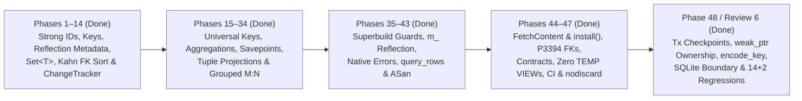
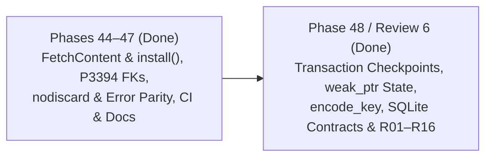

# CodeFirstCppDB_sqlgen — Architecture, Reusability & Next-Gen Roadmap

> **Document Version:** 17.0 (Phases 49–50: Prepared-Statement Typed SQLite Reader, Write/Batch Atomicity, Ownership & Schema Versioning Hardening)  
> **Date:** 2026-11-23  
> **Active Branch:** `main`  
> **Toolchain Baseline:** GCC 16.2+ (`-std=c++26 -freflection`), CMake 4.5+, Ninja, SQLite 3 (CI runs in `archlinux:latest` on `main` pushes/PRs)  
> **License:** MIT ([LICENSE](LICENSE))  
> **Status:** Phases 1–50 Completed (`106/106` GoogleTests passing on `gcc-debug`, `gcc-release`, and `gcc-asan`)

---


## Table of Contents

1. [Executive Summary & Vision](#1-executive-summary--vision)
2. [Quick Start, Coding Standards & Developer Setup](#2-quick-start-coding-standards--developer-setup)
3. [Current Architecture & Library Stack (v16.1)](#3-current-architecture--library-stack-v161)
   - [Directory Layout](#directory-layout)
   - [Layer Boundaries](#layer-boundaries)
   - [External Submodule Libraries Assessment](#external-submodule-libraries-assessment)
   - [End-to-End Developer Experience (Encapsulated, Zero-DTO POCO, & `m_` Aggregate Modes)](#end-to-end-developer-experience-encapsulated-zero-dto-poco--m_-aggregate-modes)
   - [Core Technical Pillars](#core-technical-pillars)
4. [Completed Engineering Roadmap (Phases 1–48)](#4-completed-engineering-roadmap-phases-148)
5. [Multi-Stage Audits (`readme5.md` Triage, Downstream Feedback & Review 6 Hardening)](#5-multi-stage-audits-readme5md-triage-downstream-feedback--review-6-hardening)
   - [5.1 Independent Review (`readme5.md` — Archived/Removed) Triage](#51-independent-review-readme5md--archivedremoved-triage)
   - [5.2 Re-Evaluation of Phases 35–38 (`521c561`) & Phases 39–46 (`00797dc` -> `c20efde`)](#52-re-evaluation-of-phases-3538-521c561--phases-3946-00797dc--c20efde)
   - [5.3 Downstream Consumer Re-Evaluation ("Project Horizon")](#53-downstream-consumer-re-evaluation-project-horizon)
   - [5.4 Phase 47 Polish & Review 6 Reliability/Lifetime Audit (`R01`–`R16`)](#54-phase-47-polish--review-6-reliabilitylifetime-audit-r01r16)
6. [Phase 44–48 Verification Ledger](#6-phase-4448-verification-ledger)
   - [Phases 44–47 Verified Implementation Ledger](#phases-4447-verified-implementation-ledger)
   - [Phase 48 / Review 6 Verified Reliability & Lifetime Ledger (`R01`–`R16`)](#phase-48--review-6-verified-reliability--lifetime-ledger-r01r16)
7. [External Consumer Integration Guide (CMake `FetchContent` & `add_subdirectory`)](#7-external-consumer-integration-guide-cmake-fetchcontent--add_subdirectory)
8. [Architecture Comparison Matrix](#8-architecture-comparison-matrix)
9. [Appendix: Technical FAQ](#9-appendix-technical-faq)

---

## 1. Executive Summary & Vision

**CodeFirstCppDB_sqlgen** brings the **Code-First developer experience of C# and Entity Framework Core (EF Core)** to native **ISO C++26** on the latest **GCC 16+ toolchain** as a **plug-and-play reusable library**.

By combining **C++26 static reflection (`<meta>`, `std::meta::info`, `template for`, constexpr exceptions)**, **C++23 deducing `this` & named modules (`import std;`)**, **C++20 concepts**, **monadic error handling (`std::expected`)**, and **`sqlgen`**, the library eliminates repetitive C++ data-access boilerplate at compile time—without external code generators, preprocessor macros, or runtime reflection overhead. See [CODING_STANDARDS.md](CODING_STANDARDS.md) for the project's C++26 module, naming, SQLite integrity, and CMake packaging rules.

```text
┌────────────────────────────────────────────────────────────────────────┐
│                   Consumer C++26 Domain / Data Models                  │
│   (DDD Classes, Zero-DTO POCOs, `m_` Aggregates, or P3394 Annotated)   │
└───────────────────────────────────┬────────────────────────────────────┘
                                    │
                       C++26 Static Reflection (std::meta)
                                    │
                                    ▼
┌────────────────────────────────────────────────────────────────────────┐
│         Pure Reusable ORM Modules: `core` & `dal` (CodeFirstCppDB)     │
│   (SchemaTraits, EntityKey_t, ValidQueryColumn, Topological FK Graph)  │
└───────┬───────────────────────────┼────────────────────────────┬───────┘
        │                           │                            │
        ▼                           ▼                            ▼
┌──────────────────┐       ┌──────────────────┐       ┌──────────────────┐
│ ensure_created & │       │ MapperTraits     │       │ DbContextBase,   │
│ ensure_index     │       │ (Private Splice, │       │ Set<T>, DbQuery, │
│ (Kahn FK + UX)   │       │  m_ / _ & POCO)  │       │ Grouped FK & UoW │
└───────┬──────────┘       └────────┬─────────┘       └────────┬─────────┘
        │                           │                          │
        └───────────────────────────┼──────────────────────────┘
                                    ▼
┌────────────────────────────────────────────────────────────────────────┐
│              SQLiteConnection / DatabaseConnection (sqlgen)            │
│   (AST Pushdown, Tuple Projections, SAVEPOINT, Introspection, Raw SQL) │
└────────────────────────────────────────────────────────────────────────┘
```

---

## 2. Quick Start, Coding Standards & Developer Setup

### Prerequisites (Arch Linux / EndeavourOS)

```bash
sudo pacman -S --needed base-devel cmake ninja gdb sqlite

g++ --version     # Requires GCC 16.1+ (verified on 16.2.1 with -std=c++26 -freflection)
cmake --version   # Requires CMake 4.0+ (verified on 4.5.0 with CMAKE_CXX_MODULE_STD)
```

### Build, Test & Run (Standalone Development Mode)

```bash
# 1. Initialize submodules (sqlgen, reflect-cpp, googletest)
git submodule update --init --recursive

# 2. Configure & build (GCC Debug preset)
cmake --preset gcc-debug
cmake --build --preset build-gcc-debug

# 3. Run unit & integration test suite via CTest (91 tests across 43 test suites)
ctest --preset test-gcc-debug

# Optional: Run with AddressSanitizer + UndefinedBehaviorSanitizer + _GLIBCXX_ASSERTIONS
cmake --preset gcc-asan
cmake --build --preset build-gcc-asan
ctest --preset test-gcc-asan

# 4. Run the Startup application (creates & queries relationalDB.db)
./build/linux/arch/gcc/debug/Startup/Startup
./build/linux/arch/gcc/debug/Startup/Startup --no-reset
```

Before modifying core modules, DTO traits, or build targets, review [CODING_STANDARDS.md](CODING_STANDARDS.md). All earlier findings from `readme5.md` (branch `Review101_pkstl`) and `review6` (`readme6.md`) have been resolved and covered by tests on `main`, and those temporary review artifacts/branches have been removed.

---

## 3. Current Architecture & Library Stack (v16.1)

### Directory Layout

```text
CodeFirstCppDB_sqlgen/
├── .github/workflows/ci.yml        # GitHub Actions CI: clang-format>=21, CMake 4.5.1, Debug/ASan, -fcontracts, consumer checks
├── LICENSE                         # MIT License
├── CMakeLists.txt                  # Root CMake config (C++26, versioned import std, PROJECT_IS_TOP_LEVEL guards, install()/export rules)
├── CMakePresets.json               # Presets for gcc-debug, gcc-release, gcc-asan & testPresets (no hardcoded compiler paths)
├── cmake/
│   └── CodeFirstCppDBConfig.cmake.in
├── CODING_STANDARDS.md             # Project coding, naming, SQLite & CMake packaging standards
├── README.md                       # Top-level user guide (compiled Quick Start, FetchContent/install & MIT License)
├── readme4.md                      # Master architectural specification, audit triage & roadmap
│
├── Core/                           # Module: `core` (Domain Primitives & Repository Contracts)
│   ├── CMakeLists.txt              # Target `CodeFirstCppDB_Core` (OUTPUT_NAME Core, PUBLIC cxx_std_26) + stdc++exp on GNU + aliases
│   ├── core.ixx                    # Primary module interface
│   ├── Id.ixx                      # Strong explicit ID wrapper: Core::Id<Tag, ValueType>
│   ├── Key.ixx                     # SingleKey<K>, CompositeKey<K...>, Core::encode_key(), Key concepts & injective formatter
│   └── repositories/               # Abstract contracts & structured error model
│       ├── DbError.ixx             # DbError, DbErrorCode, native_code, Debug std::stacktrace & unified create() classifier
│       └── IGenericRepository.ixx  # IRepository<T> & IGenericRepository<T, KeyType>
│
├── DAL/                            # Module: `dal` (Reusable Data Access & ORM Engine)
│   ├── CMakeLists.txt              # Target `CodeFirstCppDB_DAL` (OUTPUT_NAME DAL) + PRIVATE warnings
│   ├── dal.ixx                     # Primary module interface
│   ├── context/                    # EF Core-style Gateway, Set, Query & Driver Adapter
│   │   ├── DbContext.ixx           # DbContextBase<Conn>, TransactionScope, BaselineCheckpoint, ContextState, FK navigation
│   │   ├── DbSet.ixx               # DbSet<Domain> (weak_ptr/local ContextState ownership) & capability-safe DbQuery
│   │   └── SQLiteConnection.ixx    # SQL pushdown, engine autocommit state, validated savepoints, strict prepared bindings
│   ├── schema/                     # Compile-time reflection metadata & relational traits
│   │   ├── SchemaTraits.ixx        # Exact PK/FK traits, P3394 annotations/AnnotatedDto + references<Parent>, Kahn FK sort
│   │   └── EntityMetadata.ixx      # Compile-time table/column/key reflection inspector
│   ├── mappers/
│   │   └── MapperTraits.ixx        # Domain <-> DTO splice mapper (is_hydratable_from, checked try_with_primary_key, [[=column]])
│   ├── repositories/
│   │   └── GenericRepository.ixx   # Type-agnostic CRUD repository (Single & Composite keys, P2900 pre(...) contracts)
│   └── tests/                      # 91 GoogleTests across 43 suites, split by feature + `-Wall -Wextra -Wpedantic -Wshadow`
│       ├── CMakeLists.txt
│       ├── TestSupport.hpp
│       ├── test_keys_and_mapper.cpp
│       ├── test_query_pushdown.cpp
│       ├── test_uow_and_transactions.cpp
│       ├── test_introspection_and_schema.cpp
│       └── test_p3394_and_reflection.cpp
│
├── Samples/                        # Module: `samples` (Opt-in Demo Entities, DTOs & Sample Repos — zero samples in Core/DAL)
│   ├── CMakeLists.txt              # Target `CodeFirstCppDB_Samples` (OUTPUT_NAME Samples) + aliases
│   ├── SampleIds.ixx               # Sample PersonId / SomethingId strong aliases
│   ├── entities/                   # Person, Something, Person_Something
│   ├── repositories/               # I*Repository & SQLite*Repo
│   ├── schema/                     # PersonDTO, SomethingDTO, Person_SomethingDTO
│   └── samples.ixx                 # Exports sample partitions
│
└── Startup/                        # Pure-Module Demo App (built when CODEFIRST_BUILD_EXAMPLES=ON)
    └── main.cpp                    # Defines AppDbContext, --no-reset idempotent seed via add_returning, queries
```

### Layer Boundaries

| Layer | Module / CMake Target | Responsibilities | Architectural Rules & Notes |
| :--- | :--- | :--- | :--- |
| **Core** | `core` (`CodeFirstCppDB_Core` / `CodeFirstCppDB::Core`) | `Id<Tag, ValueType>` (`explicit`), `SingleKey`, `CompositeKey`, `Core::encode_key()`, `DbError` (`native_code` + Debug `std::stacktrace` across all factory/map paths), `IRepository`, `IGenericRepository`. | Zero `sqlgen`, SQLite headers, or sample files. Propagates `PUBLIC cxx_std_26`. |
| **DAL** | `dal` (`CodeFirstCppDB_DAL` / `CodeFirstCppDB::DAL`) | `SchemaOf<Domain>`, `AnnotatedDto`, `EntityKey_t<Domain>`, `EntityMetadata<Domain>`, `MapperTraits`, `GenericRepository`, `DbContextBase`, `TransactionScope`, `DbSet`, `DbQuery`, `SQLiteConnection`. | Zero sample files. Enforces transactional tracker checkpoints, safe `weak_ptr`/local `ContextState` ownership, capability/pagination guards, checked primary-key narrowing, engine-derived `sqlite3_get_autocommit` transaction state, strict prepared-statement contracts, and savepoint identifier validation. |
| **Samples** | `samples` (`CodeFirstCppDB_Samples` / `CodeFirstCppDB::Samples`) | Sample `PersonId`, `SomethingId`, `Person`, `Something`, `Person_Something` domain classes, DTOs, and sample repositories — physically contained under `Samples/`. | Defaults to `CODEFIRST_INCLUDE_SAMPLES=OFF` when `!PROJECT_IS_TOP_LEVEL`. Linked by `Startup` and `test_DAL`. |
| **Startup** | Executable ([Startup/main.cpp](Startup/main.cpp)) | Demo application creating and querying `relationalDB.db`. | Built only when `CODEFIRST_BUILD_EXAMPLES=ON`. Verified `--no-reset` idempotency (`if (db.people.count() == 0)` + `add_returning`). |

### External Submodule Libraries Assessment

| Submodule / Library | Version / Role | How We Use It | Audit & Integration Notes |
| :--- | :--- | :--- | :--- |
| **`extern/sqlgen`** | `0.6.0` (SQL AST & Driver Layer) | Provides `sqlgen::sqlite::Connection`, `PrimaryKey`, `ForeignKey`, `Col`, `read`, `select_from`, `where`, `group_by`, `order_by`, `limit`, `offset`, `insert`, `insert_or_replace`, `update`, `delete_from`, `create_table`, `create_index`, `drop`, and aggregations. | Isolated behind `DAL` global module fragments (`module; #include <sqlgen.hpp>`). Exported alongside `CodeFirstCppDB_DAL` when `CODEFIRST_INSTALL=ON`. |
| **`extern/reflect-cpp`** | Transitive dependency of `sqlgen` | Supplies `rfl::Result`, `rfl::Ref`, `rfl::Tuple`, `rfl::NamedTuple`, and `rfl::internal::StringLiteral` used inside `sqlgen`'s SQL transpiler. | **Not** used for JSON or domain reflection in our code; all `Core`/`DAL` introspection uses native ISO C++26 `<meta>`. |
| **`extern/googletest`** | Unit & Integration Testing | Runs `91` tests across `43` modular suites (`test_DAL`). | Guarded behind `if(CODEFIRST_BUILD_TESTS)` so external consumers never configure or build GoogleTest. |

### End-to-End Developer Experience (Encapsulated, Zero-DTO POCO, & `m_` Aggregate Modes)

```cpp
import std;
import core;
import dal;

// Pure aggregate struct following `m_` member naming convention
struct PersonRecord {
    std::int32_t m_id = 0;
    std::string m_firstName;
    std::string m_lastName;
};

// AppDbContext binding DbSet<T> properties via C++26 reflection
class AppDbContext : public DAL::DbContextBase<DAL::SQLiteConnection> {
public:
    Set<PersonRecord> people{ this };
    using DbContextBase::DbContextBase;
};
```

### Core Technical Pillars

1. **Private-Member Splicing, `m_` / `_` Affix Stripping & Case-Insensitive Column Resolution ([DAL/mappers/MapperTraits.ixx](DAL/mappers/MapperTraits.ixx#L24-L176)):**
   - Maps encapsulated private fields (`camelCase_`), `m_`-prefixed fields (`m_camelCase` / `M_camelCase`), or public fields (`camelCase` / `snake_case`) to/from DTO columns (`snake_case`) and splices database-generated primary keys back into domain entities (`with_primary_key`) using `std::meta::access_context::unchecked()`.
   - Resolves `"m_firstName"`, `"FirstName"`, `"firstName"`, `"firstName_"`, and `"first_name"` to `PersonDTO::first_name` in $O(M)$ compile time via `ValidQueryColumn<Domain, DTO, ColLiteral>`.
2. **Universal STL & Strong-ID Keys ([Core/Id.ixx](Core/Id.ixx), [Core/Key.ixx](Core/Key.ixx), [DAL/schema/SchemaTraits.ixx](DAL/schema/SchemaTraits.ixx)):**
   - `Core::Id<Tag, ValueType = std::int32_t>`, `SingleKey<K>`, `CompositeKey<K...>`, and `InferredKey_t<DTO>` support `std::int32_t`, `std::int64_t`, `std::string`, and heterogeneous composite keys.
3. **Compile-Time Topological Foreign-Key Sorting, Index DDL & Grouped Relationship Navigation ([DAL/schema/SchemaTraits.ixx](DAL/schema/SchemaTraits.ixx), [DAL/context/DbContext.ixx](DAL/context/DbContext.ixx)):**
   - `kahn_topological_sort` orders `ensure_created()` and `ensure_deleted()` at compile time (`consteval`), automatically creating composite-key `UNIQUE` indexes on junction tables.
   - `query_children`, `query_parent`, `query_children_batch`, `query_children_grouped`, `query_parents_batch`, `query_many_to_many`, `query_many_to_many_batch`, and `query_many_to_many_grouped` navigate foreign-key relationships via batched `IN` queries.
4. **Composable Server-Side `DbQuery`, Tuple Projections, Savepoints & Runtime SQLite Introspection ([DAL/context/DbSet.ixx](DAL/context/DbSet.ixx), [DAL/context/SQLiteConnection.ixx](DAL/context/SQLiteConnection.ixx)):**
   - `DbQuery` composes `where_*` and `or_where_*` predicates, multi-column `order_by`/`then_by`, `LIMIT/OFFSET`, `.select<"col">()`, `.select_distinct<"col">()`, `.select_columns<"c1", "c2">()`, `.select_distinct_columns<"c1", "c2">()`, aggregations, non-tracking `.any()`, `.remove_where()`, `.update_where<Cols...>(vals...)`, and `.ensure_index_created<Name, Cols...>()`.
   - `SQLiteConnection` & `DbContextBase` expose pure-module `list_tables()`, `table_info(table_name)`, and `execute_raw(sql)`.

---

## 4. Completed Engineering Roadmap (Phases 1–48)



- [x] **Phases 1–14 — Core Foundations, Reflection Metadata, POCO Mode, Topological FK Sort, Zero-JSON `ChangeTracker`, Composable `DbQuery`, Upsert & FK Navigation (`01853df`).**
- [x] **Phases 15–18 — Universal STL Keys, Domain Column Resolution, Batched M:N `IN` Pushdown & Repository Cleanup (`dca5d38`).**
- [x] **Phases 19–22 — Build Hardening, ORM Engine Decoupling, Case-Insensitive Columns, `NULL`/Negative Predicates, SQL Aggregations & `add_returning` (`88c46ac`).**
- [x] **Phases 23–26 — `try_last_insert_rowid()`, `add_range_returning()`, `then_by`, `select`, `where_between`, `update_where`, `query_children_batch` / `query_parents_batch`, & `SAVEPOINT`s (`a51208b`).**
- [x] **Phases 27–30 — Nested `TransactionScope` Savepoints, Non-Tracking `any()` / `COUNT(*)` `exists()`, Variadic `update_where`, `select_distinct` / `count_distinct`, Full `or_where_*` Parity, `query_children_grouped`, & `query_many_to_many_batch` (`8a1f87c`).**
- [x] **Phases 31–34 — Index & Partial Index DDL, Multi-Column Tuple Projections, Grouped M:N Eager Hydration, & Savepoint Dirty-Flush (`7b95202`).**
- [x] **Phases 35–38 (`521c561`) — CMake Superbuild Consumer Readiness, `Samples` Target Split, `m_` Prefix Reflection, FK Hardening & Runtime Introspection.**
- [x] **Phase 39 (`00797dc`) — Transactional Correctness (`SAVEPOINT` `save_changes()`), `explicit Core::Id`, `Startup --no-reset`, `[this]` Capture Removal, `track_copy()`, Atomic `update()` & `close()`.**
- [x] **Phases 40–46 (`c20efde`) — Consumer Packaging (`FetchContent`/`add_subdirectory` + `CODEFIRST_INSTALL=ON`), Verified `README.md`, End-to-End P3394 `AnnotatedDto` + `references<Parent>` + `[[=column]]`, C++26 Cleanups & P2900 `pre(...)` Contracts, Direct SQLite C-API Introspection (Zero `TEMP VIEW`s), `DbError` `native_code` + Debug `std::stacktrace`, `[[nodiscard]]` Pass, Modularized `DAL/tests/`, & Physical Relocation of `Samples/`.**
- [x] **Phases 47–48 — Phase 47 Polish, Review 6 Hardening (`R01`–`R16`), Real Composite `PRIMARY KEY` DDL, CI & MIT License:** Completed `find_tracked_ref` `std::constructible_from`, `upsert` `map_error`, `map_from_message()` Debug stacktraces, `SQLiteConnection` `[[nodiscard]]`, table-level composite `PRIMARY KEY (...)` DDL in `ensure_table_created<DTO>()`, all `R01`–`R16` reliability/lifetime fixes, CI fixes (`cmake` 4.5.1 tarball & `clang-format>=21` on Ubuntu 24.04), MIT [LICENSE](LICENSE), and removal of temporary `readme5.md`, `review6.zip`, and `Review101_pkstl`.

---

## 5. Multi-Stage Audits (`readme5.md` Triage, Downstream Feedback & Review 6 Hardening)

### 5.1 Independent Review (`readme5.md` — Archived/Removed) Triage

All items tracked from the historical `readme5.md` snapshot (`Review101_pkstl` @ `01853df`) have been resolved through Phases 39–48:

| Item in `readme5.md` | Status on `main` | Verdict & Verification Evidence |
| :--- | :--- | :--- |
| **C1** Auto-increment PK drops domain ID (`Startup --no-reset`) | **Resolved (Phase 39)** | Verified by running `Startup` followed by `Startup --no-reset` (`count() == 0` guard + `add_returning`). `explicit Core::Id` prevents raw-int coercions. |
| **C2** Composite junction PK/UNIQUE missing | **Resolved (Phases 37, 46 & 48)** | `ensure_table_created<DTO>()` ([DAL/context/SQLiteConnection.ixx](DAL/context/SQLiteConnection.ixx)) emits a real table-level `PRIMARY KEY ("col1", "col2", ...)` constraint plus `ux_<table>_composite_pk`; `Phase38SchemaIntrospectionTest` verifies `pk_index` (`1`, `2`) on both `Person_Something` and multi-`PrimaryKey` `CompositePkPairDTO`. |
| **C3** `DbSet::track(Domain&)` raw pointer & `[this]` captures | **Resolved (Phases 39, 42, 47 & 48)** | `[this]` captures removed; `track_copy()` added; `find_tracked_ref()` supports `std::constructible_from` keys (`explicit Core::Id`) and safely owns tracked instances in standalone sets (`R15`). |
| **C4** `save_changes()` commits caller's outer transaction | **Resolved (Phase 39 & 48)** | `started_tx = !in_transaction()` + `SAVEPOINT` nesting + `BaselineCheckpoint` restore on rollback/failure (`R01`–`R04`). |
| **C5** `PRAGMA foreign_keys = ON` missing on `connect()` | **Resolved (Phases 37 & 40)** | `SQLiteConnection::connect(dbPath, SQLiteConnectionOptions)` enables FKs by default; reopened on-disk FK enforcement verified in `Phase43ReopenForeignKeyTest`. |
| **C6** Dual silent-default vs `std::expected`, `[[nodiscard]]`, `DbError` traces | **Resolved (Phases 40, 46 & 47)** | `DbError::native_code` + Debug `std::stacktrace` across `create()` and `map_from_message()`, `conn->map_error` on `upsert` immediate paths, `[[nodiscard]]` on fallible mutators across `DbSet`/`DbContextBase`/`SQLiteConnection`, and error policy documented in [README.md](README.md). |
| **C7** `SQLitePersonRepo` failing under `SQLiteConnection` | **Resolved (Phases 18, 40 & 47)** | Dead mock fallback pruned and `find_by_last_name` modernized with `std::ranges::to<std::vector>()` in [Samples/repositories/SQLitePersonRepo.ixx](Samples/repositories/SQLitePersonRepo.ixx). |
| **C8** Hardcoded `std::int32_t` keys | **Resolved (Phases 15–18 & 48)** | `SingleKey<K>`, `CompositeKey<K...>`, and `GenericRepository` support arbitrary keys with checked auto-increment hydration (`R13`) and collision-free `Core::encode_key()` (`R14`). |
| **C9** TOCTOU `SELECT` before `UPDATE` & non-atomic `upsert` | **Resolved (Phases 39 & 45)** | `SQLiteConnection::update()` executes `UPDATE` directly and checks `sqlite3_changes(db)` via `native_sqlite_handle()` with zero `TEMP VIEW`s. |
| **C10** Strong `Core::Id` leak & `close()` retention | **Resolved (Phases 39 & 41)** | `Core::Id` conversion is `explicit`; `close()` resets `conn_`; `raw_connection()` guards `pre(is_open())`. |
| **A1** Library mixed with sample entities/DTOs | **Resolved (Phases 36 & 46)** | All sample IDs, entities, DTOs, and `I*Repository`/`SQLite*Repo` files physically reside inside [Samples/](Samples/). |
| **A2/A4/A5/A6 & §6–7** Constructor hydration, P3394, P2900, CI, C++26 | **Resolved (Phases 41–47)** | `is_hydratable_from`, P3394 `AnnotatedDto` + `references<Parent>` + `[[=column]]`, P2900 `pre(...)`, C++26 cleanups (`members_v`, `to_string_literal`, `[...parts]`, `Ts...[0]`, `std::ranges::to`), split `DAL/tests/`, `CODEFIRST_INSTALL=ON`, `FetchContent`, `add_subdirectory` CI check, and `clang-format` check all landed. |

### 5.2 Re-Evaluation of Phases 35–38 (`521c561`) & Phases 39–46 (`00797dc` -> `c20efde`)

All consumer packaging, P3394 annotation inheritance/FK synthesis, direct C-API introspection, physical `Samples/` relocation, and modular `DAL/tests/` splits from `00797dc` were verified completed in `c20efde`.

### 5.3 Downstream Consumer Re-Evaluation ("Project Horizon")

All 4 downstream blockers reported during Project Horizon's audit (`CodeFirstCppDB_*` target naming, `PRIVATE` warning flags, pure-module `query_rows()`/`execute_prepared()`, and clean `FetchContent`/`add_subdirectory`/`CODEFIRST_INSTALL=ON` packaging with `PUBLIC cxx_std_26`) are resolved on `main`.

### 5.4 Phase 47 Polish & Review 6 Reliability/Lifetime Audit (`R01`–`R16`)

Independent review (`readme6.md` + `review6` harness) identified 14 behavioral/contract edge cases (`R01`–`R14`) and 2 ASan lifetime failures (`R15` `dangling`, `R16` `escaped_query`), all of which are now fixed on `main` alongside the 6 remaining Phase 47 items.

---

## 6. Phase 44–48 Verification Ledger



---

### Phases 44–47 Verified Implementation Ledger

- [x] **Phase 44 (Tasks 44.1–44.3) — Consumer Packaging, Docs & CI Hygiene:** Fixed `FetchContent`/`add_subdirectory` configure guards, exported `sqlgen` and `reflectcpp` for `-DCODEFIRST_INSTALL=ON`, rewrote [README.md](README.md) with a compiled P3394 Quick Start, removed hardcoded compiler paths in [CMakePresets.json](CMakePresets.json), added `-Wall -Wextra -Wpedantic -Wshadow` to `DAL/tests`, and verified `clang-format`.
- [x] **Phase 45 (Tasks 45.1–45.3) — P3394 Single-Class Entities, C++26 Cleanups, P2900 Contracts & Zero `TEMP VIEW`s:** Verified `AnnotatedDto` inheritance + `references<Parent>` + `[[=column]]` end-to-end in `DbSet`, hardened `is_hydratable_from`, added P2900 `pre(...)` contracts, Debug `std::stacktrace` in `DbError`, and direct SQLite C-API introspection without `TEMP VIEW`s.
- [x] **Phase 46 (Tasks 46.1–46.3) — `[[nodiscard]]`, Modularized Tests & Physical `Samples/` Move:** Split `DAL/tests/` into `TestSupport.hpp` + 5 suites, added composite `.upsert()` tests, relocated all sample files into [Samples/](Samples/), and documented error handling & identity strategy in [README.md](README.md).
- [x] **Task 47.1 — CI & `README.md` Alignment:** Replaced `-DCODEFIRST_BUILD_SAMPLES=OFF` with `-DCODEFIRST_BUILD_EXAMPLES=OFF -DCODEFIRST_INCLUDE_SAMPLES=OFF` and added external `add_subdirectory` verification in [.github/workflows/ci.yml](.github/workflows/ci.yml); updated [README.md](README.md) to `CMake 4.0+` with full C++26 module settings and added `PUBLIC cxx_std_26` to [Core/CMakeLists.txt](Core/CMakeLists.txt).
- [x] **Task 47.2 — `DbSet::find_tracked_ref` Concept Constraint:** Updated [DAL/context/DbSet.ixx](DAL/context/DbSet.ixx) to `std::constructible_from<typename KeyType::key_type, K>`, enabling raw integral lookups like `find_tracked_ref(1)` for `explicit Core::Id`.
- [x] **Task 47.3 — Error Parity & `SQLiteConnection` `[[nodiscard]]`:** Routed `upsert_immediate_with` / `upsert_many_immediate_with` through `conn->map_error(...)` when available, updated `Core::DbError::map_from_message` ([Core/repositories/DbError.ixx](Core/repositories/DbError.ixx)) to capture Debug stacktraces via `create()`, and added `[[nodiscard]]` to `insert`, `insert_many`, `update`, `delete_by_id`, `upsert`, and `upsert_many` in [DAL/context/SQLiteConnection.ixx](DAL/context/SQLiteConnection.ixx).
- [x] **Task 47.4 — Shared Reflection Literal Helper & Sample Ranges:** Extracted shared `consteval to_string_literal` in [DAL/schema/SchemaTraits.ixx](DAL/schema/SchemaTraits.ixx) and adopted `std::ranges::to<std::vector>()` in [Samples/repositories/SQLitePersonRepo.ixx](Samples/repositories/SQLitePersonRepo.ixx).

### Phase 48 / Review 6 Verified Reliability & Lifetime Ledger (`R01`–`R16`)

- [x] **`R01`–`R04` Transaction & ChangeTracker Baseline Consistency ([DAL/context/DbContext.ixx](DAL/context/DbContext.ixx), [DAL/context/DbSet.ixx](DAL/context/DbSet.ixx)):**
  - `R01` (`tracked_transaction`): `DbContextBase::transaction(fn)` always runs `save_changes()` before commit so tracked-only edits persist.
  - `R02` (`rollback_retry`) & `R03` (`failed_batch_retry`): `BaselineCheckpoint` snapshots ChangeTracker baselines at `begin_transaction()` and before `save_changes()`/`transaction()`/`TransactionScope`; failed batches, exceptions, failed commits, or explicit rollbacks restore prior baselines so subsequent retries do not lose edits.
  - `R04` (`abandoned_scope`): Outer and nested `TransactionScope` destructors, rollbacks, and failed commits truncate `pending_ops_` back to entry size and restore baseline checkpoints.
- [x] **`R05`–`R09` SQLite Boundary & Dynamic Statement Contracts ([DAL/context/SQLiteConnection.ixx](DAL/context/SQLiteConnection.ixx)):**
  - `R05` (`missing_bind`): `bind_dynamic_params()` validates `params.size() == sqlite3_bind_parameter_count(stmt)`.
  - `R06` (`empty_blob`): Empty `std::vector<std::byte>` binds with `sqlite3_bind_zeroblob(..., 0)` so it remains an empty BLOB rather than SQL `NULL`.
  - `R07` (`sql_tail`): `query_rows()` and `execute_prepared()` inspect `pz_tail`, reject embedded NULs and trailing executable SQL statements, and drain all result rows cleanly.
  - `R08` (`raw_transaction`): `in_transaction()` queries `sqlite3_get_autocommit` directly so raw `BEGIN`/`ROLLBACK` SQL stays consistent with wrapper transaction state; `raw_connection()` adds `pre(is_open())`.
  - `R09` (`savepoint_name`): `savepoint()`, `release_savepoint()`, and `rollback_to_savepoint()` enforce `is_valid_sql_identifier(name)` before formatting SQL.
- [x] **`R10`–`R14` Query Capability, Pagination & Identity-Key Correctness ([DAL/context/DbSet.ixx](DAL/context/DbSet.ixx), [DAL/mappers/MapperTraits.ixx](DAL/mappers/MapperTraits.ixx), [Core/Key.ixx](Core/Key.ixx)):**
  - `R10` (`limited_delete`): `DbQuery::remove_where()` with `limit`/`offset` deletes the exact selected keys via `try_to_vector()`, while `DbQuery::update_where()` rejects unsupported `limit`/`offset` modifiers.
  - `R11` (`fallback_read`) & `R12` (`fallback_delete`): `DbQuery::try_to_vector()` rejects `WHERE` or `ORDER BY` when the connection adapter lacks `try_execute_read<DTO>`, preventing silent unfiltered reads or deletes.
  - `R13` (`rowid_overflow`): Added checked `MapperTraits::try_with_primary_key()` using `std::in_range<TargetScalarT>` (`with_primary_key` throws `std::overflow_error` on failure); `DbSet::add_returning()` cleans up any overflowing inserted SQLite row by `rowid` and returns `Core::DbError::constraint_violation`. `add_range_returning()` wraps batches in a savepoint when called inside an outer transaction.
  - `R14` (`composite_key`): Escaped quoted string formatting in `std::formatter<Core::CompositeKey<...>>` and length-prefixed `Core::encode_key()` identity-map encoding prevent delimiter collisions such as `("a, b", "c")` vs `("a", "b, c")`.
- [x] **`R15`–`R16` Ownership & Lifetime Safety ([DAL/context/DbSet.ixx](DAL/context/DbSet.ixx), [DAL/context/DbContext.ixx](DAL/context/DbContext.ixx)):**
  - `R15` (`dangling`): Standalone / connection-only `DbSet` owns a `local_state_` `std::shared_ptr<detail::ContextState>`, keeping `find_tracked_ref()` referents alive for the `DbSet`'s lifetime, and non-const `DbContextBase::create_set()` returns a context-bound set.
  - `R16` (`escaped_query`): `DbSet(Ctx*)` captures `std::weak_ptr<detail::ContextState>` rather than raw `this`/`ctx*` so queries or sets escaping a destroyed `DbContextBase` cannot dereference dangling stack frames (verified clean under ASan with `detect_stack_use_after_return=1`).

---

## 7. External Consumer Integration Guide (CMake `FetchContent` & `add_subdirectory`)

External C++26 projects can include **CodeFirstCppDB_sqlgen** via `FetchContent`, git submodule + `add_subdirectory`, or an installed package via `find_package(CodeFirstCppDB CONFIG REQUIRED)` (`-DCODEFIRST_INSTALL=ON`):

```cmake
cmake_minimum_required(VERSION 4.0)
project(ConsumerApp LANGUAGES CXX)

set(CMAKE_CXX_STANDARD 26)
set(CMAKE_CXX_STANDARD_REQUIRED ON)
set(CMAKE_CXX_EXTENSIONS OFF)
set(CMAKE_CXX_SCAN_FOR_MODULES ON)
set(CMAKE_CXX_MODULE_STD ON)

include(FetchContent)

set(CODEFIRST_LOCAL_DIR "" CACHE PATH "Optional local CodeFirstCppDB_sqlgen checkout")
if(CODEFIRST_LOCAL_DIR AND EXISTS "${CODEFIRST_LOCAL_DIR}/CMakeLists.txt")
    FetchContent_Declare(
        CodeFirstCppDB
        SOURCE_DIR "${CODEFIRST_LOCAL_DIR}"
    )
else()
    FetchContent_Declare(
        CodeFirstCppDB
        GIT_REPOSITORY https://github.com/mythrz/CodeFirstCppDB_sqlgen.git
        GIT_TAG        main
    )
endif()

# Automatically defaults CODEFIRST_BUILD_TESTS=OFF, CODEFIRST_BUILD_EXAMPLES=OFF,
# and CODEFIRST_INCLUDE_SAMPLES=OFF because PROJECT_IS_TOP_LEVEL is FALSE!
FetchContent_MakeAvailable(CodeFirstCppDB)

# Link PRIVATE inside an isolated consumer module target so internal DAL flags stay contained
target_link_libraries(ConsumerDataModule
    PRIVATE
        CodeFirstCppDB::Core
        CodeFirstCppDB::DAL
)
```

And inside the consumer's C++26 module unit:

```cpp
export module ConsumerApp.DataAccess;

import std;
import core;
import dal;
```

---

## 8. Architecture Comparison Matrix

| Feature / Aspect | Early v3 Baseline | Previous `main` (`c20efde`) | Current `main` (v16.1 — Phases 47 & 48 / Final) | C# Entity Framework Core |
| :--- | :--- | :--- | :--- | :--- |
| **Packaging & Reuse** | Monolithic test repo (`SqlGenIsolationTest`) | `FetchContent`/`add_subdirectory` & `CODEFIRST_INSTALL=ON`, physical `Samples/` | + MIT [LICENSE](LICENSE) (installed with package), `PUBLIC cxx_std_26`, fixed CI (`CMake` 4.5.1 & `clang-format>=21`), aligned `README.md` | NuGet `Microsoft.EntityFrameworkCore.Sqlite` |
| **Domain Definition** | Encapsulated classes + DTOs | P3394 `AnnotatedDto` (`[[=references]]`, `[[=column]]`), `m_` aggregates, ctor hydration | + Shared `to_string_literal`, checked `try_with_primary_key()` (`R13`), `std::ranges::to` | `[Table]` / `[Column]` attributes + POCOs |
| **Keys & Integrity** | Manual ID lookups | Explicit `Core::Id`, `PRAGMA foreign_keys`, composite PK index, P2900 `pre(...)` | + Table-level composite `PRIMARY KEY (...)` DDL + `ux_<table>_composite_pk`, injective `Core::encode_key()` & quoted `CompositeKey` formatter (`R14`), `find_tracked_ref` `constructible_from` | `HasKey(x => new { x.A, x.B })`, strong keys |
| **Runtime Introspection & Raw SQL** | None | `list_tables()`, `table_info()`, `execute_raw()`, parameterized `query_rows()` & `execute_prepared()` | + Exact bind count checks (`R05`), empty BLOB `zeroblob` (`R06`), tail/NUL rejection (`R07`), engine autocommit (`R08`), savepoint identifier validation (`R09`) | `Database.SqlQueryRaw<T>()` & `GetSchema()` |
| **Error & Lifetime Discipline** | Swallowed defaults + raw refs | `track_copy()`, `DbError::native_code` + Debug traces, split `DAL/tests/` (85/85) | + `BaselineCheckpoint` tx/scope rollback (`R01`–`R04`), `weak_ptr`/local `ContextState` (`R15`–`R16`), capability/limit guards (`R10`–`R12`), `[[nodiscard]]` & `upsert` `map_error` parity (`91/91`) | Exceptions / `DbUpdateException` |

---

## 9. Appendix: Technical FAQ

1. **Why is GCC 16.1+ required instead of Clang?**
   - GCC 16.1+ (verified on GCC 16.2.1) implements ISO C++26 static reflection (`P2996`, `P3394` annotations, `define_aggregate`, `parameters_of`) via `-std=c++26 -freflection` and `<meta>`. Standard Clang releases do not yet support `<meta>`.
2. **How do we keep internal tests (`test_DAL`) and `Startup` working while keeping `Core` and `DAL` clean for consumers?**
   - `Samples` (`CodeFirstCppDB::Samples`, `export module samples;`) isolates all demo entities, DTOs, and sample repositories physically under [Samples/](Samples/). It builds automatically when `PROJECT_IS_TOP_LEVEL` or `CODEFIRST_BUILD_TESTS` is `ON`, while external consumers (`PROJECT_IS_TOP_LEVEL=OFF`) only compile `CodeFirstCppDB::Core` and `CodeFirstCppDB::DAL`.
3. **Why keep both `m_` pure aggregates and optional P3394 annotations?**
   - Downstream libraries that isolate pure data structs (`import std;` only, shared across UI and storage layers) cannot add ORM attributes inside their data module; `m_`-aware `MapperTraits` keeps them zero-dependency, while optional P3394 `[[=...]]` annotations (Phases 42 & 45) give self-contained ORM users zero-DTO 1-class ergonomics.
4. **What is the status of `Review101_pkstl` / `readme5.md` and Review 6 (`review6.zip` / `readme6.md`)?**
   - All Phase 47 polish tasks (`47.1`–`47.4`), all `readme5.md` items, and all 16 Review 6 findings (`R01`–`R16`, plus real table-level composite `PRIMARY KEY` DDL) are implemented and verified with permanent regression coverage on `main` (`91/91` tests across `43` suites). Accordingly, `readme5.md`, `review6.zip`, and branch `Review101_pkstl` have been removed from the repository.
