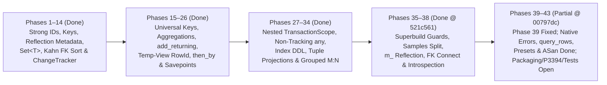
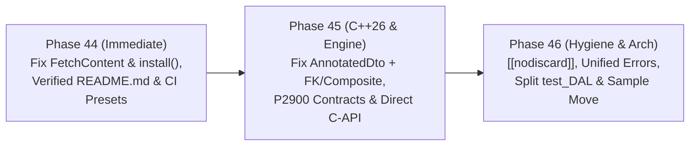

# CodeFirstCppDB_sqlgen — Architecture, Reusability & Next-Gen Roadmap

> **Document Version:** 14.0 (Post-`00797dc` Verification Audit, Consumer Packaging Regression Findings & Phases 44–46 Remediation Roadmap)  
> **Date:** 2026-11-15  
> **Active Branch:** `main` (at commit `00797dc`)  
> **Toolchain Baseline:** GCC 16.2+ (`-std=c++26 -freflection`), CMake 4.0+ (verified on 4.5.0), Ninja, SQLite 3  
> **Status:** Phases 1–39 Completed; Phases 40–43 Partially Implemented (81/81 GoogleTests across 42 suites passing on `gcc-debug` and `gcc-asan`; open packaging, P3394, docs, and test-split items tracked in Phases 44–46)

---

## Table of Contents

1. [Executive Summary & Vision](#1-executive-summary--vision)
2. [Quick Start, Coding Standards & Developer Setup](#2-quick-start-coding-standards--developer-setup)
3. [Current Architecture & Library Stack (v14.0 — Post-`00797dc` Audit)](#3-current-architecture--library-stack-v140--post-00797dc-audit)
   - [Directory Layout](#directory-layout)
   - [Layer Boundaries](#layer-boundaries)
   - [External Submodule Libraries Assessment](#external-submodule-libraries-assessment)
   - [End-to-End Developer Experience (Encapsulated, Zero-DTO POCO, & `m_` Aggregate Modes)](#end-to-end-developer-experience-encapsulated-zero-dto-poco--m_-aggregate-modes)
   - [Core Technical Pillars](#core-technical-pillars)
4. [Completed & Partial Engineering Roadmap (Phases 1–43)](#4-completed--partial-engineering-roadmap-phases-143)
5. [Multi-Stage Audits (`readme5.md` Triage, Downstream Feedback & `00797dc` Re-Evaluation)](#5-multi-stage-audits-readme5md-triage-downstream-feedback--00797dc-re-evaluation)
   - [5.1 Independent Review (`readme5.md`) Triage (Audited @ `01853df`, Re-Evaluated @ `521c561` / `00797dc`)](#51-independent-review-readme5md-triage-audited--01853df-re-evaluated--521c561--00797dc)
   - [5.2 Re-Evaluation of Phases 35–38 (`521c561`) Implementation](#52-re-evaluation-of-phases-3538-521c561-implementation)
   - [5.3 Downstream Consumer Re-Evaluation ("Project Horizon")](#53-downstream-consumer-re-evaluation-project-horizon)
   - [5.4 Post-Commit `00797dc` Implementation Verification & Gap Analysis](#54-post-commit-00797dc-implementation-verification--gap-analysis)
6. [Phase 39–43 Audit Status & Next-Generation Remediation Roadmap (Phases 44–46)](#6-phase-3943-audit-status--next-generation-remediation-roadmap-phases-4446)
   - [Phase 39–43 Verified Implementation Ledger](#phase-3943-verified-implementation-ledger)
   - [Phase 44: Consumer Packaging Recovery (`FetchContent` & `install()`), Verified Docs & CI Fixes](#phase-44-consumer-packaging-recovery-fetchcontent--install-verified-docs--ci-fixes)
   - [Phase 45: Complete P3394 Annotations, P2900 Contracts, C++26 Cleanups & Direct SQLite C-API Simplification](#phase-45-complete-p3394-annotations-p2900-contracts-c26-cleanups--direct-sqlite-c-api-simplification)
   - [Phase 46: `[[nodiscard]]` & Unified Error Policy, `test_DAL` Modularization & Architecture Polish](#phase-46-nodiscard--unified-error-policy-test_dal-modularization--architecture-polish)
7. [External Consumer Integration Guide (CMake `FetchContent` & `add_subdirectory`)](#7-external-consumer-integration-guide-cmake-fetchcontent--add_subdirectory)
8. [Architecture Comparison Matrix](#8-architecture-comparison-matrix)
9. [Appendix: Technical FAQ](#9-appendix-technical-faq)

---

## 1. Executive Summary & Vision

**CodeFirstCppDB_sqlgen** brings the **Code-First developer experience of C# and Entity Framework Core (EF Core)** to native **ISO C++26** on the latest **GCC 16+ toolchain** as a **plug-and-play reusable library**.

By combining **C++26 static reflection (`<meta>`, `std::meta::info`, `template for`, constexpr exceptions)**, **C++23 deducing `this` & named modules (`import std;`)**, **C++20 concepts**, **monadic error handling (`std::expected`)**, and **`sqlgen`**, the library eliminates repetitive C++ data-access boilerplate at compile time—without external code generators, preprocessor macros, or runtime reflection overhead. See [CODING_STANDARDS.md](CODING_STANDARDS.md) for the project's C++26 module, naming, SQLite integrity, and CMake packaging rules.

```text
┌────────────────────────────────────────────────────────────────────────┐
│                   Consumer C++26 Domain / Data Models                  │
│   (DDD Classes, Zero-DTO POCOs, `m_` Aggregates, or P3394 Annotated)   │
└───────────────────────────────────┬────────────────────────────────────┘
                                    │
                       C++26 Static Reflection (std::meta)
                                    │
                                    ▼
┌────────────────────────────────────────────────────────────────────────┐
│         Pure Reusable ORM Modules: `core` & `dal` (CodeFirstCppDB)     │
│   (SchemaTraits, EntityKey_t, ValidQueryColumn, Topological FK Graph)  │
└───────┬───────────────────────────┼────────────────────────────┬───────┘
        │                           │                            │
        ▼                           ▼                            ▼
┌──────────────────┐       ┌──────────────────┐       ┌──────────────────┐
│ ensure_created & │       │ MapperTraits     │       │ DbContextBase,   │
│ ensure_index     │       │ (Private Splice, │       │ Set<T>, DbQuery, │
│ (Kahn FK + UX)   │       │  m_ / _ & POCO)  │       │ Grouped FK & UoW │
└───────┬──────────┘       └────────┬─────────┘       └────────┬─────────┘
        │                           │                          │
        └───────────────────────────┼──────────────────────────┘
                                    ▼
┌────────────────────────────────────────────────────────────────────────┐
│              SQLiteConnection / DatabaseConnection (sqlgen)            │
│   (AST Pushdown, Tuple Projections, SAVEPOINT, Introspection, Raw SQL) │
└────────────────────────────────────────────────────────────────────────┘
```

---

## 2. Quick Start, Coding Standards & Developer Setup

### Prerequisites (Arch Linux / EndeavourOS)

```bash
sudo pacman -S --needed base-devel cmake ninja gdb sqlite

g++ --version     # Requires GCC 16.1+ (verified on 16.2.1 with -std=c++26 -freflection)
cmake --version   # Requires CMake 4.0+ (verified on 4.5.0 with CMAKE_CXX_MODULE_STD)
```

### Build, Test & Run (Standalone Development Mode)

```bash
# 1. Initialize submodules (sqlgen, reflect-cpp, googletest)
git submodule update --init --recursive

# 2. Configure & build (GCC Debug preset)
cmake --preset gcc-debug
cmake --build --preset build-gcc-debug

# 3. Run unit & integration test suite via CTest (81 tests across 42 test suites)
ctest --preset test-gcc-debug

# Optional: Run with AddressSanitizer + UndefinedBehaviorSanitizer + _GLIBCXX_ASSERTIONS
cmake --preset gcc-asan
cmake --build --preset build-gcc-asan
ctest --preset test-gcc-asan

# 4. Run the Startup application (creates & queries relationalDB.db)
./build/linux/arch/gcc/debug/Startup/Startup
./build/linux/arch/gcc/debug/Startup/Startup --no-reset
```

Before modifying core modules, DTO traits, or build targets, review [CODING_STANDARDS.md](CODING_STANDARDS.md). For the earlier independent review on `01853df` and GCC 16.2.1 feature probe results, see [readme5.md](readme5.md) (intentionally retained on `main` and branch `Review101_pkstl` until all remaining open findings are resolved).

---

## 3. Current Architecture & Library Stack (v14.0 — Post-`00797dc` Audit)

### Directory Layout

```text
CodeFirstCppDB_sqlgen/
├── .github/workflows/ci.yml        # GitHub Actions CI workflow (needs preset/compiler fix + clang-format check)
├── CMakeLists.txt                  # Root CMake config (C++26, PROJECT_IS_TOP_LEVEL guards, install() rules)
├── CMakePresets.json               # Presets for gcc-debug, gcc-release, gcc-asan & testPresets
├── cmake/
│   └── CodeFirstCppDBConfig.cmake.in
├── CODING_STANDARDS.md             # Project coding, naming, SQLite & CMake packaging standards
├── README.md                       # Top-level user guide (Quick Start snippet currently needs API fixes)
├── readme4.md                      # Master architectural specification, audit triage & roadmap
├── readme5.md                      # Independent architecture/C++26 review snapshot (Review101_pkstl @ 01853df)
│
├── Core/                           # Module: `core` (Domain Primitives & Repository Contracts)
│   ├── CMakeLists.txt              # Target `CodeFirstCppDB_Core` (OUTPUT_NAME Core) + aliases
│   ├── core.ixx                    # Primary module interface
│   ├── Id.ixx                      # Strong explicit ID wrapper: Core::Id<Tag, ValueType>
│   ├── Key.ixx                     # SingleKey<K>, CompositeKey<K...>, Key concepts
│   └── repositories/               # Abstract contracts & structured error model
│       ├── DbError.ixx             # DbError, DbErrorCode, native_code & message classifier
│       └── IGenericRepository.ixx  # IRepository<T> & IGenericRepository<T, KeyType>
│
├── DAL/                            # Module: `dal` (Reusable Data Access & ORM Engine)
│   ├── CMakeLists.txt              # Target `CodeFirstCppDB_DAL` (OUTPUT_NAME DAL) + PRIVATE warnings
│   ├── dal.ixx                     # Primary module interface
│   ├── context/                    # EF Core-style Gateway, Set, Query & Driver Adapter
│   │   ├── DbContext.ixx           # DbContextBase<Conn>, TransactionScope, Grouped/Batch FK Nav, query_rows forwards
│   │   ├── DbSet.ixx               # DbSet<Domain> & composable server-side DbQuery (select_columns, track_copy)
│   │   └── SQLiteConnection.ixx    # SQL pushdown, options, extended native error map, query_rows(), execute_prepared()
│   ├── schema/                     # Compile-time reflection metadata & relational traits
│   │   ├── SchemaTraits.ixx        # Exact PK/FK traits, P3394 annotation tags/AnnotatedDto (WIP), Kahn FK sort
│   │   └── EntityMetadata.ixx      # Compile-time table/column/key reflection inspector
│   ├── mappers/
│   │   └── MapperTraits.ixx        # Domain <-> DTO splice mapper (constructor hydration, .get(), m_/_ stripping)
│   ├── repositories/
│   │   └── GenericRepository.ixx   # Type-agnostic CRUD repository (Single & Composite keys)
│   └── tests/
│       └── test_DAL.cpp            # 81 GoogleTests across 42 suites (3,356 lines; pending Phase 46 split)
│
├── Samples/                        # Module: `samples` (Opt-in Demo Entities, DTOs & Sample Repos)
│   ├── CMakeLists.txt              # Target `CodeFirstCppDB_Samples` (OUTPUT_NAME Samples) + aliases
│   ├── SampleIds.ixx               # Sample PersonId / SomethingId strong aliases
│   └── samples.ixx                 # Exports sample partitions (currently still pulls demo files from Core/ and DAL/)
│
└── Startup/                        # Pure-Module Demo App (built when CODEFIRST_BUILD_EXAMPLES=ON)
    └── main.cpp                    # Defines AppDbContext, --no-reset idempotent seed via add_returning, queries
```

### Layer Boundaries

| Layer | Module / CMake Target | Responsibilities | Architectural Rules & Remaining Notes |
| :--- | :--- | :--- | :--- |
| **Core** | `core` (`CodeFirstCppDB_Core` / `CodeFirstCppDB::Core`) | `Id<Tag, ValueType>` (explicit conversion), `SingleKey`, `CompositeKey`, `DbError` (with `native_code`), `IRepository`, `IGenericRepository`. | Zero `sqlgen` or SQLite headers. Sample IDs moved out to `Samples/SampleIds.ixx`; legacy demo files (`Core/entities/*`, `I*Repository.ixx`) still physically reside under `Core/`. |
| **DAL** | `dal` (`CodeFirstCppDB_DAL` / `CodeFirstCppDB::DAL`) | `SchemaOf<Domain>`, `EntityKey_t<Domain>`, `EntityMetadata<Domain>`, `MapperTraits` (constructor hydration + splice), `GenericRepository`, `DbContextBase`, `TransactionScope`, `DbSet`, `DbQuery`, and `SQLiteConnection`. | `PUBLIC` warning flags cleaned to `PRIVATE`; exposes `query_rows()` / `execute_prepared()` (`DynamicCell`/`DynamicQueryResult`). Needs `[[nodiscard]]` completion, P3394 `AnnotatedDto` member-visibility fix, `FetchContent` / `install()` fix, and physical relocation of sample `*DTO.ixx` / `SQLite*Repo.ixx` files. |
| **Samples** | `samples` (`CodeFirstCppDB_Samples` / `CodeFirstCppDB::Samples`) | Sample `PersonId`, `SomethingId`, `Person`, `Something`, `Person_Something` domain classes, DTOs, and sample repositories. | Defaults to `CODEFIRST_INCLUDE_SAMPLES=OFF` when `!PROJECT_IS_TOP_LEVEL`. Linked by `Startup` and `test_DAL`. |
| **Startup** | Executable ([Startup/main.cpp](Startup/main.cpp)) | Demo application creating and querying `relationalDB.db`. | Built only when `CODEFIRST_BUILD_EXAMPLES=ON`. Fixed `--no-reset` idempotency (`if (db.people.count() == 0)` + `add_returning`). |

### External Submodule Libraries Assessment

| Submodule / Library | Version / Role | How We Use It | Audit & Integration Notes |
| :--- | :--- | :--- | :--- |
| **`extern/sqlgen`** | `0.6.0` (SQL AST & Driver Layer) | Provides `sqlgen::sqlite::Connection`, `PrimaryKey`, `ForeignKey`, `Col`, `read`, `select_from`, `where`, `group_by`, `order_by`, `limit`, `offset`, `insert`, `insert_or_replace`, `update`, `delete_from`, `create_table`, `create_index`, `drop`, and aggregations. | Isolated behind `DAL` global module fragments (`module; #include <sqlgen.hpp>`). Guarded with `if(NOT TARGET sqlgen)`. |
| **`extern/reflect-cpp`** | Transitive dependency of `sqlgen` | Supplies `rfl::Result`, `rfl::Ref`, `rfl::Tuple`, `rfl::NamedTuple`, and `rfl::internal::StringLiteral` used inside `sqlgen`'s SQL transpiler. | **Not** used for JSON or domain reflection in our code; all `Core`/`DAL` introspection uses native ISO C++26 `<meta>`. |
| **`extern/googletest`** | Unit & Integration Testing | Runs 81 tests across 42 suites (`test_DAL`). | Guarded behind `if(CODEFIRST_BUILD_TESTS)` so external consumers never configure or build GoogleTest. |

### End-to-End Developer Experience (Encapsulated, Zero-DTO POCO, & `m_` Aggregate Modes)

```cpp
import std;
import core;
import dal;

// Pure aggregate struct following `m_` member naming convention
struct PersonRecord {
    std::int32_t m_id = 0;
    std::string m_firstName;
    std::string m_lastName;
};

// AppDbContext binding DbSet<T> properties via C++26 reflection
class AppDbContext : public DAL::DbContextBase<DAL::SQLiteConnection> {
public:
    Set<PersonRecord> people{ this };
    using DbContextBase::DbContextBase;
};
```

### Core Technical Pillars

1. **Private-Member Splicing, `m_` / `_` Affix Stripping & Case-Insensitive Column Resolution ([DAL/mappers/MapperTraits.ixx](DAL/mappers/MapperTraits.ixx#L24-L176)):**
   - Maps encapsulated private fields (`camelCase_`), `m_`-prefixed fields (`m_camelCase` / `M_camelCase`), or public fields (`camelCase` / `snake_case`) to/from DTO columns (`snake_case`) and splices database-generated primary keys back into domain entities (`with_primary_key`) using `std::meta::access_context::unchecked()`.
   - Resolves `"m_firstName"`, `"FirstName"`, `"firstName"`, `"firstName_"`, and `"first_name"` to `PersonDTO::first_name` in $O(M)$ compile time via `ValidQueryColumn<Domain, DTO, ColLiteral>`.
2. **Universal STL & Strong-ID Keys ([Core/Id.ixx](Core/Id.ixx), [Core/Key.ixx](Core/Key.ixx), [DAL/schema/SchemaTraits.ixx](DAL/schema/SchemaTraits.ixx)):**
   - `Core::Id<Tag, ValueType = std::int32_t>`, `SingleKey<K>`, `CompositeKey<K...>`, and `InferredKey_t<DTO>` support `std::int32_t`, `std::int64_t`, `std::string`, and heterogeneous composite keys.
3. **Compile-Time Topological Foreign-Key Sorting, Index DDL & Grouped Relationship Navigation ([DAL/schema/SchemaTraits.ixx](DAL/schema/SchemaTraits.ixx), [DAL/context/DbContext.ixx](DAL/context/DbContext.ixx)):**
   - `kahn_topological_sort` orders `ensure_created()` and `ensure_deleted()` at compile time (`consteval`), automatically creating composite-key `UNIQUE` indexes on junction tables.
   - `query_children`, `query_parent`, `query_children_batch`, `query_children_grouped`, `query_parents_batch`, `query_many_to_many`, `query_many_to_many_batch`, and `query_many_to_many_grouped` navigate foreign-key relationships via batched `IN` queries.
4. **Composable Server-Side `DbQuery`, Tuple Projections, Savepoints & Runtime SQLite Introspection ([DAL/context/DbSet.ixx](DAL/context/DbSet.ixx), [DAL/context/SQLiteConnection.ixx](DAL/context/SQLiteConnection.ixx)):**
   - `DbQuery` composes `where_*` and `or_where_*` predicates, multi-column `order_by`/`then_by`, `LIMIT/OFFSET`, `.select<"col">()`, `.select_distinct<"col">()`, `.select_columns<"c1", "c2">()`, `.select_distinct_columns<"c1", "c2">()`, aggregations, non-tracking `.any()`, `.remove_where()`, `.update_where<Cols...>(vals...)`, and `.ensure_index_created<Name, Cols...>()`.
   - `SQLiteConnection` & `DbContextBase` expose pure-module `list_tables()`, `table_info(table_name)`, and `execute_raw(sql)`.

---

## 4. Completed & Partial Engineering Roadmap (Phases 1–43)



- [x] **Phases 1–14 — Core Foundations, Reflection Metadata, POCO Mode, Topological FK Sort, Zero-JSON `ChangeTracker`, Composable `DbQuery`, Upsert & FK Navigation (`01853df`).**
- [x] **Phases 15–18 — Universal STL Keys, Domain Column Resolution, Batched M:N `IN` Pushdown & Repository Cleanup (`dca5d38`).**
- [x] **Phases 19–22 — Build Hardening, ORM Engine Decoupling, Case-Insensitive Columns, `NULL`/Negative Predicates, SQL Aggregations & `add_returning` (`88c46ac`).**
- [x] **Phases 23–26 — Read-Only Temp-View `try_last_insert_rowid()`, `add_range_returning()`, `then_by`, `select`, `where_between`, `update_where`, `query_children_batch` / `query_parents_batch`, & `SAVEPOINT`s (`a51208b`).**
- [x] **Phases 27–30 — Nested `TransactionScope` Savepoints, Non-Tracking `any()` / `COUNT(*)` `exists()`, Variadic `update_where`, `select_distinct` / `count_distinct`, Full `or_where_*` Parity, `query_children_grouped`, & `query_many_to_many_batch` (`8a1f87c`).**
- [x] **Phases 31–34 — Index & Partial Index DDL, Multi-Column Tuple Projections, Grouped M:N Eager Hydration, & Savepoint Dirty-Flush (`7b95202`).**
- [x] **Phase 35 — CMake Superbuild Consumer Readiness (`521c561`):** Lowered `cmake_minimum_required(VERSION 4.0)`, renamed project to `CodeFirstCppDB`, added `PROJECT_IS_TOP_LEVEL` guards for `CODEFIRST_BUILD_TESTS`, `CODEFIRST_BUILD_EXAMPLES`, `CODEFIRST_INCLUDE_SAMPLES`, `reflectcpp`, `sqlgen`, and `gtest`, and added `CodeFirstCppDB::*` / `CodeFirst::*` aliases.
- [x] **Phase 36 — `Samples` Target Decoupling (`521c561`):** Moved `Person`, `Something`, `Person_Something`, their DTOs, and `SQLite*Repo` out of `core` / `dal` into opt-in `Samples` (`export module samples;`).
- [x] **Phase 37 — `m_` Member Prefix Reflection & SQLite Hardening (`521c561`):** Added `strip_member_affixes()` (`m_` / `M_` / `_`) in `MapperTraits` & `ValidQueryColumn`, called `enable_foreign_keys()` in `SQLiteConnection::connect()`, and auto-created `ux_<table>_composite_pk` unique index in `ensure_table_created<DTO>()`.
- [x] **Phase 38 — Runtime SQLite Introspection API (`521c561`):** Added `TableColumnInfo`, `list_tables()`, `table_info()`, and `execute_raw()` on `SQLiteConnection` and `DbContextBase`.
- [x] **Phase 39 — Transactional Correctness, Strong-ID Safety & Lifecycle Hardening (`00797dc`):** Fixed `save_changes()` inside outer transactions (`SAVEPOINT`), fixed `Startup --no-reset` idempotency, made `Core::Id` conversion `explicit`, replaced `[this]` closures in `DbSet` + added `track_copy()` (deprecating `track(Domain&)`), replaced pre-`SELECT` in `SQLiteConnection::update()`, and released `conn_` in `close()`.
- [ ] **Phases 40–43 — Partially Implemented (`00797dc`):** Delivered `DbError::native_code` + `sqlite3_extended_errcode()`, `SQLiteConnectionOptions`, `query_rows()` / `execute_prepared()`, `SampleIds.ixx`, prefixed target names, `PRIVATE` warning flags, constructor hydration, `gcc-asan` + `gtest_discover_tests`, and initial `README.md` / CI workflow — **but left broken `FetchContent` / `CODEFIRST_INSTALL` packaging, broken `AnnotatedDto` inheritance, non-compiling `README.md` Quick Start, missing `[[nodiscard]]` / contracts / C++26 cleanups, and unsplit `test_DAL.cpp`**. See [§5.4](#54-post-commit-00797dc-implementation-verification--gap-analysis) and [Phases 44–46](#phase-44-consumer-packaging-recovery-fetchcontent--install-verified-docs--ci-fixes).

---

## 5. Multi-Stage Audits (`readme5.md` Triage, Downstream Feedback & `00797dc` Re-Evaluation)

### 5.1 Independent Review ([readme5.md](readme5.md)) Triage (Audited @ `01853df`, Re-Evaluated @ `521c561` / `00797dc`)

Because [readme5.md](readme5.md) was written against an early baseline (`Review101_pkstl` @ `01853df`, Phases 1–14), each proposal has now been re-verified against both `521c561` and `00797dc`:

| Item in `readme5.md` | Status @ `00797dc` | Verdict & Verification Evidence |
| :--- | :--- | :--- |
| **C1** Auto-increment PK drops domain ID (`Startup --no-reset`) | **Resolved for `Startup` (Phase 39)** | Verified by running `Startup` followed by `Startup --no-reset` (`count() == 0` guard + `add_returning`); `DbError` / explicit `.get()` now enforced on `Core::Id`. *(Still open: compile-time `static_assert` rejecting accidental non-zero app-assigned keys into `AutoIncrement` DTOs.)* |
| **C2** Composite junction PK/UNIQUE missing | **Mostly Resolved (Phase 37)** | `ensure_table_created` emits `ux_<table>_composite_pk` (`SQLiteConnection.ixx:142-166`). Caveats still open: `PRAGMA table_info()` reports `pk_index == 0`, and `Phase37SqliteHardeningTest` still lacks a live composite `.upsert()` test (`test_DAL.cpp:3060-3098`). |
| **C3** `DbSet::track(Domain&)` raw pointer & `[this]` captures | **Resolved (Phase 39)** | `[this]` captures in `stage_upsert`, `stage_upsert_range`, and `DbSet::query()` `track_cb` replaced (`DbSet.ixx:1633-1850`); `track_copy()` added and raw-ref `track(Domain&)` deprecated. |
| **C4** `save_changes()` commits caller's outer transaction | **Resolved (Phase 39)** | `started_tx = !in_transaction()` + `SAVEPOINT` path verified in `DbContext.ixx:910-979` and `Phase39HardeningTest`. |
| **C5** `PRAGMA foreign_keys = ON` missing on `connect()` | **Resolved (Phases 37 & 40)** | `SQLiteConnection::connect(dbPath, SQLiteConnectionOptions)` enables FKs by default (`SQLiteConnection.ixx:88-126`), plus `busy_timeout` & `wal_mode` options; reopened on-disk FK enforcement verified in `Phase43ReopenForeignKeyTest`. |
| **C6** Dual silent-default vs `std::expected`, missing `[[nodiscard]]`, substring `DbError` | **Partially Resolved (Phase 40)** | `DbError::native_code` + `sqlite3_extended_errcode()` mapping added (`DbError.ixx:19`, `SQLiteConnection.ixx:1359-1393`). **Still open:** `DbSet` mutators (`add`, `add_range`, `update`, `remove`, `upsert`, `stage_*`) and several `DbContextBase`/`SQLiteConnection` mutators still lack `[[nodiscard]]`; dual silent `{}`/`0`/`false` wrappers remain undocumented/unchanged; no Debug `std::stacktrace`. |
| **C7** `SQLitePersonRepo` failing under `SQLiteConnection` | **Resolved (Phases 18 & 40)** | Dead mock `.query().where().execute()` fallback branch pruned in `00797dc` (`SQLitePersonRepo.ixx:26-33`). |
| **C8** Hardcoded `std::int32_t` keys | **Resolved (Phases 15–18)** | `SingleKey<K>`, `CompositeKey<K...>`, and `GenericRepository` support arbitrary `ReflectionType` keys. |
| **C9** TOCTOU `SELECT` before `UPDATE` & non-atomic `upsert` | **Mostly Resolved (Phase 39)** | `SQLiteConnection::update()` now executes `UPDATE` directly and checks `sqlite3_changes()` (`SQLiteConnection.ixx:540-628`). *(Minor cleanup: uses `_codefirst_changes` `TEMP VIEW` instead of calling `sqlite3_changes(native_sqlite_handle())` directly; auto-incr `upsert_immediate` fallback still checks `exists ? update : insert`.)* |
| **C10** Strong `Core::Id` leak & `close()` retention | **Resolved (Phase 39)** | `Id.ixx:28` conversion is `explicit`; `SQLiteConnection::close()` resets `conn_` (`SQLiteConnection.ixx:65-86`). `query_many_to_many` uses single `IN` pushdown when `SinglePrimaryKey<TargetDTO>` holds (`DbContext.ixx:548-561`; composite target keys remain sequential lookups). |
| **A1** Library mixed with sample entities/DTOs | **Mostly Resolved (Phases 36 & 41)** | `PersonId`/`SomethingId` moved to `Samples/SampleIds.ixx`. Sample files (`Core/entities/*`, `DAL/schema/*DTO.ixx`, `I*Repository.ixx`, `SQLite*Repo.ixx`) are excluded from `CodeFirstCppDB_Core`/`CodeFirstCppDB_DAL`, though physically stored under `Core/` and `DAL/`. |
| **A2/A4/A5/A6 & §6–7** Legacy `SQLite*Repo`, type erasure, bypassed constructors, duplicated topo sort, warnings/ASan/CI, C++26 adoptions | **Partially Resolved / Open** | Constructors (`P3096`), `gcc-asan`, `-Wall -Wextra -Wpedantic -Wshadow`, `PRIVATE` flags, and initial CI landed. **Still open:** P3394 `AnnotatedDto` inheritance/FK bugs, P2900 contracts (`0` annotations in code), C++26 cleanups (`members_v` unused, `col_literal_of`, `[...parts]`, `Ts...[I]`, `std::ranges::to`, `find_tracked_ref`), duplicated topo sort, broken `FetchContent`/`install()`, `test_DAL.cpp` split, and legacy `SQLite*Repo` / `DbSet` type erasure. *(Retention decision: keep branch `Review101_pkstl` and [readme5.md](readme5.md) until resolved.)* |

### 5.2 Re-Evaluation of Phases 35–38 (`521c561`) Implementation

1. **Sample IDs Leaked in `Core` ([Core/Id.ixx](Core/Id.ixx)):** **Fixed in `00797dc`** — `PersonId` and `SomethingId` moved to [Samples/SampleIds.ixx](Samples/SampleIds.ixx).
2. **CMake Superbuild Leaks & Side Effects ([CMakeLists.txt:31-46](CMakeLists.txt#L31-L46), [Core/CMakeLists.txt](Core/CMakeLists.txt), [DAL/CMakeLists.txt](DAL/CMakeLists.txt)):**
   - **Fixed:** `DAL` `-Wno-*` moved `PRIVATE`; `-freflection` gated on `GNU`; internal targets prefixed (`CodeFirstCppDB_Core`/`_DAL`/`_Samples`).
   - **REGRESSION INTRODUCED in `00797dc`:** Guarding `reflectcppConfig.cmake` and `SQLite3Config.cmake` creation inside `if(PROJECT_IS_TOP_LEVEL)` broke clean external consumers (`FetchContent` / `add_subdirectory`) because `extern/sqlgen/CMakeLists.txt:141` invokes `find_package(SQLite3 CONFIG)`.
3. **`MapperTraits::strip_member_affixes` Boundary ([DAL/mappers/MapperTraits.ixx:16-23](DAL/mappers/MapperTraits.ixx#L16-L23)):** **Fixed in `00797dc`** (`name.size() > 2`).
4. **Introspection & Composite Coverage Gaps:** `Phase43ReopenForeignKeyTest` verified reopened on-disk FK enforcement, **but composite `.upsert()` on `Person_Something` is still untested**, and `list_tables()` / `table_info()` still use session `TEMP VIEW`s.

### 5.3 Downstream Consumer Re-Evaluation ("Project Horizon")

Re-evaluating after `00797dc`:
1. **Unprefixed Internal Target Names:** **Fixed** (`CodeFirstCppDB_Core`, `CodeFirstCppDB_DAL`, `CodeFirstCppDB_Samples` with `OUTPUT_NAME`).
2. **`PUBLIC` Warning-Suppression Flags on `DAL`:** **Fixed** (`PRIVATE` on `CodeFirstCppDB_DAL`).
3. **Pure-Module Dynamic Row Reader (`query_rows` / `execute_prepared`):** **Fixed** — `DynamicCell`, `DynamicRow`, `DynamicQueryResult`, `query_rows()`, and `execute_prepared()` compile cleanly in pure modules with zero `<sqlite3.h>` leaks and pass `Phase41DynamicQueryTest`.
4. **`FetchContent` / `add_subdirectory` & `install()` Packaging:** **BROKEN in `00797dc`** (see §5.4 #1 and #2 below).

### 5.4 Post-Commit `00797dc` Implementation Verification & Gap Analysis

Every claim below was reproduced and verified directly against commit `00797dc` on `main`:

1. **REGRESSION — `add_subdirectory` / `FetchContent` Clean Consumer Configure Fails ([CMakeLists.txt:31-46](CMakeLists.txt#L31-L46)):**
   - Configuring a standalone consumer app via `add_subdirectory(CodeFirstCppDB_sqlgen ...)` failed immediately with:
     `CMake Error at extern/sqlgen/CMakeLists.txt:141 (find_package): Could not find a package configuration file provided by "SQLite3"`.
   - **Root cause:** `reflectcppConfig.cmake` and `SQLite3Config.cmake` generation was gated on `if(PROJECT_IS_TOP_LEVEL)` instead of `if(NOT DEFINED SQLite3_DIR)` / `if(NOT DEFINED reflectcpp_DIR)` inside `if(NOT TARGET sqlgen)`. Using `CMAKE_CURRENT_BINARY_DIR` isolates those generated shim configs to the subproject's own binary directory without polluting the parent's top-level cache when skipped properly.
2. **BROKEN — `-DCODEFIRST_INSTALL=ON` Fails CMake Generation ([CMakeLists.txt:78-114](CMakeLists.txt#L78-L114), [DAL/CMakeLists.txt:20-25](DAL/CMakeLists.txt#L20-L25)):**
   - Configuring with `-DCODEFIRST_INSTALL=ON` failed with:
     `install(EXPORT "CodeFirstCppDBTargets" ...) includes target "CodeFirstCppDB_DAL" which requires target "sqlgen" that is not in any export set.`
   - **Root cause:** `CodeFirstCppDB_DAL` links `PUBLIC sqlgen SQLite3::SQLite3`, yet `sqlgen` (and `reflectcpp`) are unexported submodule targets without install/export rules or `find_dependency` package resolution.
3. **NON-COMPILING — `README.md` Quick Start Uses Fictional APIs ([README.md:14-38](README.md#L14-L38)):**
   - Uses non-existent symbols (`DAL::Context::DbContext`, `db.open("app.db")`, `Core::Entities::Person`, `Core::Entities::PersonId`, 4-argument `Person` ctor with age `36`, `inserted->id().get()`, and `https://github.com/your-org/CodeFirstCppDB_sqlgen.git`). Actual APIs are `DAL::SQLiteConnection::connect(...)`, `DAL::DbContextBase<DAL::SQLiteConnection>`, `Core::Person`, `Core::PersonId`, and `inserted->getId().get()`.
4. **CI PRESET BUG & MISSING FORMAT GATE ([CMakePresets.json:11-40](CMakePresets.json#L11-L40), [.github/workflows/ci.yml:30-40](.github/workflows/ci.yml#L30-L40)):**
   - `CMakePresets.json` hardcodes `"CMAKE_C_COMPILER": "/usr/bin/gcc"` and `"CMAKE_CXX_COMPILER": "/usr/bin/g++"`, overriding CI's `CC=gcc-16` / `CXX=g++-16` environment variables on Ubuntu 24.04 (where `gcc-16`/`g++-16` do not automatically replace `/usr/bin/g++`).
   - `.github/workflows/ci.yml` does not run `clang-format --dry-run -Werror` (verified that `Core/Key.ixx` and `Core/repositories/DbError.ixx` currently emit `-Wclang-format-violations`).
   - `DAL/tests/CMakeLists.txt` also omits the strict `-Wall -Wextra -Wpedantic -Wshadow` compile options applied to `Core`, `DAL`, `Samples`, and `Startup`.
5. **INCOMPLETE & BROKEN FOR `DbSet` — P3394 `AnnotatedDto` Inheritance Flaw ([DAL/schema/SchemaTraits.ixx:124-215](DAL/schema/SchemaTraits.ixx#L124-L215), [DAL/tests/test_DAL.cpp:3302-3316](DAL/tests/test_DAL.cpp#L3302-L3316)):**
   - `AnnotatedDto<Domain>` inherits fields from `AnnotatedDtoHolder<Domain>::Fields` instead of placing synthesized fields directly on `SchemaOf_t<Domain>`. Because `SchemaTraits` (`primary_key_count`, `foreign_key_count`, `key_members_of`, `non_key_members_of`), `EntityMetadata`, and `MapperTraits` inspect `std::meta::nonstatic_data_members_of(^^DTO, ...)` (which only sees direct members, **not inherited base-class members**), `AnnotatedDto<AnnotatedWidget>` has `0` reflected columns/keys (`HasSchema<AnnotatedWidget>` is `false`!). `Phase42ReflectionModernizationTest` only tested `HasTableName<SynthDTO>` and `SynthDTO::tablename` and never tested `HasSchema`, `MapperTraits`, `ensure_created()`, or `DbSet<AnnotatedWidget>`.
   - `references<Parent>` ([DAL/schema/SchemaTraits.ixx:20](DAL/schema/SchemaTraits.ixx#L20)) is declared but never handled inside `synthesize_annotated_dto_fields()`, and multi-field composite PKs / index annotations are unhandled.
   - `find_hydrating_constructor()` ([DAL/mappers/MapperTraits.ixx:185-233](DAL/mappers/MapperTraits.ixx#L185-L233)) checks constructor parameter count and identifier names, without checking type convertibility/constructibility from the unwrapped DTO fields.
6. **PARTIAL / UNIMPLEMENTED ITEMS CHECKED `[x]` IN `00797dc`:**
   - **`[[nodiscard]]` coverage incomplete:** Still absent on `DbSet` mutators (`add`, `add_range`, `update`, `remove`, `upsert`, `upsert_range`, `stage_*`, `remove_where`, `update_where`, `ensure_index_created` in [DAL/context/DbSet.ixx:986-1986](DAL/context/DbSet.ixx#L986-L1986)), several `DbContextBase` methods (`ensure_created`, `ensure_deleted`, `begin_transaction`, `commit`, `rollback`, `savepoint`, `transaction` in [DAL/context/DbContext.ixx:203-1089](DAL/context/DbContext.ixx#L203-L1089)), and several `SQLiteConnection` mutators (`ensure_index_created`, `enable_foreign_keys`, `begin_transaction`, `commit`, `rollback`, `delete_where`, `update_where`, `savepoint` in [DAL/context/SQLiteConnection.ixx:172-957](DAL/context/SQLiteConnection.ixx#L172-L957)).
   - **Zero C++26 P2900 contracts in source:** `CODEFIRST_ENABLE_CONTRACTS` adds `-fcontracts`, but zero `pre(...)`, `post(...)`, or `contract_assert(...)` checks exist in `Core/` or `DAL/`.
   - **Missing C++26/23 cleanups & features checked `[x]` in Task 42.2 / 40.1:** No Debug `std::stacktrace` in `DbError`, no `find_tracked_ref()` returning `std::optional<Domain&>`, no `std::ranges::to<std::vector>()`, no `[...parts]` structured-binding packs, no `Ts...[I]` pack indexing, `Schema::members_v<T>` (`SchemaTraits.ixx:23`) is declared but unused, `col_literal_of` (`SchemaTraits.ixx:259-269`) and `synthesize_annotated_dto_fields` (`SchemaTraits.ixx:170-175`) still hand-loop over `char`, and `DbContextBase::topological_dbset_order` (`DbContext.ixx:165`) duplicates `Schema::topological_dto_order`.
   - **Unnecessary `TEMP VIEW` workarounds in `SQLiteConnection`:** Even though `native_sqlite_handle()` now extracts `sqlite3*` cleanly (`SQLiteConnection.ixx:1348-1357`), `update()` (`SQLiteConnection.ixx:584-628`), `try_last_insert_rowid()`, `list_tables()`, and `table_info()` still create/query SQLite `TEMP VIEW`s (and `table_info()` validates/interpolates SQL strings instead of binding via `query_rows()`).
   - **`DAL/tests/test_DAL.cpp` still monolithic (`3,356` lines):** Not yet split into focused test files, and composite-key `.upsert()` on `Person_Something` remains untested.
   - **Physical sample files still inside `Core/` and `DAL/` directories:** Excluded from core/DAL CMake targets, yet still living at `Core/entities/*`, `Core/repositories/I*Repository.ixx`, `DAL/schema/*DTO.ixx`, and `DAL/repositories/SQLite*Repo.ixx` rather than inside `Samples/`.

---

## 6. Phase 39–43 Audit Status & Next-Generation Remediation Roadmap (Phases 44–46)



---

### Phase 39–43 Verified Implementation Ledger

Audit of commit `00797dc` against each task originally marked `[x]`:

- [x] **Task 39.1 — `DbContextBase::save_changes()` Outer-Transaction Fix (`DbContext.ixx:910-979`):** Verified (`started_tx = !in_transaction()`, `SAVEPOINT` nesting when inside an outer transaction, plus `Phase39HardeningTest`).
- [x] **Task 39.2 — `Startup --no-reset` & Explicit `Core::Id` (`Startup/main.cpp:67-115`, `Core/Id.ixx:28`):** Verified `explicit` conversion on `Core::Id`, `add_returning` seeding guarded by `db.people.count() == 0`, and checked `std::expected` returns. *(Note: a compile-time check preventing accidental non-zero app-assigned keys into auto-increment DTOs remains open.)*
- [x] **Task 39.3 — Lifetime Hardening & Atomic `update()` / `close()` (`DbSet.ixx`, `SQLiteConnection.ixx`):** Verified value captures replacing `[this]` in `stage_upsert`, `stage_upsert_range`, and `track_cb`; `track_copy()` added and `track(Domain&)` deprecated; `update()` checks `changes()` and `close()` resets `conn_`.
- [ ] **Task 40.1 — Native Error Codes & Debug Stacktraces:** `int native_code` + `sqlite3_extended_errcode()` landed (`DbError.ixx:19`, `SQLiteConnection.ixx:1359-1393`); **Debug `std::stacktrace` capture was not implemented**.
- [ ] **Task 40.2 — `[[nodiscard]]`, Connection Options & Error Policy Cleanup:** `SQLiteConnectionOptions` landed and dead `SQLitePersonRepo` mock fallback was pruned (`SQLitePersonRepo.ixx:26-33`), **but `[[nodiscard]]` is still missing on `DbSet` mutators, several `DbContextBase`/`SQLiteConnection` mutators, and `SQLitePerson_SomethingRepo`, and the `try_*` vs silent-default error contract remains undocumented/unresolved**.
- [ ] **Task 41.1 — Complete Sample Decoupling & CMake Superbuild Hygiene:** `SampleIds.ixx`, prefixed target names, and `PRIVATE` flags landed — **but gating `reflectcppConfig.cmake`/`SQLite3Config.cmake` on `PROJECT_IS_TOP_LEVEL` broke clean `FetchContent` / `add_subdirectory` consumers**, `topological_dbset_order` / `topological_dto_order` remain duplicated, and sample `.ixx` files remain physically inside `Core/` and `DAL/`.
- [x] **Task 41.2 — Pure-Module Dynamic Row Reader (`SQLiteConnection.ixx:25-57, 1125-1289`, `DbContext.ixx:75-106`):** Verified `DynamicCell`, `DynamicRow`, `DynamicQueryResult`, `query_rows()`, and `execute_prepared()` with bound parameters and zero `<sqlite3.h>` leak.
- [ ] **Task 41.3 — CMake `install()` & `CodeFirstCppDBConfig.cmake`:** `install(...)` rules were added (`CMakeLists.txt:78-114`), **but `-DCODEFIRST_INSTALL=ON` fails CMake generation because `CodeFirstCppDB_DAL` links unexported target `sqlgen` `PUBLIC`**.
- [ ] **Task 42.1 — P3394 Single-Class Entities (`SchemaTraits.ixx:16-215`):** Annotation tags and `AnnotatedDto` skeleton landed, **but `AnnotatedDto` inherits from `Fields` instead of holding direct data members (breaking `HasSchema<AnnotatedWidget>` / `DbSet<AnnotatedWidget>`), `references<Parent>` is unhandled, and composite PK / index annotations are missing**.
- [ ] **Task 42.2 — Exact Wrappers, Constructor Hydration & C++26 Cleanups:** Partial specialization wrapper traits and `find_hydrating_constructor()` landed (`MapperTraits.ixx:185-233`, missing parameter-type compatibility checks) plus `name.size() > 2`, `= delete("...")`, and `std::move_only_function` — **but `Schema::members_v<T>` is unused, `col_literal_of` still hand-loops characters, and `find_tracked_ref()` (`std::optional<Domain&>`), `std::ranges::to<std::vector>()`, `[...parts]` structured-binding packs, and `Ts...[I]` pack indexing were not implemented**.
- [ ] **Task 42.3 — Opt-In C++26 Contracts (`-fcontracts`):** `CODEFIRST_ENABLE_CONTRACTS` CMake option landed (`CMakeLists.txt:10`), **but zero `pre(...)`, `post(...)`, or `contract_assert(...)` annotations exist in the codebase**.
- [ ] **Task 43.1 — Presets, Warnings & Formatting:** `gcc-debug`, `gcc-asan`, `testPresets`, and `PRIVATE` warnings (`-Wall -Wextra -Wpedantic -Wshadow`) landed — **but `CMakePresets.json` hardcodes `/usr/bin/g++` (breaking CI `CXX=g++-16`), `DAL/tests/CMakeLists.txt` lacks strict warnings, and `clang-format --dry-run` still fails on `Core/Key.ixx` and `Core/repositories/DbError.ixx`**.
- [ ] **Task 43.2 — Test Split, Composite Upsert Test, `README.md` & CI:** `gtest_discover_tests`, `Phase43ReopenForeignKeyTest`, `README.md`, and `.github/workflows/ci.yml` landed — **but `test_DAL.cpp` remains unsplit at 3,356 lines, composite `.upsert()` on `Person_Something` is still untested, and `README.md` Quick Start does not compile**.

---

### Phase 44: Consumer Packaging Recovery (`FetchContent` & `install()`), Verified Docs & CI Fixes

#### Objective
Restore broken external superbuild consumption (`FetchContent` / `add_subdirectory`), fix `CODEFIRST_INSTALL=ON`, make `README.md` compile verbatim, and fix `.github/workflows/ci.yml` + `CMakePresets.json` so GCC 16 CI is genuinely valid.

#### Detailed Tasks

- [ ] **Task 44.1: Fix `FetchContent` / `add_subdirectory` Configure Regression ([CMakeLists.txt:28-57](CMakeLists.txt#L28-L57))**
  - Inside `if(NOT TARGET sqlgen)`, replace `if(PROJECT_IS_TOP_LEVEL)` around `reflectcppConfig.cmake` / `SQLite3Config.cmake` with checks on whether `sqlgen` already has `reflectcpp_DIR` / `SQLite3_DIR` resolved (`if(NOT DEFINED reflectcpp_DIR)` / `if(NOT DEFINED SQLite3_DIR)` or `CMAKE_FIND_PACKAGE_REDIRECTS_DIR`). Because files are written into `${CMAKE_CURRENT_BINARY_DIR}` (the subproject's own build folder), parent projects using `FetchContent` or `add_subdirectory` configure cleanly without polluting parent CMake state.
  - Add a CI/CTest smoke test configuring and building a minimal external consumer project against `CodeFirstCppDB::Core` and `CodeFirstCppDB::DAL` via `add_subdirectory` (with `CODEFIRST_BUILD_TESTS=OFF`, `CODEFIRST_BUILD_EXAMPLES=OFF`, `CODEFIRST_INCLUDE_SAMPLES=OFF`).

- [ ] **Task 44.2: Fix `-DCODEFIRST_INSTALL=ON` Target Export Closure ([CMakeLists.txt:78-114](CMakeLists.txt#L78-L114), [DAL/CMakeLists.txt:20-25](DAL/CMakeLists.txt#L20-L25), [cmake/CodeFirstCppDBConfig.cmake.in](cmake/CodeFirstCppDBConfig.cmake.in))**
  - Resolve the `install(EXPORT "CodeFirstCppDBTargets" ...)` failure (`target "CodeFirstCppDB_DAL" requires target "sqlgen" that is not in any export set`) by either:
    - Keeping `sqlgen` `PRIVATE` where module boundaries do not require exporting its target directly, OR installing/exporting vendored `sqlgen` + `reflectcpp` into `CodeFirstCppDBTargets` / finding pre-installed packages when `CODEFIRST_INSTALL=ON`, and verifying `cmake -DCODEFIRST_INSTALL=ON` + `cmake --install` + downstream `find_package(CodeFirstCppDB CONFIG)` succeed cleanly.

- [ ] **Task 44.3: Replace Fictional `README.md` Quick Start & Fix CI Compiler/Format Gate ([README.md](README.md), [CMakePresets.json](CMakePresets.json), [.github/workflows/ci.yml](.github/workflows/ci.yml))**
  - Rewrite [README.md](README.md#L11-L52) Quick Start using real, compiled APIs (`DAL::SQLiteConnection::connect("app.db")`, `DAL::DbContextBase<DAL::SQLiteConnection>`, `Core::Person`, `Core::PersonId`, `.getId().get()`, real repo URL, plus a minimal `Annotated` single-class entity example once Phase 45.1 lands).
  - Fix `CMakePresets.json` / `.github/workflows/ci.yml` so presets do not override `CC=gcc-16` / `CXX=g++-16` in CI (either drop hardcoded `/usr/bin/gcc` & `/usr/bin/g++` paths in `CMakePresets.json` or pass `-DCMAKE_C_COMPILER=gcc-16 -DCMAKE_CXX_COMPILER=g++-16` explicitly on CI configure).
  - Run `clang-format` across `Core/`, `DAL/`, `Samples/`, `Startup/` and add a `clang-format --dry-run -Werror` CI check; add `-Wall -Wextra -Wpedantic -Wshadow` to `DAL/tests/CMakeLists.txt`.

---

### Phase 45: Complete P3394 Annotations, P2900 Contracts, C++26 Cleanups & Direct SQLite C-API Simplification

#### Objective
Finish the remaining C++26 GCC 16 features so P3394 annotated entities work end-to-end inside `DbContext`/`DbSet`, P2900 contracts protect programmer invariants, `MapperTraits`/`SchemaTraits` cleanups are actually completed, and `SQLiteConnection` eliminates legacy `TEMP VIEW` workarounds.

#### Detailed Tasks

- [ ] **Task 45.1: Make `AnnotatedDto` Usable End-to-End with `DbSet` + Add `references<Parent>` / Composite PK Support ([DAL/schema/SchemaTraits.ixx:16-215](DAL/schema/SchemaTraits.ixx#L16-L215))**
  - Fix the member-visibility bug where `AnnotatedDto<Domain>` inherits fields from `AnnotatedDtoHolder<Domain>::Fields` (`nonstatic_data_members_of(^^AnnotatedDto<Domain>, ...)` returns `0` members). Synthesize the DTO struct directly (or teach reflection helpers / DTO synthesis to place members and `tablename` directly on the reflected DTO type via `define_aggregate` + specialization trait `table_name_of<DTO>()`), and verify `HasSchema<AnnotatedWidget>`, `MapperTraits`, `ensure_created()`, `add_returning()`, `update()`, `find()`, and `DbSet<AnnotatedWidget>` end-to-end against `:memory:` SQLite!
  - Implement `[[=DAL::Schema::references<Parent>{ "id" }]]` synthesis to `sqlgen::ForeignKey<FieldT, SchemaOf_t<Parent>, ColLit>` so annotated entities participate in Kahn topological FK sorting, `PRAGMA foreign_keys = ON`, and `query_children()` / `query_parent()` / `query_many_to_many()`.
  - Harden `find_hydrating_constructor()` ([DAL/mappers/MapperTraits.ixx:185-233](DAL/mappers/MapperTraits.ixx#L185-L233)) to check parameter type convertibility (`std::is_constructible_v`) in addition to parameter count and name matching.

- [ ] **Task 45.2: Finish Remaining C++26 Cleanups & Opt-In P2900 Contracts ([DAL/schema/SchemaTraits.ixx](DAL/schema/SchemaTraits.ixx), [DAL/context/DbSet.ixx](DAL/context/DbSet.ixx), [DAL/context/DbContext.ixx](DAL/context/DbContext.ixx), [Core/repositories/DbError.ixx](Core/repositories/DbError.ixx))**
  - Adopt `Schema::members_v<T>` across `SchemaTraits.ixx`, `EntityMetadata.ixx`, and `MapperTraits.ixx`; remove remaining char copy loops (`col_literal_of`, `synthesize_annotated_dto_fields`); use structured-binding packs (`const auto& [...parts] = id.tuple();`) instead of `std::apply` in `GenericRepository.ixx`; simplify `infer_key_type_helper` with pack indexing (`Ts...[I]`); adopt `std::ranges::to<std::vector>()`; deduplicate `DbContextBase::topological_dbset_order` (`DbContext.ixx:165`) and `Schema::topological_dto_order` (`SchemaTraits.ixx:520`).
  - Add `DbSet::find_tracked_ref()` returning `std::optional<Domain&>` (P2988) and optional Debug `std::stacktrace` capture in `Core::DbError`.
  - Add real P2900 contracts (`pre(limit > 0)` on `DbQuery::page()`, open-state/non-null invariants) under `CODEFIRST_ENABLE_CONTRACTS` and add a CI/test build verifying `-fcontracts` enforcement alongside `gcc-asan`.
  - Also evaluate adding `consteval` `validate_column_name<DTO, ColLiteral>()` in `DbQuery::where_*` (per [readme5.md](readme5.md) §7.3) for clear compile-time column typo diagnostics, and removing the remaining char-loop copy in `SchemaTraits.ixx:170-175`.

- [ ] **Task 45.3: Eliminate Legacy `TEMP VIEW` Workarounds in `SQLiteConnection` ([DAL/context/SQLiteConnection.ixx:584-628, 763-1095](DAL/context/SQLiteConnection.ixx#L584-L628))**
  - Since `native_sqlite_handle()` (`SQLiteConnection.ixx:1348-1357`) already gives `sqlite3*` cleanly inside the GMF-backed implementation:
    - Replace the `_codefirst_changes` `TEMP VIEW` in `SQLiteConnection::update()` with `sqlite3_changes(native_sqlite_handle()) == 0`.
    - Replace `_codefirst_last_rowid` `TEMP VIEW` in `try_last_insert_rowid()` with `sqlite3_last_insert_rowid(native_sqlite_handle())`.
    - Replace `_codefirst_tables` and `_codefirst_table_info` `TEMP VIEW`s + string interpolation in `list_tables()` and `table_info()` with direct parameterized `query_rows("SELECT cid, name, type, \"notnull\", dflt_value, pk FROM pragma_table_info(?);", params)`.
    - Also emit explicit `PRIMARY KEY (col1, col2, ...)` or document `pk_index` behavior for composite junction tables (`C2` caveat in `readme5.md`).

---

### Phase 46: `[[nodiscard]]` & Unified Error Policy, `test_DAL` Modularization & Architecture Polish

#### Objective
Finish `[[nodiscard]]` consistency, clarify/unify the error policy (`C6`), expand composite `.upsert()` & connection tests, split `test_DAL.cpp`, and complete physical sample decoupling.

#### Detailed Tasks

- [ ] **Task 46.1: Complete `[[nodiscard]]` Audit & Error Policy Clarification ([DAL/context/DbSet.ixx](DAL/context/DbSet.ixx), [DAL/context/DbContext.ixx](DAL/context/DbContext.ixx), [DAL/context/SQLiteConnection.ixx](DAL/context/SQLiteConnection.ixx))**
  - Add `[[nodiscard]]` on **every** `std::expected`-returning function across `DbSet`, `DbQuery`, `DbContextBase`, `TransactionScope`, `SQLiteConnection`, and `SQLitePerson_SomethingRepo`.
  - Document the error contract clearly in `README.md` / `readme4.md`: `try_*` + `std::expected` mutators are the primary API; consider marking silent `{}`/`0`/`false` convenience helpers or adding an explicit checked/throwing facade (`C6` in [readme5.md](readme5.md)).
  - Add compile-time identity-strategy guidance (`AutoIncrement` vs `AppAssigned`) when using `Domain::Key` vs `PrimaryKey<T, true>`.

- [ ] **Task 46.2: Split `DAL/tests/test_DAL.cpp` (`3,356` Lines) & Close Test Coverage Gaps ([DAL/tests/](DAL/tests/))**
  - Split `DAL/tests/test_DAL.cpp` into focused feature suites (`test_keys_and_mapper.cpp`, `test_query_pushdown.cpp`, `test_uow_and_transactions.cpp`, `test_introspection_and_schema.cpp`, `test_p3394_and_reflection.cpp`) using real `:memory:` / temp-file SQLite databases for behavioral tests and reserving `TestDatabaseConnection` strictly for error injection.
  - Add missing live SQLite tests: `Person_Something` composite `.upsert()` single-row replacement test (resolving the `C2` test gap), end-to-end P3394 `Annotated` entity + FK persistence test, and external `add_subdirectory` consumer build test.

- [ ] **Task 46.3: Relocate Physical Sample Files & Architectural Cleanup ([Samples/](Samples/), [Core/](Core/), [DAL/](DAL/))**
  - Move `Core/entities/*`, `Core/repositories/I*Repository.ixx`, `DAL/schema/*DTO.ixx`, and `DAL/repositories/SQLite*Repo.ixx` physically under `Samples/` so `Core/` and `DAL/` contain zero sample files on disk (`A1`), and evaluate deprecating/adapting legacy `SQLite*Repo` wrappers cleanly over `DbSet` (`A2`).
  - Once Phases 44–46 close out the remaining tracked items from [readme5.md](readme5.md) (`C2` composite PK DDL/test, `C6` `[[nodiscard]]` & error policy, `A1`/`A2`/`A4`, P3394 FK/composite, P2900 contracts, `test_DAL` split), retire branch `Review101_pkstl` and archive/remove `readme5.md`.

---

## 7. External Consumer Integration Guide (CMake `FetchContent` & `add_subdirectory`)

> [!WARNING]
> **Regression Note (`00797dc`):** Clean `FetchContent` / `add_subdirectory` builds fail at configure time if `SQLite3_DIR` / `reflectcpp_DIR` are not pre-configured by the parent project because `CMakeLists.txt:31-46` moved shim config generation inside `if(PROJECT_IS_TOP_LEVEL)`. Phase 44.1 fixes this; until then, pass `-DSQLite3_DIR=...` or update `CMakeLists.txt` per Task 44.1. Also note `-DCODEFIRST_INSTALL=ON` is currently blocked by Phase 44.2 (`sqlgen` not in `CodeFirstCppDBTargets`).

External C++26 projects can include **CodeFirstCppDB_sqlgen** via `FetchContent` (or git submodule + `add_subdirectory`):

```cmake
include(FetchContent)

set(CODEFIRST_LOCAL_DIR "" CACHE PATH "Optional local CodeFirstCppDB_sqlgen checkout")
if(CODEFIRST_LOCAL_DIR AND EXISTS "${CODEFIRST_LOCAL_DIR}/CMakeLists.txt")
    FetchContent_Declare(
        CodeFirstCppDB
        SOURCE_DIR "${CODEFIRST_LOCAL_DIR}"
    )
else()
    FetchContent_Declare(
        CodeFirstCppDB
        GIT_REPOSITORY https://github.com/mythicalrazor/CodeFirstCppDB_sqlgen.git
        GIT_TAG        main
    )
endif()

# Automatically defaults CODEFIRST_BUILD_TESTS=OFF, CODEFIRST_BUILD_EXAMPLES=OFF,
# and CODEFIRST_INCLUDE_SAMPLES=OFF because PROJECT_IS_TOP_LEVEL is FALSE!
FetchContent_MakeAvailable(CodeFirstCppDB)

# Link PRIVATE inside an isolated consumer module target so internal DAL flags stay contained
target_link_libraries(ConsumerDataModule
    PRIVATE
        CodeFirstCppDB::Core
        CodeFirstCppDB::DAL
)
```

And inside the consumer's C++26 module unit:

```cpp
export module ConsumerApp.DataAccess;

import std;
import core;
import dal;
```

---

## 8. Architecture Comparison Matrix

| Feature / Aspect | Early v3 Baseline | Current `main` (v14.0 — Post-`00797dc`) | Next Target (Phases 44–46) | C# Entity Framework Core |
| :--- | :--- | :--- | :--- | :--- |
| **Packaging & Reuse** | Monolithic test repo (`SqlGenIsolationTest`) | `CodeFirstCppDB_*` prefixed targets, `PRIVATE` flags, `SampleIds.ixx`; `FetchContent` & `install()` currently broken (`00797dc`) | + Fixed `FetchContent` & `CODEFIRST_INSTALL=ON`, physical sample relocation to `Samples/` | NuGet `Microsoft.EntityFrameworkCore.Sqlite` |
| **Domain Definition** | Encapsulated classes + DTOs | Encapsulated, Zero-DTO POCO, `m_` aggregates, `parameters_of` ctor hydration + P3394 skeleton (`AnnotatedDto` broken on `DbSet`) | + Working end-to-end P3394 single-class entities (`[[=references]]`, `HasSchema`, `DbSet`), ctor type checks | `[Table]` / `[Column]` attributes + POCOs |
| **Keys & Integrity** | Manual ID lookups | Explicit `Core::Id`, `PRAGMA foreign_keys` on `connect()` + options, outer-tx `SAVEPOINT` `save_changes()`, native SQLite codes, atomic `update()` | + Composite `PRIMARY KEY` DDL / upsert test, `[[nodiscard]]` on all mutators, P2900 `-fcontracts` | `HasKey(x => new { x.A, x.B })`, strong keys |
| **Runtime Introspection & Raw SQL** | None | `list_tables()`, `table_info()`, `execute_raw()`, parameterized `query_rows()` & `execute_prepared()` (`DynamicQueryResult`) | + Direct `sqlite3_changes()` / `sqlite3_last_insert_rowid()` / parameterized `pragma_table_info(?)` without `TEMP VIEW`s | `Database.SqlQueryRaw<T>()` & `GetSchema()` |
| **Error & Lifetime Discipline** | Swallowed defaults + raw refs | Value-tracked `track_copy()` (deprecated `track(Domain&)`), no `[this]` query captures, `std::move_only_function`, `SQLiteConnection::close()` resets handle | + Unified error policy docs, `find_tracked_ref()` (`std::optional<T&>`), Debug `std::stacktrace`, split test suites & working GCC 16 CI | Exceptions / `DbUpdateException` |

---

## 9. Appendix: Technical FAQ

1. **Why is GCC 16.1+ required instead of Clang?**
   - GCC 16.1+ (verified on GCC 16.2.1) implements ISO C++26 static reflection (`P2996`, `P3394` annotations, `define_aggregate`, `parameters_of`) via `-std=c++26 -freflection` and `<meta>`. Standard Clang releases do not yet support `<meta>`.
2. **How do we keep internal tests (`test_DAL`) and `Startup` working while keeping `Core` and `DAL` clean for consumers?**
   - `Samples` (`CodeFirstCppDB::Samples`, `export module samples;`) isolates the demo entities, DTOs, and sample repositories. It builds automatically when `PROJECT_IS_TOP_LEVEL` or `CODEFIRST_BUILD_TESTS` is `ON`, while external consumers (`PROJECT_IS_TOP_LEVEL=OFF`) only compile `CodeFirstCppDB::Core` and `CodeFirstCppDB::DAL` (`Samples/` physical file relocation follows in Phase 46.3).
3. **Why keep both `m_` pure aggregates and optional P3394 annotations?**
   - Downstream libraries that isolate pure data structs (`import std;` only, shared across UI and storage layers) cannot add ORM attributes inside their data module; `m_`-aware `MapperTraits` keeps them zero-dependency, while optional P3394 `[[=...]]` annotations (Phases 42 & 45.1) give self-contained ORM users zero-DTO 1-class ergonomics.
4. **Why is `Review101_pkstl` / `readme5.md` kept for now instead of deleted?**
   - Commit `00797dc` resolved Phase 39 (`C1` in `Startup`, `C3`, `C4`, `C5`, `C7`, `C10` strong IDs/`close()`), added `query_rows()` and native SQLite extended error codes, and introduced ASan/CI scaffolding — **but left broken `FetchContent` & `install()` packaging, broken `AnnotatedDto` inheritance on `DbSet`, zero P2900 contracts, missing `[[nodiscard]]` on mutators, non-compiling `README.md`, unsplit `test_DAL.cpp`, and open `readme5.md` items (`C2` composite PK DDL/upsert test, `C6` error policy, `A2`/`A4`/`A6`)**. Once Phases 44–46 resolve those items, `Review101_pkstl` and [readme5.md](readme5.md) can be retired cleanly.
