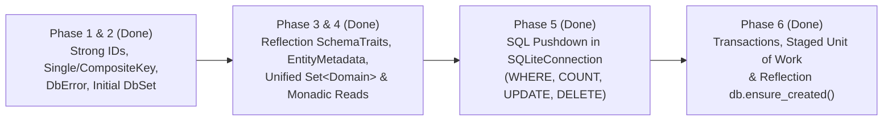
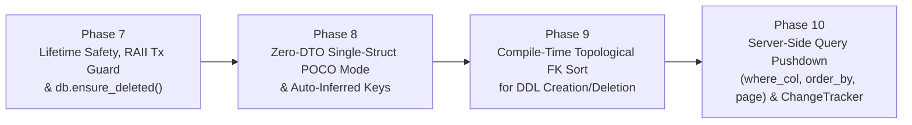

# CodeFirstCppDB_sqlgen — Architecture, Audit & Next-Gen Roadmap

> **Document Version:** 5.0 (Post-Phase-6 Consolidated Summary & Next-Gen Roadmap)  
> **Date:** 2026-11-14  
> **Active Branch:** `main` (at commit `77d8a73`)  
> **Toolchain Baseline:** GCC 16.1+ (`-std=c++26 -freflection`), CMake 4.4+, Ninja, SQLite 3  
> **Status:** Core Phases 1–6 Completed & Verified (38/38 GoogleTests passing across 7 suites)

---

## Table of Contents

1. [Executive Summary & Vision](#1-executive-summary--vision)
2. [Quick Start & Developer Setup](#2-quick-start--developer-setup)
3. [Current Architecture (v5.0 — Phases 1–6 Complete)](#3-current-architecture-v50--phases-16-complete)
   - [Directory Layout](#directory-layout)
   - [Layer Boundaries](#layer-boundaries)
   - [End-to-End Developer Experience](#end-to-end-developer-experience)
   - [Core Technical Pillars](#core-technical-pillars)
4. [Completed Engineering Roadmap (Phases 1–6 Summary)](#4-completed-engineering-roadmap-phases-16-summary)
5. [Post-Phase-6 Code Audit & Verification Findings](#5-post-phase-6-code-audit--verification-findings)
6. [Next-Generation Improvements Roadmap (Phases 7–10)](#6-next-generation-improvements-roadmap-phases-710)
7. [Architecture Comparison Matrix](#7-architecture-comparison-matrix)
8. [Appendix: Technical FAQ](#8-appendix-technical-faq)

---

## 1. Executive Summary & Vision

**CodeFirstCppDB_sqlgen** brings the **Code-First developer experience of C# and Entity Framework Core (EF Core)** to native C++26.

By combining **C++26 static reflection (`<meta>`)**, **C++23 deducing `this` & named modules (`import std;`)**, **C++20 concepts**, **monadic error handling (`std::expected`)**, and **`sqlgen`**, the library eliminates repetitive C++ data-access boilerplate entirely at compile time—without external code generators, preprocessor macros, or runtime reflection overhead.

```text
┌────────────────────────────────────────────────────────────────────────┐
│                        C++26 Domain Entities                           │
│     (Encapsulated classes or POCOs with SingleKey / CompositeKey)      │
└───────────────────────────────────┬────────────────────────────────────┘
                                    │
                       C++26 Static Reflection (std::meta)
                                    │
                                    ▼
┌────────────────────────────────────────────────────────────────────────┐
│               Compile-Time Relational Metadata Engine                  │
│   (SchemaTraits, SchemaOf<T>, EntityMetadata<T>, col_of<Member> ASTs)  │
└───────┬───────────────────────────┼────────────────────────────┬───────┘
        │                           │                            │
        ▼                           ▼                            ▼
┌──────────────────┐       ┌──────────────────┐       ┌──────────────────┐
│ db.ensure_created│       │ MapperTraits     │       │ DbContextBase &  │
│ (Reflected DDL)  │       │ (Private Splice) │       │ Set<T> / UoW API │
└───────┬──────────┘       └────────┬─────────┘       └────────┬─────────┘
        │                           │                          │
        └───────────────────────────┼──────────────────────────┘
                                    ▼
┌────────────────────────────────────────────────────────────────────────┐
│              SQLiteConnection / DatabaseConnection (sqlgen)            │
│       (Server-side WHERE, COUNT, UPDATE, DELETE & Transactions)        │
└────────────────────────────────────────────────────────────────────────┘
```

---

## 2. Quick Start & Developer Setup

### Prerequisites (Arch Linux / EndeavourOS)

```bash
sudo pacman -S --needed base-devel cmake ninja gdb sqlite postgresql-libs mariadb-libs

g++ --version     # Requires GCC 16.1+ (-std=c++26 -freflection)
cmake --version   # Requires CMake 4.4+ (CMAKE_CXX_MODULE_STD)
```

### Build, Test & Run

```bash
# 1. Initialize submodules (sqlgen, reflect-cpp, googletest)
git submodule update --init --recursive

# 2. Configure & build (GCC Debug preset)
cmake --preset gcc-debug
cmake --build build/linux/arch/gcc/debug

# 3. Run unit & integration test suite (38 tests across 7 test suites)
./build/linux/arch/gcc/debug/DAL/tests/test_DAL

# 4. Run the Startup application (creates & queries relationalDB.db)
./build/linux/arch/gcc/debug/Startup/Startup
./build/linux/arch/gcc/debug/Startup/Startup --no-reset
```

---

## 3. Current Architecture (v5.0 — Phases 1–6 Complete)

### Directory Layout

```text
CodeFirstCppDB_sqlgen/
├── CMakeLists.txt                  # Root CMake config (C++26, -freflection, import std)
├── CMakePresets.json               # Presets for gcc-debug, gcc-release
├── readme4.md                      # Master architectural specification & roadmap
│
├── Core/                           # Module: `core` (Pure Domain Layer — Zero DB deps)
│   ├── core.ixx                    # Primary module interface
│   ├── Id.ixx                      # Strong ID wrapper: Core::Id<Tag>
│   ├── Key.ixx                     # SingleKey<K>, CompositeKey<K...>, Key concepts
│   ├── entities/                   # Encapsulated domain entities (immutable IDs)
│   │   ├── Person.ixx              # Key = SingleKey<PersonId>
│   │   ├── Something.ixx           # Key = SingleKey<SomethingId>
│   │   └── Person_Something.ixx    # Key = CompositeKey<PersonId, SomethingId>
│   └── repositories/               # Abstract contracts & structured error model
│       ├── DbError.ixx             # DbError, DbErrorCode & message classifier
│       ├── IGenericRepository.ixx  # IRepository<T> & IGenericRepository<T, KeyType>
│       ├── IPersonRepository.ixx
│       ├── ISomethingRepository.ixx
│       └── IPerson_SomethingRepository.ixx
│
├── DAL/                            # Module: `dal` (Data Access Layer)
│   ├── dal.ixx                     # Primary module interface
│   ├── context/                    # EF Core-style Gateway, Set & Driver Adapter
│   │   ├── DbContext.ixx           # DbContextBase<Conn> (ensure_created, save_changes, tx)
│   │   ├── DbSet.ixx               # DbSet<Domain, DTO, Conn, Key> (Single & Composite)
│   │   └── SQLiteConnection.ixx    # SQL pushdown & transaction adapter over sqlgen
│   ├── schema/                     # Relational DTOs & compile-time reflection metadata
│   │   ├── SchemaTraits.ixx        # Concepts, SchemaOf<T>, col_of<Member>, WHERE builders
│   │   ├── EntityMetadata.ixx      # Compile-time table/column/key reflection inspector
│   │   ├── PersonDTO.ixx
│   │   ├── SomethingDTO.ixx
│   │   └── Person_SomethingDTO.ixx
│   ├── mappers/
│   │   └── MapperTraits.ixx        # Bidirectional Domain <-> DTO via std::meta splicing
│   ├── repositories/
│   │   ├── GenericRepository.ixx
│   │   ├── SQLitePersonRepo.ixx
│   │   ├── SQLiteSomethingRepo.ixx
│   │   └── SQLitePerson_SomethingRepo.ixx
│   └── tests/
│       └── test_DAL.cpp            # 38 GoogleTests (Mock + live :memory: SQLite)
│
└── Startup/                        # Pure-Module Composition Root (Zero #includes)
    └── main.cpp                    # Defines AppDbContext, seeds via UoW, queries entities
```

### Layer Boundaries

| Layer | Module / Namespace | Responsibilities | Architectural Rules |
| :--- | :--- | :--- | :--- |
| **Core** | `core` (`Core::*`) | Domain entities, `Id<Tag>`, `SingleKey`, `CompositeKey`, `DbError`, repository interfaces. | **Zero external dependencies.** No `sqlgen` or SQLite headers; immutable identities. |
| **DAL::Schema** | `dal` (`DAL::Schema::*`) | DTO structs, `SchemaOf<Domain>`, `EntityMetadata<Domain>`, and `col_of<Member>` AST builders. | Constrained by `RelationalEntity<T>` (`SinglePrimaryKey` or `CompositePrimaryKey`). |
| **DAL::Mappers** | `dal` (`DAL::Mappers::*`) | `MapperTraits<Domain, DTO>` converting private domain fields <-> public DTO members. | Uses `std::meta::access_context::unchecked()` and `consteval` name matching. |
| **DAL::Context** | `dal` (`DAL::*`) | `DbContextBase`, `DbSet` (`Set<Domain>`), and `SQLiteConnection`. | Coordinates `ensure_created()`, staged `save_changes()`, and SQL query pushdown. |
| **Startup** | Executable (`main.cpp`) | Defines `AppDbContext`, connects via `SQLiteConnection::connect`, and runs workflows. | **100% pure C++ modules** (`import std; import core; import dal;`) — no `#include`s or DTOs. |

### End-to-End Developer Experience

With Phases 1–6 in place, [Startup/main.cpp](file:///home/d5/Developer09/CodeFirstCppDB_sqlgen/Startup/main.cpp) requires zero preprocessor includes and zero manual SQL/DTO wiring:

```cpp
import std;
import core;
import dal;

class AppDbContext : public DAL::DbContextBase<DAL::SQLiteConnection> {
public:
    Set<Core::Person> people{ this };
    Set<Core::Something> somethings{ this };
    Set<Core::Person_Something> personSomethings{ this };

    using DbContextBase::DbContextBase;
};

int main() {
    auto conn = DAL::SQLiteConnection::connect("relationalDB.db").value();
    AppDbContext db(conn);

    // 1. Auto-creates all tables from reflected Set<T> members & enables foreign keys
    db.ensure_created().value();

    // 2. Stage changes in Unit of Work and commit atomically in a transaction
    db.defer_changes(true);
    db.people.add(Core::Person(Core::PersonId{ 1 }, "Ada", "Lovelace"));
    db.somethings.add(Core::Something(Core::SomethingId{ 1 }, "Analytical Engine", "Hardware"));
    db.personSomethings.add(Core::Person_Something(Core::PersonId{ 1 }, Core::SomethingId{ 1 }, "Architect"));
    db.save_changes().value(); // BEGIN TRANSACTION -> INSERTs -> COMMIT (or automatic ROLLBACK)

    // 3. Query single-key and composite-key sets uniformly
    auto ada = db.people.find(Core::PersonId{ 1 });
    auto link = db.personSomethings.find(Core::PersonId{ 1 }, Core::SomethingId{ 1 });
}
```

### Core Technical Pillars

1. **Private-Member Reflection Auto-Mapper ([MapperTraits.ixx](file:///home/d5/Developer09/CodeFirstCppDB_sqlgen/DAL/mappers/MapperTraits.ixx)):**
   - Uses `std::meta::nonstatic_data_members_of(^^Domain, std::meta::access_context::unchecked())` and splice expressions (`result.[:dom_m:] = ...`) to map private domain fields to/from DTOs (`snake_case` <-> `camelCase_`) without `friend` declarations or mutable ID setters.
2. **Compile-Time Key & Schema Introspection ([Key.ixx](file:///home/d5/Developer09/CodeFirstCppDB_sqlgen/Core/Key.ixx), [SchemaTraits.ixx](file:///home/d5/Developer09/CodeFirstCppDB_sqlgen/DAL/schema/SchemaTraits.ixx), [EntityMetadata.ixx](file:///home/d5/Developer09/CodeFirstCppDB_sqlgen/DAL/schema/EntityMetadata.ixx)):**
   - `SingleKey<K>` and `CompositeKey<K...>` support structured bindings (`auto [pid, sid] = link.getKey();`) and `std::formatter`.
   - `SinglePrimaryKey<DTO>` and `CompositePrimaryKey<DTO>` inspect `sqlgen::PrimaryKey` and `sqlgen::ForeignKey` fields via `consteval` reflection—working for any custom DTO regardless of column names.
   - `SchemaOf<Domain>` maps domain entities to their DTOs automatically so `Set<Core::Person>` requires only a single template argument.
3. **Reflection-to-`sqlgen::Col` SQL Pushdown ([SchemaTraits.ixx](file:///home/d5/Developer09/CodeFirstCppDB_sqlgen/DAL/schema/SchemaTraits.ixx#L137-L262), [SQLiteConnection.ixx](file:///home/d5/Developer09/CodeFirstCppDB_sqlgen/DAL/context/SQLiteConnection.ixx)):**
   - `col_of<Member>` converts `std::meta::identifier_of(Member)` into an `rfl::internal::StringLiteral` at compile time to instantiate `sqlgen::Col<...>`.
   - `try_get_by_id`, `try_get_by_composite_id`, `try_count`, `update`, and `delete_by_id` / `delete_by_composite_id` generate targeted `WHERE ... LIMIT 1`, `SELECT COUNT(*)`, `UPDATE ... SET ... WHERE`, and `DELETE FROM ... WHERE` SQL statements.
4. **Reflection-Driven `ensure_created()` & Transactional Unit of Work ([DbContext.ixx](file:///home/d5/Developer09/CodeFirstCppDB_sqlgen/DAL/context/DbContext.ixx)):**
   - `ensure_created(this Self&& self)` uses C++23 deducing `this` and C++26 `std::meta::nonstatic_data_members_of(^^DerivedType)` to discover all `Set<T>` members on the user's `DbContext`, create their tables (`CREATE TABLE IF NOT EXISTS`), and enable `PRAGMA foreign_keys = ON;`.
   - `save_changes()` and `transaction(fn)` wrap staged mutations inside `BEGIN TRANSACTION` / `COMMIT` with automatic `ROLLBACK` on any constraint or driver error.

---

## 4. Completed Engineering Roadmap (Phases 1–6 Summary)



- [x] **Phases 1 & 2 — Foundations & Key Model:** Enforced immutable entity IDs, implemented `SingleKey<K>` and `CompositeKey<K...>`, split `IRepository` from `IGenericRepository`, and added `DbError::map_from_message`.
- [x] **Phase 3 — Reflection Schema Concepts & Metadata:** Replaced hardcoded field checks in `SinglePrimaryKey`/`CompositePrimaryKey` with `<meta>` field introspection, added `SchemaOf<Domain>`, and built `EntityMetadata<Domain, DTO>`.
- [x] **Phase 4 — Unified `DbSet<Domain>` & Monadic Reads:** Enabled `Set<Domain>` for both single-key and composite-key entities (with variadic `find(k1, k2)` / `remove(k1, k2)`) and added `try_to_vector()` / `try_find()` returning `std::expected<..., Core::DbError>`.
- [x] **Phase 5 — SQL Query Pushdown & True `UPDATE`:** Built `col_of<Member>`, `make_pk_where`, and `make_composite_where` to push single/composite lookups, `COUNT(*)`, `DELETE`, and `UPDATE` down to SQLite (fixing `sqlgen::write`'s insert-only behavior).
- [x] **Phase 6 — Unit of Work, Transactions & `ensure_created()`:** Added `SQLiteConnection::connect`, `begin_transaction`/`commit`/`rollback`, staged `defer_changes(true)` + atomic `save_changes()`, scoped `db.transaction(fn)`, and reflection-driven `db.ensure_created()`.

---

## 5. Post-Phase-6 Code Audit & Verification Findings

A full build and audit of commit `77d8a73` confirmed:
- **Build & Test Health:** All **38 unit and integration tests across 7 test suites** in [test_DAL.cpp](file:///home/d5/Developer09/CodeFirstCppDB_sqlgen/DAL/tests/test_DAL.cpp) pass in ~8 ms, and [Startup/main.cpp](file:///home/d5/Developer09/CodeFirstCppDB_sqlgen/Startup/main.cpp) runs cleanly with zero `#include` directives.
- **Subtle Edge Cases & Opportunities Identified During Audit:**
  1. **`DbContextBase` Copy/Move Lifetime Safety ([DbContext.ixx](file:///home/d5/Developer09/CodeFirstCppDB_sqlgen/DAL/context/DbContext.ixx#L34-L42), [DbSet.ixx](file:///home/d5/Developer09/CodeFirstCppDB_sqlgen/DAL/context/DbSet.ixx#L38-L45)):**
     - When `Set<Core::Person> people{ this };` is initialized on a derived `DbContext`, `DbSet` captures the raw `ctx` (`this`) pointer inside its `is_deferred_fn_` and `enqueue_op_fn_` lambdas.
     - If a user copies or moves an `AppDbContext` instance, those lambdas in the copied/moved `DbSet` members would still point to the old `DbContext` address (dangling pointer!). `DbContextBase` should explicitly `= delete` its copy and move constructors/assignment operators.
  2. **`SQLiteConnection` Open/Close State & Legacy `ITransaction` Stub ([SQLiteConnection.ixx](file:///home/d5/Developer09/CodeFirstCppDB_sqlgen/DAL/context/SQLiteConnection.ixx#L142-L145), [DbContext.ixx](file:///home/d5/Developer09/CodeFirstCppDB_sqlgen/DAL/context/DbContext.ixx#L14-L21)):**
     - `SQLiteConnection::is_open()` is currently a hardcoded `return true;`. Adding `close()` and a `bool is_open_{ true };` member (and rolling back any uncommitted transaction in `close()` / `~SQLiteConnection()`) brings `SQLiteConnection` to full parity with `TestDatabaseConnection`.
     - `class ITransaction` in `DbContext.ixx` is an unused interface stub from Phase 1 and can either be removed or replaced by an RAII `TransactionGuard`.
  3. **Declaration-Order Sensitivity in `db.ensure_created()` ([DbContext.ixx](file:///home/d5/Developer09/CodeFirstCppDB_sqlgen/DAL/context/DbContext.ixx#L85-L108)):**
     - `ensure_created()` iterates `Set<T>` members in the order they are declared in the derived class. If a junction `Set` is declared *before* the parent `Set` it references, strict SQL engines will reject the `CREATE TABLE` foreign key reference unless sorted topologically.
  4. **In-Memory Lambda Filtering in `DbSet::where` ([DbSet.ixx](file:///home/d5/Developer09/CodeFirstCppDB_sqlgen/DAL/context/DbSet.ixx#L271-L300)):**
     - While primary-key, composite-key, and count operations now execute in SQL, `DbSet::where(pred)` and `first_or_default(pred)` still load `to_vector()` into C++ memory.

---

## 6. Next-Generation Improvements Roadmap (Phases 7–10)

To evolve **CodeFirstCppDB_sqlgen** from a completed 6-phase foundation into a production-hardened, general-purpose C++26 ORM library, we propose **Phases 7 through 10**:



### Phase 7: Lifetime Hardening, Connection Lifecycle & `db.ensure_deleted()` *(Completed)*
- [x] **Task 7.1: Prevent Dangling Context Pointers (`DAL/context/DbContext.ixx`)**
  - Explicitly `= delete` copy and move constructors/assignment operators on `DbContextBase` so `Set<T>{ this }` member closures can never dangle.
  - Replace the unused `ITransaction` interface with an RAII `TransactionScope` guard that automatically rolls back on scope exit if not committed.
- [x] **Task 7.2: `SQLiteConnection::close()` & Destructor Safety (`DAL/context/SQLiteConnection.ixx`)**
  - Add `void close() noexcept` and `bool is_open_{ true };` to `SQLiteConnection`, automatically rolling back if `in_transaction_` is true when closed or destroyed.
- [x] **Task 7.3: Reflection-Driven `db.ensure_deleted()` (`DAL/context/DbContext.ixx` & `SQLiteConnection.ixx`)**
  - Add `ensure_table_dropped<DTO>()` (`sqlgen::drop<DTO> | sqlgen::if_exists`) and `db.ensure_deleted(this Self&& self)` (iterating reflected `Set<T>` members in reverse order so child/junction tables are dropped before parent tables), eliminating `std::filesystem::remove(dbPath)` in `Startup/main.cpp`.

### Phase 8: Zero-DTO Single-Struct POCO Mode & Auto-Inferred Keys *(Completed)*
- [x] **Task 8.1: Identity Fast-Path in `MapperTraits<T, T>` (`DAL/mappers/MapperTraits.ixx`)**
  - Add `if constexpr (std::is_same_v<Domain, DTO>) return dto;` in `MapperTraits::to_domain` and `to_dto` so a single struct annotated with `sqlgen::PrimaryKey` / `sqlgen::ForeignKey` can serve as both `Domain` and `DTO` with zero copy/mapping overhead.
- [x] **Task 8.2: Automatic `InferredKey_t<DTO>` Fallback (`DAL/schema/SchemaTraits.ixx` & `EntityMetadata.ixx`)**
  - Use C++26 `<meta>` over `key_members_of<DTO>()` to synthesize `Core::SingleKey<V>` or `Core::CompositeKey<V1, V2, ...>` automatically when `Domain::Key` is not manually defined on a POCO struct.

### Phase 9: Compile-Time Topological Foreign-Key Sorting
- [ ] **Task 9.1: `consteval` Foreign-Key Dependency Graph (`DAL/schema/SchemaTraits.ixx`)**
  - Inspect `SqlgenForeignKeyField<F>::ForeignTableType` across all reflected `Set<T>` DTOs in a `DbContext` at compile time (`consteval`) to compute a topological creation order (parents before children) and reverse deletion order (children before parents), making `db.ensure_created()` and `db.ensure_deleted()` completely independent of member declaration order in `AppDbContext`.

### Phase 10: Server-Side Query Builder (`where_col`, `order_by`, `page`) & Dirty-Checking `ChangeTracker`
- [ ] **Task 10.1: Fluent Server-Side Query Pushdown on `DbSet` (`DAL/context/DbSet.ixx` & `SQLiteConnection.ixx`)**
  - Add `where_sql(Condition)`, `where_equal<ColLiteral>(val)`, `order_by<ColLiteral>(desc)`, and `page(limit, offset)` on `DbSet` so filtering, sorting, and pagination translate directly into `sqlgen::read<std::vector<DTO>> | sqlgen::where(...) | sqlgen::order_by(...) | sqlgen::limit(...) | sqlgen::offset(...)`.
- [ ] **Task 10.2: Optional Identity Map & Snapshot `ChangeTracker` (`DAL/context/DbContext.ixx`)**
  - Track entities loaded via `find()` / `to_vector()` by `Domain::Key`; on `save_changes()`, compare current domain state against the original snapshot (`MapperTraits::to_dto`) and automatically emit `UPDATE` statements for mutated entities without requiring explicit `db.set.update(entity)` calls.

---

## 7. Architecture Comparison Matrix

| Feature / Aspect | Early v3 Baseline | Current `main` (v5.0 — Phases 1–6) | Next-Gen Target (Phases 7–10) | C# Entity Framework Core |
| :--- | :--- | :--- | :--- | :--- |
| **Entity Identity** | Mutable (`setId`) | Immutable (`Id<Tag>`, `SingleKey`, `CompositeKey`) | Auto-inferred `Key` for plain POCOs | `[Key]` or Convention |
| **Composite Keys** | Broken (`static_assert`) | Generic `Set<T>` + reflected composite SQL | + Auto-inferred composite keys | `.HasKey(x => new { x.K1, x.K2 })` |
| **DbSet Ergonomics** | Manual Repos only | `Set<Domain>` (Single & Composite keys) | + Single-struct POCO mode | `DbSet<TEntity>` |
| **Query Execution** | Raw `sqlgen::read` | SQL pushdown for `find`, `count`, `update`, `remove` | + Server-side `where_col`, `order_by`, `page` | LINQ `IQueryable` -> SQL |
| **Unit of Work** | None | Staged `defer_changes` + atomic `save_changes()` | + Snapshot dirty-checking `ChangeTracker` | `ChangeTracker` + `SaveChanges()` |
| **Schema Creation** | Manual `create_table` | Reflected `db.ensure_created()` (`this Self&&`) | + Compile-time FK topological sort & `ensure_deleted()` | `EnsureCreated()` / `EnsureDeleted()` |
| **Error Handling** | Hardcoded `Unknown` | Monadic `std::expected<T, DbError>` on reads/writes | + RAII `TransactionScope` guard | `DbUpdateException` |

---

## 8. Appendix: Technical FAQ

1. **Why is GCC 16.1+ required instead of Clang?**
   - GCC 16.1+ implements ISO C++26 static reflection (`P2996`) via `-std=c++26 -freflection` and `<meta>`. Standard Clang releases do not yet support `<meta>`.
2. **Why is `extern/reflect-cpp` still needed if our code uses C++26 `<meta>`?**
   - Our `Core` and `DAL` modules exclusively use C++26 `<meta>`, but the `sqlgen` library itself depends on `reflect-cpp` (`rfl::Result`, `rfl::Ref`, `rfl::NamedTuple`) internally.
3. **How does `MapperTraits` populate private fields on `Core::Person` without `friend` or setters?**
   - `std::meta::access_context::unchecked()` combined with member splicing (`result.[:dom_m:] = ...`) reads and writes private members at compile time without exposing mutable setters on domain models.
4. **How does `db.ensure_created()` know which tables to create without a template pack on `DbContextBase`?**
   - It uses C++23 **deducing `this`** (`this Self&& self`) to deduce the derived `AppDbContext` type and reflects all `IsDbSetMember` data members of `Self` via `std::meta::nonstatic_data_members_of(^^DerivedType, std::meta::access_context::unchecked())`.
