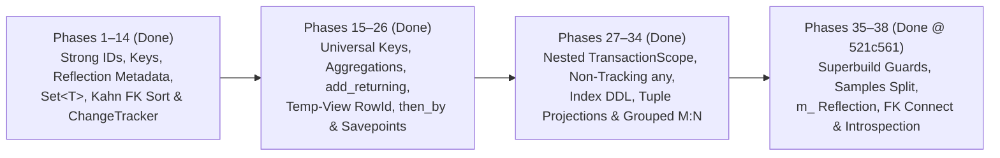
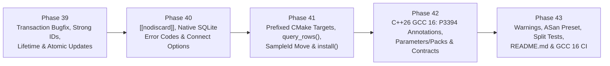

# CodeFirstCppDB_sqlgen — Architecture, Reusability & Next-Gen Roadmap

> **Document Version:** 13.0 (Post-Phase-38 Triple Audit: [readme5.md](readme5.md) Triage, `521c561` Code Review, & Downstream Consumer Feedback — Phases 39–43 Roadmap)  
> **Date:** 2026-11-15  
> **Active Branch:** `main` (at commit `521c561`)  
> **Toolchain Baseline:** GCC 16.2+ (`-std=c++26 -freflection`), CMake 4.0+ (verified on 4.5.0), Ninja, SQLite 3  
> **Status:** Phases 1–38 Completed & Verified (75/75 GoogleTests passing across 37 suites)

---

## Table of Contents

1. [Executive Summary & Vision](#1-executive-summary--vision)
2. [Quick Start, Coding Standards & Developer Setup](#2-quick-start-coding-standards--developer-setup)
3. [Current Architecture & Library Stack (v13.0 — Phases 1–38 Complete)](#3-current-architecture--library-stack-v130--phases-138-complete)
   - [Directory Layout](#directory-layout)
   - [Layer Boundaries](#layer-boundaries)
   - [External Submodule Libraries Assessment](#external-submodule-libraries-assessment)
   - [End-to-End Developer Experience (Encapsulated, Zero-DTO POCO, & `m_` Aggregate Modes)](#end-to-end-developer-experience-encapsulated-zero-dto-poco--m_-aggregate-modes)
   - [Core Technical Pillars](#core-technical-pillars)
4. [Completed Engineering Roadmap (Phases 1–38 Summary)](#4-completed-engineering-roadmap-phases-138-summary)
5. [Triple-Source Post-Phase-38 Audit (`readme5.md` Triage, `521c561` Review, & Downstream Consumer Feedback)](#5-triple-source-post-phase-38-audit-readme5md-triage-521c561-review--downstream-consumer-feedback)
   - [5.1 Independent Review (`readme5.md`) Triage (Audited @ `01853df`, Re-Evaluated @ `521c561`)](#51-independent-review-readme5md-triage-audited--01853df-re-evaluated--521c561)
   - [5.2 Re-Evaluation of Phases 35–38 (`521c561`) Implementation](#52-re-evaluation-of-phases-3538-521c561-implementation)
   - [5.3 Downstream Consumer Re-Evaluation ("Project Horizon")](#53-downstream-consumer-re-evaluation-project-horizon)
6. [Next-Generation Hardening, Packaging & C++26 Modernization Roadmap (Phases 39–43)](#6-next-generation-hardening-packaging--c26-modernization-roadmap-phases-3943)
   - [Phase 39: Transactional Correctness, Strong-ID Safety & Lifecycle Hardening](#phase-39-transactional-correctness-strong-id-safety--lifecycle-hardening)
   - [Phase 40: Unified Error Policy, Native SQLite Extended Codes & `[[nodiscard]]` Hygiene](#phase-40-unified-error-policy-native-sqlite-extended-codes--nodiscard-hygiene)
   - [Phase 41: Downstream Superbuild Polish, Dynamic Row Query API (`query_rows`) & CMake `install()`](#phase-41-downstream-superbuild-polish-dynamic-row-query-api-query_rows--cmake-install)
   - [Phase 42: Cutting-Edge C++26 & GCC 16 Reflection Modernization (P3394 Annotations, `define_aggregate`, Constructors & Contracts)](#phase-42-cutting-edge-c26--gcc-16-reflection-modernization-p3394-annotations-define_aggregate-constructors--contracts)
   - [Phase 43: Tooling, Sanitizers, Strict Warnings, Test Modularity & User Documentation](#phase-43-tooling-sanitizers-strict-warnings-test-modularity--user-documentation)
7. [External Consumer Integration Guide (CMake `FetchContent` & `add_subdirectory`)](#7-external-consumer-integration-guide-cmake-fetchcontent--add_subdirectory)
8. [Architecture Comparison Matrix](#8-architecture-comparison-matrix)
9. [Appendix: Technical FAQ](#9-appendix-technical-faq)

---

## 1. Executive Summary & Vision

**CodeFirstCppDB_sqlgen** brings the **Code-First developer experience of C# and Entity Framework Core (EF Core)** to native **ISO C++26** on the latest **GCC 16+ toolchain** as a **plug-and-play reusable library**.

By combining **C++26 static reflection (`<meta>`, `std::meta::info`, `template for`, constexpr exceptions)**, **C++23 deducing `this` & named modules (`import std;`)**, **C++20 concepts**, **monadic error handling (`std::expected`)**, and **`sqlgen`**, the library eliminates repetitive C++ data-access boilerplate at compile time—without external code generators, preprocessor macros, or runtime reflection overhead. See [CODING_STANDARDS.md](CODING_STANDARDS.md) for the project's C++26 module, naming, SQLite integrity, and CMake packaging rules.

```text
┌────────────────────────────────────────────────────────────────────────┐
│                   Consumer C++26 Domain / Data Models                  │
│   (DDD Classes, Zero-DTO POCOs, `m_` Aggregates, or P3394 Annotated)   │
└───────────────────────────────────┬────────────────────────────────────┘
                                    │
                       C++26 Static Reflection (std::meta)
                                    │
                                    ▼
┌────────────────────────────────────────────────────────────────────────┐
│         Pure Reusable ORM Modules: `core` & `dal` (CodeFirstCppDB)     │
│   (SchemaTraits, EntityKey_t, ValidQueryColumn, Topological FK Graph)  │
└───────┬───────────────────────────┼────────────────────────────┬───────┘
        │                           │                            │
        ▼                           ▼                            ▼
┌──────────────────┐       ┌──────────────────┐       ┌──────────────────┐
│ ensure_created & │       │ MapperTraits     │       │ DbContextBase,   │
│ ensure_index     │       │ (Private Splice, │       │ Set<T>, DbQuery, │
│ (Kahn FK + UX)   │       │  m_ / _ & POCO)  │       │ Grouped FK & UoW │
└───────┬──────────┘       └────────┬─────────┘       └────────┬─────────┘
        │                           │                          │
        └───────────────────────────┼──────────────────────────┘
                                    ▼
┌────────────────────────────────────────────────────────────────────────┐
│              SQLiteConnection / DatabaseConnection (sqlgen)            │
│   (AST Pushdown, Tuple Projections, SAVEPOINT, Introspection, Raw SQL) │
└────────────────────────────────────────────────────────────────────────┘
```

---

## 2. Quick Start, Coding Standards & Developer Setup

### Prerequisites (Arch Linux / EndeavourOS)

```bash
sudo pacman -S --needed base-devel cmake ninja gdb sqlite

g++ --version     # Requires GCC 16.1+ (verified on 16.2.1 with -std=c++26 -freflection)
cmake --version   # Requires CMake 4.0+ (verified on 4.5.0 with CMAKE_CXX_MODULE_STD)
```

### Build, Test & Run (Standalone Development Mode)

```bash
# 1. Initialize submodules (sqlgen, reflect-cpp, googletest)
git submodule update --init --recursive

# 2. Configure & build (GCC Debug preset)
cmake --preset gcc-debug
cmake --build build/linux/arch/gcc/debug

# 3. Run unit & integration test suite (75 tests across 37 test suites)
./build/linux/arch/gcc/debug/DAL/tests/test_DAL

# 4. Run the Startup application (creates & queries relationalDB.db)
./build/linux/arch/gcc/debug/Startup/Startup
./build/linux/arch/gcc/debug/Startup/Startup --no-reset
```

Before modifying core modules, DTO traits, or build targets, review [CODING_STANDARDS.md](CODING_STANDARDS.md). For the earlier independent review on `01853df` and GCC 16.2.1 feature probe results, see [readme5.md](readme5.md).

---

## 3. Current Architecture & Library Stack (v13.0 — Phases 1–38 Complete)

### Directory Layout

```text
CodeFirstCppDB_sqlgen/
├── CMakeLists.txt                  # Root CMake config (C++26, PROJECT_IS_TOP_LEVEL guards, import std)
├── CMakePresets.json               # Presets for gcc-debug, gcc-release (plus legacy clang stubs)
├── CODING_STANDARDS.md             # Project coding, naming, SQLite & CMake packaging standards
├── readme4.md                      # Master architectural specification, audit triage & roadmap
├── readme5.md                      # Independent architecture/C++26 review snapshot (Review101_pkstl @ 01853df)
│
├── Core/                           # Module: `core` (Domain Primitives & Repository Contracts)
│   ├── CMakeLists.txt              # Target `Core` + aliases `CodeFirstCppDB::Core` / `CodeFirst::Core`
│   ├── core.ixx                    # Primary module interface
│   ├── Id.ixx                      # Strong ID wrapper: Core::Id<Tag, ValueType> (+ legacy sample aliases pending Phase 41 move)
│   ├── Key.ixx                     # SingleKey<K>, CompositeKey<K...>, Key concepts
│   └── repositories/               # Abstract contracts & structured error model
│       ├── DbError.ixx             # DbError, DbErrorCode & message classifier
│       └── IGenericRepository.ixx  # IRepository<T> & IGenericRepository<T, KeyType>
│
├── DAL/                            # Module: `dal` (Reusable Data Access & ORM Engine)
│   ├── CMakeLists.txt              # Target `DAL` + aliases `CodeFirstCppDB::DAL` / `CodeFirst::DAL`
│   ├── dal.ixx                     # Primary module interface
│   ├── context/                    # EF Core-style Gateway, Set, Query & Driver Adapter
│   │   ├── DbContext.ixx           # DbContextBase<Conn>, TransactionScope, Grouped/Batch FK Nav, Introspection forwards
│   │   ├── DbSet.ixx               # DbSet<Domain> & composable server-side DbQuery (select_columns, index DDL)
│   │   └── SQLiteConnection.ixx    # SQL pushdown, tuple reads, index DDL, temp-view rowid, savepoints, list_tables, table_info, execute_raw
│   ├── schema/                     # Compile-time reflection metadata & relational traits
│   │   ├── SchemaTraits.ixx        # Concepts, InferredKey_t, dto_equals, Kahn FK sort
│   │   └── EntityMetadata.ixx      # Compile-time table/column/key reflection inspector
│   ├── mappers/
│   │   └── MapperTraits.ixx        # Domain <-> DTO splice mapper (m_/M_/_ stripping), with_primary_key, ValidQueryColumn
│   ├── repositories/
│   │   └── GenericRepository.ixx   # Type-agnostic CRUD repository (Single & Composite keys)
│   └── tests/
│       └── test_DAL.cpp            # 75 GoogleTests across 37 suites (built when CODEFIRST_BUILD_TESTS=ON)
│
├── Samples/                        # Module: `samples` (Opt-in Demo Entities, DTOs & Sample Repos)
│   ├── CMakeLists.txt              # Target `Samples` + aliases `CodeFirstCppDB::Samples` / `CodeFirst::Samples`
│   └── samples.ixx                 # Exports sample partitions (referencing Core/entities, DAL/schema/*DTO, etc.)
│
└── Startup/                        # Pure-Module Demo App (built when CODEFIRST_BUILD_EXAMPLES=ON)
    └── main.cpp                    # Defines AppDbContext, seeds via UoW, queries entities
```

### Layer Boundaries

| Layer | Module / CMake Target | Responsibilities | Architectural Rules & Remaining Notes |
| :--- | :--- | :--- | :--- |
| **Core** | `core` (`Core` / `CodeFirstCppDB::Core`) | `Id<Tag, ValueType>`, `SingleKey`, `CompositeKey`, `DbError`, `IRepository`, `IGenericRepository`. | Zero `sqlgen` or SQLite headers. *Pending Phase 41:* move `PersonId`/`SomethingId` out of [Core/Id.ixx](Core/Id.ixx#L41-L42) into `Samples`, and prefix target name (`CodeFirstCppDB_Core`). |
| **DAL** | `dal` (`DAL` / `CodeFirstCppDB::DAL`) | `SchemaOf<Domain>`, `EntityKey_t<Domain>`, `EntityMetadata<Domain>`, `MapperTraits`, `GenericRepository`, `DbContextBase`, `TransactionScope`, `DbSet`, `DbQuery`, and `SQLiteConnection`. | Entity-agnostic ORM engine, runtime `list_tables()`, `table_info()`, and `execute_raw()`. *Pending Phase 41:* move `-Wno-*` flags `PRIVATE`, prefix target name, add `query_rows()`. |
| **Samples** | `samples` (`Samples` / `CodeFirstCppDB::Samples`) | Sample `Person`, `Something`, `Person_Something` domain classes, DTOs, and sample repositories. | Defaults to `CODEFIRST_INCLUDE_SAMPLES=OFF` when `!PROJECT_IS_TOP_LEVEL`. Linked by `Startup` and `test_DAL`. |
| **Startup** | Executable ([Startup/main.cpp](Startup/main.cpp)) | Demo application creating and querying `relationalDB.db`. | Built only when `CODEFIRST_BUILD_EXAMPLES=ON`. *Pending Phase 39:* fix `--no-reset` auto-increment ID reuse bug. |

### External Submodule Libraries Assessment

| Submodule / Library | Version / Role | How We Use It | Audit & Integration Notes |
| :--- | :--- | :--- | :--- |
| **`extern/sqlgen`** | `0.6.0` (SQL AST & Driver Layer) | Provides `sqlgen::sqlite::Connection`, `PrimaryKey`, `ForeignKey`, `Col`, `read`, `select_from`, `where`, `group_by`, `order_by`, `limit`, `offset`, `insert`, `insert_or_replace`, `update`, `delete_from`, `create_table`, `create_index`, `drop`, and aggregations. | Isolated behind `DAL` global module fragments (`module; #include <sqlgen.hpp>`). Guarded with `if(NOT TARGET sqlgen)`. |
| **`extern/reflect-cpp`** | Transitive dependency of `sqlgen` | Supplies `rfl::Result`, `rfl::Ref`, `rfl::Tuple`, `rfl::NamedTuple`, and `rfl::internal::StringLiteral` used inside `sqlgen`'s SQL transpiler. | **Not** used for JSON or domain reflection in our code; all `Core`/`DAL` introspection uses native ISO C++26 `<meta>`. |
| **`extern/googletest`** | Unit & Integration Testing | Runs 75 tests across 37 suites (`test_DAL`). | Guarded behind `if(CODEFIRST_BUILD_TESTS)` so external consumers never configure or build GoogleTest. |

### End-to-End Developer Experience (Encapsulated, Zero-DTO POCO, & `m_` Aggregate Modes)

```cpp
import std;
import core;
import dal;

// Pure aggregate struct following `m_` member naming convention
struct PersonRecord {
    std::int32_t m_id = 0;
    std::string m_firstName;
    std::string m_lastName;
};

// AppDbContext binding DbSet<T> properties via C++26 reflection
class AppDbContext : public DAL::DbContextBase<DAL::SQLiteConnection> {
public:
    Set<PersonRecord> people{ this };
    using DbContextBase::DbContextBase;
};
```

### Core Technical Pillars

1. **Private-Member Splicing, `m_` / `_` Affix Stripping & Case-Insensitive Column Resolution ([DAL/mappers/MapperTraits.ixx](DAL/mappers/MapperTraits.ixx#L24-L176)):**
   - Maps encapsulated private fields (`camelCase_`), `m_`-prefixed fields (`m_camelCase` / `M_camelCase`), or public fields (`camelCase` / `snake_case`) to/from DTO columns (`snake_case`) and splices database-generated primary keys back into domain entities (`with_primary_key`) using `std::meta::access_context::unchecked()`.
   - Resolves `"m_firstName"`, `"FirstName"`, `"firstName"`, `"firstName_"`, and `"first_name"` to `PersonDTO::first_name` in $O(M)$ compile time via `ValidQueryColumn<Domain, DTO, ColLiteral>`.
2. **Universal STL & Strong-ID Keys ([Core/Id.ixx](Core/Id.ixx), [Core/Key.ixx](Core/Key.ixx), [DAL/schema/SchemaTraits.ixx](DAL/schema/SchemaTraits.ixx)):**
   - `Core::Id<Tag, ValueType = std::int32_t>`, `SingleKey<K>`, `CompositeKey<K...>`, and `InferredKey_t<DTO>` support `std::int32_t`, `std::int64_t`, `std::string`, and heterogeneous composite keys.
3. **Compile-Time Topological Foreign-Key Sorting, Index DDL & Grouped Relationship Navigation ([DAL/schema/SchemaTraits.ixx](DAL/schema/SchemaTraits.ixx), [DAL/context/DbContext.ixx](DAL/context/DbContext.ixx)):**
   - `kahn_topological_sort` orders `ensure_created()` and `ensure_deleted()` at compile time (`consteval`), automatically creating composite-key `UNIQUE` indexes on junction tables.
   - `query_children`, `query_parent`, `query_children_batch`, `query_children_grouped`, `query_parents_batch`, `query_many_to_many`, `query_many_to_many_batch`, and `query_many_to_many_grouped` navigate foreign-key relationships via batched `IN` queries.
4. **Composable Server-Side `DbQuery`, Tuple Projections, Savepoints & Runtime SQLite Introspection ([DAL/context/DbSet.ixx](DAL/context/DbSet.ixx), [DAL/context/SQLiteConnection.ixx](DAL/context/SQLiteConnection.ixx)):**
   - `DbQuery` composes `where_*` and `or_where_*` predicates, multi-column `order_by`/`then_by`, `LIMIT/OFFSET`, `.select<"col">()`, `.select_distinct<"col">()`, `.select_columns<"c1", "c2">()`, `.select_distinct_columns<"c1", "c2">()`, aggregations, non-tracking `.any()`, `.remove_where()`, `.update_where<Cols...>(vals...)`, and `.ensure_index_created<Name, Cols...>()`.
   - `SQLiteConnection` & `DbContextBase` expose pure-module `list_tables()`, `table_info(table_name)`, and `execute_raw(sql)`.

---

## 4. Completed Engineering Roadmap (Phases 1–38 Summary)



- [x] **Phases 1–14 — Core Foundations, Reflection Metadata, POCO Mode, Topological FK Sort, Zero-JSON `ChangeTracker`, Composable `DbQuery`, Upsert & FK Navigation (`01853df`).**
- [x] **Phases 15–18 — Universal STL Keys, Domain Column Resolution, Batched M:N `IN` Pushdown & Repository Cleanup (`dca5d38`).**
- [x] **Phases 19–22 — Build Hardening, ORM Engine Decoupling, Case-Insensitive Columns, `NULL`/Negative Predicates, SQL Aggregations & `add_returning` (`88c46ac`).**
- [x] **Phases 23–26 — Read-Only Temp-View `try_last_insert_rowid()`, `add_range_returning()`, `then_by`, `select`, `where_between`, `update_where`, `query_children_batch` / `query_parents_batch`, & `SAVEPOINT`s (`a51208b`).**
- [x] **Phases 27–30 — Nested `TransactionScope` Savepoints, Non-Tracking `any()` / `COUNT(*)` `exists()`, Variadic `update_where`, `select_distinct` / `count_distinct`, Full `or_where_*` Parity, `query_children_grouped`, & `query_many_to_many_batch` (`8a1f87c`).**
- [x] **Phases 31–34 — Index & Partial Index DDL, Multi-Column Tuple Projections, Grouped M:N Eager Hydration, & Savepoint Dirty-Flush (`7b95202`).**
- [x] **Phase 35 — CMake Superbuild Consumer Readiness (`521c561`):** Lowered `cmake_minimum_required(VERSION 4.0)`, renamed project to `CodeFirstCppDB`, added `PROJECT_IS_TOP_LEVEL` guards for `CODEFIRST_BUILD_TESTS`, `CODEFIRST_BUILD_EXAMPLES`, `CODEFIRST_INCLUDE_SAMPLES`, `reflectcpp`, `sqlgen`, and `gtest`, and added `CodeFirstCppDB::*` / `CodeFirst::*` aliases.
- [x] **Phase 36 — `Samples` Target Decoupling (`521c561`):** Moved `Person`, `Something`, `Person_Something`, their DTOs, and `SQLite*Repo` out of `core` / `dal` into opt-in `Samples` (`export module samples;`).
- [x] **Phase 37 — `m_` Member Prefix Reflection & SQLite Hardening (`521c561`):** Added `strip_member_affixes()` (`m_` / `M_` / `_`) in `MapperTraits` & `ValidQueryColumn`, called `enable_foreign_keys()` in `SQLiteConnection::connect()`, and auto-created `ux_<table>_composite_pk` unique index in `ensure_table_created<DTO>()`.
- [x] **Phase 38 — Runtime SQLite Introspection API (`521c561`):** Added `TableColumnInfo`, `list_tables()`, `table_info()`, and `execute_raw()` on `SQLiteConnection` and `DbContextBase`.

---

## 5. Triple-Source Post-Phase-38 Audit (`readme5.md` Triage, `521c561` Review, & Downstream Consumer Feedback)

### 5.1 Independent Review ([readme5.md](readme5.md)) Triage (Audited @ `01853df`, Re-Evaluated @ `521c561`)

Because [readme5.md](readme5.md) was written against an early baseline (`Review101_pkstl` @ `01853df`, Phases 1–14), each proposal was re-verified directly against `main` (`521c561`):

| Item in `readme5.md` | Status @ `521c561` | Verdict & Verification Evidence |
| :--- | :--- | :--- |
| **C2** Composite junction PK/UNIQUE missing | **Mostly Resolved (Phase 37)** | `ensure_table_created` emits `ux_<table>_composite_pk` (`SQLiteConnection.ixx:89-113`). Minor caveat: `PRAGMA table_info()` reports `pk_index == 0` because uniqueness uses an index rather than `PRIMARY KEY (...)` inside `CREATE TABLE`. |
| **C5** `PRAGMA foreign_keys = ON` missing on `connect()` | **Resolved (Phase 37)** | `SQLiteConnection::connect()` calls `handle->enable_foreign_keys()` (`SQLiteConnection.ixx:68-71`). Optional `busy_timeout` / `wal_mode` remain manual opt-ins. |
| **C7** `SQLitePersonRepo` failing under `SQLiteConnection` | **Resolved** | `SQLitePersonRepo.ixx:30-40` dispatches via `if constexpr (requires { ... fetch_where_equal ... })`, though the legacy mock branch remains dead code (`A2`). |
| **C8** Hardcoded `std::int32_t` keys | **Resolved (Phases 15–18)** | `SingleKey<K>`, `CompositeKey<K...>`, and `GenericRepository` support arbitrary `ReflectionType` keys. |
| **A1** Library mixed with sample entities/DTOs | **Mostly Resolved (Phase 36)** | `Samples` target created, **except** `PersonId` and `SomethingId` still remain in `Core/Id.ixx:41-42`. |
| **C10** N+1 M:N queries, `remove_where()` stale tracker, movable `DbContext`, missing `then_by` / `ValidQueryColumn` | **Resolved (Phases 16–33)** | `query_many_to_many` uses `IN` pushdown, `remove_where()`/`update_where()` call `clear_track_fn_()` (note: clears all tracked entries of that `Domain` type), `DbContextBase` deletes copy/move, `then_by` & `ValidQueryColumn` exist. |
| **C4** `save_changes()` commits caller's outer transaction | **STILL BUGGY** | `DbContextBase::save_changes()` (`DbContext.ixx:889-928`) still calls `commit()` / `rollback()` even when `already_in_tx == true`! Calling `db.save_changes()` inside `TransactionScope` or after `begin_transaction()` commits/aborts the outer transaction prematurely. |
| **C1** Auto-increment PK drops domain ID (`Startup --no-reset`) | **STILL BUGGY** | `Startup/main.cpp:69-89` still discards `(void)db.people.add(...)` with hardcoded `PersonId{1}`/`{2}`, breaking `--no-reset` FK alignment and hitting unique violation on `Person_Something`; no compile-time identity-strategy check exists. |
| **C3** `DbSet::track(Domain&)` raw pointer & `[this]` captures | **STILL PRESENT** | `track(Domain&)` stores raw `const void* borrowed_instance` (`DbContext.ixx:324`, `DbSet.ixx:2153`); `stage_upsert`, `stage_upsert_range`, and `DbSet::query()`'s `track_cb` capture raw `[this]` (`DbSet.ixx:1641, 1653, 1834`). |
| **C6** Dual silent-default vs `std::expected` errors, missing `[[nodiscard]]`, substring `DbError` | **STILL PRESENT** | Non-`try_` wrappers return `{}`/`0`/`false`; mutators (`add`, `update`, `remove`, `save_changes`, `commit`, `execute_raw`) lack `[[nodiscard]]`; `DbError::map_from_message()` classifies only by lowercase substrings (`DbError.ixx:56-75`). |
| **C9** TOCTOU `SELECT` before `UPDATE` & non-atomic auto-incr `upsert` | **STILL PRESENT** | `SQLiteConnection::update()` (`SQLiteConnection.ixx:494-509`) runs a pre-`SELECT` before `UPDATE`; auto-increment `upsert_immediate` runs `exists_by_id ? update_one : insert_one` (`DbSet.ixx:2310`). |
| **C10** Strong `Core::Id` implicit conversion & `close()` handle retention | **STILL PRESENT** | `Id.ixx:30` implicit `operator const ValueType&()` still lets `PersonId{1} == SomethingId{1}` and `PersonId{2} + SomethingId{3}` compile; `SQLiteConnection::close()` (`SQLiteConnection.ixx:38-57`) flips `is_open_ = false` without releasing `conn_`. |
| **A2/A4/A5/A6 & §6–7** Legacy `SQLite*Repo`, type erasure, bypassed constructors, duplicated topo sort, warnings/ASan/Clang presets, C++26 P3394 annotations | **OPEN & HIGH-VALUE** | Valid architectural & C++26 improvements directly advancing downstream safety and GCC 16 C++26 modernization (captured in Phases 39–43). *(Rejected `A3` removing immediate mode: Project Horizon actively uses both immediate and deferred UoW modes, so keeping both while enforcing consistent snapshots/errors is preferable.)* |

### 5.2 Re-Evaluation of Phases 35–38 (`521c561`) Implementation

Inspecting the actual diffs and sources at `521c561` surfaced concrete code and build issues introduced or left unfinished in Phases 35–38:

1. **Sample IDs Leaked in `Core` ([Core/Id.ixx:41-42](Core/Id.ixx#L41-L42)):** `PersonId` and `SomethingId` were left inside `Core/Id.ixx`, so downstream consumers linking `CodeFirstCppDB::Core` still inherit demo aliases.
2. **CMake Superbuild Leaks & Side Effects ([CMakeLists.txt:25-52](CMakeLists.txt#L25-L52), [Core/CMakeLists.txt:15](Core/CMakeLists.txt#L15), [DAL/CMakeLists.txt:26-30](DAL/CMakeLists.txt#L26-L30)):**
   - `DAL` still attaches `-Wno-expose-global-module-tu-local` and `-Wno-deprecated-literal-operator` **`PUBLIC`**.
   - `Core` attaches `-freflection` **`PUBLIC`** without `$<$<CXX_COMPILER_ID:GNU>:-freflection>`.
   - Root `CMakeLists.txt` unconditionally overwrites `reflectcpp_DIR`, `SQLite3_DIR`, and writes `reflectcppConfig.cmake` / `SQLite3Config.cmake` files into `${CMAKE_CURRENT_BINARY_DIR}` even when `sqlgen` is skipped (`if(NOT TARGET sqlgen)`) or consumed as a subproject.
3. **`MapperTraits::strip_member_affixes` Boundary Edge Case ([DAL/mappers/MapperTraits.ixx:24-35](DAL/mappers/MapperTraits.ixx#L24-L35)):**
   - `ends_with("_")` checks `name.size() > 1`, whereas `starts_with("m_") || starts_with("M_")` does **not** check `name.size() > 2`, so a hypothetical 2-char member `"m_"` strips to `""`.
4. **Introspection & Composite Test Coverage Gaps ([DAL/context/SQLiteConnection.ixx:876-1026](DAL/context/SQLiteConnection.ixx#L876-L1026), [DAL/tests/test_DAL.cpp:3029-3103](DAL/tests/test_DAL.cpp#L3029-L3103)):**
   - `list_tables()` and `table_info()` create session `TEMP VIEW`s inside `const` methods (`_codefirst_tables`, `temp._codefirst_table_info`) without `[[nodiscard]]` on `execute_raw()`.
   - `Phase37SqliteHardeningTest` verified `.update()` rather than `.upsert()` on composite keys, and did not test opening an existing database file on disk with `SQLiteConnection::connect()` (without calling `ensure_created()`) to prove connection-level FK enforcement across reconnects.

### 5.3 Downstream Consumer Re-Evaluation ("Project Horizon")

Re-evaluating `CodeFirstCppDB_sqlgen` (`521c561`) from a downstream C++26 GUI modular superbuild consumer confirms that `FetchContent` + `PROJECT_IS_TOP_LEVEL`, `CodeFirstCppDB::Core`/`DAL` aliases, zero-glue `m_`-prefixed aggregate mapping, and `list_tables()`/`table_info()` now integrate cleanly. Four remaining friction points remain for external adoption:

1. **Unprefixed Internal Target Names (`Core`, `DAL`, `Samples`):** Although `CodeFirstCppDB::*` aliases exist, the actual targets in [Core/CMakeLists.txt](Core/CMakeLists.txt#L1), [DAL/CMakeLists.txt](DAL/CMakeLists.txt#L1), and [Samples/CMakeLists.txt](Samples/CMakeLists.txt#L1) are still named `Core`, `DAL`, and `Samples`, risking target-name collisions in multi-repo superbuilds.
2. **`PUBLIC` Warning-Suppression Flags on `DAL`:** Downstream targets must link `CodeFirstCppDB::DAL` **`PRIVATE`** to prevent `-Wno-expose-global-module-tu-local` and `-Wno-deprecated-literal-operator` from silencing diagnostics in unrelated consumer modules.
3. **No Pure-Module Dynamic Row Reader (`query_rows`) for Unknown Schemas:** `list_tables()` and `table_info()` discover arbitrary table schemas cleanly in C++26 modules, and `execute_raw()` handles void DDL/DML—**but reading dynamic rows (`SELECT * FROM <unknown_table>`) still forces consumers back to raw `<sqlite3.h>` C calls**!
4. **No `install()` / `CodeFirstCppDBConfig.cmake` Package Exports:** Integration is source-only (`FetchContent` / `add_subdirectory`); installed package consumption via `find_package(CodeFirstCppDB CONFIG)` is not yet supported.

---

## 6. Next-Generation Hardening, Packaging & C++26 Modernization Roadmap (Phases 39–43)



---

### Phase 39: Transactional Correctness, Strong-ID Safety & Lifecycle Hardening

#### Objective
Resolve the remaining data-integrity and lifetime bugs verified from [readme5.md](readme5.md) (`C1`, `C3`, `C4`, `C9`, `C10`) so `save_changes()`, `Startup --no-reset`, strong IDs, and change tracking are production-safe.

#### Detailed Tasks

- [ ] **Task 39.1: Fix `DbContextBase::save_changes()` Outer-Transaction Bug ([DAL/context/DbContext.ixx:878-929](DAL/context/DbContext.ixx#L878-L929))**
  - Capture `const bool started_tx = !in_transaction();` at entry.
  - Only call `begin_transaction()` / `commit()` / `rollback()` when `started_tx` is `true`!
  - When `already_in_tx` (`!started_tx`) is `true` and `!pending_ops_.empty()`, flush inside an acquired `SAVEPOINT` (rolling back only to the savepoint on failure and leaving the caller's outer `TransactionScope` / `begin_transaction()` intact).
  - Add regression tests proving `db.save_changes()` inside `TransactionScope` and `begin_transaction()` flushes staged ops without committing the outer transaction.

- [ ] **Task 39.2: Fix `Startup --no-reset` Identity Handling & Enforce Explicit Strong IDs ([Startup/main.cpp](Startup/main.cpp), [Core/Id.ixx:28-33](Core/Id.ixx#L28-L33))**
  - Make `Core::Id<Tag, ValueType>::operator const ValueType&()` **`explicit`** so cross-entity comparisons/arithmetic like `PersonId{1} == SomethingId{1}` fail to compile; update `MapperTraits::to_dto` and `SchemaTraits` unwrapping (`unwrap_id`) to extract `.get()` explicitly.
  - Update [Startup/main.cpp](Startup/main.cpp#L69-L91) to check table count (`if (db.people.count() == 0)`) or query existing rows on `--no-reset`, persist via `add_returning`, link `Person_Something` using returned keys, and check every `std::expected` result instead of casting to `(void)`.
  - Add compile-time / documented clarity on identity strategy (`AutoIncrement` vs `AppAssigned` when `Domain::Key` or explicit non-zero PKs are mapped into `PrimaryKey<T, true>`).

- [ ] **Task 39.3: Harden Pointer Captures, Tracker Eviction & Atomic `update()` / `close()` ([DAL/context/DbSet.ixx](DAL/context/DbSet.ixx), [DAL/context/SQLiteConnection.ixx](DAL/context/SQLiteConnection.ixx))**
  - Replace `[this]` captures in `stage_upsert`, `stage_upsert_range`, and `DbSet::query()`'s `track_cb` (`DbSet.ixx:1641, 1653, 1834`) with value-captured `conn_`, `repo_`, or `std::weak_ptr` / shared tracker state so dangling `DbQuery` or staged closures cannot trigger UB.
  - Deprecate raw-pointer `DbSet::track(Domain&)` in favor of value-owned `track_copy(Domain)` / `find_tracked()` (`std::shared_ptr<Domain>`).
  - Replace the TOCTOU pre-`SELECT` in `SQLiteConnection::update()` (`SQLiteConnection.ixx:494-525`) with direct `UPDATE` + `sqlite3_changes()` zero-row check, and release/close the underlying `conn_` handle safely in `SQLiteConnection::close()` (`SQLiteConnection.ixx:38-57`).

---

### Phase 40: Unified Error Policy, Native SQLite Extended Codes & `[[nodiscard]]` Hygiene

#### Objective
Eliminate silent error swallowing, replace string-matching error heuristics with SQLite extended result codes, add connection configuration options, and finish enforcing `[[nodiscard]]`.

#### Detailed Tasks

- [ ] **Task 40.1: Structured Native Error Codes & Debug Stacktraces ([Core/repositories/DbError.ixx](Core/repositories/DbError.ixx), [DAL/context/SQLiteConnection.ixx](DAL/context/SQLiteConnection.ixx))**
  - Add `int native_code{ 0 };` (and optional Debug `std::stacktrace` capture on GCC 16+) to `Core::DbError`.
  - Add a SQLite error-mapping helper inside `DAL:sqlite_connection` inspecting `sqlite3_extended_errcode(...)` (`SQLITE_CONSTRAINT_UNIQUE`, `SQLITE_CONSTRAINT_PRIMARYKEY`, `SQLITE_CONSTRAINT_FOREIGNKEY`, `SQLITE_BUSY`, `SQLITE_CANTOPEN`) before falling back to `DbError::map_from_message()`.

- [ ] **Task 40.2: Consistent `[[nodiscard]]`, Connection Options & Legacy Cleanup**
  - Add `[[nodiscard]]` on every `std::expected`-returning mutator and DDL/exec method (`add`, `add_range`, `update`, `remove`, `upsert`, `stage_*`, `save_changes`, `commit`, `rollback`, `ensure_created`, `ensure_deleted`, `execute_raw`, `update_where`, `remove_where`).
  - Add `SQLiteConnectionOptions` (`bool foreign_keys = true; std::chrono::milliseconds busy_timeout{ 0 }; bool wal_mode = false;`) overload on `SQLiteConnection::connect(dbPath, options)`.
  - Document the error contract cleanly: **`try_*` monadic methods are the primary supported API**; mark silent-fallback convenience wrappers (`fetch_all`, `get_by_id`, `any()`, `count()`) clearly or provide an opt-in throwing/checked boundary, and prune the dead mock `.query().where().execute()` fallback branch in `Samples`.

---

### Phase 41: Downstream Superbuild Polish, Dynamic Row Query API (`query_rows`) & CMake `install()`

#### Objective
Resolve every remaining downstream consumer friction point identified by Project Horizon (`521c561` audit + consumer re-evaluation) so `CodeFirstCppDB::Core` and `CodeFirstCppDB::DAL` embed with zero target collisions, zero flag leakage, full dynamic SQLite row querying, and installable CMake package support.

#### Detailed Tasks

- [ ] **Task 41.1: Complete Sample Decoupling, Prefix Internal Targets & Clean Up CMake Side Effects ([CMakeLists.txt](CMakeLists.txt), [Core/](Core/), [DAL/](DAL/), [Samples/](Samples/))**
  - Move `PersonId` and `SomethingId` out of [Core/Id.ixx:41-42](Core/Id.ixx#L41-L42) into `Samples` (`Samples/samples.ixx` / `SampleIds.ixx`), and optionally relocate the physical sample `.ixx` files (`Core/entities/`, `DAL/schema/*DTO.ixx`, `I*Repository.ixx`, `SQLite*Repo.ixx`) under `Samples/` so `Core/` and `DAL/` contain zero sample files on disk.
  - Rename internal CMake targets from `Core` / `DAL` / `Samples` to `CodeFirstCppDB_Core`, `CodeFirstCppDB_DAL`, and `CodeFirstCppDB_Samples` (keeping `CodeFirstCppDB::Core`, `CodeFirstCppDB::DAL`, `CodeFirstCppDB::Samples` aliases and clean `OUTPUT_NAME`).
  - Change `-Wno-expose-global-module-tu-local` and `-Wno-deprecated-literal-operator` in [DAL/CMakeLists.txt:26-30](DAL/CMakeLists.txt#L26-L30) from `PUBLIC` to **`PRIVATE`** (gated by `$<$<CXX_COMPILER_ID:GNU>:...>`), and change `-freflection` in [Core/CMakeLists.txt:15](Core/CMakeLists.txt#L15) to `$<$<CXX_COMPILER_ID:GNU>:-freflection>`.
  - Guard `reflectcppConfig.cmake` / `SQLite3Config.cmake` writes and `SQLGEN_*` cache overrides inside `if(NOT TARGET sqlgen)` / `if(PROJECT_IS_TOP_LEVEL)` in [CMakeLists.txt:25-52](CMakeLists.txt#L25-L52).
  - Deduplicate `DbContextBase::topological_dbset_order` (`DbContext.ixx:133-168`) and `Schema::topological_dto_order` (`SchemaTraits.ixx:400-423`) into one shared compile-time helper.

- [ ] **Task 41.2: Pure-Module Dynamic Row Reader (`query_rows()`) ([DAL/context/SQLiteConnection.ixx](DAL/context/SQLiteConnection.ixx), [DAL/context/DbContext.ixx](DAL/context/DbContext.ixx))**
  - Export dynamic value/row structs from `dal:sqlite_connection` and forward through `DbContextBase`:
    ```cpp
    using DynamicCell = std::variant<
        std::monostate,
        std::int64_t,
        double,
        std::string,
        std::vector<std::byte>>;

    struct DynamicRow
    {
        std::vector<DynamicCell> cells;
    };

    struct DynamicQueryResult
    {
        std::vector<std::string> columns;
        std::vector<DynamicRow> rows;
    };
    ```
  - Add `[[nodiscard]] std::expected<DynamicQueryResult, Core::DbError> query_rows(std::string_view sql, std::span<const DynamicCell> params = {}) const` (plus parameterized `execute_prepared(std::string_view sql, std::span<const DynamicCell> params)`) using `sqlite3_prepare_v2` + `sqlite3_bind_*` / `sqlite3_column_*` strictly inside the GMF-backed implementation unit so arbitrary-table UI explorers need zero `<sqlite3.h>` includes and stay SQL-injection safe!

- [ ] **Task 41.3: Add CMake `install()` & `CodeFirstCppDBConfig.cmake` Packaging**
  - Add `CMakePackageConfigHelpers` + `install(TARGETS CodeFirstCppDB_Core CodeFirstCppDB_DAL EXPORT CodeFirstCppDBTargets FILE_SET CXX_MODULES DESTINATION ...)` + `CodeFirstCppDBConfig.cmake` / `CodeFirstCppDBConfigVersion.cmake` guarded by `CODEFIRST_INSTALL` so external consumers can adopt via `find_package(CodeFirstCppDB CONFIG)` once toolchain module export settles.

---

### Phase 42: Cutting-Edge C++26 & GCC 16 Reflection Modernization (P3394 Annotations, `define_aggregate`, Constructors & Contracts)

#### Objective
Leverage the full power of **ISO C++26 on GCC 16.2+** (validated in [readme5.md](readme5.md) §7 & Appendix A) to simplify ORM internals, preserve domain constructor invariants, and introduce **optional single-class P3394 annotation-driven entities**—while staying 100% compatible with unannotated zero-dependency `m_` consumer aggregates.

#### Detailed Tasks

- [ ] **Task 42.1: Optional Single-Class Entities via P3394 Annotations (`[[=...]]`) & `std::meta::define_aggregate` (`DAL/schema/`)**
  - Introduce lightweight `DAL::Schema` / `Core` annotation tags using structural literals (`std::define_static_string`):
    ```cpp
    struct table       { const char* name; };
    struct column      { const char* name; };
    struct primary_key { bool auto_increment = false; };
    struct unique      {};
    template<typename Parent> struct references { const char* col = "id"; };
    ```
  - When a `Domain` type carries `[[=table("...")]]` (`std::meta::annotations_of_with_type`), automatically synthesize the matching `sqlgen` DTO via `std::meta::define_aggregate`—so authors using annotations need **one class and zero separate DTO**!
  - Keep existing pure aggregate structs (`PersonRecord` with `m_` fields + zero DB headers) + `SchemaOf<Domain>` working unchanged! *(Per [readme5.md](readme5.md), do not gate P3394 annotations behind `#ifdef __cpp_annotations` on GCC 16.2.)*

- [ ] **Task 42.2: Exact Reflection Wrapper Checks, Constructor Hydration & C++26 Idiom Cleanups**
  - **Exact wrapper detection ([DAL/schema/SchemaTraits.ixx](DAL/schema/SchemaTraits.ixx)):** Replace duck-typed `SqlgenPrimaryKeyField` / `SqlgenForeignKeyField` with exact `std::meta::has_template_arguments(t) && std::meta::template_of(t) == ^^sqlgen::PrimaryKey` / `^^sqlgen::ForeignKey`.
  - **Constructor hydration (`std::meta::parameters_of`, P3096) in [DAL/mappers/MapperTraits.ixx](DAL/mappers/MapperTraits.ixx):** When a `Domain` class exposes a constructor whose parameter names/types match its schema fields, construct it directly through that constructor in `to_domain()` so class invariants always execute on load (falling back to aggregate initialization / `access_context::unchecked()` when no matching constructor exists).
  - **Reflection & C++26/23 cleanups:**
    - Guard `name.size() > 2` in `MapperTraits::strip_member_affixes()` (`MapperTraits.ixx:26`).
    - Centralize repeated `std::define_static_array(nonstatic_data_members_of(...))` into one `Schema::members_v<T>` variable template, replace `col_literal_of` char loop with `std::define_static_string`, replace `std::apply` with C++26 **structured-binding packs** (`const auto& [...parts] = id.tuple();`), replace `infer_key_type_helper` index dance with **pack indexing** (`Ts...[I]`), use `= delete("...")` reasons on non-copyable context/scope types, adopt `std::move_only_function` for `pending_ops_` and `std::ranges::to<std::vector>()`, and add `find_tracked_ref()` returning `std::optional<Domain&>`.

- [ ] **Task 42.3: Opt-In C++26 Contracts (`-fcontracts`, P2900)**
  - Add `option(CODEFIRST_ENABLE_CONTRACTS "Enable C++26 pre/post contracts on invariant checks" OFF)` for `pre(limit > 0)` on `DbQuery::page()`, open-handle contracts, and `TransactionScope` state checks—strictly for programmer logic errors, keeping `std::expected<T, Core::DbError>` for all runtime/database errors.

---

### Phase 43: Tooling, Sanitizers, Strict Warnings, Test Modularity & User Documentation

#### Objective
Bring presets, compiler warnings, sanitizers, formatting, test organization, CI, and top-level user documentation up to production-grade open-source standards.

#### Detailed Tasks

- [ ] **Task 43.1: Fix Presets, Tasks, Strict Warnings & Format Consistency ([CMakePresets.json](CMakePresets.json), [.vscode/tasks.json](.vscode/tasks.json), [Core/repositories/DbError.ixx](Core/repositories/DbError.ixx))**
  - Update [CMakePresets.json](CMakePresets.json) and [.vscode/tasks.json](.vscode/tasks.json) so `gcc-debug` is the default build task, remove or clearly mark unsupported Clang presets (since `<meta>` requires GCC 16+), add a `gcc-asan` preset (`-fsanitize=address,undefined -D_GLIBCXX_ASSERTIONS`), and add `testPresets` with `gtest_discover_tests`.
  - Enable strict **`PRIVATE`** warnings (`-Wall -Wextra -Wpedantic -Wshadow`) on `Core`, `DAL`, `Samples`, and `Startup` while marking `extern/` headers `SYSTEM`.
  - Convert [Core/repositories/DbError.ixx](Core/repositories/DbError.ixx) from K&R braces to Allman braces per [CODING_STANDARDS.md](CODING_STANDARDS.md).

- [ ] **Task 43.2: Modularize `test_DAL`, Expand Coverage, Add `README.md` & GCC 16 CI**
  - Split `DAL/tests/test_DAL.cpp` (currently 3,105 lines) into focused feature test suites (`test_keys_and_mapper.cpp`, `test_query_pushdown.cpp`, `test_uow_and_transactions.cpp`, `test_introspection_and_schema.cpp`) running behavioral tests primarily against real `:memory:` / temp-file SQLite databases (reserving `TestDatabaseConnection` mocks for failure injection).
  - Add missing Phase 37 tests: `Person_Something` composite `.upsert()` verifying single-row replacement, and reopening an existing on-disk DB file via `SQLiteConnection::connect()` without calling `ensure_created()` to verify connection-level FK enforcement.
  - Add a concise user-facing root `README.md` (GCC 16.1+ requirement, 20-line quick start, `FetchContent` guide, identity strategy guide, and explicit non-thread-safe `DbContext` documentation) plus a GitHub Actions GCC 16 workflow running `gcc-debug`, `gcc-asan`, and `ctest`.

---

## 7. External Consumer Integration Guide (CMake `FetchContent` & `add_subdirectory`)

External C++26 projects ("Project Horizon" or any CMake 4.x application) can include **CodeFirstCppDB_sqlgen** cleanly today with zero test/example bloat via `FetchContent` (or git submodule + `add_subdirectory`):

```cmake
include(FetchContent)

set(CODEFIRST_LOCAL_DIR "" CACHE PATH "Optional local CodeFirstCppDB_sqlgen checkout")
if(CODEFIRST_LOCAL_DIR AND EXISTS "${CODEFIRST_LOCAL_DIR}/CMakeLists.txt")
    FetchContent_Declare(
        CodeFirstCppDB
        SOURCE_DIR "${CODEFIRST_LOCAL_DIR}"
    )
else()
    FetchContent_Declare(
        CodeFirstCppDB
        GIT_REPOSITORY https://github.com/<owner>/CodeFirstCppDB_sqlgen.git
        GIT_TAG        main
    )
endif()

# Automatically defaults CODEFIRST_BUILD_TESTS=OFF, CODEFIRST_BUILD_EXAMPLES=OFF,
# and CODEFIRST_INCLUDE_SAMPLES=OFF because PROJECT_IS_TOP_LEVEL is FALSE!
FetchContent_MakeAvailable(CodeFirstCppDB)

# Link PRIVATE inside an isolated consumer module target so internal DAL flags stay contained
target_link_libraries(ConsumerDataModule
    PRIVATE
        CodeFirstCppDB::Core
        CodeFirstCppDB::DAL
)
```

And inside the consumer's C++26 module unit:

```cpp
export module ConsumerApp.DataAccess;

import std;
import core;
import dal;
```

---

## 8. Architecture Comparison Matrix

| Feature / Aspect | Early v3 Baseline | Current `main` (v13.0 — Phases 1–38) | Next-Gen Target (Phases 39–43) | C# Entity Framework Core |
| :--- | :--- | :--- | :--- | :--- |
| **Packaging & Reuse** | Monolithic test repo (`SqlGenIsolationTest`) | `PROJECT_IS_TOP_LEVEL` guards, `Samples` split, `CodeFirstCppDB::*` aliases | + Prefixed target IDs, `PRIVATE` flags, `Core/Id.ixx` sample IDs moved, `install()` + `*Config.cmake` | NuGet `Microsoft.EntityFrameworkCore.Sqlite` |
| **Domain Definition** | Encapsulated classes + DTOs | Encapsulated, Zero-DTO POCO, & `m_` aggregate structs (`m_id`, `m_firstName`) | + Optional P3394 `[[=...]]` 1-class entities via `define_aggregate` + `parameters_of` constructor hydration | `[Table]` / `[Column]` attributes + POCOs |
| **Keys & Integrity** | Manual ID lookups | `PRAGMA foreign_keys = ON` on `connect()`, composite `UNIQUE` index, nested savepoints | + Explicit `Core::Id`, outer-tx-safe `save_changes()`, native SQLite error codes, atomic `update()` | `HasKey(x => new { x.A, x.B })`, strong keys |
| **Runtime Introspection & Raw SQL** | None | `list_tables()`, `table_info()`, `execute_raw()` | + Parameterized pure-module `query_rows()` (`DynamicQueryResult`) with zero `<sqlite3.h>` leak | `Database.SqlQueryRaw<T>()` & `GetSchema()` |
| **Error & Lifetime Discipline** | Swallowed defaults + raw refs | Dual `try_*` `std::expected` + non-`try_` wrappers, `ChangeTracker` | + Consistent `[[nodiscard]]`, value-tracked entities, `std::optional<T&>`, no raw `[this]` query captures | Exceptions / `DbUpdateException` |

---

## 9. Appendix: Technical FAQ

1. **Why is GCC 16.1+ required instead of Clang?**
   - GCC 16.1+ (verified on GCC 16.2.1) implements ISO C++26 static reflection (`P2996`, `P3394` annotations, `define_aggregate`, `parameters_of`) via `-std=c++26 -freflection` and `<meta>`. Standard Clang releases do not yet support `<meta>`.
2. **How do we keep internal tests (`test_DAL`) and `Startup` working while keeping `Core` and `DAL` clean for consumers?**
   - `Samples` (`CodeFirstCppDB::Samples`, `export module samples;`) isolates the demo entities, DTOs, and sample repositories. It builds automatically when `PROJECT_IS_TOP_LEVEL` or `CODEFIRST_BUILD_TESTS` is `ON`, while external consumers (`PROJECT_IS_TOP_LEVEL=OFF`) only compile `CodeFirstCppDB::Core` and `CodeFirstCppDB::DAL`.
3. **Why keep both `m_` pure aggregates and optional P3394 annotations?**
   - Downstream libraries that isolate pure data structs (`import std;` only, shared across UI and storage layers) cannot add ORM attributes inside their data module; `m_`-aware `MapperTraits` keeps them zero-dependency, while optional P3394 `[[=...]]` annotations (Phase 42) give self-contained ORM users zero-DTO 1-class ergonomics.
4. **Why use a `TEMP VIEW` instead of a `TEMP TABLE` for `try_last_insert_rowid()`?**
   - Inserting `last_insert_rowid()` into a temporary table executes a SQL `INSERT`, which causes SQLite to overwrite `last_insert_rowid()` with the new row's `rowid` (`1`). Defining `CREATE TEMP VIEW IF NOT EXISTS _codefirst_last_rowid AS SELECT last_insert_rowid() AS id;` allows `sqlgen::dynamic::SelectFrom` to read `last_insert_rowid()` in a single read-only `SELECT`.
