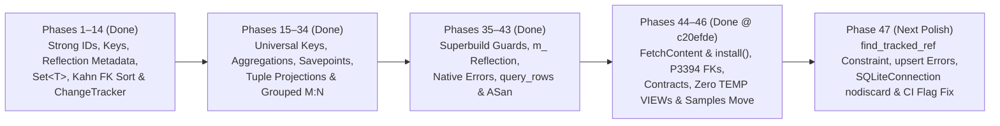
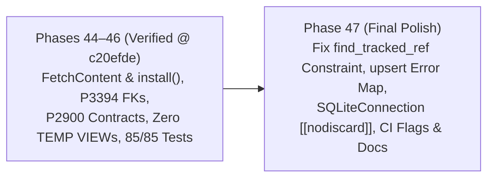

# CodeFirstCppDB_sqlgen — Architecture, Reusability & Next-Gen Roadmap

> **Document Version:** 15.0 (Post-`c20efde` Verification Audit — Phases 44–46 Verified & Phase 47 Polish Items)  
> **Date:** 2026-11-15  
> **Active Branch:** `main` (at commit `c20efde`)  
> **Toolchain Baseline:** GCC 16.2+ (`-std=c++26 -freflection`), CMake 4.0+ (verified on 4.5.0), Ninja, SQLite 3  
> **Status:** Phases 1–46 Completed (`85/85` GoogleTests across `42` suites passing on `gcc-debug`, `gcc-asan`, and `-DCODEFIRST_ENABLE_CONTRACTS=ON`; 6 minor Phase 47 adjustments remain, so `Review101_pkstl` / [readme5.md](readme5.md) are retained until closed)

---

## Table of Contents

1. [Executive Summary & Vision](#1-executive-summary--vision)
2. [Quick Start, Coding Standards & Developer Setup](#2-quick-start-coding-standards--developer-setup)
3. [Current Architecture & Library Stack (v15.0 — Post-`c20efde` Audit)](#3-current-architecture--library-stack-v150--post-c20efde-audit)
   - [Directory Layout](#directory-layout)
   - [Layer Boundaries](#layer-boundaries)
   - [External Submodule Libraries Assessment](#external-submodule-libraries-assessment)
   - [End-to-End Developer Experience (Encapsulated, Zero-DTO POCO, & `m_` Aggregate Modes)](#end-to-end-developer-experience-encapsulated-zero-dto-poco--m_-aggregate-modes)
   - [Core Technical Pillars](#core-technical-pillars)
4. [Completed Engineering Roadmap (Phases 1–46)](#4-completed-engineering-roadmap-phases-146)
5. [Multi-Stage Audits (`readme5.md` Triage, Downstream Feedback & `c20efde` Verification)](#5-multi-stage-audits-readme5md-triage-downstream-feedback--c20efde-verification)
   - [5.1 Independent Review (`readme5.md`) Triage (Audited @ `01853df`, Re-Evaluated @ `00797dc` / `c20efde`)](#51-independent-review-readme5md-triage-audited--01853df-re-evaluated--00797dc--c20efde)
   - [5.2 Re-Evaluation of Phases 35–38 (`521c561`) & Phases 39–43 (`00797dc`)](#52-re-evaluation-of-phases-3538-521c561--phases-3943-00797dc)
   - [5.3 Downstream Consumer Re-Evaluation ("Project Horizon")](#53-downstream-consumer-re-evaluation-project-horizon)
   - [5.4 Post-Commit `c20efde` Verification & Remaining Adjustments](#54-post-commit-c20efde-verification--remaining-adjustments)
6. [Phase 44–46 Verification Ledger & Phase 47 Polish Roadmap](#6-phase-4446-verification-ledger--phase-47-polish-roadmap)
   - [Phases 44–46 Verified Implementation Ledger](#phases-4446-verified-implementation-ledger)
   - [Phase 47: Final Error-Path, Concept, CI & Documentation Adjustments](#phase-47-final-error-path-concept-ci--documentation-adjustments)
7. [External Consumer Integration Guide (CMake `FetchContent` & `add_subdirectory`)](#7-external-consumer-integration-guide-cmake-fetchcontent--add_subdirectory)
8. [Architecture Comparison Matrix](#8-architecture-comparison-matrix)
9. [Appendix: Technical FAQ](#9-appendix-technical-faq)

---

## 1. Executive Summary & Vision

**CodeFirstCppDB_sqlgen** brings the **Code-First developer experience of C# and Entity Framework Core (EF Core)** to native **ISO C++26** on the latest **GCC 16+ toolchain** as a **plug-and-play reusable library**.

By combining **C++26 static reflection (`<meta>`, `std::meta::info`, `template for`, constexpr exceptions)**, **C++23 deducing `this` & named modules (`import std;`)**, **C++20 concepts**, **monadic error handling (`std::expected`)**, and **`sqlgen`**, the library eliminates repetitive C++ data-access boilerplate at compile time—without external code generators, preprocessor macros, or runtime reflection overhead. See [CODING_STANDARDS.md](CODING_STANDARDS.md) for the project's C++26 module, naming, SQLite integrity, and CMake packaging rules.

```text
┌────────────────────────────────────────────────────────────────────────┐
│                   Consumer C++26 Domain / Data Models                  │
│   (DDD Classes, Zero-DTO POCOs, `m_` Aggregates, or P3394 Annotated)   │
└───────────────────────────────────┬────────────────────────────────────┘
                                    │
                       C++26 Static Reflection (std::meta)
                                    │
                                    ▼
┌────────────────────────────────────────────────────────────────────────┐
│         Pure Reusable ORM Modules: `core` & `dal` (CodeFirstCppDB)     │
│   (SchemaTraits, EntityKey_t, ValidQueryColumn, Topological FK Graph)  │
└───────┬───────────────────────────┼────────────────────────────┬───────┘
        │                           │                            │
        ▼                           ▼                            ▼
┌──────────────────┐       ┌──────────────────┐       ┌──────────────────┐
│ ensure_created & │       │ MapperTraits     │       │ DbContextBase,   │
│ ensure_index     │       │ (Private Splice, │       │ Set<T>, DbQuery, │
│ (Kahn FK + UX)   │       │  m_ / _ & POCO)  │       │ Grouped FK & UoW │
└───────┬──────────┘       └────────┬─────────┘       └────────┬─────────┘
        │                           │                          │
        └───────────────────────────┼──────────────────────────┘
                                    ▼
┌────────────────────────────────────────────────────────────────────────┐
│              SQLiteConnection / DatabaseConnection (sqlgen)            │
│   (AST Pushdown, Tuple Projections, SAVEPOINT, Introspection, Raw SQL) │
└────────────────────────────────────────────────────────────────────────┘
```

---

## 2. Quick Start, Coding Standards & Developer Setup

### Prerequisites (Arch Linux / EndeavourOS)

```bash
sudo pacman -S --needed base-devel cmake ninja gdb sqlite

g++ --version     # Requires GCC 16.1+ (verified on 16.2.1 with -std=c++26 -freflection)
cmake --version   # Requires CMake 4.0+ (verified on 4.5.0 with CMAKE_CXX_MODULE_STD)
```

### Build, Test & Run (Standalone Development Mode)

```bash
# 1. Initialize submodules (sqlgen, reflect-cpp, googletest)
git submodule update --init --recursive

# 2. Configure & build (GCC Debug preset)
cmake --preset gcc-debug
cmake --build --preset build-gcc-debug

# 3. Run unit & integration test suite via CTest (85 tests across 42 test suites)
ctest --preset test-gcc-debug

# Optional: Run with AddressSanitizer + UndefinedBehaviorSanitizer + _GLIBCXX_ASSERTIONS
cmake --preset gcc-asan
cmake --build --preset build-gcc-asan
ctest --preset test-gcc-asan

# 4. Run the Startup application (creates & queries relationalDB.db)
./build/linux/arch/gcc/debug/Startup/Startup
./build/linux/arch/gcc/debug/Startup/Startup --no-reset
```

Before modifying core modules, DTO traits, or build targets, review [CODING_STANDARDS.md](CODING_STANDARDS.md). For the earlier independent review on `01853df` and GCC 16.2.1 feature probe results, see [readme5.md](readme5.md) (retained on `main` and branch `Review101_pkstl` until the remaining Phase 47 items are closed).

---

## 3. Current Architecture & Library Stack (v15.0 — Post-`c20efde` Audit)

### Directory Layout

```text
CodeFirstCppDB_sqlgen/
├── .github/workflows/ci.yml        # GitHub Actions CI: format, Debug/ASan, -fcontracts, find_package install check
├── CMakeLists.txt                  # Root CMake config (C++26, PROJECT_IS_TOP_LEVEL guards, install()/export rules)
├── CMakePresets.json               # Presets for gcc-debug, gcc-release, gcc-asan & testPresets (no hardcoded compiler paths)
├── cmake/
│   └── CodeFirstCppDBConfig.cmake.in
├── CODING_STANDARDS.md             # Project coding, naming, SQLite & CMake packaging standards
├── README.md                       # Top-level user guide (compiled Quick Start + FetchContent/install instructions)
├── readme4.md                      # Master architectural specification, audit triage & roadmap
├── readme5.md                      # Independent architecture/C++26 review snapshot (Review101_pkstl @ 01853df)
│
├── Core/                           # Module: `core` (Domain Primitives & Repository Contracts)
│   ├── CMakeLists.txt              # Target `CodeFirstCppDB_Core` (OUTPUT_NAME Core) + stdc++exp on GNU + aliases
│   ├── core.ixx                    # Primary module interface
│   ├── Id.ixx                      # Strong explicit ID wrapper: Core::Id<Tag, ValueType>
│   ├── Key.ixx                     # SingleKey<K>, CompositeKey<K...>, Key concepts
│   └── repositories/               # Abstract contracts & structured error model
│       ├── DbError.ixx             # DbError, DbErrorCode, native_code, Debug std::stacktrace & message classifier
│       └── IGenericRepository.ixx  # IRepository<T> & IGenericRepository<T, KeyType>
│
├── DAL/                            # Module: `dal` (Reusable Data Access & ORM Engine)
│   ├── CMakeLists.txt              # Target `CodeFirstCppDB_DAL` (OUTPUT_NAME DAL) + PRIVATE warnings
│   ├── dal.ixx                     # Primary module interface
│   ├── context/                    # EF Core-style Gateway, Set, Query & Driver Adapter
│   │   ├── DbContext.ixx           # DbContextBase<Conn>, TransactionScope, Grouped/Batch FK Nav, query_rows forwards
│   │   ├── DbSet.ixx               # DbSet<Domain> & composable server-side DbQuery (select_columns, track_copy, find_tracked_ref)
│   │   └── SQLiteConnection.ixx    # SQL pushdown, options, extended native error map, direct C-API helpers, query_rows()
│   ├── schema/                     # Compile-time reflection metadata & relational traits
│   │   ├── SchemaTraits.ixx        # Exact PK/FK traits, P3394 annotations/AnnotatedDto + references<Parent>, Kahn FK sort
│   │   └── EntityMetadata.ixx      # Compile-time table/column/key reflection inspector
│   ├── mappers/
│   │   └── MapperTraits.ixx        # Domain <-> DTO splice mapper (is_hydratable_from ctor checks, [[=column]], m_/_ stripping)
│   ├── repositories/
│   │   └── GenericRepository.ixx   # Type-agnostic CRUD repository (Single & Composite keys, P2900 pre(...) contracts)
│   └── tests/                      # 85 GoogleTests across 42 suites, split by feature + `-Wall -Wextra -Wpedantic -Wshadow`
│       ├── CMakeLists.txt
│       ├── TestSupport.hpp
│       ├── test_keys_and_mapper.cpp
│       ├── test_query_pushdown.cpp
│       ├── test_uow_and_transactions.cpp
│       ├── test_introspection_and_schema.cpp
│       └── test_p3394_and_reflection.cpp
│
├── Samples/                        # Module: `samples` (Opt-in Demo Entities, DTOs & Sample Repos — zero samples in Core/DAL)
│   ├── CMakeLists.txt              # Target `CodeFirstCppDB_Samples` (OUTPUT_NAME Samples) + aliases
│   ├── SampleIds.ixx               # Sample PersonId / SomethingId strong aliases
│   ├── entities/                   # Person, Something, Person_Something
│   ├── repositories/               # I*Repository & SQLite*Repo
│   ├── schema/                     # PersonDTO, SomethingDTO, Person_SomethingDTO
│   └── samples.ixx                 # Exports sample partitions
│
└── Startup/                        # Pure-Module Demo App (built when CODEFIRST_BUILD_EXAMPLES=ON)
    └── main.cpp                    # Defines AppDbContext, --no-reset idempotent seed via add_returning, queries
```

### Layer Boundaries

| Layer | Module / CMake Target | Responsibilities | Architectural Rules & Notes |
| :--- | :--- | :--- | :--- |
| **Core** | `core` (`CodeFirstCppDB_Core` / `CodeFirstCppDB::Core`) | `Id<Tag, ValueType>` (explicit conversion), `SingleKey`, `CompositeKey`, `DbError` (`native_code` + Debug `std::stacktrace`), `IRepository`, `IGenericRepository`. | Zero `sqlgen`, SQLite headers, or sample files. Note: `DbError::map_from_message()` still needs `capture_debug_trace()`. |
| **DAL** | `dal` (`CodeFirstCppDB_DAL` / `CodeFirstCppDB::DAL`) | `SchemaOf<Domain>`, `AnnotatedDto`, `EntityKey_t<Domain>`, `EntityMetadata<Domain>`, `MapperTraits`, `GenericRepository`, `DbContextBase`, `TransactionScope`, `DbSet`, `DbQuery`, `SQLiteConnection`. | Zero sample files. Supports P3394 single-class entities (`references<Parent>` + `[[=column]]`), direct C-API SQLite helpers (zero `TEMP VIEW`s), and P2900 `pre(...)` contracts. Needs minor Phase 47 fixes (`find_tracked_ref` constraint, `upsert` error mapping, 6 `SQLiteConnection` `[[nodiscard]]` attributes). |
| **Samples** | `samples` (`CodeFirstCppDB_Samples` / `CodeFirstCppDB::Samples`) | Sample `PersonId`, `SomethingId`, `Person`, `Something`, `Person_Something` domain classes, DTOs, and sample repositories — physically contained under `Samples/`. | Defaults to `CODEFIRST_INCLUDE_SAMPLES=OFF` when `!PROJECT_IS_TOP_LEVEL`. Linked by `Startup` and `test_DAL`. |
| **Startup** | Executable ([Startup/main.cpp](Startup/main.cpp)) | Demo application creating and querying `relationalDB.db`. | Built only when `CODEFIRST_BUILD_EXAMPLES=ON`. Verified `--no-reset` idempotency (`if (db.people.count() == 0)` + `add_returning`). |

### External Submodule Libraries Assessment

| Submodule / Library | Version / Role | How We Use It | Audit & Integration Notes |
| :--- | :--- | :--- | :--- |
| **`extern/sqlgen`** | `0.6.0` (SQL AST & Driver Layer) | Provides `sqlgen::sqlite::Connection`, `PrimaryKey`, `ForeignKey`, `Col`, `read`, `select_from`, `where`, `group_by`, `order_by`, `limit`, `offset`, `insert`, `insert_or_replace`, `update`, `delete_from`, `create_table`, `create_index`, `drop`, and aggregations. | Isolated behind `DAL` global module fragments (`module; #include <sqlgen.hpp>`). Exported alongside `CodeFirstCppDB_DAL` when `CODEFIRST_INSTALL=ON`. |
| **`extern/reflect-cpp`** | Transitive dependency of `sqlgen` | Supplies `rfl::Result`, `rfl::Ref`, `rfl::Tuple`, `rfl::NamedTuple`, and `rfl::internal::StringLiteral` used inside `sqlgen`'s SQL transpiler. | **Not** used for JSON or domain reflection in our code; all `Core`/`DAL` introspection uses native ISO C++26 `<meta>`. |
| **`extern/googletest`** | Unit & Integration Testing | Runs `85` tests across `42` modular suites (`test_DAL`). | Guarded behind `if(CODEFIRST_BUILD_TESTS)` so external consumers never configure or build GoogleTest. |

### End-to-End Developer Experience (Encapsulated, Zero-DTO POCO, & `m_` Aggregate Modes)

```cpp
import std;
import core;
import dal;

// Pure aggregate struct following `m_` member naming convention
struct PersonRecord {
    std::int32_t m_id = 0;
    std::string m_firstName;
    std::string m_lastName;
};

// AppDbContext binding DbSet<T> properties via C++26 reflection
class AppDbContext : public DAL::DbContextBase<DAL::SQLiteConnection> {
public:
    Set<PersonRecord> people{ this };
    using DbContextBase::DbContextBase;
};
```

### Core Technical Pillars

1. **Private-Member Splicing, `m_` / `_` Affix Stripping & Case-Insensitive Column Resolution ([DAL/mappers/MapperTraits.ixx](DAL/mappers/MapperTraits.ixx#L24-L176)):**
   - Maps encapsulated private fields (`camelCase_`), `m_`-prefixed fields (`m_camelCase` / `M_camelCase`), or public fields (`camelCase` / `snake_case`) to/from DTO columns (`snake_case`) and splices database-generated primary keys back into domain entities (`with_primary_key`) using `std::meta::access_context::unchecked()`.
   - Resolves `"m_firstName"`, `"FirstName"`, `"firstName"`, `"firstName_"`, and `"first_name"` to `PersonDTO::first_name` in $O(M)$ compile time via `ValidQueryColumn<Domain, DTO, ColLiteral>`.
2. **Universal STL & Strong-ID Keys ([Core/Id.ixx](Core/Id.ixx), [Core/Key.ixx](Core/Key.ixx), [DAL/schema/SchemaTraits.ixx](DAL/schema/SchemaTraits.ixx)):**
   - `Core::Id<Tag, ValueType = std::int32_t>`, `SingleKey<K>`, `CompositeKey<K...>`, and `InferredKey_t<DTO>` support `std::int32_t`, `std::int64_t`, `std::string`, and heterogeneous composite keys.
3. **Compile-Time Topological Foreign-Key Sorting, Index DDL & Grouped Relationship Navigation ([DAL/schema/SchemaTraits.ixx](DAL/schema/SchemaTraits.ixx), [DAL/context/DbContext.ixx](DAL/context/DbContext.ixx)):**
   - `kahn_topological_sort` orders `ensure_created()` and `ensure_deleted()` at compile time (`consteval`), automatically creating composite-key `UNIQUE` indexes on junction tables.
   - `query_children`, `query_parent`, `query_children_batch`, `query_children_grouped`, `query_parents_batch`, `query_many_to_many`, `query_many_to_many_batch`, and `query_many_to_many_grouped` navigate foreign-key relationships via batched `IN` queries.
4. **Composable Server-Side `DbQuery`, Tuple Projections, Savepoints & Runtime SQLite Introspection ([DAL/context/DbSet.ixx](DAL/context/DbSet.ixx), [DAL/context/SQLiteConnection.ixx](DAL/context/SQLiteConnection.ixx)):**
   - `DbQuery` composes `where_*` and `or_where_*` predicates, multi-column `order_by`/`then_by`, `LIMIT/OFFSET`, `.select<"col">()`, `.select_distinct<"col">()`, `.select_columns<"c1", "c2">()`, `.select_distinct_columns<"c1", "c2">()`, aggregations, non-tracking `.any()`, `.remove_where()`, `.update_where<Cols...>(vals...)`, and `.ensure_index_created<Name, Cols...>()`.
   - `SQLiteConnection` & `DbContextBase` expose pure-module `list_tables()`, `table_info(table_name)`, and `execute_raw(sql)`.

---

## 4. Completed Engineering Roadmap (Phases 1–46)



- [x] **Phases 1–14 — Core Foundations, Reflection Metadata, POCO Mode, Topological FK Sort, Zero-JSON `ChangeTracker`, Composable `DbQuery`, Upsert & FK Navigation (`01853df`).**
- [x] **Phases 15–18 — Universal STL Keys, Domain Column Resolution, Batched M:N `IN` Pushdown & Repository Cleanup (`dca5d38`).**
- [x] **Phases 19–22 — Build Hardening, ORM Engine Decoupling, Case-Insensitive Columns, `NULL`/Negative Predicates, SQL Aggregations & `add_returning` (`88c46ac`).**
- [x] **Phases 23–26 — `try_last_insert_rowid()`, `add_range_returning()`, `then_by`, `select`, `where_between`, `update_where`, `query_children_batch` / `query_parents_batch`, & `SAVEPOINT`s (`a51208b`).**
- [x] **Phases 27–30 — Nested `TransactionScope` Savepoints, Non-Tracking `any()` / `COUNT(*)` `exists()`, Variadic `update_where`, `select_distinct` / `count_distinct`, Full `or_where_*` Parity, `query_children_grouped`, & `query_many_to_many_batch` (`8a1f87c`).**
- [x] **Phases 31–34 — Index & Partial Index DDL, Multi-Column Tuple Projections, Grouped M:N Eager Hydration, & Savepoint Dirty-Flush (`7b95202`).**
- [x] **Phases 35–38 (`521c561`) — CMake Superbuild Consumer Readiness, `Samples` Target Split, `m_` Prefix Reflection, FK Hardening & Runtime Introspection.**
- [x] **Phase 39 (`00797dc`) — Transactional Correctness (`SAVEPOINT` `save_changes()`), `explicit Core::Id`, `Startup --no-reset`, `[this]` Capture Removal, `track_copy()`, Atomic `update()` & `close()`.**
- [x] **Phases 40–46 (`00797dc` -> `c20efde`) — Consumer Packaging (`FetchContent`/`add_subdirectory` + `CODEFIRST_INSTALL=ON`), Verified `README.md`, End-to-End P3394 `AnnotatedDto` + `references<Parent>` + `[[=column]]`, C++26 Cleanups & P2900 `pre(...)` Contracts, Direct SQLite C-API Introspection (Zero `TEMP VIEW`s), `DbError` `native_code` + Debug `std::stacktrace`, `[[nodiscard]]` Pass, Modularized `DAL/tests/` (`85/85`), & Physical Relocation of `Samples/`.**

---

## 5. Multi-Stage Audits (`readme5.md` Triage, Downstream Feedback & `c20efde` Verification)

### 5.1 Independent Review ([readme5.md](readme5.md)) Triage (Audited @ `01853df`, Re-Evaluated @ `00797dc` / `c20efde`)

Because [readme5.md](readme5.md) was written against an early baseline (`Review101_pkstl` @ `01853df`, Phases 1–14), each item has been verified against `c20efde`:

| Item in `readme5.md` | Status @ `c20efde` | Verdict & Verification Evidence |
| :--- | :--- | :--- |
| **C1** Auto-increment PK drops domain ID (`Startup --no-reset`) | **Resolved (Phase 39)** | Verified by running `Startup` followed by `Startup --no-reset` (`count() == 0` guard + `add_returning`, exit `0`). `explicit Core::Id` prevents accidental raw-int coercions. |
| **C2** Composite junction PK/UNIQUE missing | **Resolved (Phases 37 & 46)** | `ensure_table_created` creates `ux_<table>_composite_pk` ([DAL/context/SQLiteConnection.ixx](DAL/context/SQLiteConnection.ixx)); `Phase37CompositeUpsertReplacesRow` (`test_uow_and_transactions.cpp`) now exercises live composite `.upsert()` replacement against SQLite. |
| **C3** `DbSet::track(Domain&)` raw pointer & `[this]` captures | **Resolved (Phases 39 & 42)** | `[this]` captures removed; `track_copy()` added (raw-ref `track(Domain&)` deprecated); `find_tracked_ref()` returns `std::optional<Domain&>`. *(Minor Phase 47 fix: allow `explicit Core::Id` / `constructible_from` keys in `find_tracked_ref(const K&)`.)* |
| **C4** `save_changes()` commits caller's outer transaction | **Resolved (Phase 39)** | `started_tx = !in_transaction()` + `SAVEPOINT` nesting verified in [DAL/context/DbContext.ixx](DAL/context/DbContext.ixx) and `Phase39HardeningTest`. |
| **C5** `PRAGMA foreign_keys = ON` missing on `connect()` | **Resolved (Phases 37 & 40)** | `SQLiteConnection::connect(dbPath, SQLiteConnectionOptions)` enables FKs by default (`busy_timeout_ms`, `wal_mode`, `foreign_keys`); reopened on-disk FK enforcement verified in `Phase43ReopenForeignKeyTest`. |
| **C6** Dual silent-default vs `std::expected`, `[[nodiscard]]`, substring `DbError` | **Mostly Resolved (Phases 40 & 46)** | `DbError::native_code` + Debug `std::stacktrace` added ([Core/repositories/DbError.ixx](Core/repositories/DbError.ixx)), error policy documented in [README.md](README.md), and `DbSet`/`DbContextBase`/`DbQuery` mutators carry `[[nodiscard]]`. *(Minor Phase 47 gaps: `DbSet::upsert_immediate_with` / `upsert_many_immediate_with` call `DbError::map_from_message()` instead of `conn->map_error()`, `map_from_message()` skips `capture_debug_trace()`, and 6 `SQLiteConnection` `sqlgen::Result` mutators omit `[[nodiscard]]`.)* |
| **C7** `SQLitePersonRepo` failing under `SQLiteConnection` | **Resolved (Phases 18 & 40)** | Dead mock `.query().where().execute()` fallback branch pruned in [Samples/repositories/SQLitePersonRepo.ixx](Samples/repositories/SQLitePersonRepo.ixx). |
| **C8** Hardcoded `std::int32_t` keys | **Resolved (Phases 15–18)** | `SingleKey<K>`, `CompositeKey<K...>`, and `GenericRepository` support arbitrary `ReflectionType` keys. |
| **C9** TOCTOU `SELECT` before `UPDATE` & non-atomic `upsert` | **Resolved (Phases 39 & 45)** | `SQLiteConnection::update()` executes `UPDATE` directly and checks `sqlite3_changes(db)` via `native_sqlite_handle()` with zero `TEMP VIEW`s ([DAL/context/SQLiteConnection.ixx:531-536](DAL/context/SQLiteConnection.ixx#L531-L536)). |
| **C10** Strong `Core::Id` leak & `close()` retention | **Resolved (Phases 39 & 41)** | `Core::Id` conversion is `explicit`; `close()` resets `conn_`; `query_many_to_many` uses single `IN` pushdown when `SinglePrimaryKey<TargetDTO>`. |
| **A1** Library mixed with sample entities/DTOs | **Resolved (Phases 36 & 46)** | All sample IDs, entities, DTOs, and `I*Repository`/`SQLite*Repo` files physically reside inside [Samples/](Samples/). |
| **A2/A4/A5/A6 & §6–7** Legacy `SQLite*Repo`, constructor hydration, P3394, P2900, CI, C++26 | **Mostly Resolved (Phases 41–46)** | `is_hydratable_from`, P3394 `AnnotatedDto` + `references<Parent>` + `[[=column]]`, P2900 `pre(...)`, C++26 cleanups (`members_v`, `col_literal_of`, `[...parts]`, `Ts...[0]`, `std::ranges::to`), `test_DAL` 5-file split (`85/85`), `CODEFIRST_INSTALL=ON`, `FetchContent`, and `clang-format` CI check all landed. *(Retain `Review101_pkstl` & [readme5.md](readme5.md) for one final Phase 47 pass closing the remaining minor error-path, `[[nodiscard]]`, concept, and CI/doc items.)* |

### 5.2 Re-Evaluation of Phases 35–38 (`521c561`) & Phases 39–43 (`00797dc`)

Every critical regression previously identified in `00797dc` was resolved in `c20efde`:
1. **`add_subdirectory` / `FetchContent` Regression:** Fixed in [CMakeLists.txt:28-46](CMakeLists.txt#L28-L46) (`if(NOT DEFINED reflectcpp_DIR)` / `if(NOT DEFINED SQLite3_DIR)` instead of `if(PROJECT_IS_TOP_LEVEL)`). Verified by configuring an external consumer with `-DCODEFIRST_BUILD_TESTS=OFF -DCODEFIRST_BUILD_EXAMPLES=OFF -DCODEFIRST_INCLUDE_SAMPLES=OFF` cleanly.
2. **`-DCODEFIRST_INSTALL=ON` Target Export Closure:** Fixed in [CMakeLists.txt:78-140](CMakeLists.txt#L78-L140) and [cmake/CodeFirstCppDBConfig.cmake.in](cmake/CodeFirstCppDBConfig.cmake.in) (`sqlgen` and `reflectcpp` exported alongside `Core`/`DAL`). Verified by installing to `/tmp` and building/running an external `find_package(CodeFirstCppDB CONFIG REQUIRED)` consumer.
3. **`README.md` Quick Start Compilation:** Rewritten around real P3394 `Author`/`Book` entities and verified to compile and run verbatim against an external consumer build.
4. **P3394 `AnnotatedDto` + `references<Parent>` + `[[=column]]`:** `collect_data_members()` / `CountFieldsHelper` traverse `AnnotatedDtoHolder<Domain>::Fields` base-class members ([DAL/schema/SchemaTraits.ixx](DAL/schema/SchemaTraits.ixx)), and `Phase42ReflectionModernizationTest` (`test_p3394_and_reflection.cpp`) passes live end-to-end SQLite persistence & FK topological sorting.
5. **Direct SQLite C-API Introspection:** All `_codefirst_changes`, `_codefirst_last_rowid`, `_codefirst_tables`, and `_codefirst_table_info` `TEMP VIEW`s were eliminated in favor of `sqlite3_changes`, `sqlite3_last_insert_rowid`, `query_rows()`, and `pragma_table_info(?)`.
6. **Physical Sample Move & `test_DAL` Split:** All sample entities/DTOs/repos live in [Samples/](Samples/); `DAL/tests/` is split into `TestSupport.hpp` and 5 focused test files (`85/85` tests passing on `gcc-debug` and `gcc-asan`).

### 5.3 Downstream Consumer Re-Evaluation ("Project Horizon")

All 4 major downstream blockers reported during Project Horizon's integration audit are now **Resolved** in `c20efde`:
1. Unprefixed internal targets (`CodeFirstCppDB_Core` / `_DAL` / `_Samples`): **Fixed**.
2. `PUBLIC` warning-suppression flags leaking from `DAL`: **Fixed** (`PRIVATE` on `CodeFirstCppDB_DAL`).
3. Pure-module dynamic row reader (`query_rows()` / `execute_prepared()` returning `DynamicQueryResult` with zero `<sqlite3.h>` leaks): **Fixed**.
4. Clean `FetchContent` / `add_subdirectory` configure and `CODEFIRST_INSTALL=ON` `find_package` export closure: **Fixed** (external `add_subdirectory` configure and `find_package` build/run both verified cleanly).

### 5.4 Post-Commit `c20efde` Verification & Remaining Adjustments

Direct verification of `c20efde` established the following 6 small, concrete items for **Phase 47** polish:

1. **Wrong CMake Option Name in CI Install Job ([.github/workflows/ci.yml:84](.github/workflows/ci.yml#L84)) & Missing `add_subdirectory` CI Smoke Check:**
   - Line 84 passes `-DCODEFIRST_BUILD_SAMPLES=OFF`, whereas [CMakeLists.txt](CMakeLists.txt) defines `-DCODEFIRST_BUILD_EXAMPLES=OFF` and `-DCODEFIRST_INCLUDE_SAMPLES=OFF` (CMake ignores `-DCODEFIRST_BUILD_SAMPLES` with an unused-variable warning).
   - CI tests `find_package(CodeFirstCppDB CONFIG REQUIRED)`, but does not yet test an external `add_subdirectory` / `FetchContent` consumer build.
2. **`README.md` Version Mismatch ([README.md:8](README.md#L8), [README.md:85-95](README.md#L85-L95)):**
   - Line 8 still states `CMake 3.30+` even though [CMakeLists.txt:1](CMakeLists.txt#L1) requires `cmake_minimum_required(VERSION 4.0)`.
   - The `FetchContent` snippet omits `CMAKE_CXX_STANDARD 26`, `CMAKE_CXX_SCAN_FOR_MODULES ON`, and `CMAKE_CXX_MODULE_STD ON` needed for `import std;` / C++26 modules in fresh downstream projects.
3. **`DbSet::find_tracked_ref(const K&)` Over-Constrained for `explicit Core::Id` ([DAL/context/DbSet.ixx:2182-2188](DAL/context/DbSet.ixx#L2182-L2188)):**
   - `find_tracked(const K&)` ([DAL/context/DbSet.ixx:2156-2162](DAL/context/DbSet.ixx#L2156-L2162)) uses `std::constructible_from<typename KeyType::key_type, K>`, allowing raw integers like `1` with `explicit Core::Id`. By contrast, `find_tracked_ref(const K&)` uses `std::convertible_to<K, typename KeyType::key_type>`, rejecting `db.people.find_tracked_ref(1)`.
4. **`upsert` Immediate Paths Lose `native_code` & `map_from_message()` Drops Debug Stacktraces ([DAL/context/DbSet.ixx:2292,2340](DAL/context/DbSet.ixx#L2292), [Core/repositories/DbError.ixx:102-132](Core/repositories/DbError.ixx#L102-L132)):**
   - `upsert_immediate_with()` and `upsert_many_immediate_with()` return `Core::DbError::map_from_message(res.error().what())` instead of `conn->map_error(res.error().what())`, dropping SQLite `native_code` on `upsert` failures.
   - `Core::DbError::map_from_message()` constructs `DbError{ code, msg }` directly without `create(...)` / `capture_debug_trace()`.
5. **6 Fallible `SQLiteConnection` Mutators Still Missing `[[nodiscard]]` ([DAL/context/SQLiteConnection.ixx:473,484,494,541,674,686](DAL/context/SQLiteConnection.ixx#L473)):**
   - `insert`, `insert_many`, `update`, `delete_by_id`, `upsert`, and `upsert_many` return `sqlgen::Result<sqlgen::Ref<sqlgen::sqlite::Connection>>` without `[[nodiscard]]`.
6. **Minor Code Hygiene Items ([DAL/schema/SchemaTraits.ixx:201-205,333-341](DAL/schema/SchemaTraits.ixx#L201-L205), [Samples/repositories/SQLitePersonRepo.ixx:31-32](Samples/repositories/SQLitePersonRepo.ixx#L31-L32)):**
   - `SchemaTraits.ixx:201-205` duplicates the `rfl::internal::StringLiteral` `index_sequence` lambda already used in `col_literal_of` (`337-340`); extracting a single `consteval auto to_string_literal(std::string_view)` helper removes the duplication.
   - `SQLitePersonRepo::find_by_last_name` still uses `std::vector<Core::Person>(domain_view.begin(), domain_view.end())` instead of `std::ranges::to<std::vector>()`.

---

## 6. Phase 44–46 Verification Ledger & Phase 47 Polish Roadmap



---

### Phases 44–46 Verified Implementation Ledger

Audit of commit `c20efde` on `main`:

- [x] **Phase 44 (Tasks 44.1–44.3) — Consumer Packaging, Docs & CI Hygiene:** Fixed `FetchContent`/`add_subdirectory` configure guards in [CMakeLists.txt](CMakeLists.txt), exported `sqlgen` and `reflectcpp` for `-DCODEFIRST_INSTALL=ON`, rewrote [README.md](README.md) with a compiled P3394 Quick Start, removed hardcoded compiler paths in [CMakePresets.json](CMakePresets.json), added `-Wall -Wextra -Wpedantic -Wshadow` to `DAL/tests`, and formatted the codebase (`clang-format --dry-run -Werror` clean). *(Two minor CI/README typos tracked in Phase 47.1.)*
- [x] **Phase 45 (Tasks 45.1–45.3) — P3394 Single-Class Entities, C++26 Cleanups, P2900 Contracts & Zero `TEMP VIEW`s:** Verified `AnnotatedDto` inheritance visibility + `references<Parent>` + `[[=column]]` end-to-end inside `DbSet`, hardened `is_hydratable_from` constructor checks, added P2900 `pre(...)` contracts ([DAL/context/DbSet.ixx](DAL/context/DbSet.ixx), [DAL/repositories/GenericRepository.ixx](DAL/repositories/GenericRepository.ixx)), added Debug `std::stacktrace` to `DbError`, and removed all 4 SQLite `TEMP VIEW` workarounds in [DAL/context/SQLiteConnection.ixx](DAL/context/SQLiteConnection.ixx).
- [x] **Phase 46 (Tasks 46.1–46.3) — `[[nodiscard]]`, Modularized Tests & Physical `Samples/` Move:** Split `DAL/tests/test_DAL.cpp` into `TestSupport.hpp` + 5 focused suites (`85/85` passing across `42` suites), added `Phase37CompositeUpsertReplacesRow`, relocated all sample entities/DTOs/repos into [Samples/](Samples/), and documented the error contract & identity strategy in [README.md](README.md). *(Minor `[[nodiscard]]`, `upsert` error-map, `find_tracked_ref` constraint, and `StringLiteral` helper follow-ups tracked below so `Review101_pkstl` / [readme5.md](readme5.md) can retire cleanly once Phase 47 lands.)*

---

### Phase 47: Final Error-Path, Concept, CI & Documentation Adjustments

- [ ] **Task 47.1: Fix CI Sample Option & `add_subdirectory` Coverage + Align `README.md` CMake Requirements ([.github/workflows/ci.yml:84](.github/workflows/ci.yml#L84), [README.md:8,85-95](README.md#L8))**
  - Replace `-DCODEFIRST_BUILD_SAMPLES=OFF` with `-DCODEFIRST_BUILD_EXAMPLES=OFF -DCODEFIRST_INCLUDE_SAMPLES=OFF` in `.github/workflows/ci.yml:84`.
  - Add an external `add_subdirectory` consumer build/run step in `.github/workflows/ci.yml` alongside the `find_package` consumer check.
  - Update `README.md:8` from `CMake 3.30+` to `CMake 4.0+` (matching `CMakeLists.txt:1`), and include `CMAKE_CXX_STANDARD 26`, `CMAKE_CXX_SCAN_FOR_MODULES ON`, and `CMAKE_CXX_MODULE_STD ON` in the `FetchContent` snippet.

- [ ] **Task 47.2: Fix `DbSet::find_tracked_ref` Concept Constraint ([DAL/context/DbSet.ixx:2182-2188](DAL/context/DbSet.ixx#L2182-L2188))**
  - Replace `std::convertible_to<K, typename KeyType::key_type>` with `std::constructible_from<typename KeyType::key_type, K>` to match `find_tracked(const K&)` and add a unit test exercising `find_tracked_ref(raw_id)` on an `explicit Core::Id` entity.

- [ ] **Task 47.3: Unify `upsert` Native Error Mapping, `map_from_message()` Traces & Remaining `[[nodiscard]]` ([DAL/context/DbSet.ixx:2292,2340](DAL/context/DbSet.ixx#L2292), [Core/repositories/DbError.ixx:102-132](Core/repositories/DbError.ixx#L102-L132), [DAL/context/SQLiteConnection.ixx:473-686](DAL/context/SQLiteConnection.ixx#L473-L686))**
  - Update `DbSet::upsert_immediate_with` and `upsert_many_immediate_with` to map errors via `conn->map_error(...)` when `ConnectionHandle` provides it, preserving `native_code`.
  - Route `Core::DbError::map_from_message` return values through `DbError::create(...)` so Debug stacktraces are captured uniformly.
  - Add `[[nodiscard]]` to `SQLiteConnection::insert`, `insert_many`, `update`, `delete_by_id`, `upsert`, and `upsert_many`.

- [ ] **Task 47.4: Minor Reflection & Sample Range Cleanups + Retire `Review101_pkstl` ([DAL/schema/SchemaTraits.ixx:201-205,333-341](DAL/schema/SchemaTraits.ixx#L201-L205), [Samples/repositories/SQLitePersonRepo.ixx:31-32](Samples/repositories/SQLitePersonRepo.ixx#L31-L32))**
  - Extract a shared `consteval auto to_string_literal(std::string_view)` helper in `DAL/schema/SchemaTraits.ixx` and reuse it in both `synthesize_annotated_dto_fields` and `col_literal_of`.
  - Switch `SQLitePersonRepo::find_by_last_name` to `std::ranges::to<std::vector>()`.
  - Once Tasks 47.1–47.4 land cleanly, delete branch `Review101_pkstl` and remove [readme5.md](readme5.md).

---

## 7. External Consumer Integration Guide (CMake `FetchContent` & `add_subdirectory`)

External C++26 projects can include **CodeFirstCppDB_sqlgen** via `FetchContent`, git submodule + `add_subdirectory`, or an installed package via `find_package(CodeFirstCppDB CONFIG REQUIRED)` (`-DCODEFIRST_INSTALL=ON`):

```cmake
cmake_minimum_required(VERSION 4.0)
project(ConsumerApp LANGUAGES CXX)

set(CMAKE_CXX_STANDARD 26)
set(CMAKE_CXX_STANDARD_REQUIRED ON)
set(CMAKE_CXX_EXTENSIONS OFF)
set(CMAKE_CXX_SCAN_FOR_MODULES ON)
set(CMAKE_CXX_MODULE_STD ON)

include(FetchContent)

set(CODEFIRST_LOCAL_DIR "" CACHE PATH "Optional local CodeFirstCppDB_sqlgen checkout")
if(CODEFIRST_LOCAL_DIR AND EXISTS "${CODEFIRST_LOCAL_DIR}/CMakeLists.txt")
    FetchContent_Declare(
        CodeFirstCppDB
        SOURCE_DIR "${CODEFIRST_LOCAL_DIR}"
    )
else()
    FetchContent_Declare(
        CodeFirstCppDB
        GIT_REPOSITORY https://github.com/mythrz/CodeFirstCppDB_sqlgen.git
        GIT_TAG        main
    )
endif()

# Automatically defaults CODEFIRST_BUILD_TESTS=OFF, CODEFIRST_BUILD_EXAMPLES=OFF,
# and CODEFIRST_INCLUDE_SAMPLES=OFF because PROJECT_IS_TOP_LEVEL is FALSE!
FetchContent_MakeAvailable(CodeFirstCppDB)

# Link PRIVATE inside an isolated consumer module target so internal DAL flags stay contained
target_link_libraries(ConsumerDataModule
    PRIVATE
        CodeFirstCppDB::Core
        CodeFirstCppDB::DAL
)
```

And inside the consumer's C++26 module unit:

```cpp
export module ConsumerApp.DataAccess;

import std;
import core;
import dal;
```

---

## 8. Architecture Comparison Matrix

| Feature / Aspect | Early v3 Baseline | Current `main` (v15.0 — Post-`c20efde`) | Phase 47 Target | C# Entity Framework Core |
| :--- | :--- | :--- | :--- | :--- |
| **Packaging & Reuse** | Monolithic test repo (`SqlGenIsolationTest`) | `CodeFirstCppDB_*` prefixed targets, `PRIVATE` flags, working `FetchContent`/`add_subdirectory` & `CODEFIRST_INSTALL=ON`, physical `Samples/` isolation | + Fix `.github/workflows/ci.yml` sample flag typo, add CI `add_subdirectory` job, update `README.md` CMake 4.0+ / module settings | NuGet `Microsoft.EntityFrameworkCore.Sqlite` |
| **Domain Definition** | Encapsulated classes + DTOs | Encapsulated, Zero-DTO POCO, `m_` aggregates, `is_hydratable_from` ctor checks, end-to-end P3394 `AnnotatedDto` (`[[=references]]`, `[[=column]]`) | + Deduplicate `to_string_literal` helper in `SchemaTraits` | `[Table]` / `[Column]` attributes + POCOs |
| **Keys & Integrity** | Manual ID lookups | Explicit `Core::Id`, `PRAGMA foreign_keys` on `connect()` + options, outer-tx `SAVEPOINT` `save_changes()`, composite PK index + upsert test, P2900 `pre(...)` contracts | + Fix `find_tracked_ref(const K&)` for `explicit Core::Id` (`std::constructible_from`) | `HasKey(x => new { x.A, x.B })`, strong keys |
| **Runtime Introspection & Raw SQL** | None | `list_tables()`, `table_info()`, `execute_raw()`, parameterized `query_rows()` & `execute_prepared()`, direct SQLite C-API helpers (zero `TEMP VIEW`s) | Already complete | `Database.SqlQueryRaw<T>()` & `GetSchema()` |
| **Error & Lifetime Discipline** | Swallowed defaults + raw refs | Value-tracked `track_copy()` (deprecated `track(Domain&)`), no `[this]` query captures, `close()` resets handle, `DbError::native_code` + Debug `std::stacktrace`, modular `DAL/tests/` (85/85) | + Unify `upsert` error mapping (`conn->map_error`), Debug traces in `map_from_message()`, and `[[nodiscard]]` on 6 `SQLiteConnection` mutators | Exceptions / `DbUpdateException` |

---

## 9. Appendix: Technical FAQ

1. **Why is GCC 16.1+ required instead of Clang?**
   - GCC 16.1+ (verified on GCC 16.2.1) implements ISO C++26 static reflection (`P2996`, `P3394` annotations, `define_aggregate`, `parameters_of`) via `-std=c++26 -freflection` and `<meta>`. Standard Clang releases do not yet support `<meta>`.
2. **How do we keep internal tests (`test_DAL`) and `Startup` working while keeping `Core` and `DAL` clean for consumers?**
   - `Samples` (`CodeFirstCppDB::Samples`, `export module samples;`) isolates all demo entities, DTOs, and sample repositories physically under [Samples/](Samples/). It builds automatically when `PROJECT_IS_TOP_LEVEL` or `CODEFIRST_BUILD_TESTS` is `ON`, while external consumers (`PROJECT_IS_TOP_LEVEL=OFF`) only compile `CodeFirstCppDB::Core` and `CodeFirstCppDB::DAL`.
3. **Why keep both `m_` pure aggregates and optional P3394 annotations?**
   - Downstream libraries that isolate pure data structs (`import std;` only, shared across UI and storage layers) cannot add ORM attributes inside their data module; `m_`-aware `MapperTraits` keeps them zero-dependency, while optional P3394 `[[=...]]` annotations (Phases 42 & 45) give self-contained ORM users zero-DTO 1-class ergonomics.
4. **Why is `Review101_pkstl` / `readme5.md` kept for now instead of deleted?**
   - Commit `c20efde` resolved nearly all major gaps from `00797dc` (packaging, `README.md`, end-to-end `AnnotatedDto` + FKs, P2900 `pre(...)`, Debug stacktraces, zero `TEMP VIEW`s, split `DAL/tests/`, composite `.upsert()`, and physical `Samples/` relocation) — **but left 6 concrete Phase 47 adjustments** (`DbSet::find_tracked_ref` constraint for `explicit Core::Id`, `upsert` error-map native code / Debug stacktrace consistency, 6 `SQLiteConnection` `[[nodiscard]]` attributes, `.github/workflows/ci.yml` sample flag typo + `add_subdirectory` smoke test, `README.md` CMake 4.0+ / module settings, and `to_string_literal` / `std::ranges::to` cleanups). Once Phase 47 resolves those items, `Review101_pkstl` and [readme5.md](readme5.md) can be retired cleanly.
