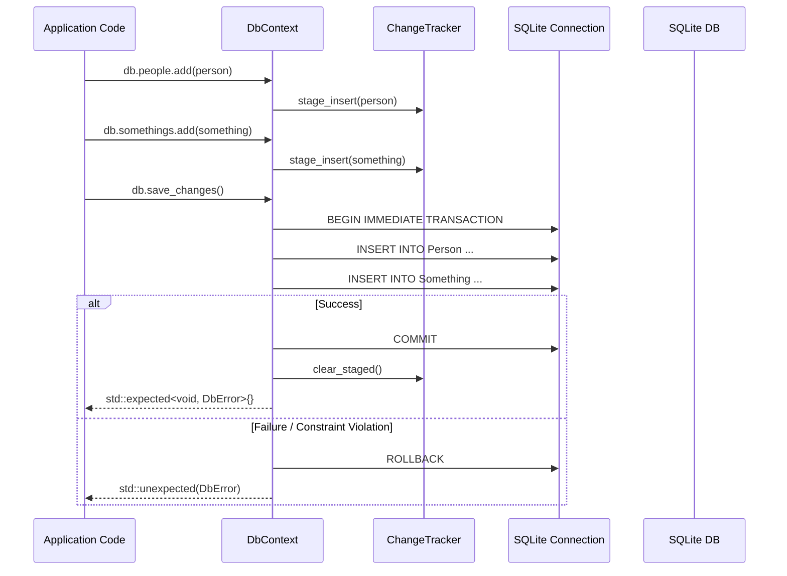
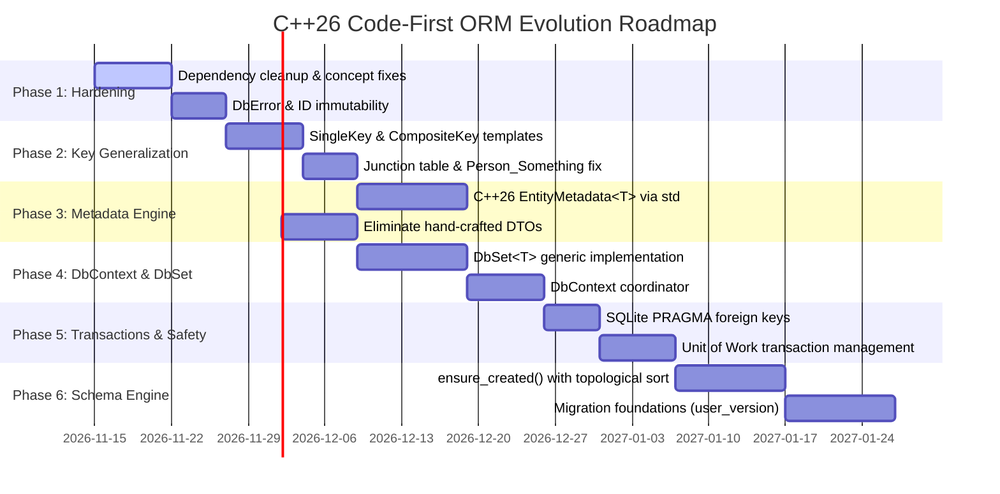

# CodeFirstCppDB_sqlgen — Architecture, Review & Next-Gen Roadmap

> **Document Version:** 4.0 (Consolidated Master Specification)  
> **Date:** 2026-11-14  
> **Active Branch:** `20261114` (based off `main`)  
> **Toolchain Baseline:** GCC 16.1+ (`-std=c++26 -freflection`), CMake 4.4+, Ninja, SQLite 3  
> **Consolidation Scope:** Merges and supersedes `README.md`, `README2.md` (historical), `README3.md`, `Antigravity_opinion.md`, and `ChatGPT_opinion.md`.

---

## Table of Contents

1. [Executive Summary & Project Vision](#1-executive-summary--project-vision)
2. [Quick Start & Developer Setup](#2-quick-start--developer-setup)
   - [Prerequisites & System Packages](#prerequisites--system-packages)
   - [Cloning & Submodule Management](#cloning--submodule-management)
   - [CMake Presets & Building](#cmake-presets--building)
   - [Running Unit Tests & Startup Application](#running-unit-tests--startup-application)
   - [VS Code / Codium IDE Configuration](#vs-code--codium-ide-configuration)
3. [Evolutionary Background](#3-evolutionary-background)
   - [From Traditional Headers to C++23 Named Modules](#from-traditional-headers-to-c23-named-modules)
   - [From External Reflection to C++26 Native `std::meta`](#from-external-reflection-to-c26-native-stdmeta)
4. [Current Architecture (Baseline v3)](#4-current-architecture-baseline-v3)
   - [Project Directory Structure](#project-directory-structure)
   - [Layer Boundaries & Separation of Concerns](#layer-boundaries--separation-of-concerns)
   - [Dependency Inversion Flow](#dependency-inversion-flow)
   - [Key Technical Implementations](#key-technical-implementations)
5. [In-Depth Code Review & Architectural Critique](#5-in-depth-code-review--architectural-critique)
   - [Validated Strengths & Accomplishments](#validated-strengths--accomplishments)
   - [Critical Limitations & Technical Debt](#critical-limitations--technical-debt)
6. [The Target Vision: "Entity Framework Core" for C++26](#6-the-target-vision-entity-framework-core-for-c26)
   - [What Makes EF Core "Plug-and-Play"?](#what-makes-ef-core-plug-and-play)
   - [Proposed Architectural Paradigm](#proposed-architectural-paradigm)
   - [Unified Compile-Time Relational Metadata (`EntityMetadata<T>`)](#unified-compile-time-relational-metadata-entitymetadatat)
   - [Generalized Key & Relationship Taxonomy](#generalized-key--relationship-taxonomy)
   - [Modern `DbContext` and `DbSet<T>` API Design](#modern-dbcontext-and-dbsett-api-design)
   - [Unit of Work & Atomic Transaction Pipeline](#unit-of-work--atomic-transaction-pipeline)
   - [Monadic Result Types Across Reads and Writes](#monadic-result-types-across-reads-and-writes)
7. [Phased Implementation Roadmap](#7-phased-implementation-roadmap)
   - [Phase 1: Housekeeping & Critical Contract Hardening](#phase-1-housekeeping--critical-contract-hardening)
   - [Phase 2: Generalized Key Model & Composite Key Junction Support](#phase-2-generalized-key-model--composite-key-junction-support)
   - [Phase 3: Compile-Time Metadata Engine](#phase-3-compile-time-metadata-engine)
   - [Phase 4: Modern `DbContext` & `DbSet<T>` Interface](#phase-4-modern-dbcontext--dbsett-interface)
   - [Phase 5: Atomic Transactions, SQLite Integrity & Safety](#phase-5-atomic-transactions-sqlite-integrity--safety)
   - [Phase 6: Automatic Schema Engine & Migrations](#phase-6-automatic-schema-engine--migrations)
8. [Architecture Comparison Matrix](#8-architecture-comparison-matrix)
9. [Appendix: Troubleshooting & FAQ](#9-appendix-troubleshooting--faq)

---

## 1. Executive Summary & Project Vision

**CodeFirstCppDB_sqlgen** is an experimental, modern C++ database access system designed to explore how **C++26 static reflection (`std::meta`)**, **C++20/23 named modules**, **concepts**, and **monadic error handling (`std::expected`)** can realize a true **Code-First Database** architecture in C++.

### The Core Ambition
In the C# and .NET ecosystem, **Entity Framework Core (EF Core)** sets the gold standard for developer ergonomics:
1. You write plain domain classes (POCOs).
2. You declare a `DbContext` exposing `DbSet<T>`.
3. The framework derives database schemas, foreign-key relationships, and migration scripts automatically via reflection and metadata.
4. You query and mutate entities using intuitive, strongly-typed APIs without writing boilerplate DTOs, data mappers, or bespoke repository classes for every table.

In C++, developers have historically been forced into heavy external code generators, preprocessors, macro-laden ORMs, or tedious hand-maintained DTO/mapper layers.

With the advent of **C++26 compile-time reflection** (ISO/IEC P2996 and GCC 16+ `-freflection`), C++ finally possesses the language primitives needed to inspect struct members, types, and annotations entirely at compile time with zero runtime overhead. This project aims to evolve from a working reflection prototype into a **modular, plug-and-play, reusable Code-First ORM framework** for modern C++.

```text
┌────────────────────────────────────────────────────────────────────────┐
│                        C++26 Domain Entities                           │
│     (Clean POCOs: Person, Something, Order, Product, junction types)   │
└───────────────────────────────────┬────────────────────────────────────┘
                                    │
                       C++26 Static Reflection (std::meta)
                                    │
                                    ▼
┌────────────────────────────────────────────────────────────────────────┐
│               Compile-Time Relational Metadata Engine                  │
│       (Tables, Columns, Primary/Composite Keys, FKs, Nullability)       │
└───────┬───────────────────────────┼────────────────────────────┬───────┘
        │                           │                            │
        ▼                           ▼                            ▼
┌──────────────┐           ┌──────────────────┐           ┌──────────────┐
│ DDL Schema   │           │ Reflection Auto- │           │ DbSet<T> &   │
│ Generation   │           │ Object Mapper    │           │ Generic Repos│
└───────┬──────┘           └────────┬─────────┘           └──────┬───────┘
        │                           │                            │
        └───────────────────────────┼────────────────────────────┘
                                    ▼
┌────────────────────────────────────────────────────────────────────────┐
│                  Database Provider Abstraction (sqlgen)                │
│                         (SQLite / Postgres / DuckDB)                   │
└────────────────────────────────────────────────────────────────────────┘
```

---

## 2. Quick Start & Developer Setup

### Prerequisites & System Packages

The project targets modern Linux distributions (tested on **Arch Linux / EndeavourOS** and compatible systems).

```bash
# Install core build toolchain and libraries on Arch Linux / EndeavourOS
sudo pacman -S --needed \
    base-devel \
    cmake \
    ninja \
    gdb \
    sqlite \
    postgresql-libs \
    mariadb-libs

# Verify required versions
g++ --version     # Must be GCC 16.x or newer (with -freflection support)
cmake --version   # Must be CMake 4.4 or newer (required for CMAKE_CXX_MODULE_STD)
ninja --version   # Ninja 1.11+
```

> [!NOTE]
> Clang (as of version 18-20) does not yet ship native C++26 static reflection (`std::meta`) in its official release trunk (it is maintained in an experimental experimental branch). Therefore, **GCC 16.x is the primary supported compiler**.

### Cloning & Submodule Management

This repository uses submodules for external libraries (`sqlgen`, `reflect-cpp`, `googletest`):

```bash
# Clone the repository
git clone https://github.com/mythicalrazor/CodeFirstCppDB_sqlgen.git
cd CodeFirstCppDB_sqlgen

# Switch to the planning branch
git checkout 20261114

# Fetch and initialize all submodules recursively
git submodule update --init --recursive
```

### CMake Presets & Building

The project provides preconfigured presets in `CMakePresets.json`:

```bash
# Configure the GCC Debug build
cmake --preset gcc-debug

# Build all targets (Core, DAL, test_DAL, Startup) using Ninja
cmake --build build/linux/arch/gcc/debug

# Alternatively, configure and build Release:
cmake --preset gcc-release
cmake --build build/linux/arch/gcc/release
```

### Running Unit Tests & Startup Application

```bash
# 1. Run the GoogleTest suite (22 unit tests covering DAL & Reflection Mapper)
./build/linux/arch/gcc/debug/DAL/tests/test_DAL

# Or run via CTest:
ctest --test-dir build/linux/arch/gcc/debug --output-on-failure

# 2. Run the Startup demonstration executable (creates and populates relationalDB.db)
./build/linux/arch/gcc/debug/Startup/Startup
```

### VS Code / Codium IDE Configuration

Recommended extensions:
- `kylinideteam.cppdebug` (C++ Debugging via GDB)
- `kylinideteam.kylin-cmake-tools` (CMake Tools integration)
- `yy0931.vscode-sqlite3-editor` (Directly browse generated SQLite databases in the IDE)

Use the predefined VS Code launch target: **`Debug DAL_unit_tests (gcc debug)`** or **`Debug Startup (gcc debug)`**.

---

## 3. Evolutionary Background

### From Traditional Headers to C++23 Named Modules

The early project prototypes (`README` and `README2.md`) relied on traditional C++ header files (`.h`/`.hpp`) and translation units (`.cpp`), leading to cyclic inclusion issues between entities and database repositories, macro pollution from SQLite headers, and slow compilation times.

The architecture was migrated entirely to **C++23/26 Named Module Partitions (`.ixx`)**:
- Each layer is an umbrella module (`core`, `dal`).
- Partition files isolate entities, interfaces, schemas, and repositories (e.g. `export module core:person;`).
- Standard library functionality is consumed using `import std;`, drastically reducing preprocessor overhead.
- Global module fragments (`module; #include <...>`) are strictly quarantined to encapsulate external C/C++ libraries (`sqlite3.h`, `sqlgen.hpp`, `<meta>`).

### From External Reflection to C++26 Native `std::meta`

Initial iterations evaluated `reflect-cpp` to inspect struct layouts. While useful for C++20, `reflect-cpp` relies on structured binding trickery and template specialization, which imposes limitations on private members and deep customization.

With GCC 16, the project transitioned to **C++26 Native Static Reflection**:
- Member reflection via `std::meta::nonstatic_data_members_of(^^Type)`.
- Compile-time iteration via `template for (constexpr auto m : members)`.
- Direct member manipulation via unchecked splicing: `obj.[:m:] = value`.
- Zero runtime overhead: all member matching, type checking, and offsets are computed at compile time.

---

## 4. Current Architecture (Baseline v3)

### Project Directory Structure

```text
CodeFirstCppDB_sqlgen/
├── CMakeLists.txt                  # Root build configuration (C++26, -freflection)
├── CMakePresets.json               # Presets for gcc-debug, gcc-release, clang
├── relationalDB.db                 # Persistent SQLite database generated by Startup
│
├── Core/                           # Module: `core` (Zero DB dependencies)
│   ├── CMakeLists.txt
│   ├── core.ixx                    # Primary module interface (umbrella exports)
│   ├── Id.ixx                      # Strong typed ID: Core::Id<Tag>
│   ├── entities/                   # Domain entities (encapsulated C++ classes)
│   │   ├── Person.ixx
│   │   ├── Something.ixx
│   │   └── Person_Something.ixx
│   └── repositories/               # Pure abstract contracts
│       ├── DbError.ixx             # Core::DbError & DbErrorCode
│       ├── IGenericRepository.ixx  # Contract: CRUD for DomainEntity
│       ├── IPersonRepository.ixx
│       ├── ISomethingRepository.ixx
│       └── IPerson_SomethingRepository.ixx
│
├── DAL/                            # Module: `dal` (Data Access Layer)
│   ├── CMakeLists.txt
│   ├── dal.ixx                     # Primary module interface (umbrella exports)
│   ├── schema/                     # DTO structs for sqlgen & relational schemas
│   │   ├── SchemaTraits.ixx        # RelationalEntity concept
│   │   ├── PersonDTO.ixx
│   │   ├── SomethingDTO.ixx
│   │   └── Person_SomethingDTO.ixx
│   ├── mappers/                    # C++26 Reflection Auto-Mappers
│   │   └── MapperTraits.ixx        # Bidirectional Domain <-> DTO translation
│   ├── repositories/               # Repository implementations
│   │   ├── GenericRepository.ixx   # GenericRepository<Domain, DTO, Conn>
│   │   ├── SQLitePersonRepo.ixx
│   │   ├── SQLiteSomethingRepo.ixx
│   │   └── SQLitePerson_SomethingRepo.ixx
│   └── tests/                      # GoogleTest unit tests
│       ├── CMakeLists.txt
│       └── test_DAL.cpp            # In-memory mock & reflection tests (22 tests)
│
├── Startup/                        # Application entry point & manual DI
│   ├── CMakeLists.txt
│   └── main.cpp                    # Database creation, seeding & verification
│
└── extern/                         # Submodules
    ├── googletest/
    ├── reflect-cpp/
    └── sqlgen/
```

### Layer Boundaries & Separation of Concerns

| Layer | Primary Namespace | Responsibilities | Constraints & Isolation Rules |
| :--- | :--- | :--- | :--- |
| **Core** | `Core` | Pure domain models (`Person`, `Something`), strongly-typed IDs (`Id<Tag>`), domain error definitions (`DbError`), and abstract repository interfaces (`IPersonRepository`). | **Zero database knowledge.** Must not import `dal`, `#include <sqlite3.h>`, or depend on `sqlgen`. Entities use class encapsulation. |
| **DAL::Schema** | `DAL::Schema` | Plain Old Data (POD) structs matching relational tables. Uses `sqlgen::PrimaryKey` and `sqlgen::ForeignKey`. | Public data fields only. Constrained by `RelationalEntity<T>` concept. |
| **DAL::Mappers** | `DAL::Mappers` | Compile-time automated translation between `DAL::Schema` DTOs and `Core` domain entities using C++26 reflection. | Fully constrained by `Mappable<Domain, DTO>`. Resolves naming conventions (`snake_case` to `camelCase_`) at compile time. |
| **DAL::Repositories**| `DAL::Repositories`| Concrete generic and specialized repository implementations. Converts domain calls to SQL queries via connection handle. | Implements `Core` interfaces. Accepts connection handles constrained by `DatabaseConnection`. |
| **Startup** | N/A (Exec) | Composition root, configuration, database connection initialization, schema generation, dependency injection, and execution. | Ties concrete DAL repositories to abstract Core interfaces. |

### Dependency Inversion Flow

```mermaid
graph TD
    subgraph Startup_Layer [Startup Application]
        Main[Startup / main.cpp]
    end

    subgraph Core_Layer [Core Module (Pure Domain)]
        IPersonRepo["Core::IPersonRepository"]
        IGenericRepo["Core::IGenericRepository&lt;Person&gt;"]
        PersonEntity["Core::Person (Domain)"]
        DbError["Core::DbError"]
        IPersonRepo -->|Extends| IGenericRepo
    end

    subgraph DAL_Layer [DAL Module (Data Access)]
        PersonRepoImpl["DAL::Repositories::SQLitePersonRepo&lt;Conn&gt;"]
        GenericRepoImpl["DAL::Repositories::GenericRepository&lt;Person, PersonDTO, Conn&gt;"]
        Mapper["DAL::Mappers::MapperTraits&lt;Person, PersonDTO&gt;"]
        PersonDTO["DAL::Schema::PersonDTO"]
        ConnHandle["Connection Handle (SQLite / Mock)"]

        PersonRepoImpl -->|Inherits| GenericRepoImpl
        GenericRepoImpl -->|Uses| Mapper
        Mapper -->|Translates| PersonDTO
        Mapper -->|Produces / Consumes| PersonEntity
        GenericRepoImpl -->|Delegates to| ConnHandle
    end

    Main -->|Instantiates| ConnHandle
    Main -->|Injects Conn into| PersonRepoImpl
    Main -->|Executes through| IPersonRepo
    PersonRepoImpl -.->|Implements| IPersonRepo
    GenericRepoImpl -.->|Implements| IGenericRepo
```

### Key Technical Implementations

#### 1. Zero-Overhead Strong IDs (`Core::Id<Tag>`)
Prevents primitive obsession and accidental argument swapping (e.g. passing a `SomethingId` where a `PersonId` is expected):
```cpp
export namespace Core {
    template<typename Tag>
    struct Id {
        std::int32_t value{0};
        constexpr explicit Id(std::int32_t v = 0) noexcept : value(v) {}
        [[nodiscard]] constexpr std::int32_t get() const noexcept { return value; }
        constexpr operator std::int32_t() const noexcept { return value; }
        constexpr auto operator<=>(const Id&) const noexcept = default;
    };

    using PersonId = Id<struct PersonTag>;
    using SomethingId = Id<struct SomethingTag>;
}
```

#### 2. C++26 Static Reflection Auto-Mapper (`MapperTraits`)
Maps between relational DTO structs and encapsulated domain entities without hardcoded assignment functions:
- Uses `std::meta::nonstatic_data_members_of` to reflect fields.
- Consteval matchers automatically correlate `snake_case` DTO fields (`first_name`) with `camelCase_` private domain members (`firstName_`).
- Employs **unchecked splice assignment** (`result.[:dom_m:] = static_cast<...>(val)`) via `std::meta::access_context::unchecked()`, allowing direct assignment into private members of `Core::Person` without requiring friendship or order-dependent constructors.
- Fails at compile time (`throw` in `consteval`) if any field cannot be unambiguously mapped.

#### 3. Monadic Error Propagation (`std::expected<void, Core::DbError>`)
Mutations (`insert_one`, `insert_many`, `update_one`, `delete_by_id`) return `std::expected<void, Core::DbError>` rather than throwing exceptions or returning plain booleans, ensuring failures must be handled explicitly by the caller.

---

## 5. In-Depth Code Review & Architectural Critique

Based on thorough codebase analysis and consolidated insights from `Antigravity_opinion.md` and `ChatGPT_opinion.md`, the current prototype possesses brilliant technical highlights but also distinct architectural deficiencies that must be addressed to achieve true plug-and-play reusability.

### Validated Strengths & Accomplishments

1. **Pioneering C++26 Reflection Architecture:** The `MapperTraits` implementation is one of the cleanest real-world demonstrations of ISO C++26 static reflection (`std::meta`) in data access. It eliminates runtime reflection penalties and avoids brittle macro preprocessors.
2. **Strict Module Boundary & Clean Separation:** The unidirectional dependency chain (`Startup -> DAL -> Core`) is strictly maintained. `Core` is completely insulated from database drivers.
3. **Fail-Fast Compile-Time Type Safety:** Mismatches between schema definitions and domain entities are caught at compile time by `static_assert` and `consteval` algorithms.
4. **Comprehensive Test Suite:** 22 GoogleTests in `DAL/tests/test_DAL.cpp` thoroughly test bidirectional mapping, optional fields (`std::nullopt`), round-trips, CRUD operations, and interface polymorphism using an in-memory mock driver.

---

### Critical Limitations & Technical Debt

#### Defect 1: The Single Integer Primary Key Monopoly
- **The Problem:** `Core::IGenericRepository<T>` and `DAL::Repositories::GenericRepository` explicitly hardcode primary keys as `std::int32_t id`:
  ```cpp
  virtual std::optional<DomainEntity> get_by_id(std::int32_t id) const = 0;
  virtual std::expected<void, DbError> delete_by_id(std::int32_t id) = 0;
  virtual bool exists_by_id(std::int32_t id) const = 0;
  ```
  Similarly, `DAL::Schema::RelationalEntity` enforces `{ dto.id.value() } -> std::same_as<std::int32_t&>;`.
- **The Impact:** Any entity that does not use a single 32-bit integer primary key (e.g. 64-bit IDs, UUID/GUID strings, composite primary keys) cannot use the generic repository.

#### Defect 2: Composite Key & Junction Table Inconsistency (`Person_Something`)
- **The Problem:** `Person_SomethingDTO` models a many-to-many junction table between `Person` and `Something`. It has two foreign keys (`person_id`, `something_id`) and no single `id` column.
- **The Code Contradiction:**
  In `DAL/schema/Person_SomethingDTO.ixx`:
  ```cpp
  static_assert(!RelationalEntity<Person_SomethingDTO>,
      "Person_SomethingDTO correctly fails RelationalEntity constraint as it uses a composite key.");
  ```
  Yet `SQLitePerson_SomethingRepo` still inherits from `GenericRepository<Core::Person_Something, Person_SomethingDTO, ConnectionHandle>`. Calling `get_by_id` or `delete_by_id` on this repository makes no semantic sense and fails silently or returns `nullopt`.
- **The Solution:** Generalize entity key metadata to support `SingleKey<T>`, `CompositeKey<T1, T2>`, and `NoKey`.

#### Defect 3: Weak and Incomplete `DatabaseConnection` Concept
- **The Problem:** The concept defining a database connection in `DAL/repositories/GenericRepository.ixx` is:
  ```cpp
  template<typename T>
  concept DatabaseConnection = requires(T conn) {
      { conn.is_open() } -> std::same_as<bool>;
  };
  ```
- **The Impact:** It only checks if `conn.is_open()` exists! It does not constrain `fetch_all<DTO>()`, `get_by_id<DTO>(id)`, `insert(dto)`, `update(dto)`, or `delete_by_id<DTO>(id)`. A type satisfying this concept can fail with massive template compilation errors deep inside `GenericRepository`.
- **The Solution:** Define granular concepts (`ReadableConnection`, `WritableConnection`, `QueryableConnection`, `TransactionalConnection`).

#### Defect 4: Domain Entity Identity Mutability (`setId` Anti-Pattern)
- **The Problem:** `Core::Person` and `Core::Something` expose public `setId(PersonId id)` methods.
- **The Hazard:** In domain-driven design and code-first persistence, an entity's primary key constitutes its immutable identity. Mutating an ID at runtime creates dangerous persistence anomalies (e.g., does the repository execute an `UPDATE` on the old ID or an `INSERT` with the new ID?).
- **The Solution:** Remove public `setId` methods. Identity should be assigned at construction or managed via dedicated identity wrappers.

#### Defect 5: High Entity Boilerplate (The Anti-"Plug-and-Play" Factor)
- **The Problem:** To add a new entity (e.g. `Order`), a developer must currently write:
  1. `Core/entities/Order.ixx`
  2. `Core/Id.ixx` (new tag and alias)
  3. `Core/repositories/IOrderRepository.ixx`
  4. Module export in `Core/core.ixx`
  5. `DAL/schema/OrderDTO.ixx`
  6. Concept checks in `DAL/schema/SchemaTraits.ixx`
  7. `DAL/repositories/SQLiteOrderRepo.ixx`
  8. Module export in `DAL/dal.ixx`
  9. Wiring in `Startup/main.cpp`
- **The Contrast with EF Core:** In EF Core, you create **one** class:
  ```csharp
  public class Order { public int Id { get; set; } public string Title { get; set; } }
  ```
  and register `public DbSet<Order> Orders { get; set; }` in `DbContext`. Everything else is generated automatically.
- **The Goal:** Modern C++26 reflection can inspect domain classes directly. If DTOs are omitted, `MapperTraits` can be bypassed entirely or reserved only for non-trivial projections.

#### Defect 6: Coarse Error Classification
- **The Problem:** `DbErrorCode` defines `Unknown`, `NotFound`, `DuplicateKey`, `ConnectionError`, `ConstraintViolation`. However, in `GenericRepository.ixx`, every failure is caught as:
  ```cpp
  return std::unexpected<Core::DbError>{ Core::DbError{ Core::DbErrorCode::Unknown, res.error().what() } };
  ```
- **The Impact:** Callers cannot distinguish a duplicate key collision from a connection disconnect or a foreign-key constraint violation.

#### Defect 7: Silent Query Failures (Read Operations Mask Database Crashes)
- **The Problem:** Read operations have the following signatures:
  ```cpp
  std::vector<Domain> get_all() const;
  std::optional<Domain> get_by_id(std::int32_t id) const;
  ```
- **The Hazard:** If the database connection drops or a query fails, `get_all()` returns an empty `std::vector` and `get_by_id()` returns `std::nullopt`. Callers cannot distinguish "Record does not exist" from "Database connection failed / table corrupted".
- **The Solution:** Return `std::expected<std::vector<Domain>, DbError>` and `std::expected<std::optional<Domain>, DbError>`.

#### Defect 8: Leaky Abstraction in Startup
- **The Problem:** In `Startup/main.cpp`, rather than demonstrating proper dependency injection through repository interfaces, the code reads raw DTOs via `sqlgen::read<std::vector<DTO>>` and manually calls `DAL::Mappers::MapperTraits::to_domain`.
- **The Solution:** Startup should interact strictly with `Core::IPersonRepository` or a unified `DbContext`.

#### Defect 9: Absence of Unit of Work & Transaction Coordination
- **The Problem:** In `main.cpp`, 2 Persons, 2 Somethings, and 2 Person_Somethings are inserted. If the 3rd insertion fails, the first two remain committed, leaving an inconsistent database.
- **The Solution:** Introduce a `DbContext` transaction scope: `context.begin_transaction()`, `context.save_changes()`, and automatic rollback on failure.

#### Defect 10: Unused Legacy Dependency (`reflect-cpp`)
- **The Problem:** `CMakeLists.txt` configures and links `extern/reflect-cpp`. However, after the GCC 16 C++26 static reflection upgrade, no active source file uses `reflect-cpp`.
- **The Solution:** Remove `extern/reflect-cpp` from build targets or isolate it purely for benchmark comparison.

#### Defect 11: SQLite Foreign Key Integrity Enforcement
- **The Problem:** In SQLite, foreign-key constraint enforcement is disabled by default for backwards compatibility. Unless `PRAGMA foreign_keys = ON;` is explicitly executed upon opening the connection, foreign-key relationships in `Person_SomethingDTO` are not enforced by the SQLite engine.
- **The Solution:** Ensure connection initialization executes `PRAGMA foreign_keys = ON;`.

#### Defect 12: Destructive Database Demo Behavior
- **The Problem:** `Startup/main.cpp` calls `std::filesystem::remove("relationalDB.db")` unconditionally on every launch.
- **The Solution:** Support an explicit CLI flag (e.g. `--reset` or `--recreate`) or adopt idempotent schema verification (`ensure_created`).

---

## 6. The Target Vision: "Entity Framework Core" for C++26

To achieve the user's objective — **"reusable and easy to plug and play, in a similar way code-first database with C# and Entity Framework works"** — we outline the next-generation architectural blueprint.

### What Makes EF Core "Plug-and-Play"?

```text
┌────────────────────────────────────────────────────────────────────────┐
│                        C# Entity Framework Core                        │
├────────────────────────────────────────────────────────────────────────┤
│ 1. POCO Domain Classes  : One definition for business logic & schema   │
│ 2. DbContext Gateway    : Central container for data access & config   │
│ 3. DbSet<T> Collections : Strongly-typed query/mutation entry points  │
│ 4. Model Metadata       : Schema derived via reflection & attributes   │
│ 5. EnsureCreated()      : Discovers all entities and creates DDL tables│
│ 6. Change Tracker       : Tracks entity states (Added, Modified, etc.) │
│ 7. SaveChanges()        : Executes atomic transaction for all changes  │
│ 8. Pluggable Providers  : UseSqlite(), UseNpgsql(), UseSqlServer()     │
└────────────────────────────────────────────────────────────────────────┘
```

### Proposed Architectural Paradigm

In C++26, static reflection allows us to achieve the exact same workflow **entirely at compile time**, with zero runtime reflection overhead, no dynamic assemblies, and no code-generation build steps.

```text
                                Application Code
                                       │
                    ┌──────────────────┴──────────────────┐
                    ▼                                     ▼
        Define Entity Structs                   Declare DbContext
        (Zero boilerplate)                     (Single unit of work)
        struct Person {                         class AppDb : public DbContext<AppDb> {
            Id<Person> id;                          DbSet<Person> people;
            std::string firstName;                  DbSet<Something> items;
            std::string lastName;                   DbSet<PersonSomething> links;
        };                                      };
                    │                                     │
                    └──────────────────┬──────────────────┘
                                       │
                                       ▼
                       C++26 Static Reflection Engine
                       (std::meta::nonstatic_data_members_of)
                                       │
                                       ▼
                       Compile-Time EntityMetadata<T>
                   ┌───────────────────┼───────────────────┐
                   ▼                   ▼                   ▼
            Schema Engine       Query / Mutation        Mapper /
         (Table DDL & Index)       (SQL DML)         Type Projection
                   │                   │                   │
                   └───────────────────┼───────────────────┘
                                       ▼
                         Database Provider (sqlgen)
                                       │
                                       ▼
                            SQLite / RDBMS Backend
```

### Unified Compile-Time Relational Metadata (`EntityMetadata<T>`)

Instead of hand-coding DTOs, SchemaTraits, and Mappers for every entity, a single metadata inspection template inspects the entity type at compile time:

```cpp
template<typename Entity>
struct EntityMetadata {
    static constexpr std::string_view table_name = /* reflected or [[db::table]] */;
    static constexpr auto columns = /* reflected data members */;
    static constexpr auto primary_key = /* reflected single or composite key */;
    static constexpr auto foreign_keys = /* reflected foreign key relations */;
    static constexpr bool is_composite_key = /* true if multi-column key */;
};
```

### Generalized Key & Relationship Taxonomy

To eliminate the `int32_t` single-key limitation and support junction tables natively:

```cpp
// 1. Single Primary Key
template<typename KeyType>
struct SingleKey {
    KeyType value;
    static constexpr bool is_composite = false;
};

// 2. Composite Primary Key (e.g. for Person_Something)
template<typename... KeyTypes>
struct CompositeKey {
    std::tuple<KeyTypes...> keys;
    static constexpr bool is_composite = true;
};

// 3. Foreign Key Annotation
template<typename TargetEntity, typename KeyType = std::int32_t>
struct ForeignKeyRef {
    KeyType value;
    using Target = TargetEntity;
};
```

### Modern `DbContext` and `DbSet<T>` API Design

Here is the developer experience for creating a complete code-first database in C++26:

```cpp
// ==========================================
// 1. Domain Entities (Clean, intuitive POCOs)
// ==========================================
struct Person {
    Core::Id<struct PersonTag> id;
    std::string firstName;
    std::string lastName;
};

struct Something {
    Core::Id<struct SomethingTag> id;
    std::string name;
    std::string category;
    std::optional<std::string> description;
};

struct PersonSomething {
    Core::Id<struct PersonTag> personId;
    Core::Id<struct SomethingTag> somethingId;
    std::string associationType;

    // Declares composite key at compile time
    using Key = CompositeKey<Core::Id<struct PersonTag>, Core::Id<struct SomethingTag>>;
};

// ==========================================
// 2. The DbContext (Plug-and-play Gateway)
// ==========================================
class MyDbContext : public DbContext<MyDbContext> {
public:
    DbSet<Person> people;
    DbSet<Something> somethings;
    DbSet<PersonSomething> personSomethings;

    explicit MyDbContext(DatabaseConfig config)
        : DbContext(std::move(config)) {}
};

// ==========================================
// 3. User Consumption (Pure EF Core Style!)
// ==========================================
int main() {
    MyDbContext db({ .database_path = "app.db", .provider = Provider::SQLite });

    // 1. Automatic Code-First Schema Creation
    db.database().ensure_created();

    // 2. Add entities
    Person alice{ .id = 1, .firstName = "Alice", .lastName = "Smith" };
    db.people.add(alice);

    Something laptop{ .id = 1, .name = "Laptop", .category = "Tech" };
    db.somethings.add(laptop);

    db.personSomethings.add({ .personId = 1, .somethingId = 1, .associationType = "Owner" });

    // 3. Atomic commit (Transaction)
    auto saveResult = db.save_changes();
    if (!saveResult) {
        std::println(stderr, "Save failed: {}", saveResult.error().to_string());
        return 1;
    }

    // 4. Strongly-Typed Fluent Queries
    auto techItems = db.somethings.where([](const auto& s) { return s.category == "Tech"; });
    for (const auto& item : techItems) {
        std::println("Found tech item: {}", item.name);
    }
}
```

### Unit of Work & Atomic Transaction Pipeline



### Monadic Result Types Across Reads and Writes

All database interactions adhere to explicit error-handling contracts:
- `std::expected<std::vector<T>, DbError> fetch_all()`
- `std::expected<std::optional<T>, DbError> find_by_id(Key key)`
- `std::expected<void, DbError> save_changes()`

---

## 7. Phased Implementation Roadmap

To turn this vision into reality systematically, the work is organized into 6 concrete phases:



### Phase 1: Housekeeping & Critical Contract Hardening
- [ ] **Task 1.1:** Isolate `extern/reflect-cpp` strictly for sqlgen internals.
- [x] **Task 1.2:** Strengthen `DatabaseConnection<T>` concept with `ReadableConnection` and `WritableConnection` contracts.
- [x] **Task 1.3:** Enhance `Core::DbError` with structured root-cause classification (`map_from_message`, factories, error codes).
- [x] **Task 1.4:** Enforce domain identity immutability by removing public `setId` from `Person`, `Something`, and `Person_Something`.
- [x] **Task 1.5:** Refactor `Startup/main.cpp` to consume repositories and `DbContext` polymorphically, eliminating leaky DTO mapper calls.

### Phase 2: Generalized Key Model & Composite Key Junction Support
- [x] **Task 2.1:** Implement compile-time `SingleKey<KeyType>` and `CompositeKey<KeyTypes...>`.
- [x] **Task 2.2:** Update `IGenericRepository` with `IRepository` base and parameterized `KeyType`.
- [x] **Task 2.3:** Redesign `Person_Something` and `Person_SomethingDTO` to satisfy `RelationalEntity` and `CompositePrimaryKey`.
- [x] **Task 2.4:** Implement composite-key lookup (`get_by_composite_id`, `delete_by_composite_id`, `find_by_person_id`, `find_by_something_id`).

### Phase 3: Compile-Time Metadata Engine
- [ ] **Task 3.1:** Build `EntityMetadata<T>` utilizing `std::meta::nonstatic_data_members_of`.
- [ ] **Task 3.2:** Support compile-time table name and column name derivation with optional attribute overrides.
- [ ] **Task 3.3:** Allow direct domain entity persistence, eliminating mandatory hand-written DTO files for straightforward entities.

### Phase 4: Modern `DbContext` & `DbSet<T>` Interface
- [x] **Task 4.1:** Implement `DbSet<T>` supporting `add(item)`, `add_range(items)`, `remove(id)`, `find(id)`, `to_vector()`, and `where(predicate)`.
- [x] **Task 4.2:** Implement `DbContextBase<ConnectionHandle>` and `SQLiteConnection` adapter.
- [ ] **Task 4.3:** Transition read operations to return `std::expected<std::vector<T>, DbError>` to distinguish empty results from query failures.

### Phase 5: Atomic Transactions, SQLite Integrity & Safety
- [x] **Task 5.1:** Automatically issue `PRAGMA foreign_keys = ON;` on SQLite connection creation.
- [ ] **Task 5.2:** Implement transaction RAII wrappers (`begin_transaction()`, `commit()`, `rollback()`).
- [ ] **Task 5.3:** Integrate `save_changes()` with atomic transaction rollback.
- [x] **Task 5.4:** Replace unsafe `std::filesystem::remove` in startup with optional `--no-reset` flag and safe execution.

### Phase 6: Automatic Schema Engine & Migrations
- [ ] **Task 6.1:** Implement `db.database().ensure_created()`: iterates through all `DbSet<T>` registered in `DbContext`, topologically sorts table dependencies by foreign keys, and executes `CREATE TABLE IF NOT EXISTS`.
- [ ] **Task 6.2:** Lay groundwork for schema versioning using SQLite `PRAGMA user_version`.

---

## 8. Architecture Comparison Matrix

| Feature / Aspect | Current Project (v3 Baseline) | Target C++26 "EF Core" Architecture | C# Entity Framework Core |
| :--- | :--- | :--- | :--- |
| **Entity Definition** | Dual definition: Domain class in `Core` + DTO struct in `DAL` | Single POCO domain class directly (or optional DTO projection) | Single POCO class |
| **Files Per Entity** | 8+ files (Entity, Id, IRepo, DTO, SchemaTraits, Repo, Exports) | 1 file (Entity definition) + 1 line in `DbContext` | 1 file (Entity definition) + 1 line in `DbContext` |
| **Reflection Engine** | GCC 16 `std::meta` in `MapperTraits` | GCC 16 `std::meta` driving Metadata, DDL, DML & Mapper | .NET Runtime Reflection / Source Generators |
| **Primary Keys** | Hardcoded single `std::int32_t id` | Generalized: `SingleKey<T>`, `CompositeKey<T...>`, `UUID` | Any key type, Composite keys via Fluent API |
| **Junction Tables** | Partially broken (`RelationalEntity` static assertion failure) | First-class citizen via `CompositeKey` | First-class citizen (explicit or implicit join) |
| **Gateway / Entry** | Manual repository instantiation per table | Unified `DbContext` with `DbSet<T>` collections | Unified `DbContext` with `DbSet<T>` collections |
| **Unit of Work** | None (each repo commits independently) | `DbContext::save_changes()` with atomic transactions | `DbContext.SaveChanges()` with atomic transactions |
| **Schema Generation**| Manual `sqlgen::create_table` in `main.cpp` | `db.database().ensure_created()` with topological FK sort | `Database.EnsureCreated()` or Migrations |
| **Read Error Handling** | Silent failure (empty vector / `nullopt`) | Monadic: `std::expected<std::vector<T>, DbError>` | Exceptions (`SqlException`) |
| **Database Backends** | SQLite only (with mock for tests) | Provider abstraction (SQLite, PostgreSQL, In-Memory) | Pluggable Providers (SQLite, Npgsql, SqlServer) |
| **Language Standards** | C++26 (`-freflection`) + C++23 Modules | C++26 (`-freflection`) + C++23 Modules | C# 12 / .NET 8-9 |

---

## 9. Appendix: Troubleshooting & FAQ

### Q1: Why does Clang fail to build the project?
**Answer:** GCC 16.1+ includes support for C++26 static reflection via `-freflection` (implementing P2996). Standard trunk releases of Clang do not yet support `-freflection`. Always build using the `gcc-debug` or `gcc-release` CMake presets.

### Q2: Why does CMake complain about `SQLite::SQLite3` being deprecated?
**Answer:** `sqlgen`'s internal CMake config links against the legacy target name `SQLite::SQLite3`. Root `CMakeLists.txt` provides an alias to `SQLite3::SQLite3`. This is a harmless author warning and can be suppressed with `-Wno-author`.

### Q3: Why is `reflect-cpp` present if we use C++26 `std::meta`?
**Answer:** `reflect-cpp` was used in an earlier phase of the project prior to upgrading to GCC 16 reflection. It is scheduled for removal in Phase 1 of the roadmap.

### Q4: How are private domain members mapped without `friend` declarations?
**Answer:** `MapperTraits` utilizes C++26 unchecked splice syntax:
```cpp
result.[:dom_m:] = static_cast<...>(val);
```
Under GCC 16's reflection implementation, `std::meta::access_context::unchecked()` bypasses access checks at compile time within the reflection translation unit, enabling direct mapping into private fields without cluttering domain classes with ORM-specific friend declarations.

---

*(End of `readme4.md` — Consolidated Master Specification)*
