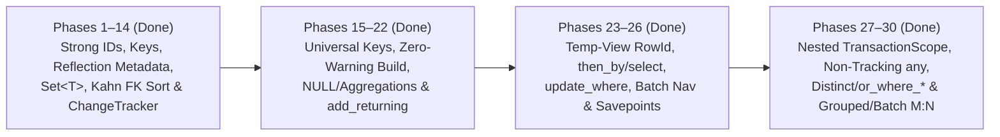
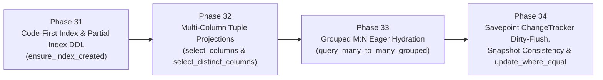

# CodeFirstCppDB_sqlgen — Architecture, Audit & Next-Gen Roadmap

> **Document Version:** 11.0 (Post-Phase-30 Full Code, Architecture & SQLite Audit + Phases 31–34 Specification)  
> **Date:** 2026-11-15  
> **Active Branch:** `main` (at commit `8a1f87c`)  
> **Toolchain Baseline:** GCC 16.1+ (`-std=c++26 -freflection`), CMake 4.4+, Ninja, SQLite 3  
> **Status:** Phases 1–30 Completed & Verified (68/68 GoogleTests passing across 30 suites in ~47 ms, zero compiler warnings)

---

## Table of Contents

1. [Executive Summary & Vision](#1-executive-summary--vision)
2. [Quick Start & Developer Setup](#2-quick-start--developer-setup)
3. [Current Architecture & Library Stack (v11.0 — Phases 1–30 Complete)](#3-current-architecture--library-stack-v110--phases-130-complete)
   - [Directory Layout](#directory-layout)
   - [Layer Boundaries](#layer-boundaries)
   - [External Submodule Libraries Assessment](#external-submodule-libraries-assessment)
   - [End-to-End Developer Experience (Encapsulated & Zero-DTO POCO Modes)](#end-to-end-developer-experience-encapsulated--zero-dto-poco-modes)
   - [Core Technical Pillars](#core-technical-pillars)
4. [Completed Engineering Roadmap (Phases 1–30 Summary)](#4-completed-engineering-roadmap-phases-130-summary)
5. [Post-Phase-30 Deep Audit of Code, Architecture & SQLite Execution](#5-post-phase-30-deep-audit-of-code-architecture--sqlite-execution)
6. [Next-Generation Improvements Roadmap (Phases 31–34)](#6-next-generation-improvements-roadmap-phases-3134)
   - [Phase 31: Code-First Index & Partial Index DDL (`ensure_index_created` / `ensure_unique_index_created`)](#phase-31-code-first-index--partial-index-ddl-ensure_index_created--ensure_unique_index_created)
   - [Phase 32: Multi-Column Server-Side Tuple Projections (`select_columns` & `select_distinct_columns`)](#phase-32-multi-column-server-side-tuple-projections-select_columns--select_distinct_columns)
   - [Phase 33: Grouped Many-to-Many Eager Hydration (`query_many_to_many_grouped`) & Composite-Key Deduplication](#phase-33-grouped-many-to-many-eager-hydration-query_many_to_many_grouped--composite-key-deduplication)
   - [Phase 34: Savepoint `ChangeTracker` Dirty-Flush Integration, Snapshot Consistency & `update_where_equal`](#phase-34-savepoint-changetracker-dirty-flush-integration-snapshot-consistency--update_where_equal)
7. [Architecture Comparison Matrix](#7-architecture-comparison-matrix)
8. [Appendix: Technical FAQ](#8-appendix-technical-faq)

---

## 1. Executive Summary & Vision

**CodeFirstCppDB_sqlgen** brings the **Code-First developer experience of C# and Entity Framework Core (EF Core)** to native C++26.

By combining **C++26 static reflection (`<meta>`)**, **C++23 deducing `this` & named modules (`import std;`)**, **C++20 concepts**, **monadic error handling (`std::expected`)**, and **`sqlgen`**, the library eliminates repetitive C++ data-access boilerplate at compile time—without external code generators, preprocessor macros, or runtime reflection overhead.

```text
┌────────────────────────────────────────────────────────────────────────┐
│                        C++26 Domain Entities                           │
│  (Encapsulated DDD classes OR Zero-DTO POCOs with Universal STL Keys)  │
└───────────────────────────────────┬────────────────────────────────────┘
                                    │
                       C++26 Static Reflection (std::meta)
                                    │
                                    ▼
┌────────────────────────────────────────────────────────────────────────┐
│               Compile-Time Relational Metadata Engine                  │
│   (SchemaTraits, EntityKey_t, ValidQueryColumn, Topological FK Graph)  │
└───────┬───────────────────────────┼────────────────────────────┬───────┘
        │                           │                            │
        ▼                           ▼                            ▼
┌──────────────────┐       ┌──────────────────┐       ┌──────────────────┐
│ ensure_created & │       │ MapperTraits     │       │ DbContextBase,   │
│ ensure_deleted   │       │ (Private Splice, │       │ Set<T>, DbQuery, │
│ (Kahn FK Order)  │       │  with_pk & POCO) │       │ Batch FK & UoW   │
└───────┬──────────┘       └────────┬─────────┘       └────────┬─────────┘
        │                           │                          │
        └───────────────────────────┼──────────────────────────┘
                                    ▼
┌────────────────────────────────────────────────────────────────────────┐
│              SQLiteConnection / DatabaseConnection (sqlgen)            │
│ (WHERE/OR/BETWEEN/IN/NULL, ORDER/THEN BY, DISTINCT, SAVEPOINT, WAL)    │
└────────────────────────────────────────────────────────────────────────┘
```

---

## 2. Quick Start & Developer Setup

### Prerequisites (Arch Linux / EndeavourOS)

```bash
sudo pacman -S --needed base-devel cmake ninja gdb sqlite

g++ --version     # Requires GCC 16.1+ (-std=c++26 -freflection)
cmake --version   # Requires CMake 4.4+ (CMAKE_CXX_MODULE_STD)
```

### Build, Test & Run

```bash
# 1. Initialize submodules (sqlgen, reflect-cpp, googletest)
git submodule update --init --recursive

# 2. Configure & build (GCC Debug preset — zero compiler warnings)
cmake --preset gcc-debug
cmake --build build/linux/arch/gcc/debug

# 3. Run unit & integration test suite (68 tests across 30 test suites)
./build/linux/arch/gcc/debug/DAL/tests/test_DAL

# 4. Run the Startup application (creates & queries relationalDB.db)
./build/linux/arch/gcc/debug/Startup/Startup
./build/linux/arch/gcc/debug/Startup/Startup --no-reset
```

---

## 3. Current Architecture & Library Stack (v11.0 — Phases 1–30 Complete)

### Directory Layout

```text
CodeFirstCppDB_sqlgen/
├── CMakeLists.txt                  # Root CMake config (C++26, optional Postgres, import std)
├── CMakePresets.json               # Presets for gcc-debug, gcc-release
├── readme4.md                      # Master architectural specification & roadmap
│
├── Core/                           # Module: `core` (Pure Domain Layer — Zero DB deps)
│   ├── core.ixx                    # Primary module interface
│   ├── Id.ixx                      # Universal strong ID wrapper: Core::Id<Tag, ValueType>
│   ├── Key.ixx                     # SingleKey<K>, CompositeKey<K...>, Key concepts
│   ├── entities/                   # Sample encapsulated domain entities (immutable IDs)
│   │   ├── Person.ixx              # Key = SingleKey<PersonId>
│   │   ├── Something.ixx           # Key = SingleKey<SomethingId>
│   │   └── Person_Something.ixx    # Key = CompositeKey<PersonId, SomethingId>
│   └── repositories/               # Abstract contracts & structured error model
│       ├── DbError.ixx             # DbError, DbErrorCode & message classifier
│       ├── IGenericRepository.ixx  # IRepository<T> & IGenericRepository<T, KeyType>
│       ├── IPersonRepository.ixx
│       ├── ISomethingRepository.ixx
│       └── IPerson_SomethingRepository.ixx
│
├── DAL/                            # Module: `dal` (Data Access Layer)
│   ├── dal.ixx                     # Primary module interface
│   ├── context/                    # EF Core-style Gateway, Set, Query & Driver Adapter
│   │   ├── DbContext.ixx           # DbContextBase<Conn>, TransactionScope, Grouped/Batch FK Nav, Savepoints
│   │   ├── DbSet.ixx               # DbSet<Domain> & composable server-side DbQuery (or_where_*, distinct, update_where)
│   │   └── SQLiteConnection.ixx    # SQL pushdown, aggregations, temp-view rowid, savepoint & WAL pragmas
│   ├── schema/                     # Relational DTOs & compile-time reflection metadata
│   │   ├── SchemaTraits.ixx        # Concepts, InferredKey_t, dto_equals, Kahn FK sort
│   │   ├── EntityMetadata.ixx      # Compile-time table/column/key reflection inspector
│   │   ├── PersonDTO.ixx
│   │   ├── SomethingDTO.ixx
│   │   └── Person_SomethingDTO.ixx
│   ├── mappers/
│   │   └── MapperTraits.ixx        # Domain <-> DTO splice mapper, with_primary_key, ValidQueryColumn
│   ├── repositories/
│   │   ├── GenericRepository.ixx   # Type-agnostic CRUD repository (Single & Composite keys)
│   │   ├── SQLitePersonRepo.ixx
│   │   ├── SQLiteSomethingRepo.ixx
│   │   └── SQLitePerson_SomethingRepo.ixx
│   └── tests/
│       └── test_DAL.cpp            # 68 GoogleTests across 30 suites
│
└── Startup/                        # Pure-Module Composition Root (Zero #includes)
    └── main.cpp                    # Defines AppDbContext, seeds via UoW, queries entities
```

### Layer Boundaries

| Layer | Module / Namespace | Responsibilities | Architectural Rules |
| :--- | :--- | :--- | :--- |
| **Core** | `core` (`Core::*`) | Domain entities, `Id<Tag, ValueType>`, `SingleKey`, `CompositeKey`, `DbError`, repository interfaces. | **Zero external dependencies.** No `sqlgen` or SQLite headers; immutable identities. |
| **DAL::Schema** | `dal` (`DAL::Schema::*`) | DTO structs, `SchemaOf<Domain>`, `EntityKey_t<Domain>`, `EntityMetadata<Domain>`, `col_of<Member>`, `dto_equals`, `kahn_topological_sort`, and FK navigation traits. | Constrained by `RelationalEntity<T>` (`SinglePrimaryKey` or `CompositePrimaryKey`). |
| **DAL::Mappers** | `dal` (`DAL::Mappers::*`) | `MapperTraits<Domain, DTO>` converting private domain fields <-> public DTO members, `with_primary_key`, POCO identity pass-through, and $O(M)$ case-insensitive `ValidQueryColumn` / `resolve_dto_member`. | Uses `std::meta::access_context::unchecked()` and `consteval` name matching; zero dependency on sample DTOs. |
| **DAL::Context** | `dal` (`DAL::*`) | `DbContextBase`, `TransactionScope`, `DbSet` (`Set<Domain>`), `DbQuery`, and `SQLiteConnection`. | Non-copyable/non-movable context; coordinates topological DDL, UoW, Zero-JSON `ChangeTracker`, grouped/batched FK navigation, SQL projections/aggregations, `add_returning`, and nested `SAVEPOINT` transactions. |
| **Startup** | Executable ([main.cpp](file:///home/d5/Developer09/CodeFirstCppDB_sqlgen/Startup/main.cpp)) | Defines `AppDbContext`, connects via `SQLiteConnection::connect`, and runs workflows. | **100% pure C++ modules** (`import std; import core; import dal;`) — no `#include`s or DTOs. |

### External Submodule Libraries Assessment

| Submodule / Library | Version / Role | How We Use It | Audit & Integration Notes |
| :--- | :--- | :--- | :--- |
| **`extern/sqlgen`** | `0.6.0` (SQL AST & Driver Layer) | Provides `sqlgen::sqlite::Connection`, `PrimaryKey`, `ForeignKey`, `Col`, `read`, `select_from`, `where`, `group_by`, `order_by`, `limit`, `offset`, `insert`, `insert_or_replace`, `update`, `delete_from`, `create_table`, `create_index`, `drop`, and `min`/`max`/`sum`/`avg`/`count`/`count_distinct`. | Isolated behind `DAL` global module fragments (`module; #include <sqlgen.hpp>`). PostgreSQL (`CODEFIRST_ENABLE_POSTGRES`), MySQL, and DuckDB are disabled by default so only SQLite3 is required. |
| **`extern/reflect-cpp`** | Transitive dependency of `sqlgen` | Supplies `rfl::Result`, `rfl::Ref`, `rfl::Tuple`, `rfl::NamedTuple`, and `rfl::internal::StringLiteral` used inside `sqlgen`'s SQL transpiler. | **Not** used for JSON or domain reflection in our code; all `Core`/`DAL` introspection uses native ISO C++26 `<meta>`. |
| **`extern/googletest`** | Unit & Integration Testing | Runs 68 tests across 30 suites (`test_DAL`) covering mock connections and live `:memory:` SQLite databases in ~47 ms. | Linked privately only to `test_DAL`. |

### End-to-End Developer Experience (Encapsulated & Zero-DTO POCO Modes)

```cpp
import std;
import core;
import dal;

class AppDbContext : public DAL::DbContextBase<DAL::SQLiteConnection> {
public:
    Set<Core::Person> people{ this };
    Set<Core::Something> somethings{ this };
    Set<Core::Person_Something> personSomethings{ this };

    using DbContextBase::DbContextBase;
};

int main() {
    auto conn = DAL::SQLiteConnection::connect("relationalDB.db").value();
    conn->enable_wal_mode().value();
    AppDbContext db(conn);

    // 1. Topological FK DDL: drops children before parents, creates parents before children
    db.ensure_deleted().value();
    db.ensure_created().value();

    // 2. Batch insert and back-populate sequential auto-increment IDs via <meta>
    auto seeded = db.people.add_range_returning({
        Core::Person(Core::PersonId{ 0 }, "Ada", "Lovelace"),
        Core::Person(Core::PersonId{ 0 }, "Alan", "Turing")
    }).value();

    // 3. Disjunctive OR filtering, multi-column sort & distinct server-side projection
    auto lastNames = db.people
        .where_equal<"firstName">("Ada")
        .or_where_like<"lastName">("T%")
        .order_by<"lastName">(false)
        .select_distinct<"lastName">();

    // 4. Variadic multi-column server-side UPDATE ... WHERE
    db.people
        .where_equal<"lastName">("Turing")
        .update_where<"firstName", "lastName">("A.M.", "Turing")
        .value();
}
```

### Core Technical Pillars

1. **Private-Member Splicing, Auto-Increment Back-Population & Case-Insensitive Column Resolution ([MapperTraits.ixx](file:///home/d5/Developer09/CodeFirstCppDB_sqlgen/DAL/mappers/MapperTraits.ixx)):**
   - Maps private domain fields (`camelCase_`) to/from DTO columns (`snake_case`) and splices database-generated primary keys back into encapsulated domain entities (`with_primary_key`) using `std::meta::access_context::unchecked()`.
   - Resolves `"FirstName"`, `"firstName"`, `"firstName_"`, and `"first_name"` to `PersonDTO::first_name` in $O(M)$ compile time via `ValidQueryColumn<Domain, DTO, ColLiteral>`.
2. **Universal STL & Strong-ID Keys ([Id.ixx](file:///home/d5/Developer09/CodeFirstCppDB_sqlgen/Core/Id.ixx), [Key.ixx](file:///home/d5/Developer09/CodeFirstCppDB_sqlgen/Core/Key.ixx), [SchemaTraits.ixx](file:///home/d5/Developer09/CodeFirstCppDB_sqlgen/DAL/schema/SchemaTraits.ixx)):**
   - `Core::Id<Tag, ValueType = std::int32_t>`, `SingleKey<K>`, `CompositeKey<K...>`, and `InferredKey_t<DTO>` support `std::int32_t`, `std::int64_t`, `std::string`, and heterogeneous composite keys.
3. **Compile-Time Topological Foreign-Key Sorting & Grouped/Batched Relationship Navigation ([SchemaTraits.ixx](file:///home/d5/Developer09/CodeFirstCppDB_sqlgen/DAL/schema/SchemaTraits.ixx#L317-L508), [DbContext.ixx](file:///home/d5/Developer09/CodeFirstCppDB_sqlgen/DAL/context/DbContext.ixx#L111-L696)):**
   - `kahn_topological_sort` orders `ensure_created()` and `ensure_deleted()` at compile time (`consteval`).
   - `query_children`, `query_parent`, `query_children_batch`, `query_children_grouped`, `query_parents_batch`, `query_many_to_many`, and `query_many_to_many_batch` navigate foreign-key relationships in $O(1)$ SQL queries.
4. **Composable Server-Side `DbQuery`, Projections, Bulk Updates, Savepoints & Zero-JSON `ChangeTracker` ([DbSet.ixx](file:///home/d5/Developer09/CodeFirstCppDB_sqlgen/DAL/context/DbSet.ixx), [SQLiteConnection.ixx](file:///home/d5/Developer09/CodeFirstCppDB_sqlgen/DAL/context/SQLiteConnection.ixx)):**
   - `DbQuery` composes full `where_*` and `or_where_*` predicates (`=`, `!=`, `<`, `<=`, `>`, `>=`, `BETWEEN`, `LIKE`, `NOT LIKE`, `IN`, `NOT IN`, `IS NULL`, `IS NOT NULL`), multi-column `order_by`/`then_by`, `LIMIT/OFFSET`, `.select<"col">()`, `.select_distinct<"col">()`, `.count()`, `.count_distinct<"col">()`, `.min()`, `.max()`, `.sum()`, `.avg()`, non-tracking `.any()`, `.remove_where()`, and variadic multi-column `.update_where<Cols...>(vals...)`.
   - Both `DbContextBase::transaction()` and RAII `TransactionScope` support nested transactions via SQL `SAVEPOINT`s with deferred-operation rollback safety.

---

## 4. Completed Engineering Roadmap (Phases 1–30 Summary)



- [x] **Phases 1–14 — Core Foundations, Reflection Metadata, POCO Mode, Topological FK Sort, Zero-JSON `ChangeTracker`, Composable `DbQuery`, Upsert & FK Navigation (`01853df`).**
- [x] **Phases 15–18 — Universal STL Keys, Domain Column Resolution, Batched M:N `IN` Pushdown & Repository Cleanup (`dca5d38`).**
- [x] **Phases 19–22 — Build Hardening, ORM Engine Decoupling, Case-Insensitive Columns, `NULL`/Negative Predicates, SQL Aggregations & `add_returning` (`88c46ac`).**
- [x] **Phases 23–26 — Read-Only Temp-View `try_last_insert_rowid()`, `add_range_returning()`, `then_by`, `select`, `where_between`, `update_where`, `query_children_batch` / `query_parents_batch`, & `SAVEPOINT`s (`a51208b`).**
- [x] **Phase 27 — Nested `TransactionScope` Savepoints, Deferred-Op Savepoint Flushing & Rollback Safety (`8a1f87c`):** Upgraded `TransactionScope` to automatically acquire/release/rollback SQL `SAVEPOINT`s when constructed inside an active transaction, and added `flush_pending_since()` / `truncate_pending_changes()` so deferred Unit-of-Work operations staged inside a nested savepoint are flushed before savepoint release and truncated on savepoint rollback.
- [x] **Phase 28 — Non-Tracking `any()` / `exists()`, Monadic `try_first_or_default()` & `try_any()`, and Variadic Multi-Column `update_where` (`8a1f87c`):** Optimized `SQLiteConnection::exists` and `exists_by_composite_id` to use `COUNT(*)`, made `DbQuery::try_any()` / `any()` non-tracking, added `try_first_or_default()`, and generalized `update_where<ColLiterals...>(new_vals...)` to update multiple columns in a single SQL `UPDATE` statement.
- [x] **Phase 29 — Server-Side `select_distinct`, `count_distinct`, & Full `or_where_*` Predicate Parity (`8a1f87c`):** Added `try_count_distinct<Col>()` / `count_distinct<Col>()` (`SELECT COUNT(DISTINCT col)`), `try_select_distinct<Col>()` / `select_distinct<Col>()` (`GROUP BY col`), and all 14 `or_where_*` predicate methods on `DbQuery`.
- [x] **Phase 30 — Grouped 1:N Eager Hydration (`query_children_grouped`) & Batched Collection M:N Navigation (`query_many_to_many_batch`) (`8a1f87c`):** Added `query_children_grouped<ChildDomain>(parents)` returning `std::vector<std::pair<ParentDomain, std::vector<ChildDomain>>>` in 1 SQL query and `query_many_to_many_batch<TargetDomain, JunctionDomain>(sources)` in 2 SQL `IN` queries.

---

## 5. Post-Phase-30 Deep Audit of Code, Architecture & SQLite Execution

A comprehensive audit of `main` at commit `8a1f87c` verified that all **68 GoogleTests across 30 test suites** pass in ~47 ms with zero compiler warnings. Inspecting the full codebase (`Core`, `DAL`, `Startup`, and `extern/sqlgen`) surfaced four high-value architectural opportunities for the next wave of improvements:

1. **Code-First Index & Partial Index DDL (`CREATE [UNIQUE] INDEX IF NOT EXISTS`) Not Exposed on `DbSet` / `DbQuery` / `SQLiteConnection` ([create_index.hpp:43-85](file:///home/d5/Developer09/CodeFirstCppDB_sqlgen/extern/sqlgen/include/sqlgen/create_index.hpp#L43-L85), [SQLiteConnection.ixx:60-96](file:///home/d5/Developer09/CodeFirstCppDB_sqlgen/DAL/context/SQLiteConnection.ixx#L60-L96)):**
   - While `SQLiteConnection` exposes `ensure_table_created<DTO>()` (`CREATE TABLE IF NOT EXISTS`) and `ensure_table_dropped<DTO>()` (`DROP TABLE IF EXISTS`), it does not yet expose `sqlgen::CreateIndex<IndexName, DTO, WhereType, ColTypes...>`!
   - `sqlgen::CreateIndex` natively supports single-column and composite indexes, `UNIQUE` constraints (`CREATE UNIQUE INDEX IF NOT EXISTS`), and even **partial/filtered SQLite indexes** (`CREATE [UNIQUE] INDEX IF NOT EXISTS ... WHERE ...`). Exposing `ensure_index_created<IndexName, ColLiterals...>(bool unique = false)` and `ensure_unique_index_created<IndexName, ColLiterals...>()` on both `DbSet` (full-table index) and `DbQuery` (partial index filtered by `where_cond_`), validated at compile time by `ValidQueryColumn<Domain, DTO, ColLiterals>...`, brings type-safe Code-First index creation to the ORM.

2. **Single-Column Limitation in Server-Side Projections (`select<ColLiteral>()`) ([DbSet.ixx:835-895](file:///home/d5/Developer09/CodeFirstCppDB_sqlgen/DAL/context/DbSet.ixx#L835-L895), [select_from.hpp:348-357](file:///home/d5/Developer09/CodeFirstCppDB_sqlgen/extern/sqlgen/include/sqlgen/select_from.hpp#L348-L357)):**
   - Currently, `DbQuery::select<ColLiteral>()` and `select_distinct<ColLiteral>()` can only project a **single** column (`std::vector<ColValueT>`). When an application needs 2 or 3 columns from a wide table (e.g., `db.people.select_columns<"firstName", "lastName">()`), it must either run multiple queries or fetch entire `DTO` rows.
   - `sqlgen::select_from<DTO>(fields...)` is variadic and returns a `Range` of `rfl::Result<rfl::NamedTuple<...>>` when invoked without `sqlgen::to<...>`, where each field is accessible by compile-time index via `rfl::get<static_cast<int>(Is)>(named_tuple)`. Adding `try_execute_tuple_read<RowTuple>` on `SQLiteConnection` enables variadic `select_columns<ColLiterals...>()` and `select_distinct_columns<ColLiterals...>()` returning `std::vector<std::tuple<ColValueType...>>` directly from SQLite!

3. **Missing Grouped Many-to-Many Eager Hydration (`query_many_to_many_grouped`) & Composite-Key Target Duplication in `query_many_to_many_batch` ([DbContext.ixx:637-695](file:///home/d5/Developer09/CodeFirstCppDB_sqlgen/DAL/context/DbContext.ixx#L637-L695)):**
   - Look at `DbContextBase::query_many_to_many_batch<TargetDomain, JunctionDomain>(sources)` ([DbContext.ixx:637-695](file:///home/d5/Developer09/CodeFirstCppDB_sqlgen/DAL/context/DbContext.ixx#L637-L695)):
     - First, while the `SinglePrimaryKey<TargetDTO>` branch uses `WHERE pk IN (target_fks)` (which SQLite naturally deduplicates), the `else` fallback branch for composite-key `TargetDTO`s ([DbContext.ixx:675-694](file:///home/d5/Developer09/CodeFirstCppDB_sqlgen/DAL/context/DbContext.ixx#L675-L694)) loops over `*junctions_res` without deduplicating `target_fk`s, returning duplicate `TargetDomain` instances if multiple sources link to the same composite-key target.
     - Second, just as `query_children_batch` needed `query_children_grouped` so callers know which parent owns which children, `query_many_to_many_batch(sources)` returns a flat `std::vector<TargetDomain>` without indicating which `SourceDomain` links to which `TargetDomain`! Adding `query_many_to_many_grouped<TargetDomain, JunctionDomain>(sources)` returning `std::expected<std::vector<std::pair<SourceDomain, std::vector<TargetDomain>>>, Core::DbError>` hydrates the full M:N graph across a collection of sources in **just 2 SQL queries** plus an $O(N + J + M)$ in-memory join.

4. **Savepoint `ChangeTracker` Dirty-Flush Gap, Snapshot Consistency on Immediate `add`/`update`, & Missing `DbSet::update_where_equal` ([DbContext.ixx:936-945, 1101-1111](file:///home/d5/Developer09/CodeFirstCppDB_sqlgen/DAL/context/DbContext.ixx#L936-L945), [DbSet.ixx:1269-1395, 1750-1755](file:///home/d5/Developer09/CodeFirstCppDB_sqlgen/DAL/context/DbSet.ixx#L1269-L1395)):**
   - Outer `DbContextBase::save_changes()` calls `(void)detect_changes();` ([DbContext.ixx:746](file:///home/d5/Developer09/CodeFirstCppDB_sqlgen/DAL/context/DbContext.ixx#L746)) before flushing `pending_ops_`. However, the nested savepoint commit paths in `DbContextBase::transaction(Fn&& fn)` ([DbContext.ixx:936](file:///home/d5/Developer09/CodeFirstCppDB_sqlgen/DAL/context/DbContext.ixx#L936)) and `TransactionScope::commit()` ([DbContext.ixx:1101](file:///home/d5/Developer09/CodeFirstCppDB_sqlgen/DAL/context/DbContext.ixx#L1101)) only check `if (pending_ops_.size() > saved_pending_size)` without calling `detect_changes()` first! Consequently, if an entity loaded via `find_tracked()` or attached via `track()` is mutated inside a nested savepoint, that dirty mutation is not flushed before `release_savepoint()`.
   - Additionally, while `upsert_immediate()` and `add_returning()` record/refresh baseline snapshots in `ChangeTracker` when `is_tracking_enabled()` is `true`, immediate `DbSet::update(item)` and non-auto-increment `DbSet::add(item)` / `add_range(items)` do not refresh the snapshot.
   - Finally, `DbSet` provides `remove_where_equal<ColLiteral>(val)` ([DbSet.ixx:1752](file:///home/d5/Developer09/CodeFirstCppDB_sqlgen/DAL/context/DbSet.ixx#L1752)), but lacks its counterpart `update_where_equal<MatchCol, SetCols...>(match_val, new_vals...)`.

---

## 6. Next-Generation Improvements Roadmap (Phases 31–34)



---

### Phase 31: Code-First Index & Partial Index DDL (`ensure_index_created` / `ensure_unique_index_created`)

#### Objective
Expose type-safe Code-First index creation (`CREATE [UNIQUE] INDEX IF NOT EXISTS ...`) on `SQLiteConnection`, `DbSet` (full-table single or composite index), and `DbQuery` (partial/filtered index with `WHERE`), validated at compile time by `ValidQueryColumn`.

#### Detailed Tasks

- [x] **Task 31.1: Add `ensure_index_created` & `ensure_filtered_index_created` on `SQLiteConnection` (`DAL/context/SQLiteConnection.ixx`)**
  - In [DAL/context/SQLiteConnection.ixx](file:///home/d5/Developer09/CodeFirstCppDB_sqlgen/DAL/context/SQLiteConnection.ixx), add:
    ```cpp
    template<rfl::internal::StringLiteral IndexName, typename DTO, typename... ColTypes>
        requires (sizeof...(ColTypes) >= 1)
    std::expected<void, Core::DbError> ensure_index_created(bool unique, const ColTypes&...)
    {
        if (!is_open())
        {
            return std::unexpected<Core::DbError>{
                Core::DbError::connection_error("Cannot create index: database connection is closed")
            };
        }
        auto res = sqlgen::CreateIndex<IndexName, DTO, sqlgen::Nothing, ColTypes...>{
            .unique_ = unique,
            .if_not_exists_ = true,
            .where_ = sqlgen::Nothing{}
        }(conn_);
        if (!res)
        {
            return std::unexpected<Core::DbError>{ Core::DbError::map_from_message(res.error().what()) };
        }
        return {};
    }

    template<rfl::internal::StringLiteral IndexName, typename DTO, typename WhereCond, typename... ColTypes>
        requires (sizeof...(ColTypes) >= 1)
    std::expected<void, Core::DbError> ensure_filtered_index_created(
        bool unique, const WhereCond& where_cond, const ColTypes&...)
    {
        if (!is_open())
        {
            return std::unexpected<Core::DbError>{
                Core::DbError::connection_error("Cannot create index: database connection is closed")
            };
        }
        auto res = sqlgen::CreateIndex<IndexName, DTO, WhereCond, ColTypes...>{
            .unique_ = unique,
            .if_not_exists_ = true,
            .where_ = where_cond
        }(conn_);
        if (!res)
        {
            return std::unexpected<Core::DbError>{ Core::DbError::map_from_message(res.error().what()) };
        }
        return {};
    }
    ```

- [x] **Task 31.2: Expose `ensure_index_created` & `ensure_unique_index_created` on `DbSet` and `DbQuery` (`DAL/context/DbSet.ixx`)**
  - On `DbSet<Domain, DTO, ConnectionHandle, KeyType>`, add:
    - `ensure_index_created<IndexName, ColLiterals...>(bool unique = false)`
    - `ensure_unique_index_created<IndexName, ColLiterals...>()`
    constrained by `(sizeof...(ColLiterals) >= 1) && (DAL::Mappers::ValidQueryColumn<Domain, DTO, ColLiterals> && ...)`, forwarding `Schema::col_of<DAL::Mappers::resolve_dto_member<Domain, DTO, ColLiterals>()>...` to `conn_->template ensure_index_created<IndexName, DTO>(unique, ...)`.
  - On `DbQuery`, add `ensure_index_created<IndexName, ColLiterals...>(bool unique = false)` and `ensure_unique_index_created<IndexName, ColLiterals...>()` (calling `ensure_filtered_index_created` when `!std::same_as<WhereCondT, rfl::Nothing>`, or `ensure_index_created` otherwise).

- [x] **Task 31.3: Phase 31 Verification Tests (`DAL/tests/test_DAL.cpp`)**
  - Test creating a composite index `db.people.ensure_index_created<"idx_person_name", "lastName", "firstName">()`.
  - Test creating a unique index `db.people.ensure_unique_index_created<"idx_person_unique_name", "firstName", "lastName">()` and verify inserting a duplicate row returns `Core::DbErrorCode::ConstraintViolation`.
  - Test creating a partial unique index via `DbQuery` (`where_not_null<"nickname">().ensure_unique_index_created<"idx_unique_nickname", "nickname">()`), verifying multiple `NULL` nicknames succeed while duplicate non-null nicknames fail with `ConstraintViolation`.

---

### Phase 32: Multi-Column Server-Side Tuple Projections (`select_columns` & `select_distinct_columns`)

#### Objective
Allow callers to project 2 or more columns server-side into `std::vector<std::tuple<Col1T, Col2T, ...>>` (both standard `SELECT c1, c2 ...` and distinct `SELECT c1, c2 ... GROUP BY c1, c2`) while preserving `WHERE`, `ORDER BY` / `THEN BY`, `LIMIT`, and `OFFSET`.

#### Detailed Tasks

- [x] **Task 32.1: Add `try_execute_tuple_read<RowTuple>` on `SQLiteConnection` (`DAL/context/SQLiteConnection.ixx`)**
  - In [DAL/context/SQLiteConnection.ixx](file:///home/d5/Developer09/CodeFirstCppDB_sqlgen/DAL/context/SQLiteConnection.ixx), add:
    ```cpp
    template<typename RowTuple, typename Query>
    [[nodiscard]] std::expected<std::vector<RowTuple>, Core::DbError> try_execute_tuple_read(Query&& query) const
    {
        if (!is_open())
        {
            return std::unexpected<Core::DbError>{
                Core::DbError::connection_error("Database connection is closed")
            };
        }
        auto range_res = std::forward<Query>(query)(conn_);
        if (!range_res)
        {
            return std::unexpected<Core::DbError>{ Core::DbError::map_from_message(range_res.error().what()) };
        }
        std::vector<RowTuple> rows;
        for (auto& item_res : *range_res)
        {
            if (!item_res)
            {
                return std::unexpected<Core::DbError>{ Core::DbError::map_from_message(item_res.error().what()) };
            }
            auto& nt = *item_res;
            rows.push_back([&]<std::size_t... Is>(std::index_sequence<Is...>) {
                return RowTuple{ std::move(rfl::get<static_cast<int>(Is)>(nt))... };
            }(std::make_index_sequence<std::tuple_size_v<RowTuple>>{}));
        }
        return rows;
    }
    ```

- [x] **Task 32.2: Add `try_select_columns` / `select_columns` & `try_select_distinct_columns` / `select_distinct_columns` on `DbQuery` and `DbSet` (`DAL/context/DbSet.ixx`)**
  - Add a private helper `execute_tuple_projection<RowTuple>(const ConnectionHandle& conn, BaseQuery&& base_query)` on `DbQuery` that applies `limit_` and `offset_` (without `| sqlgen::to<...>`) and invokes `conn.template try_execute_tuple_read<RowTuple>(std::move(q))`.
  - Add on `DbQuery` and forward on `DbSet`:
    - `try_select_columns<ColLiterals...>()` -> `std::expected<std::vector<std::tuple<ColValueT...>>, Core::DbError>`
    - `select_columns<ColLiterals...>()` -> `std::vector<std::tuple<ColValueT...>>`
    - `try_select_distinct_columns<ColLiterals...>()` -> `std::expected<std::vector<std::tuple<ColValueT...>>, Core::DbError>` (piping `| sqlgen::group_by(Schema::col_of<resolve_dto_member<Domain, DTO, ColLiterals>()>...)`)
    - `select_distinct_columns<ColLiterals...>()` -> `std::vector<std::tuple<ColValueT...>>`
    where each `ColValueT` is `typename [:std::meta::type_of(DAL::Mappers::resolve_dto_member<Domain, DTO, ColLiterals>()):]`.

- [x] **Task 32.3: Phase 32 Verification Tests (`DAL/tests/test_DAL.cpp`)**
  - Test `db.people.order_by<"lastName">().then_by<"firstName">().select_columns<"firstName", "lastName">()` and structured bindings `for (const auto& [first, last] : rows)`.
  - Test `select_distinct_columns` on multi-column combinations with duplicates.

---

### Phase 33: Grouped Many-to-Many Eager Hydration (`query_many_to_many_grouped`) & Composite-Key Deduplication

#### Objective
Deduplicate composite-key targets in `query_many_to_many_batch` and provide `query_many_to_many_grouped<TargetDomain, JunctionDomain>(sources)` to hydrate `std::vector<std::pair<SourceDomain, std::vector<TargetDomain>>>` across a collection of source entities in 2 SQL queries.

#### Detailed Tasks

- [x] **Task 33.1: Deduplicate Composite-Key Targets in `query_many_to_many_batch` (`DAL/context/DbContext.ixx`)**
  - In the composite-key `else` branch of `DbContextBase::query_many_to_many_batch` ([DAL/context/DbContext.ixx:675-694](file:///home/d5/Developer09/CodeFirstCppDB_sqlgen/DAL/context/DbContext.ixx#L675-L694)), track seen target keys (`std::unordered_set<std::string>` using `std::format("{}", target_fk)` or `TargetKeyT`) before calling `target_set.try_find(target_fk)` so shared targets across multiple sources are returned only once.

- [x] **Task 33.2: Add `query_many_to_many_grouped<TargetDomain, JunctionDomain>(sources)` on `DbContextBase` (`DAL/context/DbContext.ixx`)**
  - In [DAL/context/DbContext.ixx](file:///home/d5/Developer09/CodeFirstCppDB_sqlgen/DAL/context/DbContext.ixx), add:
    ```cpp
    template<typename TargetDomain, typename JunctionDomain, typename SourceDomain, typename Self>
    [[nodiscard]] std::expected<std::vector<std::pair<SourceDomain, std::vector<TargetDomain>>>, Core::DbError>
    query_many_to_many_grouped(this Self&& self, const std::vector<SourceDomain>& sources)
    ```
  - Implementation:
    1. If `sources.empty()`, return an empty vector.
    2. Execute **Query 1**: `auto junctions_res = self.template query_children_batch<JunctionDomain>(sources);`.
    3. Execute **Query 2**: load all referenced `TargetDomain` entities in a single batched `IN` query (or deduplicated lookup for composite-key targets) and index them in an `std::unordered_map` keyed by target raw PK (or formatted key).
    4. Group junction rows by source FK (`Schema::extract_fk_value<JunctionDTO, SourceDTO>(j_dto)`), look up each `TargetDomain` in the map, and build `std::vector<std::pair<SourceDomain, std::vector<TargetDomain>>>` preserving the exact order of `sources` (including sources with 0 linked targets).

- [x] **Task 33.3: Phase 33 Verification Tests (`DAL/tests/test_DAL.cpp`)**
  - Test `db.query_many_to_many_grouped<Core::Something, Core::Person_Something>(people)` across multiple `Core::Person` entities (including shared `Core::Something` items and a `Core::Person` with 0 items), verifying each person's paired `std::vector<Core::Something>` is accurate.

---

### Phase 34: Savepoint `ChangeTracker` Dirty-Flush Integration, Snapshot Consistency & `update_where_equal`

#### Objective
Ensure dirty tracked entities (`find_tracked` / `track`) are automatically detected and flushed before a nested savepoint commits in both `DbContextBase::transaction` and `TransactionScope::commit`, keep `ChangeTracker` snapshots consistent on immediate `add` / `update`, and add `DbSet::update_where_equal`.

#### Detailed Tasks

- [x] **Task 34.1: Call `detect_changes()` Before Savepoint Flush in `DbContextBase::transaction` & `TransactionScope::commit` (`DAL/context/DbContext.ixx`)**
  - In `DbContextBase::transaction(Fn&& fn)`'s nested savepoint branch ([DAL/context/DbContext.ixx:936](file:///home/d5/Developer09/CodeFirstCppDB_sqlgen/DAL/context/DbContext.ixx#L936)):
    - Before `if (pending_ops_.size() > saved_pending_size)`, call `(void)detect_changes();` so any tracked entity mutated inside `fn()` enqueues its update operation and is flushed inside the savepoint (and rolled back if the update violates a constraint).
  - In `TransactionScope::commit()`'s `if (is_savepoint_)` branch ([DAL/context/DbContext.ixx:1101](file:///home/d5/Developer09/CodeFirstCppDB_sqlgen/DAL/context/DbContext.ixx#L1101)):
    - Call `(void)ctx_->detect_changes();` before checking `ctx_->pending_changes_count() > saved_pending_size_` and calling `ctx_->flush_pending_since(saved_pending_size_)`.

- [x] **Task 34.2: Record/Refresh `ChangeTracker` Snapshots on Immediate `add`, `add_range`, & `update`, and Add `update_where_equal` (`DAL/context/DbSet.ixx`)**
  - In `DbSet::add(const Domain& item)` and `DbSet::add_range(const std::vector<Domain>& items)` ([DAL/context/DbSet.ixx:1269-1385](file:///home/d5/Developer09/CodeFirstCppDB_sqlgen/DAL/context/DbSet.ixx#L1269-L1385)): when not deferred and `res.has_value() && is_tracking_enabled()`, if `constexpr (!Schema::has_auto_incr_primary_key<DTO>())`, call `record_snapshot(item)` (or for each item in `items`).
  - In `DbSet::update(const Domain& item)` ([DAL/context/DbSet.ixx:1388-1395](file:///home/d5/Developer09/CodeFirstCppDB_sqlgen/DAL/context/DbSet.ixx#L1388-L1395)): when not deferred and `res.has_value() && is_tracking_enabled()`, call `record_snapshot(item)` so the baseline snapshot reflects the newly persisted state.
  - On `DbSet`, add `update_where_equal` to mirror `remove_where_equal`:
    ```cpp
    template<rfl::internal::StringLiteral MatchCol, rfl::internal::StringLiteral... SetCols, typename MatchVal, typename... SetVals>
        requires DAL::Mappers::ValidQueryColumn<Domain, DTO, MatchCol>
              && (sizeof...(SetCols) >= 1)
              && (sizeof...(SetCols) == sizeof...(SetVals))
              && (DAL::Mappers::ValidQueryColumn<Domain, DTO, SetCols> && ...)
    std::expected<void, Core::DbError> update_where_equal(const MatchVal& match_val, const SetVals&... new_vals) const
    {
        return where_equal<MatchCol>(match_val).template update_where<SetCols...>(new_vals...);
    }
    ```

- [x] **Task 34.3: Phase 34 Verification Tests (`DAL/tests/test_DAL.cpp`)**
  - Test mutating an entity obtained via `find_tracked()` inside a nested `TransactionScope` and calling `inner.commit()`, verifying the change is persisted in SQLite immediately on `inner.commit()`.
  - Test `db.people.update_where_equal<"lastName", "firstName">("Lovelace", "Augusta")`.

---

## 7. Architecture Comparison Matrix

| Feature / Aspect | Early v3 Baseline | Current `main` (v11.0 — Phases 1–30) | Next-Gen Target (Phases 31–34) | C# Entity Framework Core |
| :--- | :--- | :--- | :--- | :--- |
| **Primary Key & DDL** | `int32_t` only, flat `CREATE TABLE` | Universal STL/Strong IDs, Kahn FK table DDL, `add_returning` | + Code-First Index & Partial Index DDL (`ensure_index_created`) | `HasIndex().IsUnique().HasFilter()` |
| **Sorting & Projections** | Raw `sqlgen::read` | `order_by` / `then_by`, 1-col `select` & `select_distinct` | + Multi-column tuple projections (`select_columns` & `select_distinct_columns`) | `.Select(x => new { x.A, x.B }).Distinct()` |
| **SQL Predicates & Bulk Ops** | None | Full `where_*` & `or_where_*`, `COUNT(DISTINCT)`, variadic `update_where` | + `DbSet::update_where_equal` shorthand | `.ExecuteDelete()` / `.ExecuteUpdate()` |
| **Relationships** | Manual ID lookups | `query_children_grouped`, `query_parents_batch`, flat `query_many_to_many_batch` | + Grouped 2-query M:N hydration (`query_many_to_many_grouped`) | `.Include()` / `.ThenInclude()` |
| **Transactions & Tracking** | None | Nested `SAVEPOINT`s in `transaction()` & `TransactionScope` + `ChangeTracker` | + Automatic `detect_changes()` flush on nested savepoint commit | `IDbContextTransaction.CreateSavepoint` |

---

## 8. Appendix: Technical FAQ

1. **Why is GCC 16.1+ required instead of Clang?**
   - GCC 16.1+ implements ISO C++26 static reflection (`P2996`) via `-std=c++26 -freflection` and `<meta>`. Standard Clang releases do not yet support `<meta>`.
2. **Why is `extern/reflect-cpp` still needed if our code uses C++26 `<meta>`?**
   - Our `Core` and `DAL` modules use C++26 `<meta>` for entity/schema introspection, private member splicing, DTO equality, and topological FK sorting, while `sqlgen` uses `reflect-cpp` (`rfl::Result`, `rfl::Ref`, `rfl::NamedTuple`, `rfl::internal::StringLiteral`) for its internal SQL transpiler.
3. **Why use a `TEMP VIEW` instead of a `TEMP TABLE` for `try_last_insert_rowid()`?**
   - Inserting `last_insert_rowid()` into a temporary table executes a SQL `INSERT`, which causes SQLite to overwrite `last_insert_rowid()` with the new row's `rowid` (`1`) in the temporary table. Defining `CREATE TEMP VIEW IF NOT EXISTS _codefirst_last_rowid AS SELECT last_insert_rowid() AS id;` allows `sqlgen::dynamic::SelectFrom` to read `last_insert_rowid()` in a single read-only `SELECT` without ever mutating connection state.
4. **How do `db.ensure_created()` and `db.ensure_deleted()` handle foreign-key table ordering?**
   - They use C++23 **deducing `this`** (`this Self&& self`) to reflect all `Set<T>` members on the derived `DbContext`, extract each DTO's `sqlgen::ForeignKey` targets, and run a `consteval` Kahn topological sort (`kahn_topological_sort`) so parent tables are always created first and dropped last.
