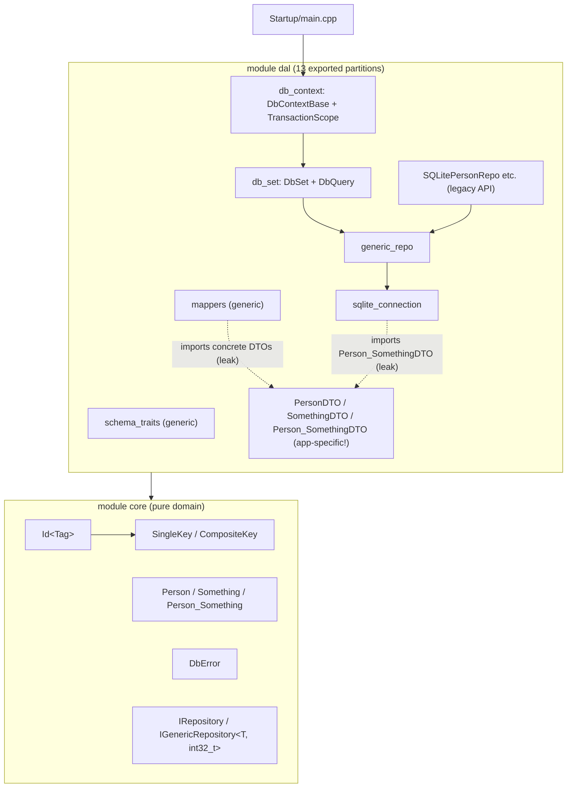
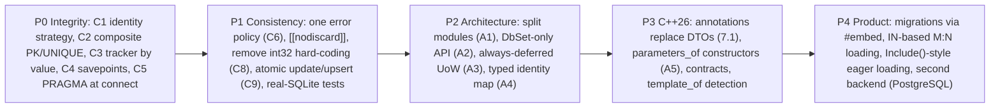

# CodeFirstCppDB_sqlgen — Independent Architecture & Code Review

> **Document:** readme5.md (review opinion, not a spec)
> **Branch / commit reviewed:** `Review101_pkstl` @ `01853df` (Phases 1–14)
> **Toolchain used for verification:** GCC 16.2.1 (`-std=c++26 -freflection`), CMake 4.5.0, Ninja, SQLite 3
> **Date:** 2026-11-15
> external team revision

---

## 1. TL;DR

This is an ambitious, technically impressive project. It may be the cleanest public demonstration so far of **C++26 static reflection (P2996) used as an ORM engine**. Topological FK ordering at compile time, private-member splicing and key inference have no runtime cost, and they are good engineering.

It is **not production-safe yet**. I reproduced a **data-integrity bug in the shipped `Startup` app**. Some important guarantees are only partly true: the junction-table key, transactions, and "strong" IDs. Several of these defects are hidden because the tests run on fresh in-memory databases, where generated IDs happen to match the IDs the domain assigned.

| Area | Score | One-line opinion |
| :--- | :---: | :--- |
| Vision / ambition | ★★★★★ | Code-first EF Core ergonomics, no codegen, no macros. Excellent. |
| Use of modern C++ | ★★★★☆ | Strong use of reflection, deducing `this`, `std::expected`, `import std`. Some C++26 tools are still unused (annotations, contracts, `template_of`). |
| Architecture / layering | ★★★☆☆ | `Core` stays pure, which is good. The `dal` module is a monolith that mixes the generic ORM with sample-app DTOs. There are two parallel persistence APIs. |
| Correctness | ★★☆☆☆ | ID loss with auto-increment PKs, junction tables with no PK, a dangling tracked pointer, an outer transaction committed by `save_changes()`. |
| API design | ★★★☆☆ | Fluent and readable, but column names are strings, errors are swallowed, and immediate/deferred modes double the API surface. |
| Error handling | ★★☆☆☆ | `std::expected` and silent `{}` / `0` / `false` fallbacks are mixed. Errors are classified by string matching. |
| Tests | ★★★☆☆ | 53 tests, fast and green. Coverage leans on a mock (27 mock vs 17 real-SQLite uses). Integrity bugs are not caught. |
| Build / tooling | ★★★☆☆ | Modern CMake modules plus `import std`. Flags are global, there are no warnings or sanitizers, Clang presets don't work, and there is no CI. |
| Documentation | ★★★☆☆ | `readme4.md` is rich but stale (says 48 tests / 11 suites, commit `29cfa92`, branch `main`) and reads as a phase log rather than user docs. |

---

## 2. How this review was done

Everything flagged as **Verified** below was reproduced on this machine, not inferred:

| Check | Result |
| :--- | :--- |
| `cmake --build build/linux/arch/gcc/debug` | ✅ Builds (incremental ~1m27s). 3 warnings: `-Wexpose-global-module-tu-local` (reflect-cpp in the GMF) and `-Wdeprecated-literal-operator` (sqlgen). |
| `DAL/tests/test_DAL` | ✅ **53 tests / 15 suites pass in 19 ms** (readme4 says 48/11, so it is stale). |
| `Startup` run #1 (reset) | ✅ Works. |
| `Startup --no-reset` run #2 | ❌ **Duplicated rows, and FK rows point at the wrong parents** (see C1). |
| `sqlite3 .schema` of produced DB | ❌ `Person_Something` has **no PRIMARY KEY / UNIQUE** constraint (see C2). |
| GCC 16.2.1 C++26 feature probes | See [§7](#7-c26-on-gcc-1621--what-is-actually-available) and the [Appendix](#appendix-a--feature-probe-results-gcc-1621). |

---

## 3. Architecture as it actually is



### What is genuinely good

1. **`Core` has no database dependencies.** Entities, keys and error types never see `sqlgen`. This is real Clean Architecture, not just a label.
2. **Compile-time schema graph.** `kahn_topological_sort` is `consteval`, and it throws at compile time when the FK graph has a cycle ([SchemaTraits.ixx#L339-L386](DAL/schema/SchemaTraits.ixx#L339-L386)). This uses C++26 constexpr exceptions well.
3. **Deducing `this`** in `ensure_created(this Self&& self)` finds `Set<T>` members on the derived context without CRTP. It is elegant.
4. **Fail-fast mapping.** Ambiguous or missing name matches in `MapperTraits` are compile errors, not runtime surprises.
5. **Pure-module composition root.** `main.cpp` only does `import std; import core; import dal;`.
6. **`DbQuery` uses typestate.** The `WhereCondT`/`OrderByT` template parameters make illegal states, such as `remove_where()` without a `WHERE`, fail to compile ([DbSet.ixx#L292-L293](DAL/context/DbSet.ixx#L292-L293)).

### Architectural concerns (opinion)

| # | Concern | Why it matters | Recommendation |
| :--- | :--- | :--- | :--- |
| A1 | **The library module contains the sample app's DTOs.** `dal:mappers` imports `:schema_person*` ([MapperTraits.ixx#L8-L10](DAL/mappers/MapperTraits.ixx#L8-L10)), and `SQLiteConnection::delete_by_composite_id` defaults to `Person_SomethingDTO` ([SQLiteConnection.ixx#L427](DAL/context/SQLiteConnection.ixx#L427)). | The ORM can't be reused without editing it. Adding an entity means recompiling the whole `dal` module. | Split it into `cfdb.core` (Id, Key, DbError), `cfdb.orm` (generic traits, mapper, DbSet, DbContext), `cfdb.sqlite` (adapter) and an **app-owned** `app.schema` module. |
| A2 | **Two parallel persistence APIs:** `IPersonRepository`/`SQLite*Repo` (key = `int32_t`) and `DbSet<T>` (key = `SingleKey<PersonId>`). | Two key models, two error paths and two test matrices for one entity. | Make `DbContext`/`DbSet` the only API. If repositories are needed for DDD ports, implement them as **thin adapters over `DbSet`**, or delete them. |
| A3 | **Immediate vs deferred dual mode** (`defer_changes(bool)`). Every mutator has two code paths plus `stage_*` duplicates. | The API surface doubles. Behaviour depends on hidden context state. | Follow EF: **always stage, flush on `save_changes()`**. Keep explicit `execute_*` only for bulk server-side operations. |
| A4 | **Type erasure inside `DbSet`:** 6 `std::function` members, a `shared_ptr<void>`, a `const void*`, and `std::type_index + std::string` keys ([DbSet.ixx#L1160-L1174](DAL/context/DbSet.ixx#L1160-L1174)). | It loses type safety, allocates per lookup (keys are formatted to strings), and is hard to reason about. | Give `DbSet` a typed back-pointer (`DbContextBase<Conn>*`). Keep **one typed identity map per entity type** (`std::unordered_map<KeyType, Entry<Domain>>` with a `std::hash` specialization for keys). |
| A5 | **Encapsulation bypass.** Entities need a public default constructor only for the mapper ([Person.ixx#L14](Core/entities/Person.ixx#L14)), and private fields are written with `access_context::unchecked()`. | Domain invariants enforced by constructors are skipped on every load. | Build entities **through their constructor** using `std::meta::parameters_of` (verified on GCC 16.2, see §7). Or require an explicit opt-in annotation. |
| A6 | **Topological sort exists twice:** `DbContextBase::topological_dbset_order` ([DbContext.ixx#L111-L147](DAL/context/DbContext.ixx#L111-L147)) and `Schema::topological_dto_order` ([SchemaTraits.ixx#L399-L423](DAL/schema/SchemaTraits.ixx#L399-L423)). | Two copies of the logic can drift apart. | Compute the DTO list from members once and call one function. |

---

## 4. Critical findings (correctness)

> [!CAUTION]
> C1 and C2 corrupt data silently. Fix them before adding features.

### C1 — Auto-increment PKs silently discard domain IDs, so FK rows point at the wrong parents (**Verified**)

`PersonDTO::id` is `sqlgen::PrimaryKey<std::int32_t, true>` (auto-increment). The INSERT generated by sqlgen leaves out auto-increment columns, so `Core::Person(PersonId{1}, ...)` is stored with **whatever ID SQLite generates**. The link entity still stores `PersonId{1}`.

Reproduced by running `Startup` and then `Startup --no-reset`:

```text
Person:            1 Rz | 2 R First | 3 Rz | 4 R First     <- app asked for ids 1,2 again
Person_Something:  (1,1,Owner) (2,2,User) (1,1,Owner) (2,2,User)   <- new links point to OLD rows
```

The second run reports success. The Phase-13 upsert test passes only because a fresh `:memory:` DB generates 1, 2, 3 in the same order as the IDs the test assigns.

**Fix:** pick **one** identity strategy for each entity, and enforce it at compile time:
- *DB-generated:* domain ID is unset until persisted. `add()` writes back `last_insert_rowid()` / `RETURNING id`, and the caller must use the returned key for FKs.
- *App-assigned:* `auto_incr = false`. A `static_assert` should reject a domain that has an explicit `Key` together with an auto-increment DTO PK.

### C2 — Junction tables have no PRIMARY KEY / UNIQUE constraint (**Verified**)

`CompositePrimaryKey` is **inferred** from two FK fields ([SchemaTraits.ixx#L78-L80](DAL/schema/SchemaTraits.ixx#L78-L80)), but no constraint is emitted:

```sql
CREATE TABLE "Person_Something" ("person_id" INTEGER NOT NULL REFERENCES "Person"("id"),
                                 "something_id" INTEGER NOT NULL REFERENCES "Something"("id"),
                                 "association_type" TEXT NOT NULL);
```

Consequences:
- Duplicate links are accepted (seen above).
- `find(k1, k2)` returns an arbitrary row (`LIMIT 1`).
- `upsert()` on composite entities can't work. sqlgen's `insert_or_replace` emits `ON CONFLICT (<constraint cols>) DO UPDATE`, and here there are no constraint columns. In plain SQLite, two `INSERT OR REPLACE` calls on this schema leave **2 rows**. No test covers a composite-key upsert.

**Fix:** emit a composite `PRIMARY KEY (person_id, something_id)` or a unique index (sqlgen has `Unique` / `create_index`). Only treat FK pairs as a key **when the DB enforces it**.

### C3 — `DbSet::track(Domain&)` stores a raw borrowed pointer (dangling → UB)

[DbSet.ixx#L887-L902](DAL/context/DbSet.ixx#L887-L902) passes `&entity` into the tracker, and `save_changes()` dereferences it later. If a stack entity goes out of scope before `save_changes()`, that is a use-after-scope. **Fix:** track by value (snapshot plus a copy), or only accept `std::shared_ptr<Domain>` from `find_tracked`.

### C4 — `save_changes()` commits a transaction it did not start

[DbContext.ixx#L555-L590](DAL/context/DbContext.ixx#L555-L590): when `in_transaction()` is already true, it still calls `commit()`. Calling `db.save_changes()` inside a `TransactionScope` or after `begin_transaction()` **commits the outer transaction early**. Later work in the scope then runs outside any transaction, and the scope's rollback does nothing.
**Fix:** commit only when `save_changes()` opened the transaction. Use `SAVEPOINT` / `RELEASE` for nesting.

### C5 — Foreign keys are enforced only if `ensure_created()` was called

`PRAGMA foreign_keys = ON` is a **per-connection** setting, but it is only issued from `ensure_created()` / `ensure_created_for()` ([DbContext.ixx#L180](DAL/context/DbContext.ixx#L180)). An app that opens an existing DB without recreating the schema runs **with no FK enforcement**. **Fix:** set it in `SQLiteConnection::connect()`, together with `busy_timeout` and, optionally, `journal_mode=WAL`.

### C6 — Errors are swallowed

These functions all turn failures into "no data":
- `DbQuery::to_vector()` → `{}`, `count()` → `0`, `any()` → `false` ([DbSet.ixx#L224-L290](DAL/context/DbSet.ixx#L224-L290))
- `DbSet::to_vector/find/contains/count`
- `SQLiteConnection::fetch_all/get_by_id/fetch_where_equal/count/execute_read`

A closed connection then looks the same as an empty table. `main.cpp` also discards results explicitly: `(void)db.people.add(...)` ([main.cpp#L70-L81](Startup/main.cpp#L70-L81)).
**Fix:** one policy only. Either return `std::expected` everywhere, with `[[nodiscard]]` on all of them, or have non-`try_` variants **throw** (`std::bad_expected_access` / a `DbException`). Never return a silent default.

### C7 — `SQLitePersonRepo` cannot be used with SQLite

`find_by_last_name` calls `conn_->query<PersonDTO>().where(...).execute()` ([SQLitePersonRepo.ixx#L26](DAL/repositories/SQLitePersonRepo.ixx#L26)). Only the test mock `TestDatabaseConnection` has that API. `SQLiteConnection` does not. It compiles only because templates are instantiated lazily. This supports A2: the legacy repository layer is effectively test-only.

### C8 — `std::int32_t` hard-coded under a generic key model

`SQLiteConnection::get_by_id/delete_by_id/exists(std::int32_t)` and `GenericRepository::unwrap_single_key` cast every key part to `int32_t` ([GenericRepository.ixx#L287-L297](DAL/repositories/GenericRepository.ixx#L287-L297)). `SingleKey<std::string>`, `int64_t` and UUID keys either fail to compile or narrow silently. **Fix:** forward the DTO's real `ReflectionType` (the schema traits already know it).

### C9 — Non-atomic read-then-write patterns

- `SQLiteConnection::update()` does a SELECT, then an UPDATE ([SQLiteConnection.ixx#L371-L412](DAL/context/SQLiteConnection.ixx#L371-L412)). That is a TOCTOU race and costs 2 round trips. Check `sqlite3_changes()` after the UPDATE instead.
- The upsert fallback for auto-increment tables does `exists ? update : insert` ([DbSet.ixx#L1043-L1044](DAL/context/DbSet.ixx#L1043-L1044)), which is not atomic.
- The `remove_where()` fallback issues N single deletes.

### C10 — Smaller issues

- `query_many_to_many` is **N+1**: one `try_find` per junction row ([DbContext.ixx#L485-L498](DAL/context/DbContext.ixx#L485-L498)). readme4 promised a single `WHERE pk IN (...)`.
- `remove_where()` does not evict tracked entities. A tracked entity that was modified and then bulk-deleted produces a failing UPDATE ("item not found") on `save_changes()`. Found by reading the code.
- `stage_upsert` captures `this` ([DbSet.ixx#L622](DAL/context/DbSet.ixx#L622)), while the other `stage_*` functions capture `repo_`. `DbSet::query()` also captures `this` in `track_cb`. A `DbQuery` that outlives its context will dangle.
- `SQLiteConnection::close()` doesn't close anything. It only flips a flag ([SQLiteConnection.ixx#L29-L47](DAL/context/SQLiteConnection.ixx#L29-L47)). Either rename it or release the handle.
- **Strong IDs leak** (**Verified**). `Id<Tag>` converts implicitly to `int32_t` ([Id.ixx#L27](Core/Id.ixx#L27)), so `PersonId{1} == SomethingId{1}` and `PersonId{2} + SomethingId{3}` both compile. Remove the implicit conversion and use `.get()` at the persistence boundary.
- `DbError::map_from_message` classifies errors by **substring match** ([DbError.ixx#L56](Core/repositories/DbError.ixx#L56)). Use SQLite extended result codes (`SQLITE_CONSTRAINT_UNIQUE`, `SQLITE_CONSTRAINT_FOREIGNKEY`, `SQLITE_BUSY`, …) and keep the native code inside `DbError`.
- `DbSet::where(pred)` loads the **entire table** and filters in memory ([DbSet.ixx#L754-L768](DAL/context/DbSet.ixx#L754-L768)). In EF, `Where` runs on the server, so the name is misleading. Rename it to `filter_in_memory` or remove it.

---

## 5. API design opinions

1. **Column names are strings.** In `where_equal<"last_name">(...)`, a typo is only caught by sqlgen, or not at all. The project already has `col_of<^^Member>`, so expose it:
   ```cpp
   db.people.where_equal<^^PersonDTO::last_name>("Lovelace");
   ```
   At minimum, add a `consteval` check that every `StringLiteral` names a DTO member (sketch in §7.3).
2. **Single-column `order_by(bool desc)`.** Allow chaining (`then_by`) and typed `asc` / `desc` tags instead of a runtime `bool` wrapped in a `std::variant`.
3. **Too many overload families.** `find`, `try_find`, `remove`, `stage_remove`, `contains` and `find_tracked` each repeat the same three overloads (KeyType / raw single / composite parts). One `make_key(auto&&... parts)` helper with one constraint would remove about 200 lines.
4. **Naming is inconsistent.** Core uses `getFirstName()` (Java/C# style), DAL uses `try_to_vector()` (std style), and types use `Person_Something`. Pick one convention (I recommend std-style `snake_case` for functions and `PascalCase` for types) and enforce it with `clang-tidy` `readability-identifier-naming`.
5. **Identity map exposure.** `find_tracked` returning `shared_ptr<Domain>` is reasonable. An `std::optional<Domain&>` view (available in GCC 16, verified) would avoid shared ownership when the context owns the entity.

---

## 6. Coding standards & tooling

### Code-level

| Rule | Current state | Recommendation |
| :--- | :--- | :--- |
| `[[nodiscard]]` on every `std::expected` return | Missing on `add`, `update`, `remove`, `upsert`, `save_changes`, `commit`, … | Add it everywhere. Ideally use a `[[nodiscard]]` wrapper type, or rely on `-Werror=unused-result`. |
| One error policy | Mixed: `sqlgen::Result`, `std::expected`, silent defaults | `std::expected<T, DbError>` at every public boundary. Convert `sqlgen::Result` only inside the adapter. |
| No duplicated reflection boilerplate | `define_static_array(nonstatic_data_members_of(^^T, ...))` appears 20+ times, with `current()` and `unchecked()` mixed | One `members_v<T>` helper and **one documented access policy**. |
| Duck-typed concepts | `SqlgenPrimaryKeyField` checks `ReflectionType` + `auto_incr` + `.value()` | Match the exact template with `std::meta::template_of(t) == ^^sqlgen::PrimaryKey` (verified). |
| `std::vector(view.begin(), view.end())` | Used throughout | `std::ranges::to<std::vector>()`. |
| `std::apply` + lambda for key parts | `GenericRepository` | C++26 structured-binding packs: `auto& [...parts] = key.tuple();` (verified). |
| Copy/move deletion | `= delete;` | `= delete("DbSet members capture this; context must not move");` (verified). |
| Formatting | `.clang-format` (Allman, 140 cols), but `DbError.ixx` is K&R | Run `clang-format --dry-run -Werror` in CI. |
| Test organisation | One 2,091-line `test_DAL.cpp`, suites named after phases | Split by feature (`keys`, `mapper`, `query`, `uow`, `tracker`, `schema`). Name tests by behaviour. Run **every** behavioural test against real `:memory:` SQLite. Use the mock only for failure injection. |

### Build-level

| Issue | Where | Fix |
| :--- | :--- | :--- |
| `add_compile_options(-freflection)` applies to everything, including googletest, sqlgen and reflect-cpp | [CMakeLists.txt#L12](CMakeLists.txt#L12) | `target_compile_options(Core PUBLIC $<$<CXX_COMPILER_ID:GNU>:-freflection>)`. |
| No warning flags | – | For own targets: `-Wall -Wextra -Wpedantic -Wconversion -Wsign-conversion -Wshadow -Wnon-virtual-dtor -Werror`. Keep `extern/` as `SYSTEM`. |
| No sanitizers or hardening | – | Add a `gcc-asan` preset (`-fsanitize=address,undefined`) and `-D_GLIBCXX_ASSERTIONS` in Debug. `__cpp_lib_hardened` is **not** defined in this libstdc++, so use the assertions macro. |
| Clang presets cannot work (no P2996 in Clang), yet the VS Code **default** build task is `clang-debug` | [CMakePresets.json](CMakePresets.json), [tasks.json#L27](.vscode/tasks.json#L27) | Remove them or mark them unsupported. Make `gcc-debug` the default. |
| `project(SqlGenIsolationTest)` | [CMakeLists.txt#L3](CMakeLists.txt#L3) | Rename it to `CodeFirstCppDB`. |
| No `testPresets`, plain `add_test` | – | Add `testPresets` and use `gtest_discover_tests` for per-test reporting. |
| No CI | – | Add a GitHub Actions job on a GCC 16 container: build, test, clang-format, and the ASan preset. |
| `CMAKE_EXPERIMENTAL_CXX_IMPORT_STD` UUID is pinned | [CMakeLists.txt#L2](CMakeLists.txt#L2) | Document the exact CMake version, or switch to the non-experimental gate once it is available. |

---

## 7. C++26 on GCC 16.2.1 — what is actually available

Every ✅ below was **compiled on this machine** (`g++ 16.2.1 -std=c++26 -freflection`). The probe sources are in [Appendix A](#appendix-a--feature-probe-results-gcc-1621).

| Feature (paper) | Status | Where it would help this project |
| :--- | :---: | :--- |
| Static reflection, `template for` (P2996, P1306) | ✅ (already used) | — |
| **Annotations for reflection** `[[=x]]` (P3394) | ✅ (note: `__cpp_annotations` is **not** defined, so don't feature-test on it) | Replace `sqlgen::PrimaryKey<>` wrappers, `static tablename` and name-convention mapping. See 7.1. |
| `std::meta::template_of` / `has_template_arguments` | ✅ | Exact detection of `PrimaryKey`/`ForeignKey` instead of duck-typed concepts. |
| `std::define_static_string` / `define_static_array` (P3491) | ✅ | Replace the hand-rolled char loop in `col_literal_of` ([SchemaTraits.ixx#L138-L149](DAL/schema/SchemaTraits.ixx#L138-L149)). |
| `std::meta::parameters_of` (P3096) | ✅ | Build entities through their constructors, keeping invariants (A5). |
| `std::meta::define_aggregate` | ✅ | Generate DTOs or projection rows (`RowCount`, partial selects) from annotated domain types. |
| `std::ranges` algorithms in `consteval` over `std::vector<info>` | ✅ | Replace manual counter loops (`primary_key_count`, `foreign_key_count`, …). |
| **Contracts** `pre` / `post` / `contract_assert` (P2900, `-fcontracts`) | ✅ (enforce semantic aborts; GCC requires `const` params in `post`) | Invariants: `page(limit > 0)`, `CompositeKey` arity, "connection open" preconditions, `TransactionScope` state. |
| constexpr exceptions (P3068) | ✅ (already used) | Keep, and add context to messages (see 7.3). |
| Pack indexing `Ts...[I]` (P2662) | ✅ | Simplify `infer_key_type_helper`, `tuple_element_t` gymnastics. |
| Structured-binding packs `auto [...xs]` (P1061) | ✅ | Replace `std::apply` lambdas in `GenericRepository` / `make_composite_where`. |
| `= delete("reason")` (P2573) | ✅ | `DbContextBase`, `TransactionScope`. |
| `_` placeholder variables (P2169) | ✅ | Ignored results in tests and seeding. |
| `std::function_ref` (P0792), `std::copyable_function`, `std::move_only_function` | ✅ | `function_ref` for `transaction(fn)` and predicates. `move_only_function` for `pending_ops_` (no forced copies of captured entities). |
| `std::optional<T&>` (P2988) | ✅ | Non-owning identity-map lookups. |
| `std::flat_map` | ✅ | Small, cache-friendly tracked-entry maps. |
| `std::inplace_vector` | ✅ | Bounded key-part buffers without heap allocation. |
| `std::views::concat`, `enumerate`, `ranges::to` | ✅ | General cleanup. |
| `#embed` | ✅ | Embed versioned SQL migration scripts into the binary. |
| `std::stacktrace` | ✅ (compiles) | Optional capture in `DbError` for Debug builds. |
| constexpr `std::format` | ❌ | Not in libstdc++ 16.2. Build compile-time messages by hand. |
| `std::execution` (senders/receivers) | ❌ (`std::execution::just` missing) | An async DbContext would need stdexec for now. |
| `std::hive` | ❌ | — |
| Hardened library (`__cpp_lib_hardened`) | ❌ | Use `-D_GLIBCXX_ASSERTIONS`. |

### 7.1 Annotation-driven entities (the biggest win)

Today each entity needs a domain class, a DTO, a `SchemaOf` specialization and name-matching heuristics. With P3394 annotations (verified working), **the domain class itself can be the schema**, with no DTO and no wrapper types:

```cpp
namespace cfdb {
    struct table       { const char* name; };
    struct column      { const char* name; };
    struct primary_key { bool auto_increment = false; };
    template<class Parent> struct references {};

    // String annotations must be structural: route literals through define_static_string.
    consteval table  tbl(std::string_view n) { return { std::define_static_string(n) }; }
    consteval column col(std::string_view n) { return { std::define_static_string(n) }; }
}

class [[=cfdb::tbl("Person")]] Person {
public:
    Person(PersonId id, std::string firstName, std::string lastName);   // invariants live here
private:
    [[=cfdb::primary_key{}]]               PersonId    id_;
    [[=cfdb::col("first_name")]]           std::string firstName_;
    [[=cfdb::col("last_name")]]            std::string lastName_;
};
```

The ORM reads `annotations_of_with_type(member, ^^cfdb::column)` and builds the sqlgen DTO with `define_aggregate`. Constraints (`PRIMARY KEY (a, b)`, `UNIQUE`, FK) come from explicit annotations, which also fixes **C2** structurally.

### 7.2 Exact wrapper detection instead of duck typing

```cpp
consteval bool is_primary_key(std::meta::info t) {
    t = std::meta::remove_cvref(t);
    return std::meta::has_template_arguments(t)
        && std::meta::template_of(t) == ^^sqlgen::PrimaryKey;
}
template<class T>
consteval std::size_t primary_key_count() {
    return std::ranges::count_if(
        std::meta::nonstatic_data_members_of(^^T, std::meta::access_context::current()),
        [](std::meta::info m) { return is_primary_key(std::meta::type_of(m)); });
}
```

### 7.3 Compile-time validation of string column names

```cpp
template<class DTO, rfl::internal::StringLiteral Col>
consteval void require_column() {
    for (auto m : std::meta::nonstatic_data_members_of(^^DTO, std::meta::access_context::current()))
        if (std::meta::identifier_of(m) == Col.string_view()) return;
    throw std::meta::exception(u8"unknown column in where_*<\"...\">", ^^DTO);  // compile error, names the DTO
}
// in DbQuery::where_equal:  consteval { require_column<DTO, ColLiteral>(); }
```

### 7.4 Contracts on the public surface

```cpp
[[nodiscard]] DbQuery page(const std::size_t limit, const std::size_t offset = 0) const
    pre(limit > 0);

std::expected<void, Core::DbError> commit()
    pre(begin_result_.has_value())
    pre(!committed_);
```

> [!WARNING]
> Contracts need `-fcontracts` on every TU that uses them. The default `enforce` semantic calls `std::terminate`. Use contracts for programmer errors (broken invariants) and **keep `std::expected` for runtime/database failures**.

### 7.5 Structured-binding packs instead of `std::apply`

```cpp
// before (GenericRepository): std::apply([this](const auto&... parts){ ... }, id.tuple());
const auto& [...parts] = id.tuple();
return conn_->template try_get_by_composite_id<DTO>(Schema::to_db_value(parts)...);
```

---

## 8. Recommended roadmap



| Priority | Items | Exit criteria |
| :--- | :--- | :--- |
| **P0** | C1–C5 | `Startup --no-reset` is idempotent or fails loudly. There are composite-PK and upsert tests on real SQLite. A test proves `save_changes()` inside a `TransactionScope` does not commit. |
| **P1** | C6–C9, `[[nodiscard]]`, warnings + ASan preset, CI | Zero swallowed errors (grep for `return {};` after a failed result). CI is green with `-Werror`. |
| **P2** | A1–A4, test split | The sample app's DTOs live outside the library. One persistence API. |
| **P3** | §7 adoptions | A new entity needs **one** annotated class and no DTO. |
| **P4** | Features | Feature parity table vs EF Core updated with honest status. |

---

## 9. Documentation opinion

- `readme4.md` is a valuable **design log**, but it is out of date. It says branch `main`, commit `29cfa92`, and 48 tests / 11 suites, while the code has 53 tests / 15 suites. It also describes completed phases in future tense in places. Move the phase history to `CHANGELOG.md` / `docs/design/`.
- The top-level `README.md` (currently missing) should be user-facing: what it is, the supported compiler (GCC ≥ 16.1 only), a 20-line quick start, known limitations (C1/C2 until fixed), and an honest comparison with EF Core.
- Document the **threading model** (a `DbContext` is not thread-safe, one per thread or request) and the **identity-key strategy** explicitly.

---

## Appendix A — Feature probe results (GCC 16.2.1)

| Probe | Result |
| :--- | :--- |
| `annotations` (`[[=primary_key{true}]]`, `[[=col("first_name")]]` via `define_static_string`) | ✅ (a raw `const char*` literal or a `std::string_view` member is rejected as non-structural) |
| `template_of`, `has_template_arguments`, `ranges::count_if` in consteval | ✅ |
| `define_static_string` | ✅ |
| `parameters_of` on constructors | ✅ |
| `define_aggregate` | ✅ |
| contracts `pre`/`post`/`contract_assert` (`-fcontracts`) | ✅ (violation prints `assertion_kind: pre, semantic: enforce` and aborts) |
| pack indexing, structured-binding packs, `= delete("…")`, `_` | ✅ |
| `inplace_vector`, `function_ref`, `copyable_function`, `move_only_function`, `optional<T&>`, `flat_map`, `views::concat`/`enumerate`, `ranges::to` | ✅ |
| `#embed`, `stacktrace`, `<debugging>`, `[[indeterminate]]`, `std::cw`, `<simd>` | ✅ |
| constexpr `std::format` | ❌ |
| `std::execution::just` | ❌ |
| `<hive>` | ❌ |
| `std::add_sat` (macro reports `202603L`, symbol not found by probe) | ⚠️ inconclusive |
| strong-ID leak: `static_assert(PersonId{1} == SomethingId{1})` | compiles (confirms C10) |

Reproduce:

```bash
# Build & test
cmake --preset gcc-debug && cmake --build build/linux/arch/gcc/debug
./build/linux/arch/gcc/debug/DAL/tests/test_DAL

# C1/C2 reproduction (in a scratch dir)
cd "$(mktemp -d)"
/path/to/build/linux/arch/gcc/debug/Startup/Startup
/path/to/build/linux/arch/gcc/debug/Startup/Startup --no-reset
sqlite3 -header -column relationalDB.db "select * from Person; select * from Person_Something;"
sqlite3 relationalDB.db .schema
```
